# NESTOVIN — Individual Module Workflow Specification

**Document ID:** NV-FWS-01  
**Version:** 0.1 — Functional workflow review draft  
**Prepared by:** Nexif Technologies  
**Product:** Nestovin V1  
**Date:** 4 November 2026  
**Status:** Working specification for client walkthrough — not yet approved as a final functional baseline

---

## 0. Purpose and how to use this document

This document describes the **individual functional workflows** of Nestovin V1. It is intended to let the client and Nexif review what each capability does, who initiates it, what decisions occur, what the system records, and what happens when the normal path cannot continue.

This is not a screen inventory, wireframe specification, API specification, database schema, or final low-level design. The diagrams use conventional flowchart shapes and selected software-modelling conventions to communicate functional behaviour. They are deliberately detailed enough to expose business rules and edge cases without prescribing implementation classes, endpoints, tables, queues, or cloud services.

### 0.1 Three-document design set

| Document | Responsibility | Status |
|---|---|---|
| `01_individual_module_workflows.md` | Individual capability workflows, actors, decisions, input/output, records, states, exceptions and acceptance scenarios | **This document** |
| `02_integration_workflows.md` | Cross-module interactions, event/data exchange, external-provider interactions, failure recovery and consistency | Not started |
| `03_complete_system_workflows.md` | End-to-end business journeys across the Resident App, Employee App, Admin Portal, Website and shared backend | Not started |

### 0.2 Source and decision precedence

This draft is grounded in:

1. **Nestovin Client Delivery Roadmap v1.1, dated 31 October 2026** — the current consolidated V1 capability inventory and delivery boundaries.
2. **Nestovin Master Services Agreement, effective 12 October 2026** — relevant confidentiality, handover, business-model and change-control provisions.
3. **Client-provided subscription/pricing example PDF** — reference example only; not approved service scope, final prices or final plan entitlements.
4. **Client clarifications through 4 November 2026** — demand collection, two operating modes, 30%/70% payment approach, Admin-configurable permissions, allocation recommendation and reminder behaviour.

Where a rule is not explicitly present in those sources or confirmed by the client, it is marked **OPEN**. The diagram may show an unresolved decision point, but it must not silently choose the answer.

### 0.3 Scope baseline

| Product surface | Agreed V1 inventory | Scope boundary |
|---|---:|---|
| Resident App | 14 capability areas | Android and iOS |
| Employee App | 10 capability areas | Android and iOS |
| Public Website | 10 pages/functions | Responsive, informational and enquiry-led; no online booking |
| Unified Admin Portal | 15 selected capability areas | Selected from a 34-module inventory; 19 other modules are deferred, not placeholders |
| Shared backend | Cross-platform services | Authentication, authorisation, central data, business workflows and integrations |

### 0.4 V1 business boundaries

- The V1 service catalogue contains **Maid, Cook and Caretaker only**.
- Nestovin is a **company-operated service model**, not an open marketplace.
- Resident and Employee apps are mobile applications. The single Admin Portal is for authorised Admin users. The Public Website is informational and enquiry-led.
- Open marketplace listings, online website booking, full recruitment ATS, full LMS, continuous employee live tracking, cross-cluster employee sharing, predictive AI workforce optimisation, automated salary disbursement and ERP/accounting replacement are not part of this V1 workflow baseline.
- The uploaded subscription/pricing example mentions additional package labels and services such as elder care, kids care, full-time cook and cleaning variants. Those details are not treated as approved V1 service scope or final product prices. V1 remains Maid, Cook and Caretaker unless the scope is formally changed.
- A capability is considered delivered when its end-to-end workflow is usable and satisfies acceptance checks; a visible screen or menu item alone is not completion.

### 0.5 Status labels

| Label | Meaning |
|---|---|
| **CONFIRMED — source** | Explicitly present in the roadmap/SOW baseline or MSA |
| **CONFIRMED — client** | Explicitly confirmed by the client in workflow discussions |
| **RECOMMENDED — pending confirmation** | Nexif's proposed behaviour; not yet an approved business rule |
| **OPEN** | More client or operational detail is required |
| **OUT OF V1** | Excluded by the current V1 boundary |
| **SCOPE CHECK** | New detail may need reconciliation with the SOW or written change control |

### 0.6 Diagram notation

The diagrams use a consistent flowchart visual language rather than forcing each workflow into a formal UML diagram category.

| Shape / notation | Meaning |
|---|---|
| `([ ... ])` | Start, end or named actor/system boundary |
| `[ ... ]` | Process or business operation |
| `[/ ... /]` | User input, data submission or output |
| `{ ... }` | Decision or condition with labelled branches |
| `[( ... )]` | Persistent data store / record repository |
| `[[ ... ]]` | Document or formal record |
| Solid arrow | Normal control progression |
| Dashed arrow | Asynchronous, optional or notification-related interaction |
| Subgraph | Responsibility boundary such as Resident App, Admin Portal, Backend or external provider |

A diagram may omit irrelevant symbols to remain readable. Written workflow notes remain authoritative where a drawing is abbreviated.

### 0.7 Important modelling rule

The diagrams distinguish **business intent** from **system action**. A resident's demand request is not the same as a confirmed service booking; a payment-provider success page is not the same as server-verified payment; and a notification being sent is not the same as a business state changing.

---

# 1. Resident App workflows

## Resident App — capability index

| ID | Capability | Main actors | Status |
|---|---|---|---|
| RES-01 | Registration and OTP Login | Resident, OTP provider, Backend | Confirmed source |
| RES-02 | City and Community Selection | Resident, Backend | Confirmed source |
| RES-03 | Residence Registration | Resident, Backend, Admin | Confirmed source; verification details partly open |
| RES-04 | Family Member Management | Primary Resident, Family Member, Cluster Admin | Confirmed source |
| RES-05 | Service Catalogue | Resident, Backend | Confirmed source |
| RES-06 | Subscription Plans and Pricing | Resident, Pricing configuration | Confirmed source; commercial values open |
| RES-07 | Demand Request / Booking and Scheduling | Resident, Operations, Admin | Client-confirmed operating model; some rules open |
| RES-08 | Payment Integration | Resident, Razorpay, Backend | Razorpay confirmed; payment splits confirmed by client |
| RES-09 | Booking and Service Status | Resident, Backend, Employee, Operations | Confirmed source; status vocabulary partly open |
| RES-10 | Service History | Resident, Backend | Confirmed source |
| RES-11 | Feedback and Ratings | Resident, Backend, Support/Operations | Confirmed source; rating rules open |
| RES-12 | Support Tickets | Resident, Support Admin | Confirmed source |
| RES-13 | Notifications | Resident, Backend, notification providers | Channel strategy confirmed; event matrix partly open |
| RES-14 | Profile and Household Management | Resident, Backend, Admin | Confirmed source; edit rules partly open |

---

## RES-01 — Registration and OTP Login

**Purpose:** Allow a resident to create or access a resident account using phone-number OTP verification.

**Actors:** Resident; Resident App; Authentication service; OTP/SMS provider; Backend.

**Entry conditions:** App is installed and network access is available. Resident has a phone number supported by the configured authentication process.

**Primary flow**

1. Resident opens the app and selects sign-up or login.
2. Resident enters a phone number.
3. App submits the request to the backend/authentication service.
4. OTP provider sends an OTP through the configured channel.
5. Resident enters the OTP.
6. Backend/authentication service validates the OTP and its validity window.
7. On success, the system creates or retrieves the resident identity and establishes an authenticated session.
8. App routes the resident to the next required onboarding step or home experience.

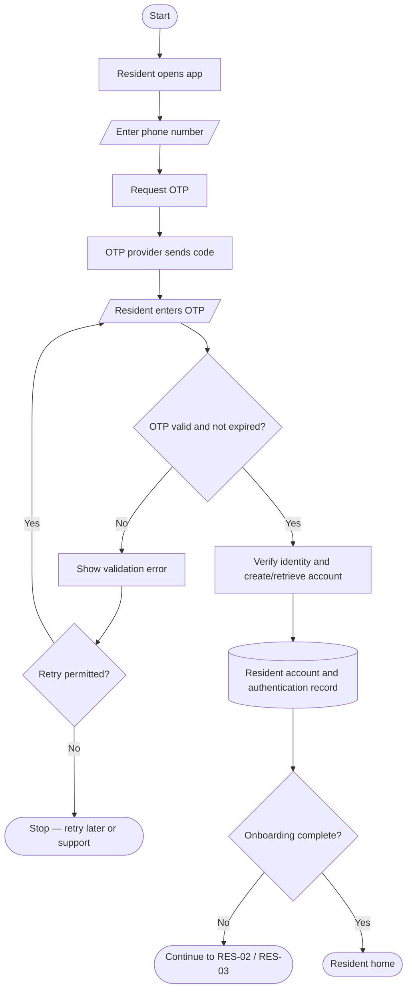

**Alternative and exception paths**

- OTP delivery fails or is delayed: show retry path; exact retry limit, resend cooldown and escalation rule are **OPEN**.
- OTP is wrong or expired: reject authentication without creating an authenticated session.
- Phone number already exists: treat as login/recovery rather than creating a duplicate resident identity; exact recovery policy is **OPEN**.
- Network drops after OTP request: allow resident to retry; provider-side duplicate handling and rate limits are technical design items.
- Resident changes phone number: identity-change workflow is not specified; do not assume an in-app phone change is allowed.

**Records / outputs:** Resident identity, verified phone number, authentication/session record and OTP attempt/audit metadata as needed.

**Rules:** Phone OTP is the resident authentication method in the agreed baseline. Authentication success does not itself verify a residence or grant household access.

**Open decisions:** OTP retry/resend limits; number-change procedure; account deletion/deactivation; whether one phone number may be associated with more than one household account.

**Acceptance scenarios:** Valid OTP authenticates; invalid/expired OTP is rejected; an existing number resolves to the existing account; failed OTP delivery never falsely authenticates.

---

## RES-02 — City and Community Selection

**Purpose:** Let a resident identify the service location and community relevant to their residence.

**Actors:** Resident; Resident App; Backend; Community Master Data.

**Primary flow**

1. Resident opens location/community selection after authentication or when changing selected service location.
2. App obtains available cities from the backend.
3. Resident selects a city.
4. App displays communities configured under that city.
5. Resident selects a community.
6. Backend validates that the community is configured for resident onboarding.
7. Selected city/community are stored against the resident's onboarding context.
8. Resident proceeds to residence registration.

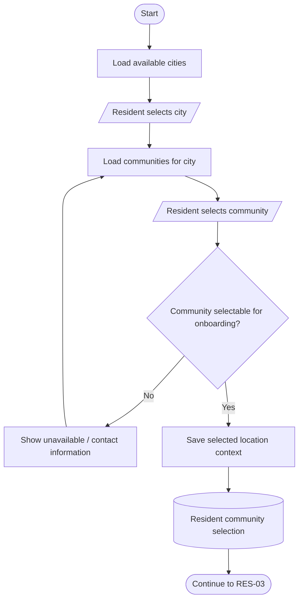

**Alternative and exception paths**

- No community is available in selected city: show unavailable state; do not permit registration against an unconfigured community.
- Resident selects wrong community: allow reselection before residence submission; post-registration correction rules are **OPEN**.
- Community is in demand-led mode: selection may be allowed, but available actions depend on configured operating mode and open demand cycle.
- Community is in continuous mode: availability is determined by live capacity; selection does not guarantee a slot.

**Records / outputs:** Selected city/community reference associated with resident onboarding.

**Open decisions:** Manual search vs postcode/location assistance vs curated list; multiple communities/addresses per resident; handling of not-yet-onboarded communities.

**Acceptance scenarios:** Only communities belonging to selected city are shown; unavailable communities cannot proceed into unsupported booking/demand; selected community is available to residence registration.

---

## RES-03 — Residence Registration (Tower, Flat and Documents)

**Purpose:** Associate the resident with a specific residence within a configured community hierarchy.

**Actors:** Resident; Resident App; Backend; Admin/Cluster Admin where review is required.

**Primary flow**

1. Resident selects community and enters residence details.
2. Resident selects tower/building and flat from configured master data.
3. Resident supplies occupancy type and required residence proof/document(s).
4. App validates required fields and file constraints at client level.
5. Backend stores the request and protected document references.
6. System records the association in the configured verification state.
7. An authorised Admin reviews the request if manual verification is required.
8. On approval, resident-to-flat association becomes active for permitted services.
9. On rejection, resident is informed of the outcome and any allowed resubmission path.

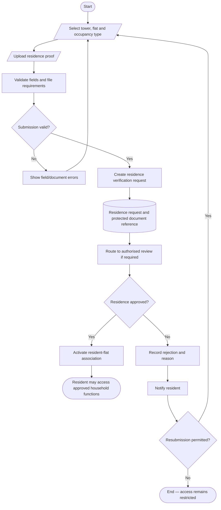

**Alternative and exception paths**

- Tower/flat absent from master data: resident cannot invent a flat record; route to authorised data-maintenance process.
- Document upload fails: allow retry; whether form data is retained as a draft is **OPEN**.
- Duplicate residence request: identify existing resident/flat relationship and avoid conflicting records; exact duplicate policy is **OPEN**.
- Proof is unclear/inconsistent: authorised reviewer decision is required; automated approval is not specified.
- Association is pending: block actions requiring verified household membership.

**Records / outputs:** Residence request, community/tower/flat, occupancy type, secure document reference and reviewer decision if applicable.

**Rules:** Residential hierarchy is maintained in Admin master data. Documents require access controls. Residence verification and family-member approval are separate workflows.

**Open decisions:** Whether all submissions require manual approval; accepted document types; resubmission count; duplicate owner/tenant handling; approver; permitted changes after approval.

**Acceptance scenarios:** Resident selects existing master records; proof is private; pending association does not grant verified privileges; reviewer decisions are auditable where review applies.

---

## RES-04 — Family Member Management and Approval

**Purpose:** Allow a Primary Resident to request access for family members while ensuring access is granted only after manual verification and explicit approval.

**Actors:** Primary Resident; Family Member; Resident App; Cluster Admin/authorised reviewer; Backend.

**Primary flow**

1. Primary Resident opens family management.
2. Primary Resident submits family member details and required supporting information.
3. Backend creates a pending family-member access request.
4. Request is routed to the authorised reviewer for the relevant community/cluster.
5. Nestovin/Cluster Admin performs physical verification outside the application.
6. Reviewer records verification outcome, decision, reviewer identity and timestamp.
7. If approved, family member access is enabled according to permitted household relationship.
8. If rejected, access is not granted and Primary Resident is notified.

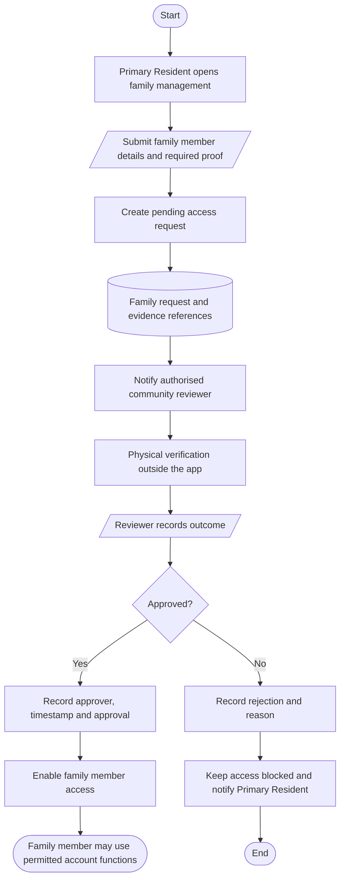

**Alternative and exception paths:** Duplicate request handling is **OPEN**; incomplete physical verification leaves the request pending; reviewer outside assigned cluster cannot decide; rejection does not grant access; approved-member removal/revocation is **OPEN**.

**Records / outputs:** Family request, evidence references, physical-verification outcome, reviewer, decision timestamp and access status.

**Rules — confirmed:** Request alone does not grant access; physical verification occurs outside the app; platform records outcome/history; approval is required before access.

**Open decisions:** Required fields/proof; allowed relationships; request cancellation; revocation; own phone authentication; Primary Resident vs family-member permissions.

**Acceptance scenarios:** Pending member remains blocked; only authorised reviewer can decide; approval records reviewer/time; rejection grants no access.

---

## RES-05 — Service Catalogue

**Purpose:** Present services Nestovin currently offers in the resident's selected community.

**Actors:** Resident; Resident App; Backend; Service/Task Configuration.

**Primary flow**

1. Resident opens the service catalogue.
2. App requests services available for the resident's community and operating context.
3. Backend returns only services configured as available for that context.
4. App displays Maid, Cook and Caretaker and configured descriptions/tasks.
5. Resident selects a service to inspect applicable tasks, plan choices or demand/booking actions.

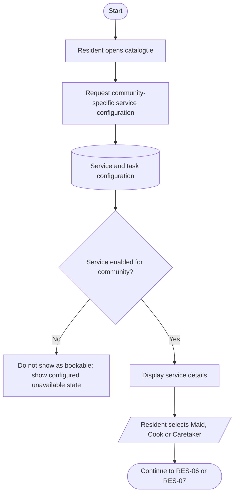

**Alternative and exception paths:** Service not enabled for community is not bookable; missing plan blocks purchase; demand-led mode leads to an open demand cycle; continuous mode leads to live capacity availability.

**Records / outputs:** Catalogue context and selected service reference; viewing alone creates no purchase/request.

**Rules — confirmed:** V1 services are Maid, Cook and Caretaker only; definitions are configured by authorised Admin users.

**Open decisions:** Task taxonomy/descriptions; visibility during demand windows; temporary service disablement while subscriptions remain active.

**Acceptance scenarios:** Only approved V1 services appear; availability is community-aware; selection alone does not create a paid request/booking.

---

## RES-06 — Subscription Plans and Pricing

**Purpose:** Display valid plan/price options for a service, residence type and community, and let a resident select a plan for a demand request or continuous booking.

**Actors:** Resident; Resident App; Backend; authorised Pricing Admin; Plan/Entitlement Configuration.

**Primary flow**

1. Resident selects a service or service combination offered in the catalogue.
2. Backend resolves available plans using community, residence attributes, service/task configuration and current pricing validity.
3. App displays eligible plans, price, duration/start rules and configured entitlements.
4. Resident reviews and selects a plan.
5. App shows the selected plan summary and applicable payment path based on community operating mode.
6. Resident proceeds to demand registration or continuous booking.

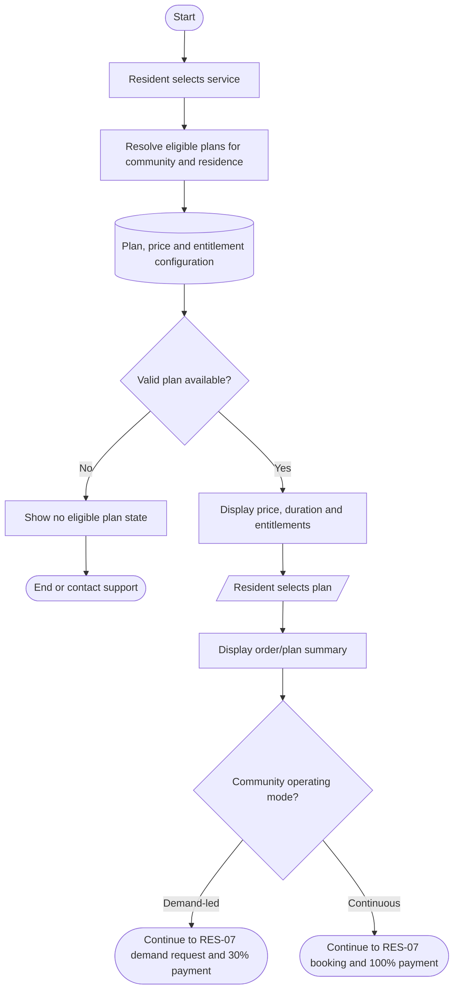

**Alternative and exception paths:** Missing/expired price prevents purchase; no eligible plan is shown; plan changed after selection—quote lock/refresh behaviour is **OPEN**; upgrade/downgrade/add-on against an active subscription is **OPEN**.

**Records / outputs:** Selected plan reference, price/version used for quote/order, duration and entitlements.

**Rules — confirmed:** Plans/pricing are Admin-configured; pricing may vary by community/residence; example PDF is not final pricing; self-service pause is excluded; demand-led and continuous modes have different payment journeys.

**Open decisions:** Final tiers/prices/duration/entitlements/frequency; service bundles; quote validity; proration; upgrade/downgrade; changes to committed requests.

**Acceptance scenarios:** Only valid plans returned; displayed price/entitlements match configured purchase version; no missing price defaults to zero or invented value.

---

## RES-07 — Demand Request, Booking and Scheduling

**Purpose:** Support two community operating modes: (1) demand-led collection and controlled slot release, and (2) continuous availability using live workforce capacity. The two modes are configurable operating approaches, not fixed numbered phases. Demand cycles are repeatable and have no pre-set cycle count.

**Actors:** Resident; Resident App; Backend; Super Admin/authorised Admin; Operations; Workforce/Slot Management; Employee.

### RES-07A — Operating-mode selection and community context

The accepted working model is that operating mode can be configured for a community, subject to Super Admin control and assigned module permissions. Mode-specific rules must not be hard-coded as a global product phase. Different communities may operate using different modes; this was accepted as the recommended approach and should be revalidated during the client walkthrough.

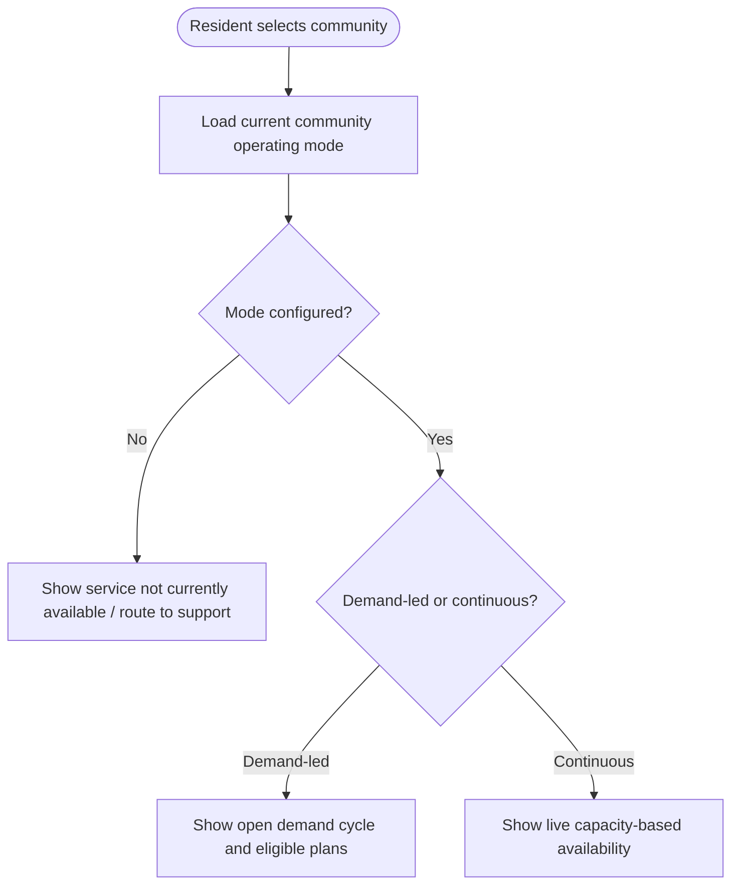

### RES-07B — Demand-led request and cycle participation

**Confirmed client behaviour**

- An authorised Admin can open a demand collection cycle for a community.
- Admin configures the collection period/buffer duration. Duration is not a fixed hard-coded number of days.
- Residents submit detailed service requests, including requested duration/hours, frequency and preferred slot/time information.
- The resident's demand request requires a mandatory **30% commitment payment** based on the selected plan price.
- The 30% payment is not the final service booking or service activation.
- Demand is aggregated so Operations can estimate the workforce required.
- Admin can manually create slots or ask the system to generate slot recommendations; Admin approval is required before publishing slots.
- Admin may open another demand cycle whenever business operations require it. There is no fixed number of cycles.
- Residents may submit additional demand in another cycle. A separate waitlist is not assumed in this workflow.

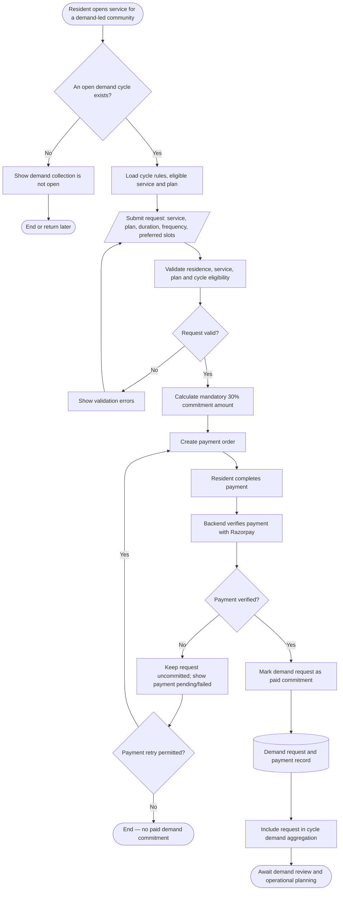

**Demand-cycle configuration — Admin controlled**

1. Resident selects a community and V1 service.
2. System checks whether a demand cycle is open and whether the service is included.
3. Resident sees collection end/buffer information and request requirements configured by Admin.
4. Resident submits a service request.
5. System calculates and collects 30% of the selected plan price.
6. Backend verifies payment before the demand is counted as a paid commitment.
7. Resident can see the request/commitment status.

**Additional demand / repeat cycle**

- The system supports additional demand cycles on the same community without a predefined phase number.
- Previous cycle requests and decisions remain in history; a new cycle must not overwrite earlier requests.
- Resident can participate in a later cycle for additional demand, subject to its configured rules.
- Whether the same resident can submit a second request for the same service while a previous request is outstanding is **OPEN**. The previous recommendation was to retain request history and allow new/updated requests, but uniqueness and amendment rules still need client confirmation.

### RES-07C — Continuous booking mode

**Confirmed client behaviour**

- Resident can see available slots based on current workforce capacity.
- Availability calculation must not promise service beyond available operational capacity.
- Resident can request the earliest feasible service slot available under configured rules.
- For continuous-mode service, resident must pay **100% before service begins**. The client's example: a resident wanting service tomorrow books today and pays the complete amount today.
- Allocation remains hybrid: the system can recommend/derive availability and allocation, while authorised Admin/Operations controls and overrides remain available as configured.

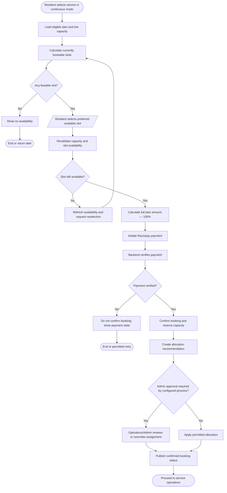

### RES-07D — Demand-led slots become bookable after release

1. Admin/Operations completes demand review and workforce-readiness planning.
2. Admin sets/announces the service commencement date and applicable payment deadline.
3. Admin creates slots manually or obtains system-generated slot recommendations.
4. Admin reviews and approves slots and publication.
5. Resident is notified of commencement date and remaining payment requirement.
6. Resident pays remaining 70% by configured deadline and before service commencement.
7. Backend verifies balance payment.
8. After 100% payment is verified, subscription/service can be activated for the announced commencement date.

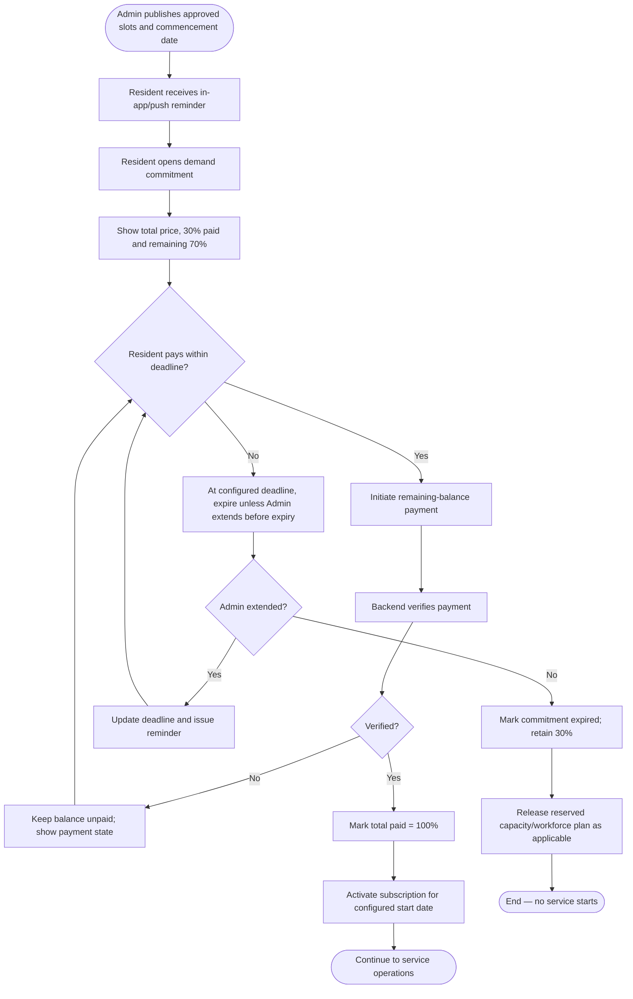

**Alternative and exception paths**

- No open demand cycle: resident cannot submit a paid demand request through that cycle.
- 30% payment fails: request is not counted as a paid commitment.
- Provider reports success but callback is delayed: backend reconciliation must verify status; do not create duplicate payment/commitment.
- Cycle closes or is extended: resident experience follows Admin-configured end date; treatment of a payment already in progress at closing time is **OPEN**.
- Resident submits another request: preserve previous records; enforce later-approved duplicate/amendment rules.
- Resident does not pay remaining 70% by deadline: commitment expires unless Admin extends before expiry; no refund of 30% under the client-confirmed rule.
- Admin changes commencement date after announcement: date-change authority, resident consent, new payment deadline and handling of an already paid 70% are **OPEN**.
- Workforce shortage after paid demand: client intends to arrange the required workforce. The platform still needs an Operations exception process; a customer refund/shortfall policy was not specified.

**Records / outputs:** Demand cycle; resident demand request; plan/price snapshot; request parameters; 30% payment; demand aggregate; cycle decision; approved slot set; commencement date; 70% payment; expiry/extension record; subscription activation.

**Open decisions requiring client validation**

- Exact fields for frequency, days, duration and preferred slots.
- Whether request edits are permitted while a cycle is open; if allowed, whether repricing/recalculation or another 30% payment is required.
- Whether one resident can have multiple paid commitments for the same service/community.
- Whether 30% is calculated on the plan price before/after discounts or fees.
- What happens if plan price changes between 30% and 70% payments.
- Whether Admin can change commencement date after the 70% notice/payment begins, and how residents are informed.
- Exact payment deadline, reminder cadence and grace-period details.
- How capacity is reserved between slot publication and receipt of the 70% balance.
- Slot model: duration, start/end times, concurrent appointments, worker skills, travel buffers and service-specific capacity.
- How recurring service frequency is represented across subscription service dates.

**Acceptance scenarios**

- Demand-led community displays the active collection cycle and accepts eligible service requests.
- Mandatory 30% is verified server-side before the request becomes a paid commitment.
- Paid commitments contribute to demand totals; unpaid attempts do not count as paid demand.
- A repeat cycle can be created without overwriting earlier cycle records.
- Only Admin-approved slots are exposed as bookable after publication.
- Remaining 70% must be paid and verified before demand-led service starts.
- Unpaid commitment expires after configured deadline unless extended by an authorised Admin before expiry; 30% is not refunded under the client-confirmed policy.
- Continuous-mode booking uses current capacity and requires verified 100% payment before service begins.

---

## RES-08 — Payment Integration (Razorpay)

**Purpose:** Collect resident payments and maintain server-verified payment records for demand commitments, continuous-mode bookings and demand-led balance payments.

**Actors:** Resident; Resident App; Backend Payment capability; Razorpay; Demand/Subscription/Booking workflows.

**Payment cases**

| Case | Amount | When |
|---|---:|---|
| Demand-led request | 30% | At demand submission; mandatory commitment payment |
| Demand-led service activation | Remaining 70% | After Admin announces commencement date; within configured deadline and before service begins |
| Continuous-mode booking | 100% | At booking, before service begins |

**Primary flow**

1. Business workflow requests a payment order for a defined purpose and amount.
2. Backend creates a payment order/attempt using Razorpay.
3. Resident completes provider checkout.
4. Razorpay returns provider response/callback/webhook information.
5. Backend verifies payment with the provider using the required server-side method.
6. Backend validates amount, currency, order/reference and business purpose.
7. Backend records the result and makes verified status available to the owning business workflow.
8. Owning workflow changes state only after verified payment.

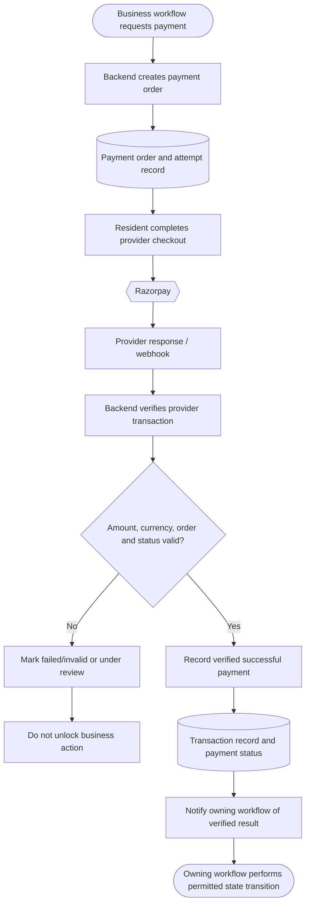

**Alternative and exception paths**

- Payment cancelled: mark attempt cancelled/failed as appropriate; do not activate demand/booking/subscription.
- Payment failed: permit retry according to approved/provider-supported behaviour; do not create a second commitment accidentally.
- Provider reports success but app does not receive success: backend verification is authoritative; app retrieves current state.
- Duplicate webhook/callback: processing must be idempotent; same provider transaction must not be credited twice.
- Amount/currency/order mismatch: do not mark successful for the business purpose; route to exception/reconciliation.
- Payment success for an expired demand commitment: handling is **OPEN**.
- Refund: exceptions require manual authorised review in the roadmap; resident-initiated refund workflow and permitted reasons are **OPEN**. Specific 30% no-refund rule applies when resident declines the remaining 70% after the announced deadline.

**Records / outputs:** Payment order, attempt, provider reference, amount, currency, verified status, timestamps, business-purpose reference, reconciliation state and refund record where applicable.

**Rules**

- Backend verification is required before payment is treated as successful.
- Frontend redirect/success screen is not proof of payment.
- Same payment event must not trigger business action twice.
- Payment records must be auditable.
- Razorpay is the named payment gateway in the agreed scope.

**Open decisions:** Supported payment methods; timeout/expiry; retry counts; refund approval matrix; reconciliation schedule; handling of partial/late/duplicate payments; transaction-fee treatment; accounting treatment of retained 30% commitment amounts.

**Acceptance scenarios:** Successful provider payment is verified by backend; failed/cancelled/duplicate/mismatched payment does not activate service; verified 30% creates demand commitment but does not start service; verified 70% completes demand-led payment; continuous booking requires verified 100%.

---

## RES-09 — Booking and Service Status

**Purpose:** Show the current state of a resident's demand request, booking, subscription and service delivery without conflating these distinct records.

**Actors:** Resident; Resident App; Backend; Operations; Employee; Payment capability.

**Primary flow**

1. Resident opens the relevant request, booking or subscription record.
2. App retrieves status from backend.
3. Backend returns applicable business status and permitted detail.
4. App displays status with the next action, if any.
5. Changes made by Admin/Operations or employee attendance/service events are reflected on refresh or through notification.

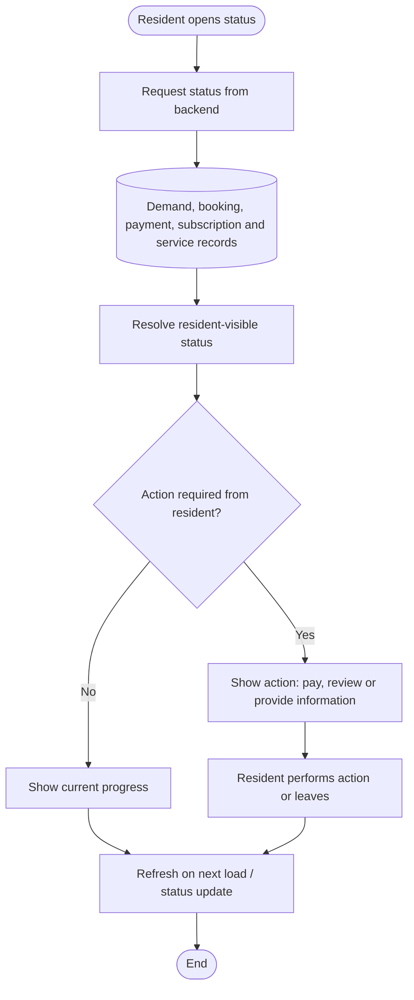

**Important conceptual separation**

- **Demand request:** resident's paid request during a demand cycle; 30% commitment payment recorded.
- **Booking:** confirmed service slot/appointment or scheduled service allocation.
- **Subscription:** purchased service plan and effective period/entitlements.
- **Payment:** transaction and balance state.
- **Service occurrence:** a specific scheduled service visit/occurrence and its attendance/completion record.

These may be linked, but one status must not be used as a substitute for all others.

**Open decisions:** Exact status labels and resident-visible wording; employee details visible to resident; cancellation/rescheduling; missed/changed date presentation; real-time vs refreshed/push-driven status updates.

**Acceptance scenarios:** Resident sees only permitted household records; demand is not shown as confirmed service before required steps; continuous booking reflects full-payment verification; status matches backend record.

---

## RES-10 — Service History

**Purpose:** Present past and current service records relevant to the resident's household.

**Actors:** Resident; Resident App; Backend; Service Records.

**Primary flow**

1. Resident opens service history.
2. App requests permitted household records.
3. Backend filters records according to resident identity and approved household access.
4. App presents service date, service type and allowed outcome/details.
5. Resident opens a record to view permitted detail.

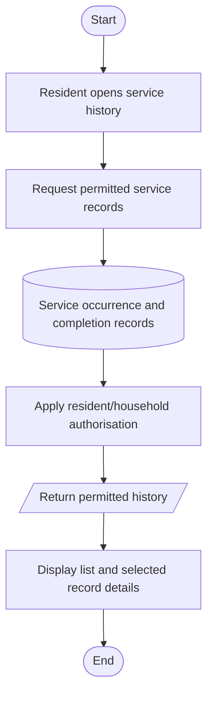

**Alternative and exception paths:** No history: show empty state. Family member with restricted access sees only permitted records. Corrected attendance/service record shows authoritative current state; visibility of historical revisions is **OPEN**.

**Records / outputs:** Resident-visible history derived from service occurrence, attendance and completion records.

**Open decisions:** Retention period; filters/search; employee name/task notes/proof/rating visibility; whether cancelled/no-show occurrences appear and how they are labelled.

**Acceptance scenarios:** History is sourced from service events; household access restrictions are applied; empty history is handled clearly.

---

## RES-11 — Feedback and Ratings

**Purpose:** Allow a resident to submit feedback/rating for an eligible service experience.

**Actors:** Resident; Resident App; Backend; Support/Operations Admin.

**Primary flow**

1. Resident opens an eligible completed service occurrence.
2. App displays feedback/rating option where enabled.
3. Resident submits configured rating and feedback fields.
4. Backend validates resident authorisation and duplicate-submission rules.
5. Feedback is stored and made available to authorised Admin users.
6. Resident receives submission confirmation.

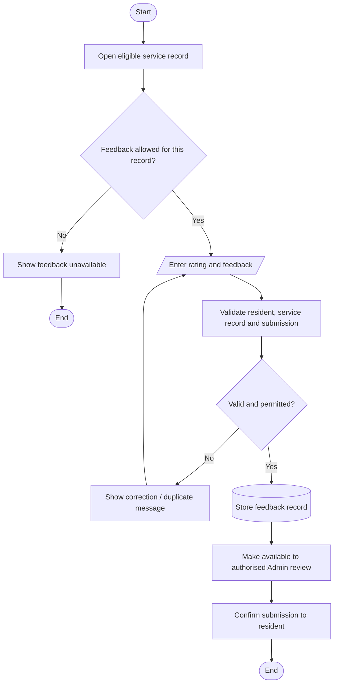

**Open decisions:** Rating scale; mandatory/optional comment; edit window; moderation/removal; anonymous vs named internal presentation; who can view/respond; whether low ratings create tickets.

**Acceptance scenarios:** Only authorised resident can review eligible service; duplicate submissions follow a defined rule; feedback is visible only to permitted users.

---

## RES-12 — Support Tickets

**Purpose:** Let a resident raise and track support relating to their account, community, booking, payment or service.

**Actors:** Resident; Resident App; Backend; Support Admin.

**Primary flow**

1. Resident opens Support.
2. Resident selects a permitted category and provides description/supporting details.
3. Resident submits ticket.
4. Backend creates ticket and reference number.
5. Ticket is routed to Support queue.
6. Support Admin categorises/assigns ticket and records updates.
7. Resident views status and permitted updates.
8. Support Admin records resolution; ticket reaches resolved/closed state under approved rule.

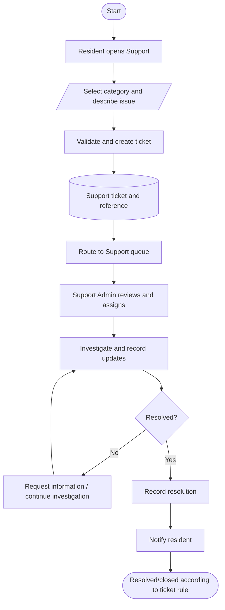

**Alternative and exception paths:** Incomplete submission handling is **OPEN**. Refund-related ticket routes to authorised Support/Finance review; opening a ticket does not issue a refund. Mis-categorised ticket may be recategorised/transferred within permission. Reopen conditions are **OPEN**.

**Records / outputs:** Ticket ID, resident, category, description, linked booking/payment/service references, assignment, update history, status, resolution and timestamps.

**Rules — confirmed:** Ticket categorisation, assignment, tracking, updates/resolution and basic escalation visibility are in Admin V1; refund exceptions require manual authorised review.

**Open decisions:** Categories, priority/SLA, routing, attachments, resident reply thread, reopening, escalation thresholds and closure confirmation.

**Acceptance scenarios:** Submission creates traceable reference; Support acts within permissions; refund ticket does not auto-refund; resident sees permitted status/updates.

---

## RES-13 — Notifications

**Purpose:** Deliver essential transactional and operational notifications to residents.

**Actors:** Resident; Backend; Notification service; push/SMS/email providers; authorised Admin sender where manually initiated.

**Primary flow**

1. Business event occurs (OTP, family decision, demand/payment status, slot/commencement update, assignment/service update or support update).
2. Originating module records the business state change.
3. Notification rules resolve recipient, channel and message template.
4. Notification service queues/sends through configured provider.
5. Delivery result is recorded where provider exposes it.
6. Resident opens app and retrieves current authoritative business status.

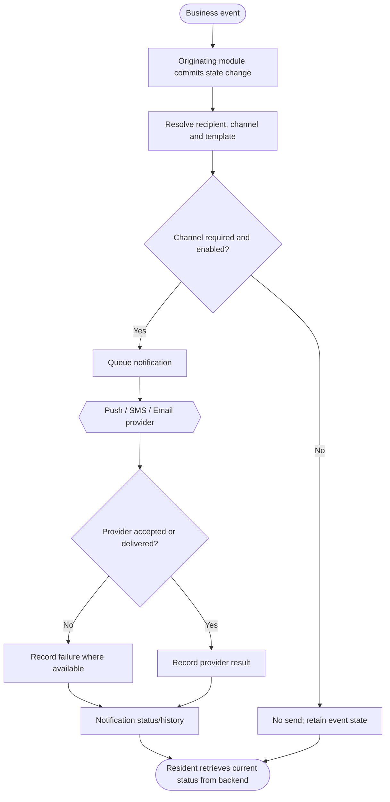

**Manual Admin notification:** Client wants authorised Admin users to issue reminders, including remaining-70% payment reminders. This is permission-controlled and must not alter payment/subscription state.

**Rules — confirmed**

- Push is intended for app notifications; SMS for OTP and selected critical events; email for selected account/support communication.
- Client wants in-app reminders/pop-ups and Admin-triggered notification for the remaining-balance reminder.
- Payment completion is established only by verified payment records, never by a reminder send or resident tap.

**Open decisions:** Final provider; event/channel matrix; templates/languages; quiet hours; retries; broadcast vs targeted notifications; manual-send permission; preferences for non-critical messages; WhatsApp decision.

**Acceptance scenarios:** Critical event notifies correct recipient; failed push does not roll back business operation; manual reminder is permission-checked/audited; payment reminder does not mark payment paid; app shows current backend state.

---

## RES-14 — Profile and Household Management

**Purpose:** Let a resident view and manage permitted personal and household information.

**Actors:** Resident; Resident App; Backend; Admin where verification/review is required.

**Primary flow**

1. Resident opens profile/household management.
2. App retrieves resident details and approved household associations.
3. Resident views permitted details.
4. Resident edits fields enabled for self-service.
5. Backend validates and saves permitted changes.
6. Changes requiring verification/Admin approval are submitted as requests rather than directly overwriting verified master data.

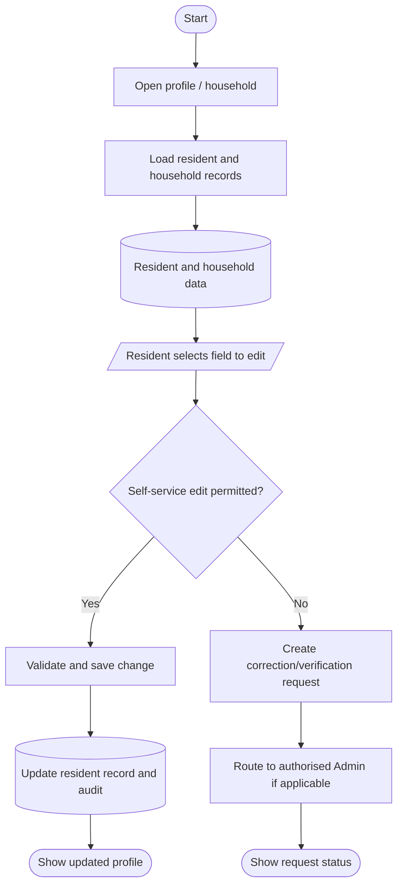

**Open decisions:** Editable fields; name/phone change; address/flat transfer; household removal; family role model; changes requiring documents/review; resident account deactivation.

**Acceptance scenarios:** Resident sees own/approved household data; verified residence data cannot be silently changed; identity/residence/access changes are auditable.

---

# 2. Employee App workflows

## Employee App — capability index

| ID | Capability | Main actors | Status |
|---|---|---|---|
| EMP-01 | Applicant Registration | Applicant, HR, Backend | Confirmed source; ATS excluded |
| EMP-02 | Employee Login (ID + Password) | Employee, HR, Backend | Confirmed source |
| EMP-03 | Employee Profile and Qualifications | Employee, HR, Backend | Confirmed source |
| EMP-04 | Training Videos and Completion | Employee, Backend, HR/Operations | Confirmed source; simple training only |
| EMP-05 | Work Schedule and Assignments | Employee, Operations, Backend | Confirmed source; routine assignment acceptance not required |
| EMP-06 | Attendance Verification | Employee, Resident/verifier, Backend | Confirmed source |
| EMP-07 | Service Completion | Employee, Resident where required, Backend | Confirmed source |
| EMP-08 | Additional Work / Overtime | Employee, Operations/Admin, Backend | Client-confirmed offer + accept/reject + Admin confirmation |
| EMP-09 | Availability and Leave | Employee, HR/Operations, Backend | Client-confirmed approval workflow |
| EMP-10 | Employee Notifications | Employee, Backend, provider | Confirmed source |

---

## EMP-01 — Applicant Registration

**Purpose:** Capture an individual's interest in working with Nestovin. This is an application-interest intake, not a complete recruitment ATS.

**Actors:** Applicant; Employee App; Backend; HR/authorised Admin.

**Primary flow**

1. Applicant opens the registration/interest form.
2. Applicant enters requested personal/contact details and available information.
3. App validates required fields.
4. Backend stores an applicant-interest record.
5. HR/authorised Admin reviews submitted information outside or through the permitted Admin workflow.
6. If selected to proceed, HR handles verification/readiness and later enables an employee account.

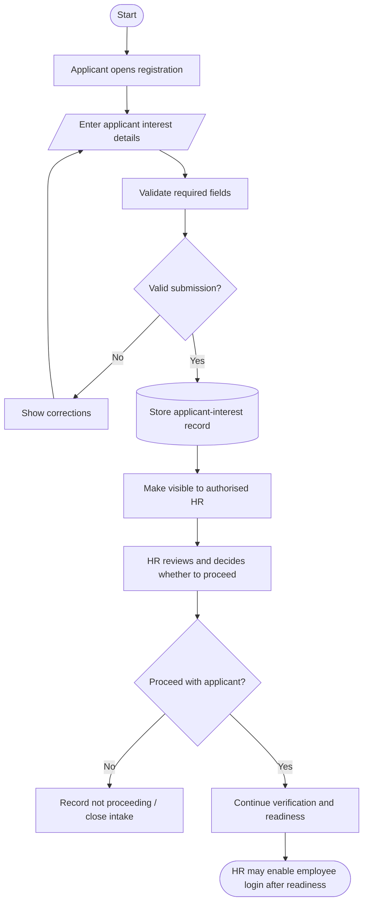

**Out of V1:** Full ATS stages, interview scheduling, automated background-check integrations, recruitment campaign management and advanced candidate analytics.

**Open decisions:** Required fields; document uploads; status labels; applicant rejection/retention policy; whether applicant can track status in app.

**Acceptance scenarios:** Applicant interest can be submitted/stored; duplicate submissions follow a defined rule; applicant is not automatically granted employee login by submitting the form.

---

## EMP-02 — Employee Login (Employee ID and Password)

**Purpose:** Authenticate an employee after HR has verified and enabled the employee account.

**Actors:** Employee; Employee App; Backend/authentication service; HR.

**Primary flow**

1. HR verifies employee readiness.
2. HR enables an employee account and Employee ID credentials through the authorised process.
3. Employee opens the app and enters Employee ID/password.
4. Backend verifies credentials and account status.
5. On success, employee session is created and permitted work information is loaded.

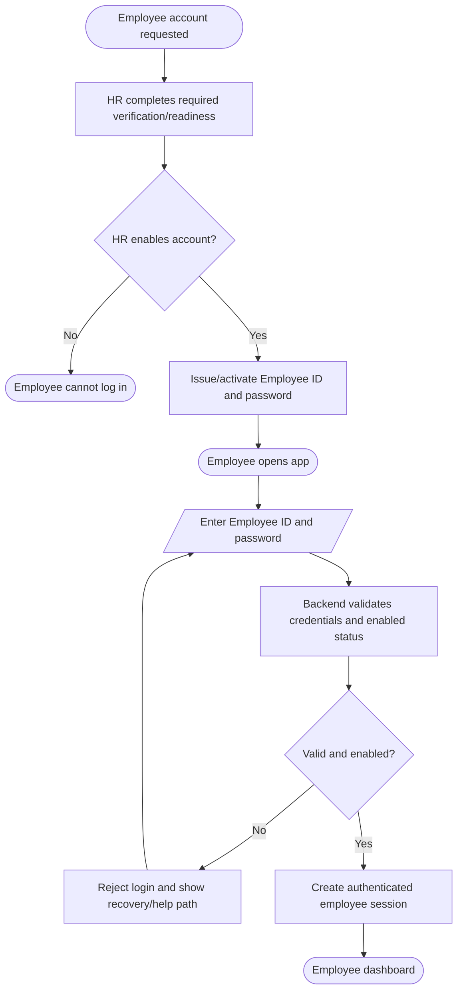

**Rules — confirmed:** Employee authentication uses Employee ID/password; HR enables access after verification/readiness.

**Open decisions:** Password set/reset; lockout; employee deactivation; lost Employee ID; multi-device sessions; mandatory first-login password change.

**Acceptance scenarios:** Applicant cannot log in before enablement; valid enabled employee can log in; disabled/unverified employee is rejected.

---

## EMP-03 — Employee Profile and Qualifications

**Purpose:** Maintain employee profile information and service/task qualifications used for work eligibility.

**Actors:** Employee; Employee App; HR/authorised Admin; Backend.

**Primary flow**

1. Employee opens profile.
2. App displays permitted details and recorded qualifications.
3. Employee submits permitted profile updates or qualification information.
4. Backend validates and records submission.
5. Fields requiring review are routed to HR/authorised Admin.
6. HR reviews and updates verification/qualification/readiness status.
7. Eligibility information is available to Operations/allocation within authorised access.

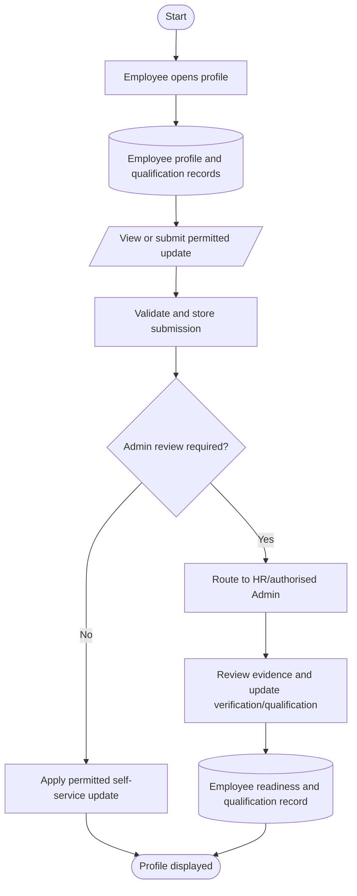

**Open decisions:** Profile fields; qualifications/documents per service/task; expiry tracking; re-verification frequency; self-edit permissions.

**Acceptance scenarios:** Employee views own profile; HR updates verification/qualification within permissions; allocation uses current approved readiness/qualification.

---

## EMP-04 — Training Videos and Completion

**Purpose:** Present assigned training videos and record employee viewing/completion. This is a simple training capability, not a full LMS.

**Actors:** Employee; Employee App; Backend; HR/Operations.

**Primary flow**

1. Employee opens training.
2. App retrieves assigned/available videos.
3. Employee selects and views a video.
4. App records completion when the configured completion condition is met.
5. Backend persists completion record.
6. Authorised Admin can review completion where required for readiness.

```mermaid
flowchart TD
    A([Start]) --> B[Employee opens training]
    B --> C[(Training video and assignment configuration)]
    C --> D[/Employee selects video/]
    D --> E[Play video]
    E --> F{Completion condition met?}
    F -- No --> G[Keep incomplete / allow resume]
    G --> E
    F -- Yes --> H[Record completion]
    H --> I[(Employee training completion record)]
    I --> J([Show completed status])
```

**Out of V1:** Full LMS, quiz/exam engine, certificate generation, training-content administration suite, learning paths and advanced training analytics.

**Open decisions:** Completion condition (watch duration, explicit confirmation or both); resume behaviour; mandatory/optional videos; whether completion blocks deployment readiness.

**Acceptance scenarios:** Video can be viewed; completion persists; reopening shows recorded status.

---

## EMP-05 — Work Schedule and Assignments

**Purpose:** Present the employee's assigned work schedule and service assignments.

**Actors:** Employee; Employee App; Operations/Cluster Admin; Backend; Work Allocation.

**Primary flow**

1. Operations creates or confirms assignment through the authorised allocation workflow.
2. Backend validates employee eligibility and authorised community/cluster scope.
3. Assignment is stored and made visible to assigned employee.
4. Employee opens schedule and views date, time, community/residence reference and permitted service/task details.
5. Employee follows assignment and uses EMP-06/EMP-07 for attendance/completion.

```mermaid
flowchart TD
    A([Operations creates/reviews assignment]) --> B[Validate employee eligibility and scope]
    B --> C{Eligible and permitted?}
    C -- No --> D[Reject recommendation / require another employee]
    D --> A
    C -- Yes --> E[(Store assignment and schedule)]
    E --> F[Notify assigned employee]
    F --> G[Employee opens work schedule]
    G --> H[Display assigned work]
    H --> I([Continue to attendance and service])
```

**Rules — confirmed**

- Routine assignment does not require employee accept/reject.
- Employee assignment is within authorised cluster(s) in V1.
- Manual backup/replacement assignment is available to authorised Operations/Cluster Admin.
- Cross-cluster workforce sharing is excluded.

**Alternative and exception paths:** Employee becomes unavailable after assignment → replacement workflow; exact notification/acknowledgement is **OPEN**. Assignment conflicts with approved leave/another assignment must be detected; priority/override rule is **OPEN**. Offline schedule/cache behaviour is **OPEN**.

**Records / outputs:** Assignment, employee, service/task, community/residence, date/time, assignment status, assigning user and audit event.

**Acceptance scenarios:** Employee sees own assignments; ineligible/out-of-scope employee cannot be assigned; routine assignment needs no acceptance; replacement is recorded and visible to correct employee.

---

## EMP-06 — Attendance Verification (OTP / QR and Location Event)

**Purpose:** Record attendance at the service location using configured OTP or QR verification, with location evidence at the verification event.

**Actors:** Employee; Resident or service-side verifier; Employee App/Resident App as applicable; Backend.

**Primary flow**

1. Employee opens scheduled service assignment.
2. Employee initiates attendance verification at the relevant service location.
3. System uses configured OTP or QR method.
4. Location evidence is captured at verification, subject to device permission and configured validation.
5. Backend validates assignment, verification token/QR, timing and location event according to approved rules.
6. If valid, attendance event is recorded.
7. Employee and authorised Admin can view attendance status.

```mermaid
flowchart TD
    A([Employee opens assigned service]) --> B[Initiate attendance verification]
    B --> C{Configured method?}
    C -- OTP --> D[/Enter or exchange OTP/]
    C -- QR --> E[/Scan or present QR/]
    D --> F[Capture location evidence for event]
    E --> F
    F --> G[Submit verification to backend]
    G --> H[Validate assignment, token, time and location rules]
    H --> I{Verification valid?}
    I -- No --> J[Reject event and show reason]
    J --> K([Retry or contact Operations])
    I -- Yes --> L[(Persist attendance event and evidence metadata)]
    L --> M([Attendance recorded])
```

**Rules — confirmed**

- Attendance supports OTP or QR as configured.
- Location evidence is captured at verification events only.
- Continuous employee live tracking is not included.
- If offline attendance queueing is enabled, server remains authoritative when event synchronises.

**Alternative and exception paths:** Offline queue/sync may be used if enabled; final validation remains server-side. Expired/wrong-assignment OTP/QR is rejected. Location permission/failure fallback is **OPEN**. Wrong location/time routes to correction/exception rather than silently accepting attendance.

**Records / outputs:** Attendance event, employee, assignment/service occurrence, method, timestamp, location evidence metadata and validation result.

**Acceptance scenarios:** Valid OTP/QR records attendance; invalid token rejected; no continuous tracking; offline events are server-validated if queueing is implemented.

---

## EMP-07 — Service Completion

**Purpose:** Let an employee record completion of an assigned service occurrence and capture resident confirmation where required.

**Actors:** Employee; Employee App; Resident; Backend; Operations.

**Primary flow**

1. Employee opens assigned service occurrence.
2. Employee completes configured service tasks.
3. Employee submits completion details.
4. Backend validates assignment and service state.
5. Where resident confirmation is required, resident confirms through the approved interaction.
6. Backend records completion and required confirmation.
7. Service occurrence becomes completed or enters applicable review state.

```mermaid
flowchart TD
    A([Assigned service in progress]) --> B[Employee completes configured tasks]
    B --> C[/Submit completion/]
    C --> D[Validate assignment and service occurrence]
    D --> E{Completion submission valid?}
    E -- No --> F[Show error / keep service open]
    F --> C
    E -- Yes --> G{Resident confirmation required?}
    G -- Yes --> H[/Resident confirms outcome/]
    H --> I{Confirmation received?}
    I -- No --> J[Keep pending / follow configured exception path]
    I -- Yes --> K[Record completion and confirmation]
    G -- No --> K
    K --> L[(Service completion record)]
    L --> M([Service occurrence completed])
```

**Rules — confirmed:** Service completion is distinct from assignment/attendance; resident confirmation is separate where required; completion feeds history and operational/finance workflows.

**Open decisions:** Task checklist; evidence/photo rules; resident confirmation mechanism; resident unavailable; dispute window; partial completion; rework; service overrun.

**Acceptance scenarios:** Only assigned employee submits completion; backend validates assignment; required resident confirmation is captured; completion is available downstream.

---

## EMP-08 — Additional Work / Overtime

**Purpose:** Offer optional additional work/overtime to eligible employees and record employee response and Admin confirmation.

**Actors:** Operations/Admin; Employee; Employee App; Backend.

**Primary flow**

1. Authorised Operations/Admin identifies additional work need.
2. System identifies eligible employees within permitted scope.
3. Admin issues offer to one or more eligible employees.
4. Employee receives offer and views details.
5. Employee accepts or rejects.
6. Backend records response.
7. Admin reviews and confirms additional work assignment.
8. Confirmed work appears in schedule and related attendance/service records.

```mermaid
flowchart TD
    A([Operations identifies additional work]) --> B[Select eligible employees]
    B --> C[Create and send optional offer]
    C --> D[(Additional-work offer record)]
    D --> E[Employee receives offer]
    E --> F{Employee response?}
    F -- Reject --> G[Record rejection]
    G --> H([Offer closed for this employee])
    F -- Accept --> I[Record acceptance]
    I --> J[Admin reviews and confirms]
    J --> K{Admin confirms?}
    K -- No --> L[Record not confirmed and notify employee]
    L --> M([End])
    K -- Yes --> N[Create confirmed assignment]
    N --> O[Update schedule and notify employee]
    O --> P([Proceed through attendance/service])
```

**Rules — client-confirmed:** Offers are optional where enabled; employee accepts/rejects; Admin confirmation is required after acceptance.

**Open decisions:** Eligibility; offer expiry/response deadline; pay rate/incentive; employee withdrawal; shift/leave conflicts; maximum hours; payroll approval inputs.

**Acceptance scenarios:** Employee can accept/reject; rejection creates no assignment; acceptance alone is not a confirmed assignment; Admin confirmation creates schedule entry.

---

## EMP-09 — Availability and Leave

**Purpose:** Allow employees to submit availability/leave information and route leave requests for HR/Operations approval.

**Actors:** Employee; Employee App; HR/Operations Admin; Backend; Scheduling/Allocation.

**Primary flow**

1. Employee opens availability/leave.
2. Employee selects request type and enters dates/details.
3. App validates required fields.
4. Backend creates pending request.
5. HR/Operations reviews.
6. Reviewer approves/rejects and records decision.
7. Employee is notified.
8. Approved leave updates effective availability for future allocation.

```mermaid
flowchart TD
    A([Start]) --> B[Employee opens availability/leave]
    B --> C[/Enter request type, dates and reason/details/]
    C --> D[Validate and submit]
    D --> E[(Pending leave/availability request)]
    E --> F[HR/Operations reviews]
    F --> G{Approve?}
    G -- No --> H[Record rejection and reason]
    H --> I[Notify employee]
    I --> J([Request closed])
    G -- Yes --> K[Record approval and reviewer]
    K --> L[Update effective availability]
    L --> M[Notify employee and allocation module]
    M --> N([Request approved])
```

**Rules — client-confirmed:** Employee request → HR/Operations approval; advanced workforce forecasting is excluded from V1.

**Open decisions:** Leave types; notice period; duration limits; half-day/partial-day leave; cancellation/withdrawal; overlapping assignments; emergency leave; approver by community/cluster.

**Acceptance scenarios:** Request remains pending until review; only authorised HR/Operations can decide; approved leave affects subsequent eligibility/capacity; reviewer history is retained.

---

## EMP-10 — Employee Notifications

**Purpose:** Deliver essential employee-facing operational messages.

**Actors:** Employee; Backend; Notification service; Push/SMS/Email providers; Admin.

**Primary flow**

1. Employee-related event occurs (account enabled, assignment created/changed, additional work offer, leave decision, attendance/service update or configured event).
2. Backend resolves employee recipient and permitted channel.
3. Notification is sent through configured provider.
4. Delivery outcome is recorded where available.
5. Employee opens app and retrieves current authoritative record.

```mermaid
flowchart TD
    A([Employee event]) --> B[Resolve event, recipient and channel]
    B --> C{Notification enabled?}
    C -- No --> D([No notification; business record remains available])
    C -- Yes --> E[Send through configured provider]
    E --> F{{Push / SMS / Email provider}}
    F --> G[Record result where available]
    G --> H([Employee sees current status in app])
```

**Open decisions:** Event matrix; channels by event; templates/languages; quiet hours; retry rules; employee preferences.

**Acceptance scenarios:** Employee receives configured assignment/leave/offer updates; notification failure does not erase/reverse decision; current record is available independently of notification.

---

# 3. Unified Admin Portal workflows

## Admin Portal — V1 capability index

The roadmap identifies 15 selected Admin capability areas from a final inventory of 34; the other 19 are deferred and are not placeholders in V1.

| ID | Capability | Main actors | Status |
|---|---|---|---|
| ADM-01 | Admin Home and Overview | Admin users, Backend | Confirmed source |
| ADM-02 | Admin User Creation and Dynamic Permissions | Super Admin, Admin users, Backend | Client-confirmed permission model; exact catalogue open |
| ADM-03 | City / Community / Cluster / Tower / Flat Master Data | Super Admin, authorised Admin | Confirmed source |
| ADM-04 | Community Migration (Excel) | Admin, Backend | Confirmed source |
| ADM-05 | Resident Management | Admin, Backend | Confirmed source |
| ADM-06 | Family-Member Approval Requests | Cluster Admin/authorised reviewer | Confirmed source |
| ADM-07 | Service, Task, Plan and Pricing Configuration | Super Admin/authorised configuration users | Confirmed source; commercial setup open |
| ADM-08 | Demand, Booking and Payment Status | Super Admin/Operations/authorised Admin | Confirmed source plus client clarifications |
| ADM-09 | Employee Profile and Verification | HR/authorised Admin | Confirmed source |
| ADM-10 | Scheduling and Time-Slot Configuration | Operations/authorised Admin | Confirmed source; slot rules open |
| ADM-11 | Work Allocation and Replacement | Operations/Cluster Admin | Confirmed source; allocation decision confirmed |
| ADM-12 | Attendance and Service Records | Operations/authorised Admin | Confirmed source |
| ADM-13 | Support Ticket Management | Support Admin | Confirmed source |
| ADM-14 | Finance Overview and Basic Payroll Calculation | Payroll/authorised Finance user | Confirmed source; formulas supplied by client |
| ADM-15 | Payroll Approval and Basic Reports | Payroll/authorised approver | Confirmed source |

### Admin permission model — cross-cutting rule

- Super Admin has access to all V1 Admin modules and controls creation of Admin users and module access assignments.
- Super Admin selects which modules an Admin user can access when creating/updating that user.
- Module-level access is the default, with optional action-level restrictions (e.g. View, Create, Edit, Delete, Approve, Export) where configured.
- The six Admin account categories in the roadmap are Super Admin, Cluster Admin, HR, Operations, Support and Payroll. These labels do not by themselves define every user's module access; per-user configuration controls access.
- Permissions must be enforced by backend APIs and data queries, not only by hiding navigation items.
- Cluster Admin data visibility remains restricted to assigned cluster(s), independently of module permission.
- Exact action catalogue, deny/override precedence, emergency access and Super Admin succession/recovery are **OPEN**.

---

## ADM-01 — Admin Home and Overview

**Purpose:** Display a role-appropriate summary of essential operational counts, pending actions and status.

**Actors:** Authenticated Admin user; Admin Portal; Backend.

**Primary flow**

1. Admin signs in through the configured authentication process.
2. Backend verifies identity and active status.
3. Backend resolves module/action permissions and data scope.
4. Portal requests summary data allowed for that user.
5. Backend returns permitted counts, status and pending actions.
6. Portal displays authorised summaries and accessible module links.

```mermaid
flowchart TD
    A([Admin opens portal]) --> B[Authenticate Admin]
    B --> C{Identity active and valid?}
    C -- No --> D([Reject access])
    C -- Yes --> E[Resolve per-user permissions and data scope]
    E --> F[Request permitted summary metrics]
    F --> G[(Operational records and pending actions)]
    G --> H[Filter by permission and assigned cluster scope]
    H --> I[Display authorised overview]
    I --> J([Admin selects an accessible module])
```

**Alternative and exception paths:** User has no operational module access: show restricted state; minimum landing access is **OPEN**. Cluster assignment changes must update scope. Failed summary query must show unavailable/partial state, not fabricated zero counts.

**Acceptance scenarios:** Overview is filtered by permission and data scope; Cluster Admin cannot see other clusters; metrics reflect backend records.

---

## ADM-02 — Admin User Creation and Dynamic Permissions

**Purpose:** Let Super Admin create Admin users and choose which modules and optional actions those users can access.

**Actors:** Super Admin; new Admin user; Admin Portal; Backend authorisation service.

**Primary flow**

1. Super Admin opens Admin User & Permissions.
2. Super Admin enters identity/contact/account details and selects applicable account category (Super Admin, Cluster Admin, HR, Operations, Support or Payroll).
3. Super Admin selects module access.
4. Where required, Super Admin configures optional action-level restrictions within selected modules.
5. If user is Cluster Admin, Super Admin assigns permitted cluster scope.
6. Backend validates that creator is authorised to create the account and assign selected permissions.
7. Backend creates account and stores permission/scope configuration.
8. User is enabled/invited according to configured activation process.
9. Super Admin can later update or revoke access; changes are enforced by backend authorisation.

```mermaid
flowchart TD
    A([Super Admin opens Admin Users]) --> B[/Enter new Admin account details/]
    B --> C[Select account category]
    C --> D[/Select accessible modules/]
    D --> E{Action-level restriction needed?}
    E -- Yes --> F[/Configure optional actions per module/]
    E -- No --> G[Use module-level defaults]
    F --> H{Cluster-scoped account?}
    G --> H
    H -- Yes --> I[/Assign permitted cluster(s)/]
    H -- No --> J[No cluster assignment required]
    I --> K[Validate creator authority and permission combination]
    J --> K
    K --> L{Valid configuration?}
    L -- No --> M[Show permission/configuration errors]
    M --> D
    L -- Yes --> N[(Create Admin account and permission records)]
    N --> O[Activate/invite user]
    O --> P([User accesses assigned modules/actions only])
```

**Permission enforcement flow**

```mermaid
flowchart TD
    A([Admin requests protected action]) --> B[Authenticate request]
    B --> C[Load current per-user permission]
    C --> D[Check module access]
    D --> E{Module permitted?}
    E -- No --> F([Deny])
    E -- Yes --> G[Check action-level restriction if configured]
    G --> H{Action permitted?}
    H -- No --> F
    H -- Yes --> I[Check data scope / assigned cluster]
    I --> J{Record within scope?}
    J -- No --> F
    J -- Yes --> K([Allow action and audit where required])
```

**Rules — client-confirmed:** Super Admin has the full Admin module set and controls which modules other Admins may access; module-level permission is default with optional action-level restrictions; backend enforcement is mandatory; Cluster Admin is restricted to assigned cluster(s).

**Open decisions:** Can Super Admin create another Super Admin; activation mechanism; exact action matrix; delegated permission changes; multiple account categories; permission-change notification; audit retention; emergency recovery.

**Acceptance scenarios:** Permitted module works; unassigned module is blocked even by direct API/URL; action-level denial is enforced; cluster scope is enforced; permission changes take effect according to approved session-refresh rule.

---

## ADM-03 — City, Community, Cluster, Tower and Flat Master Data

**Purpose:** Maintain the residential hierarchy used by onboarding, residence verification, community operations and cluster-scoped access.

**Actors:** Super Admin/authorised Admin; Backend; Resident and Employee workflows consume these records.

**Primary flow**

1. Authorised Admin opens master data.
2. Admin selects entity level: city, community, cluster, tower/building or flat.
3. Admin enters required fields and parent relationship.
4. Backend validates hierarchy and uniqueness constraints.
5. If valid, record is saved and becomes available to dependent workflows according to status.
6. Changes are auditable and respect editor's data scope.

```mermaid
flowchart TD
    A([Start]) --> B[Authorised Admin opens master data]
    B --> C{Select entity level}
    C --> D[City]
    C --> E[Community]
    C --> F[Cluster]
    C --> G[Tower / Building]
    C --> H[Flat]
    D --> I[/Enter fields and parent relationship/]
    E --> I
    F --> I
    G --> I
    H --> I
    I --> J[Validate parent, uniqueness and required data]
    J --> K{Valid?}
    K -- No --> L[Show validation errors]
    L --> I
    K -- Yes --> M[(Save master-data record and audit)]
    M --> N([Available to authorised downstream workflows])
```

**Open decisions:** Entity fields; cluster/community cardinality; multiple clusters per community; flat numbering uniqueness; occupied/vacant status; inactive/deleted behaviour; merge/reassignment; effective dates.

**Acceptance scenarios:** Parent-child hierarchy validated; duplicate records prevented by approved uniqueness rules; Cluster Admin scope enforced; Resident onboarding sees valid selectable master data.

---

## ADM-04 — Community Migration (Excel)

**Purpose:** Import structured community/tower/flat/resident setup data and identify invalid rows for correction before activation.

**Actors:** Authorised Admin; Backend import service; Admin Portal; Master Data repository.

**Primary flow**

1. Admin uses the agreed Excel template.
2. Admin uploads populated file.
3. Backend validates file type, columns, row structure and references.
4. System produces validation results identifying valid/invalid rows.
5. Admin reviews errors and corrects source file or allowed row-level values.
6. Corrected data is revalidated.
7. Once approved validation checks pass, Admin confirms import.
8. Backend writes master records and import summary.
9. Community remains in pre-activation state until separately activated.

```mermaid
flowchart TD
    A([Start migration]) --> B[Admin uploads Excel file]
    B --> C[Validate file, columns, values and hierarchy]
    C --> D[(Import validation report)]
    D --> E{Any blocking errors?}
    E -- Yes --> F[Show invalid rows and reasons]
    F --> G[/Admin corrects file or allowed values/]
    G --> B
    E -- No --> H[Show import preview and summary]
    H --> I{Admin confirms import?}
    I -- No --> J([Cancel import])
    I -- Yes --> K[Import validated master records]
    K --> L[(City/community/tower/flat records)]
    L --> M([Migration complete; activation is separate])
```

**Alternative and exception paths:** Unsupported format is rejected. Partial import vs all-or-nothing is **OPEN**. Existing/duplicate records conflict handling is **OPEN**. Interrupted import must avoid duplicate creation. Migration completion does not automatically open demand collection or continuous booking.

**Records / outputs:** Import batch, source file reference, row-level results, imported count, invalid rows, actor and timestamps.

**Acceptance scenarios:** Invalid rows are identified; corrected data can be revalidated; import is distinct from activation; reprocessing does not silently duplicate records.

---

## ADM-05 — Resident Management

**Purpose:** Allow authorised Admin users to view/manage permitted resident records, residence associations, verification status and permitted booking information.

**Actors:** Admin; Backend; resident/residence records.

**Primary flow**

1. Admin opens Resident Management if module is assigned.
2. Backend filters resident records by module permission, action permission and data scope.
3. Admin searches/views resident profile, residence association, verification status and permitted booking details.
4. If permitted to update, Admin submits the change.
5. Backend validates authority/data constraints and saves an audit entry.

```mermaid
flowchart TD
    A([Admin opens Resident Management]) --> B[Check module, action and data-scope permission]
    B --> C{Access allowed?}
    C -- No --> D([Deny access])
    C -- Yes --> E[/Search or select resident/]
    E --> F[(Resident and residence records)]
    F --> G[Display permitted profile and status]
    G --> H{Admin action?}
    H -- View --> I([End])
    H -- Update --> J[Check edit permission and validate change]
    J --> K{Permitted and valid?}
    K -- No --> L([Reject change])
    K -- Yes --> M[(Save change and audit)]
    M --> I
```

**Open decisions:** Editable resident fields; account suspension; search/export; finance-sensitive fields; duplicate resident merge.

**Acceptance scenarios:** Admin sees permitted residents only; actions are independently permission-checked; changes to residence/verification-critical fields are audited.

---

## ADM-06 — Family-Member Approval Requests

**Purpose:** Review family-member access requests and record manual physical verification and approval/rejection outcome.

**Actors:** Cluster Admin/authorised reviewer; Primary Resident; Backend.

**Primary flow**

1. Reviewer opens pending family requests for assigned community/cluster.
2. Reviewer opens request and supporting details.
3. Physical verification is performed outside the application.
4. Reviewer records verification outcome and approve/reject decision.
5. Backend records reviewer, timestamp, decision and reason where provided.
6. If approved, family access is enabled; if rejected, access remains blocked.
7. Primary Resident is notified.

```mermaid
flowchart TD
    A([Reviewer opens pending requests]) --> B[Filter by assigned community/cluster and permission]
    B --> C[/Select family request/]
    C --> D[Review request and evidence]
    D --> E[Perform physical verification outside system]
    E --> F[/Record verification result and decision/]
    F --> G{Approve?}
    G -- Yes --> H[(Save approval, reviewer and timestamp)]
    H --> I[Enable family access]
    G -- No --> J[(Save rejection, reviewer and timestamp)]
    J --> K[Keep family access blocked]
    I --> L[Notify Primary Resident]
    K --> L
    L --> M([End])
```

**Rules — confirmed:** Physical verification occurs outside the app; platform records outcome/reviewer history; pending request does not grant access.

**Open decisions:** Reviewer reassignment; request SLA; rejection reason requirement; resubmission; escalation; family access revocation.

**Acceptance scenarios:** Reviewer sees assigned scope only; decision records reviewer/time; family access is enabled only after approval.

---

## ADM-07 — Service, Task, Plan and Pricing Configuration

**Purpose:** Configure V1 service/task definitions, plan entitlements, duration/start-date rules, fixed-slot rules and community/residence pricing.

**Actors:** Super Admin/authorised configuration Admin; Backend; Resident App consumes configuration.

**Primary flow**

1. Authorised Admin opens configuration.
2. Admin selects service (Maid, Cook or Caretaker) and configures approved task definitions.
3. Admin defines plan/service entitlement details and duration/start rules supplied by the client.
4. Admin configures prices for the relevant community/residence category.
5. Backend validates completeness, overlaps and validity dates according to approved checks.
6. Admin reviews and publishes the configuration.
7. Resident-facing catalogue/plan selection retrieves the active configuration.

```mermaid
flowchart TD
    A([Start configuration]) --> B[Select V1 service]
    B --> C[/Configure tasks and service attributes/]
    C --> D[/Configure plan and entitlement rules/]
    D --> E[/Configure duration, start rule, slot rule and price by community/residence/]
    E --> F[Validate configuration completeness and conflicts]
    F --> G{Valid?}
    G -- No --> H[Show errors and require correction]
    H --> C
    G -- Yes --> I[Admin reviews and publishes configuration]
    I --> J[(Versioned service/plan/price configuration)]
    J --> K([Available to resident-facing workflows])
```

**Rules — confirmed**

- V1 service set is Maid, Cook and Caretaker only.
- Client supplies final task/service matrix, plan entitlements, duration/start-date rules, fixed-slot rules and prices.
- Pricing can vary by community/residence configuration.
- Resident self-service pause is excluded.
- Uploaded plan/pricing PDF is an example only; it is not the final V1 rate card or approved service list.

**Alternative and exception paths**

- Missing price/entitlement: prevent publication/purchase for affected combination.
- Admin edits a plan already used by residents: whether change applies prospectively only or can affect existing subscriptions is **OPEN**. Recommended safeguard: preserve original plan/price version against existing orders; this requires client confirmation.
- Configuration withdrawn: treatment of existing active subscriptions is **OPEN**.

**Records / outputs:** Service definitions, task matrix, plan, entitlements, duration/start rules, slot rules, community/residence price, effective date, publisher and version history.

**Open decisions:** Final service/task catalogue; actual tiers/prices; plan frequency/duration; bundled services; taxes/discount display; quote locking; price changes; cancellation/refund policy; legacy-plan handling.

**Acceptance scenarios:** Only approved V1 services can be published; required values must exist before purchase; Resident App receives correct community/residence price; historical purchase references preserve applicable configuration.

---

## ADM-08 — Demand, Booking and Payment Status

**Purpose:** Provide authorised Admin users visibility and control over demand requests, demand cycles, confirmed bookings and payment states.

**Actors:** Super Admin; Operations/authorised Admin; Resident; Backend; Payment module; Scheduling/Workforce modules.

### Operating modes

- **Demand-led mode:** Admin opens one or more configurable demand collection cycles for a community. Residents submit requests and pay 30%. Verified commitments are aggregated; workforce is planned; slots are generated/recommended. Admin approves slots and announces commencement date/payment deadline. Resident pays 70% before service starts. An unpaid commitment expires after the configured deadline unless Admin extends it before expiry; the 30% is not refunded when the resident declines the remaining payment.
- **Continuous mode:** Availability is calculated from live workforce capacity; resident selects an available slot and pays 100% before service starts. Admin/Operations retains configured manual control/override.
- There is no fixed number of demand cycles and no hard-coded Phase 1/Phase 2 limit.

### Primary Admin flow — demand-led mode

1. Admin selects a community and opens Demand Management.
2. Admin selects demand-led mode or confirms that it is already configured.
3. Admin configures a demand cycle: eligible services, start/end or buffer period and applicable request rules.
4. System publishes the demand collection opportunity to eligible residents.
5. Residents submit requests and pay 30%; backend-verified commitments enter demand totals.
6. Admin/Operations reviews demand grouped by service, duration/hours, frequency and preferred slots.
7. System prepares workforce/capacity calculations and slot recommendations using approved inputs.
8. Operations acquires/prepares staff outside the system or updates employee readiness records through Admin workflows.
9. Admin reviews capacity and manually creates slots or accepts/edits system recommendations.
10. Admin approves and publishes slots and commencement date.
11. Resident pays remaining 70% by the configured deadline.
12. System expires unpaid commitments at deadline unless Admin extends before expiry; full payment is required before service begins.

```mermaid
flowchart TD
    A([Admin selects community]) --> B[Open Demand Management]
    B --> C[Configure operating mode and demand cycle]
    C --> D[/Set cycle window, eligible services and request settings/]
    D --> E[Publish demand collection]
    E --> F[(Demand cycle)]
    F --> G[Collect backend-verified 30% commitments]
    G --> H[Aggregate demand by service, hours, frequency and preferred time]
    H --> I[Calculate workforce/capacity gap and slot recommendations]
    I --> J[Operations acquires/prepares workforce and updates readiness]
    J --> K[Admin creates slots manually or reviews generated recommendations]
    K --> L{Admin approves slot set and commencement date?}
    L -- No --> M[Revise capacity/slots/date]
    M --> K
    L -- Yes --> N[Publish approved slots and announce date/deadline]
    N --> O[Notify residents of remaining 70% payment]
    O --> P{Resident balance paid by deadline?}
    P -- Yes --> Q[Backend verifies 70% payment]
    Q --> R[Mark total paid = 100% and activate for start date]
    P -- No --> S{Admin extends deadline before expiry?}
    S -- Yes --> T[Update deadline and send reminder]
    T --> P
    S -- No --> U[Expire commitment; retain 30%; release capacity as applicable]
    R --> V([Proceed to service operations])
    U --> W([No service starts for expired commitment])
```

### Primary Admin flow — continuous mode

1. Admin enables continuous mode for the community, subject to Super Admin control/permission.
2. Operations maintains employee readiness, schedules and availability.
3. System computes available capacity from approved workforce/schedule inputs.
4. Resident App displays feasible slots.
5. Resident selects a slot and pays 100%.
6. Backend verifies full payment and booking is confirmed/reserved.
7. System recommends assignment; authorised Operations/Admin reviews or overrides where configured.

```mermaid
flowchart TD
    A([Admin enables continuous mode]) --> B[Maintain employee readiness and schedules]
    B --> C[Recalculate live capacity]
    C --> D[(Available slot/capacity records)]
    D --> E[Expose currently feasible slots to residents]
    E --> F[Resident selects slot and pays 100%]
    F --> G[Backend verifies full payment]
    G --> H{Payment verified and capacity still available?}
    H -- No --> I[Do not confirm; refresh capacity/payment state]
    H -- Yes --> J[Confirm booking and reserve capacity]
    J --> K[Generate allocation recommendation]
    K --> L[Admin/Operations reviews or overrides where configured]
    L --> M([Confirmed service proceeds])
```

**Admin controls required**

- Configure operating mode per community (working assumption accepted from recommended approach; revalidate in client review).
- Open, close, extend and manage demand cycles.
- Select services eligible for a cycle.
- Set collection window/buffer period.
- View paid demand commitments separately from unpaid/failed attempts.
- Review hours, frequency and preferred-slot aggregates.
- View workforce requirements/capacity gaps.
- Create slots manually or review system-generated slot recommendations.
- Approve/publish slot sets and commencement date.
- Set balance payment deadline and send reminders through authorised notification controls.
- Extend payment deadline before expiry.
- Review expired commitments and released capacity.
- View demand, booking and payment status without conflating them.

**Rules — confirmed**

- Two operating methods: demand-led controlled collection/release and continuous availability based on workforce capacity.
- Demand cycles are configurable and repeatable; no fixed count or numbered phase progression.
- Super Admin controls the model/configuration and can delegate module access.
- Demand submission captures duration/hours, frequency and preferred slots.
- 30% commitment payment is mandatory for demand-led requests.
- Remaining 70% is collected after Admin announces commencement date and before service begins.
- If resident does not pay remaining 70% by configured deadline, commitment expires unless Admin extends before expiry; the 30% is not refunded when resident declines to pay the balance.
- Continuous-mode booking requires 100% payment before service begins.
- Slot creation can be manual or system-recommended; Admin approval precedes publication.
- Allocation is recommendation-led initially; Admin/Operations approves or overrides.

**Open decisions**

- Formula converting demand hours/frequency into required headcount.
- Service-specific labour assumptions, travel buffers, shift limits and employee productivity rules.
- Capacity reservation between slot publication and receipt of 70% balance.
- Whether published slots can be withdrawn/changed after residents have paid 70%.
- Operational recovery process for workforce shortfall after commitments.
- Request edits after 30% payment and handling of amount differences.
- Cycle close/extension rules when payment is in progress.
- Whether demand participation requires verified residence.
- Permission matrix for create/close/extend cycle, publish slots, announce date and extend payment deadline.
- Continuous-mode booking horizon, cutoff, cancellation and rescheduling.

**Acceptance scenarios**

- Admin can open multiple cycles over time without fixed cycle count.
- Demand-led and continuous modes follow distinct payment/availability rules.
- Only verified 30% payments enter paid demand totals.
- Admin can manually create slots or approve system recommendations.
- Unapproved slots are not bookable.
- 70% deadline can be extended before expiry by authorised Admin.
- Expired unpaid commitment does not activate service and does not refund 30% under client-confirmed policy.
- Continuous bookings require verified 100% payment before service begins.

---

## ADM-09 — Employee Profile and Verification

**Purpose:** Maintain employee profile, verification status, qualifications, service/task eligibility and deployment readiness.

**Actors:** HR/authorised Admin; Employee; Backend.

**Primary flow**

1. HR opens an employee record or applicant record ready to progress.
2. HR reviews submitted profile details/documents.
3. HR records verification outcomes and missing items.
4. HR records approved qualifications and service/task eligibility.
5. HR updates employee readiness status.
6. Employee login is enabled only when required verification/readiness condition is satisfied.
7. Operations uses approved readiness/qualification data for workforce planning and allocation.

```mermaid
flowchart TD
    A([HR opens employee record]) --> B[Review profile and submitted evidence]
    B --> C[/Record verification and qualification outcome/]
    C --> D{Required verification complete?}
    D -- No --> E[Mark pending / request missing evidence]
    E --> B
    D -- Yes --> F[Record approved qualifications and service eligibility]
    F --> G{Employee deployment-ready?}
    G -- No --> H[Keep not-ready and record reason]
    G -- Yes --> I[Mark ready and enable account as permitted]
    I --> J[(Employee verification/readiness record)]
    J --> K([Available to allocation workflow])
```

**Rules — confirmed:** Employee profile/verification status is maintained in Admin; qualifications/readiness affect allocation; HR enables employee account after readiness. Verification standards and recruitment/training frameworks are client-owned/proprietary under MSA.

**Open decisions:** Document checklist; background/police verification steps; qualification matrix by service/task; expiry/re-verification; readiness criteria; approval separation; rejection/appeal.

**Acceptance scenarios:** HR records outcomes; not-ready employees excluded from recommendations; ready employees considered only for matching service/task and permitted cluster.

---

## ADM-10 — Scheduling and Time-Slot Configuration

**Purpose:** Configure fixed service slots and basic availability controls, and support slot sets used by demand-led and continuous modes.

**Actors:** Super Admin/Operations/authorised Admin; Backend; Workforce capacity; Resident App.

**Primary flow**

1. Authorised Admin opens scheduling configuration.
2. Admin selects community, service and operating mode.
3. Admin defines or reviews time-slot parameters and capacity settings.
4. In demand-led mode, Admin creates slots manually or requests recommendations using demand/workforce inputs.
5. In continuous mode, system derives feasible availability from live employee/schedule capacity; Admin can apply permitted overrides.
6. Admin reviews and approves slot publication where required.
7. Published availability is exposed to eligible residents.

```mermaid
flowchart TD
    A([Open scheduling]) --> B[Select community and service]
    B --> C{Operating mode?}
    C -- Demand-led --> D[Load committed demand and workforce plan]
    D --> E{Creation method?}
    E -- Manual --> F[/Admin creates slot definitions and capacity/]
    E -- Recommendation --> G[System generates slot recommendations]
    F --> H[Validate conflicts and employee capacity]
    G --> H
    C -- Continuous --> I[Calculate availability from current workforce/schedules]
    I --> J[Apply authorised Admin overrides if any]
    J --> H
    H --> K{Slot set valid and approved?}
    K -- No --> L[Revise slots/capacity]
    L --> H
    K -- Yes --> M[(Store approved slot set and publication status)]
    M --> N([Expose approved availability to residents])
```

**Rules — confirmed/recommended:** Fixed-slot configuration is in V1; capacity is considered by community/service/date and depends on employee availability and service/task demand; manual creation and system recommendations are supported with Admin approval before publication; continuous mode uses live capacity with Admin control.

**Open decisions:** Slot length/granularity; parallel capacity; worker-to-slot ratio; service duration; travel/buffer time; cutoff; booking horizon; same-day booking; cancellation/reschedule; slot lock/release; schedule-change propagation.

**Acceptance scenarios:** Admin creates manual slot set; system presents recommendations using configured inputs; invalid/conflicting sets cannot be published unresolved; only approved slots are bookable; continuous availability does not exceed authoritative capacity inputs.

---

## ADM-11 — Work Allocation and Replacement

**Purpose:** Recommend eligible employees for demand/booking and let authorised Operations/Admin review, confirm or manually replace assignments.

**Actors:** Operations; Cluster Admin; Backend allocation logic; Employee; Booking/Scheduling.

**Primary flow**

1. System receives demand/booking and required service/task, date/time and location context.
2. Allocation logic evaluates eligible employees using approved qualification, readiness, availability, current assignments and authorised cluster scope.
3. System produces recommendation or identifies capacity gap.
4. Operations reviews recommendation.
5. Operations confirms or selects a different eligible employee.
6. Backend validates scope/conflicts before saving assignment.
7. Employee schedule is updated and employee is notified.

```mermaid
flowchart TD
    A([Allocation required]) --> B[Load service/task, date/time, location and capacity need]
    B --> C[Find eligible employees]
    C --> D[Filter by qualification, readiness, availability, assignments and cluster scope]
    D --> E{Eligible employee found?}
    E -- No --> F[Show capacity gap / require Operations action]
    F --> G([No assignment created])
    E -- Yes --> H[Generate assignment recommendation]
    H --> I[Operations reviews recommendation]
    I --> J{Accept recommendation?}
    J -- Yes --> K[Validate and confirm assignment]
    J -- No --> L[Operations selects manual replacement]
    L --> M[Validate replacement eligibility and conflicts]
    M --> N{Replacement valid?}
    N -- No --> L
    N -- Yes --> K
    K --> O[(Save assignment and audit)]
    O --> P[Update employee schedule and notify employee]
    P --> Q([Assignment confirmed])
```

**Rules — confirmed:** Recommendation-led allocation; Admin/Operations confirms; authorised manual assignment/replacement supported; V1 assignment within authorised cluster(s); cross-cluster sharing and advanced predictive allocation excluded; routine assignment does not require employee accept/reject.

**Open decisions:** Ranking/scoring; tie-breaker; maximum workload; shift hours; employee preference; travel distance; household continuity; backup rules; assignment lock; reassignment notice; late arrival/absence handling.

**Acceptance scenarios:** Ineligible/unverified employee excluded; cross-cluster assignment rejected unless later approved; Operations can override with another eligible employee; conflict checks run; confirmed assignment appears in schedule.

---

## ADM-12 — Attendance and Service Records

**Purpose:** Let authorised Admin users review attendance verification outcomes, service completion and no-show records.

**Actors:** Operations/authorised Admin; Employee; Resident; Backend.

**Primary flow**

1. Admin opens attendance/service records.
2. Backend filters records by module/action permission and community/cluster scope.
3. Admin reviews OTP/QR outcomes, time/location evidence metadata, attendance state and service completion.
4. Admin may review exceptions such as failed verification, no-show or incomplete service.
5. Employee correction requests follow the separate correction workflow below.
6. Admin records permitted decision/annotation and audit history.

```mermaid
flowchart TD
    A([Admin opens attendance records]) --> B[Check permission and cluster scope]
    B --> C[/Filter by employee, community, date or status/]
    C --> D[(Attendance and service records)]
    D --> E[Review verification and completion outcome]
    E --> F{Exception present?}
    F -- No --> G([Record remains verified/current])
    F -- Yes --> H[Review exception details]
    H --> I{Employee correction request exists?}
    I -- Yes --> J[Apply ADM-12A correction review]
    I -- No --> K[Record permitted operational note/action]
    J --> L[(Persist decision and audit history)]
    K --> L
    L --> M([End])
```

### ADM-12A — Attendance correction request (client-confirmed)

1. Employee submits correction request through Employee App.
2. System stores requested correction and supporting explanation.
3. Authorised Admin reviews original attendance evidence and request.
4. Admin approves or rejects.
5. Backend preserves original event and records correction decision/change in audit history.
6. Employee is notified.

```mermaid
flowchart TD
    A([Employee submits correction request]) --> B[(Correction request linked to original attendance event)]
    B --> C[Admin reviews request and evidence]
    C --> D{Approve correction?}
    D -- No --> E[Record rejection and reason]
    D -- Yes --> F[Record approved correction]
    F --> G[Update effective attendance result with audit trail]
    E --> H[Notify employee]
    G --> H
    H --> I([End])
```

**No-show rule — confirmed from prior SOW clarification**

- For a resident no-show, employee waits 15 minutes.
- The outcome is recorded.
- Relevant service day is deducted according to the client-approved policy.
- Exact deduction calculation/entitlement rule remains **OPEN**.

**Open decisions:** Evidence retention; no-show reason codes; correction deadline; approval authority; correction after payroll close; resident dispute flow; late-arrival thresholds; incomplete-service definition.

**Acceptance scenarios:** Admin sees permitted records; correction links to original event; original/correction history remains auditable; no-show wait/result recorded; deduction uses only client-approved rule.

---

## ADM-13 — Support Ticket Management

**Purpose:** Let Support users categorise, assign, track and resolve resident support tickets with basic escalation visibility.

**Actors:** Support Admin; Resident; Backend.

**Primary flow**

1. Support user opens ticket queue.
2. Backend filters tickets by permissions and data scope.
3. Support user opens ticket and reviews resident/context references.
4. Support user categorises and assigns ticket.
5. Support user records updates and resolution progress.
6. Where needed, ticket is escalated/assigned to another authorised team.
7. Support user records resolution and closes according to approved ticket rule.
8. Resident is notified of permitted updates/resolution.

```mermaid
flowchart TD
    A([Support user opens ticket queue]) --> B[Load tickets within permission/scope]
    B --> C[/Select ticket/]
    C --> D[Review issue and linked resident/service/payment context]
    D --> E[Categorise and assign]
    E --> F[Investigate and record update]
    F --> G{Requires another team or escalation?}
    G -- Yes --> H[Assign/escalate to authorised team]
    H --> F
    G -- No --> I{Resolved?}
    I -- No --> F
    I -- Yes --> J[Record resolution]
    J --> K[Update ticket status and notify resident]
    K --> L([End])
```

**Rules — confirmed:** Basic categorisation, assignment, tracking, updates/resolution and escalation visibility are included; refund exceptions require manual authorised review.

**Open decisions:** Priority/SLA; category catalogue; escalation roles; templates; reopen window; closure evidence; linking multiple records; internal-only notes.

**Acceptance scenarios:** Support sees permitted tickets; lifecycle/updates recorded; escalated ticket traceable; refund ticket does not automatically execute refund.

---

## ADM-14 — Finance Overview and Basic Payroll Calculation

**Purpose:** Present basic booking/revenue summaries and calculate payroll using client-approved attendance, rates, overtime/incentives and deductions.

**Actors:** Payroll/authorised Finance Admin; Backend; Attendance/Service Records; Booking/Payment Records; client-approved payroll configuration.

**Primary flow**

1. Authorised user selects reporting/payroll period and permitted scope.
2. Backend retrieves verified booking/payment summaries and approved attendance/service records.
3. Payroll calculation uses client-approved pay rates, overtime/incentive inputs and deductions.
4. System produces calculation preview and supporting record summary.
5. Authorised user reviews anomalies or missing inputs.
6. Calculation is stored as a draft/period result for payroll approval.

```mermaid
flowchart TD
    A([Authorised user opens Finance]) --> B[/Select period and permitted scope/]
    B --> C[(Verified booking/payment summaries)]
    B --> D[(Approved attendance and service records)]
    B --> E[(Client-approved rates, overtime and deduction rules)]
    C --> F[Prepare basic revenue/booking overview]
    D --> G[Prepare eligible work and attendance inputs]
    E --> G
    G --> H[Calculate payroll preview]
    H --> I{Inputs complete and valid?}
    I -- No --> J[Flag missing/invalid input for authorised correction]
    J --> G
    I -- Yes --> K[(Store calculation result and inputs)]
    K --> L([Submit to ADM-15 approval workflow])
```

**Rules — confirmed:** Finance overview is basic; payroll uses client-approved inputs; automated salary disbursement is excluded; platform is not ERP/accounting replacement and must not make unapproved statutory/tax determinations.

**Open decisions:** Payroll period; pay model; absence/no-show/deduction formulas; overtime rate; incentives; advances/loans; tax/statutory fields; rounding; post-approval adjustment; export format; revenue recognition; refund/chargeback treatment.

**Acceptance scenarios:** Calculation uses approved source records/rules; missing data is flagged rather than guessed; inputs/outputs retained; no salary transfer is initiated.

---

## ADM-15 — Payroll Approval and Basic Reports

**Purpose:** Review/approve payroll calculation results and generate agreed basic reports.

**Actors:** Payroll user; authorised payroll approver; Backend.

**Primary flow**

1. Payroll calculation is prepared under ADM-14.
2. Reviewer opens calculation period.
3. Reviewer checks employees, attendance inputs, rate, overtime/incentive, deductions and totals.
4. Reviewer requests correction or approves.
5. Backend records approver, timestamp, decision and permitted comments.
6. Approved result becomes available for basic report generation/export.
7. V1 platform does not disburse salary.

```mermaid
flowchart TD
    A([Payroll result submitted]) --> B[Approver opens payroll period]
    B --> C[Review calculation and supporting inputs]
    C --> D{Approve?}
    D -- No --> E[Return for correction with reason]
    E --> F[Recalculate/update through ADM-14]
    F --> B
    D -- Yes --> G[(Record approval, approver and timestamp)]
    G --> H[Generate agreed basic report]
    H --> I([Approved payroll/report available])
```

**Open decisions:** Whether preparer/approver must differ; approval threshold; correction after approval; payroll lock; report formats/fields; export permission; re-open approval.

**Acceptance scenarios:** Only authorised approver can approve; approval records actor/time; returned calculation can be corrected/resubmitted; report generation is permission-scoped; no salary disbursement.

---

# 4. Public Website workflows

## Public Website — capability index

| ID | Page/function | Behaviour |
|---|---|---|
| WEB-01 | Home | Public informational landing page |
| WEB-02 | Services | Public description of Maid, Cook and Caretaker |
| WEB-03 | How It Works | Public explanation of Nestovin service process |
| WEB-04 | About Us | Public company information |
| WEB-05 | Contact Us / Enquiry Form | Collect public enquiries |
| WEB-06 | FAQ | Display approved frequently asked questions |
| WEB-07 | Privacy Policy | Display client-approved privacy text |
| WEB-08 | Terms & Conditions | Display client-approved terms text |
| WEB-09 | Careers Information | Informational careers content only; no application/ATS |
| WEB-10 | Enquiry Management to Support Team | Route submitted enquiries to approved Support destination |

### WEB-01 to WEB-04 and WEB-06 to WEB-09 — Public information browsing

**Purpose:** Let visitors browse approved public information. These pages do not create a resident account, demand request or service booking.

```mermaid
flowchart TD
    A([Visitor opens website]) --> B[Load requested public page]
    B --> C[(Approved website content/configuration)]
    C --> D[Render responsive informational content]
    D --> E{Visitor chooses another action?}
    E -- Browse another page --> B
    E -- Enquiry --> F([Continue to WEB-05])
    E -- Leave --> G([End])
```

**Scope boundary — confirmed:** Website is informational and enquiry-led. Online service booking, general-purpose CMS and careers application management are excluded from V1. Ongoing SEO/marketing campaign work is not included merely because the website uses SEO-friendly technology.

**Open decisions:** Final copy, legal text, images, navigation, languages, accessibility acceptance level, and whether content changes are managed through code or a limited content-configuration process.

### WEB-05 — Contact Us and Enquiry Form

**Purpose:** Allow a public visitor to submit an enquiry.

**Actors:** Public visitor; Website; Backend/form handler; Support destination.

**Primary flow**

1. Visitor opens Contact Us.
2. Visitor enters client-approved enquiry fields.
3. Website validates required fields and approved consent/notice presentation.
4. Visitor submits form.
5. Backend validates and stores enquiry.
6. Backend routes enquiry to approved Support destination.
7. Website confirms successful submission to visitor.

```mermaid
flowchart TD
    A([Visitor opens Contact Us]) --> B[/Enter enquiry details/]
    B --> C[Validate required fields]
    C --> D{Valid?}
    D -- No --> E[Show field errors]
    E --> B
    D -- Yes --> F[Submit to backend]
    F --> G[(Store enquiry record)]
    G --> H([Route through WEB-10])
    H --> I[Show submission confirmation]
    I --> J([End])
```

**Open decisions:** Exact fields; consent copy; file attachments; spam prevention; duplicate enquiry handling; acknowledgement email/SMS; enquiry categories; response SLA.

### WEB-10 — Enquiry Management to Support Team

**Purpose:** Ensure website enquiries reach the client-approved Support destination and remain traceable.

**Actors:** Backend/form handler; Support destination; Support Admin.

```mermaid
flowchart TD
    A([Enquiry stored]) --> B[Resolve approved Support destination]
    B --> C{Destination configured and reachable?}
    C -- Yes --> D[Route enquiry]
    D --> E[Record routing outcome]
    E --> F([Available to Support for follow-up])
    C -- No --> G[Record routing failure]
    G --> H[Make failure visible to authorised Admin]
    H --> I([Retry/manual follow-up under approved process])
```

**Open decisions:** Destination type (ticket queue, email or other approved channel); retry/failure alert; assignment owner; whether website enquiries become Support Tickets automatically or remain separate records; retention/deletion policy.

**Acceptance scenarios**

- Every valid enquiry is stored and acknowledged.
- Enquiry is routed to client-approved destination.
- Routing failure is recorded and visible for follow-up.
- Website does not expose resident-only booking/account functions in V1.

---

# 5. Cross-cutting functional rules referenced by individual workflows

This section records shared rules so individual modules do not restate them inconsistently. Cross-module implementation details will be expanded in `02_integration_workflows.md`.

## 5.1 Identity and access

- Resident uses phone OTP authentication.
- Employee uses Employee ID/password; HR enables access after verification/readiness.
- Admin uses the single Admin Portal with Super Admin-managed per-user module access and optional action restrictions.
- Every protected backend operation checks authentication, module/action permission and applicable data scope.
- Cluster Admin data visibility is restricted to assigned cluster(s).
- Family-member account access is not granted until manual verification and recorded approval.

## 5.2 Demand, booking and subscription are different business records

The platform must not treat these terms as interchangeable:

| Concept | Meaning in this workflow baseline |
|---|---|
| Demand cycle | Admin-opened, configurable period in which resident requests are collected for a community/service |
| Demand request | Resident's detailed service request submitted during a demand cycle |
| 30% commitment payment | Mandatory payment associated with a demand-led request; it records paid commitment but does not itself start service |
| Slot set | Manual or system-recommended set of service availability records approved by Admin before publication |
| Booking | Confirmed service slot/appointment under applicable operating mode and payment rules |
| Subscription | Purchased service plan and its effective period/entitlements |
| Service occurrence | Specific service event delivered by an assigned employee |
| Payment transaction | Provider-linked financial event verified by the backend |

## 5.3 Payment rules currently confirmed

| Operating mode / milestone | Amount | Required condition |
|---|---:|---|
| Demand-led request submission | 30% | Mandatory; backend verification before paid commitment is counted |
| Demand-led service activation | Remaining 70% | Admin announces commencement date; resident pays by configured deadline and before service begins |
| Demand-led unpaid balance | No further payment | Commitment expires after configured deadline unless Admin extends before expiry; 30% is not refunded when resident declines the balance |
| Continuous booking | 100% | Full payment required before service begins |

**Important:** The no-refund rule described by the client applies to the resident who, after paying the 30% commitment, declines to pay the remaining 70%. This document does not invent a broader no-refund policy for every cancellation, service disruption, payment error or statutory circumstance. Those rules remain to be validated and legally reviewed.

## 5.4 Workforce allocation and operating modes

- Demand-led mode uses committed demand as an input to workforce planning.
- Continuous mode uses live workforce capacity to determine currently bookable availability.
- System allocation is recommendation-led for the current V1 workflow; authorised Admin/Operations approves or overrides.
- Routine assignments do not require employee accept/reject.
- Additional work/overtime offers are the exception: employee accepts/rejects and Admin confirms.
- V1 assignment is restricted to authorised cluster(s); cross-cluster sharing is excluded.

## 5.5 Attendance and location

- Attendance uses OTP or QR according to configured method.
- Location evidence is captured at verification events only.
- Continuous background/live employee tracking is excluded.
- Offline attendance queueing may be used if implemented; server validation remains authoritative after sync.
- Resident no-show rule: employee waits 15 minutes; outcome is recorded; service-day deduction follows client-approved policy. Exact deduction formula remains open.

## 5.6 Notification principles

- Push, essential SMS and selected email are the current channel strategy.
- Admin-authorised users can send configured reminders, including remaining-balance reminders.
- Notification delivery is not the source of truth for a business transaction.
- Payment status changes only after backend verification.

## 5.7 Audit and protected records

The workflows imply auditability for at least:

- Admin account creation and permission changes.
- Residence/family verification decisions.
- Service/plan/price configuration changes.
- Demand cycle opening/closing/extension and publication decisions.
- Slot creation, approval, publication and changes.
- Payment verification, expiry and refund exceptions.
- Employee verification/readiness and assignment/replacement.
- Attendance correction decisions and service completion.
- Payroll calculation, review and approval.

Exact audit retention and data-visibility rules remain to be specified in integration and technical design.

---

# 6. Consolidated open-decision register

The following items should be taken into client review. Their omission from a diagram does not mean they are implicitly decided.

| ID | Area | Open decision | Why it matters |
|---|---|---|---|
| OPN-01 | Resident OTP | Retry limits, resend cooldown, recovery and phone-number change | Authentication and abuse controls |
| OPN-02 | Residence | Required proof types; all submissions manual or conditional review; resubmission and correction rules | Household access integrity |
| OPN-03 | Family | Allowed relationships, required fields, request expiry, removal/revocation and own-phone login | Household access model |
| OPN-04 | Plans | Final tiers, prices, duration, entitlements, task matrix, bundle rules, price version/quote validity | Commercial correctness |
| OPN-05 | Demand request | Exact frequency/duration/preferred-slot input fields; edit and duplicate rules after 30% payment | Demand aggregation and charging |
| OPN-06 | Demand cycle | Close early/extend rules, cut-off timing, concurrent cycle rules and treatment of payment in progress | Cycle lifecycle |
| OPN-07 | Demand payment | Calculation basis for 30%, discounts/fees, late/duplicate payment and expired-cycle reconciliation | Payment accuracy |
| OPN-08 | Workforce planning | Formula translating committed hours into employee count and shift capacity | Allocation recommendations |
| OPN-09 | Slot model | Slot duration, capacity unit, service duration, concurrency, travel buffer and worker-to-slot relationship | Slot generation |
| OPN-10 | Demand release | Capacity reservation between slot release and 70% payment; slot release/withdrawal behaviour | Avoiding oversell |
| OPN-11 | Remaining 70% | Exact payment deadline/reminder schedule; treatment of payment started before deadline but settled after | Commitment expiry |
| OPN-12 | Date change | Admin changes commencement date after 70% notice/payment; consent, notifications and deadlines | Resident commitment and operations |
| OPN-13 | Non-payment | What exactly is released when 70% is unpaid (employee assignment, slot, service capacity) and when | Workforce/capacity recovery |
| OPN-14 | Cancellation | Resident cancellation/reschedule policy for demand-led and continuous bookings | Refund and capacity rules |
| OPN-15 | Continuous mode | Booking horizon, same-day cutoff, earliest feasible slot, cancellation and rescheduling | Real-time service behaviour |
| OPN-16 | Mode assignment | Reconfirm that each community can have its own operating mode | Multi-community operations |
| OPN-17 | Admin permission | Full module/action catalogue; role category vs module grants; Super Admin creation of another Super Admin | Security model |
| OPN-18 | Employee | Verification checklist, qualifications, training completion condition and readiness state | Eligible workforce |
| OPN-19 | Assignment | Recommendation ranking, max workload, employee preference, travel, backup and replacement rules | Fair and feasible allocation |
| OPN-20 | Attendance | Offline queue behaviour, GPS validation tolerance, OTP/QR validity and correction deadlines | Attendance correctness |
| OPN-21 | Service completion | Task checklist, resident confirmation method, dispute/partial completion and rework | Service acceptance |
| OPN-22 | No-show | Exact service-day deduction calculation and resident-visible policy | Subscription entitlement |
| OPN-23 | Overtime | Eligibility, pay rate, expiry, response deadline, maximum hours and payroll treatment | Workforce and payroll |
| OPN-24 | Notifications | Final event/channel matrix, provider, language, quiet hours, retry, manual-send permissions and WhatsApp decision | Communication scope |
| OPN-25 | Support | Categories, priorities, SLA, escalation, reopen and refund approval rules | Support operations |
| OPN-26 | Finance/payroll | Payroll period, approved rates, formulas, deduction rules, approver separation, adjustments and exports | Financial accuracy |
| OPN-27 | Website | Final fields, consent text, destination, spam control, enquiry routing and content ownership | Public enquiry handling |
| OPN-28 | Account/integration | Production account owner/billing and vendor selections, subject to MSA Section 6 | Operational continuity |
| OPN-29 | Scope control | Whether detailed demand/payment/capacity additions are within current SOW grouping or require written change documentation | Commercial and acceptance clarity |

---

# 7. Client review checklist

For each workflow, the client should validate the following before it is marked approved:

- [ ] Actors and ownership of each step are correct.
- [ ] Primary path matches the actual business process.
- [ ] Alternative paths match valid operating situations.
- [ ] Exception paths cover expected failure/unusual conditions.
- [ ] Financial amounts, deadlines and consequences are correct.
- [ ] Admin authority and data visibility are correct.
- [ ] Notifications go to the correct recipients at the correct time.
- [ ] Final record/status shown to the user is correct.
- [ ] Open decisions have an owner and target resolution date.
- [ ] Any change beyond the current SOW baseline is identified and handled through the agreed scope/change process.

### Workflow approval register

| Workflow ID | Workflow title | Client status | Client comments / change reference | Reviewed on |
|---|---|---|---|---|
| RES-01 to RES-14 | Resident App workflows | Pending |  |  |
| EMP-01 to EMP-10 | Employee App workflows | Pending |  |  |
| ADM-01 to ADM-15 | Admin Portal workflows | Pending |  |  |
| WEB-01 to WEB-10 | Public Website workflows | Pending |  |  |

---

# 8. Boundaries before the next design documents

This file intentionally does not define:

- Final PostgreSQL tables, columns, indexes, row-level security policies or migration scripts.
- REST/GraphQL endpoint paths, request/response schemas, webhook signatures or API versioning.
- Service classes, repositories, domain events, message broker, queue technology or retry implementation.
- Workforce optimisation algorithm, scoring model, mathematical staffing formula or predictive AI logic.
- Final provider choice for OTP/SMS, push/email, maps, storage, monitoring or hosting beyond Razorpay as the named payment gateway.
- Final visual UI layouts or screen-by-screen interaction design.

Those belong in later architecture, integration and LLD documents after functional flows have been reviewed.

---

# 9. Source notes

1. **Nestovin Client Delivery Roadmap v1.1 (31 October 2026)** — capability inventories and V1 boundaries for Resident App, Employee App, Public Website and selected 15 Admin capability areas; notes that 19 other Admin modules are deferred and not placeholders.
2. **Nestovin Master Services Agreement (effective 12 October 2026)** — Section 1.4 change-order process; Section 4 confidentiality/data protection; Section 6 source-code/account handover; Section 10 business-model, community, workforce, subscription and operational-framework protections.
3. **Client-provided `NVHS FINAL SUB DOCUMENT(1).pdf`** — one-page subscription/pricing example. Used only as an example of possible plan packaging and residence-based price structure. Its prices and additional service labels are not adopted as final V1 configuration.
4. **Client workflow clarifications through 4 November 2026** — two operating modes, repeatable demand cycles, mandatory 30% demand commitment, 70% remaining payment before demand-led service start, full 100% payment before continuous-mode service, unpaid-balance expiry with pre-expiry Admin extension, no refund when resident declines to pay the balance, Admin-approved manual/system-recommended slots, recommendation-led allocation and dynamic Super Admin-controlled module permissions.

---

**End of document — NV-FWS-01, Version 0.1.**  
**Next document:** `02_integration_workflows.md` — to be prepared after review of this individual module workflow baseline.
