# Nestovin — Individual Module Flow Diagrams

**Document:** NV-FLOW-01  |  **Version:** 0.1  |  **Date:** 4 November 2026  |  **Status:** Client walkthrough draft

Each section contains a brief description followed by its functional flow diagram. These are independent V1 module workflows only. Cross-module integration and complete end-to-end business journeys are intentionally excluded.

**Mermaid usage:** These diagrams render in GitHub, GitLab and compatible Markdown previews. If your editor does not render Mermaid, copy an individual `mermaid` block into [Mermaid Live Editor](https://mermaid.live).

---

## RES-01 — Registration and OTP Login

### RES-01 — Registration and OTP Login

Allow a resident to create or access a resident account using phone-number OTP verification.

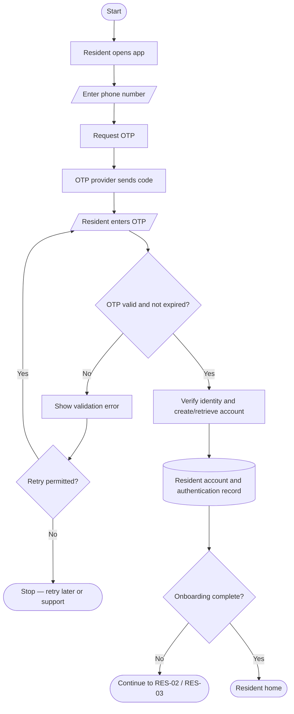

## RES-02 — City and Community Selection

### RES-02 — City and Community Selection

Let a resident identify the service location and community relevant to their residence.

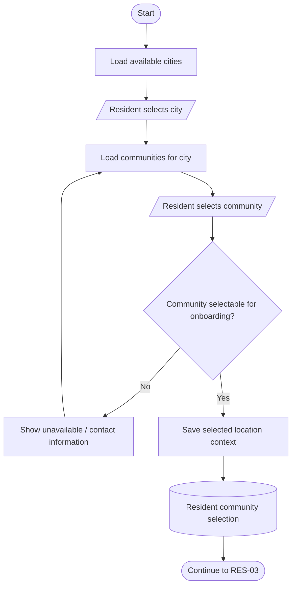

## RES-03 — Residence Registration (Tower, Flat and Documents)

### RES-03 — Residence Registration (Tower, Flat and Documents)

Associate the resident with a specific residence within a configured community hierarchy.

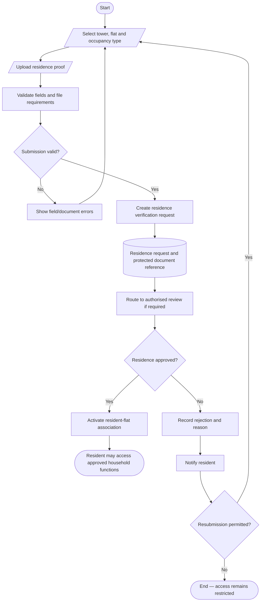

## RES-04 — Family Member Management and Approval

### RES-04 — Family Member Management and Approval

Allow a Primary Resident to request access for family members while ensuring access is granted only after manual verification and explicit approval.

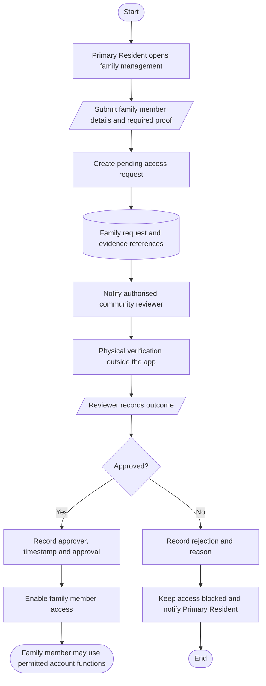

## RES-05 — Service Catalogue

### RES-05 — Service Catalogue

Present services Nestovin currently offers in the resident's selected community.

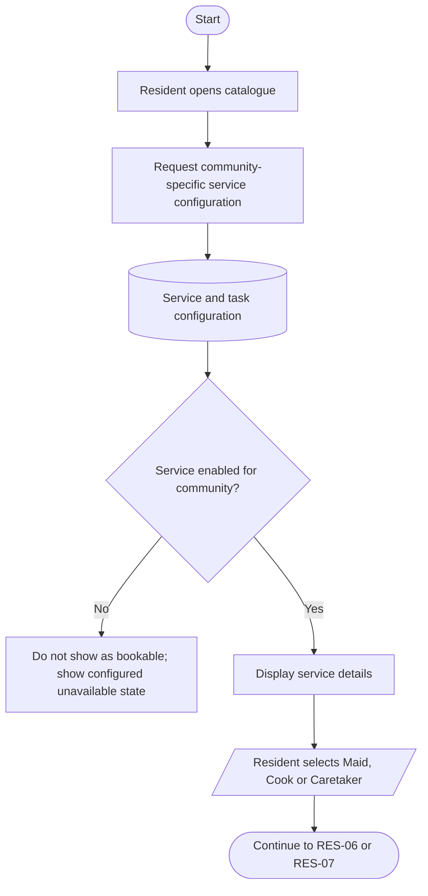

## RES-06 — Subscription Plans and Pricing

### RES-06 — Subscription Plans and Pricing

Display valid plan/price options for a service, residence type and community, and let a resident select a plan for a demand request or continuous booking.

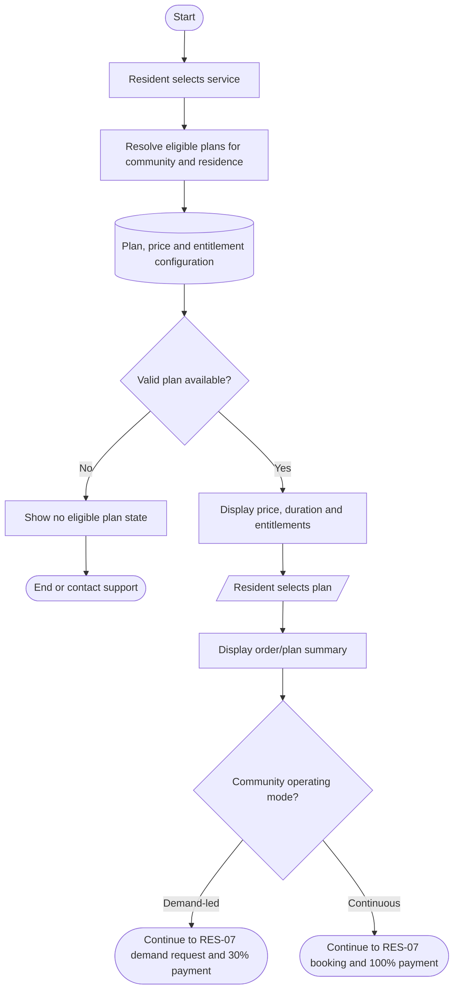

## RES-07A — Operating-mode selection and community context

### RES-07A — Operating-mode selection and community context

Shows the operating-mode selection and community context workflow.

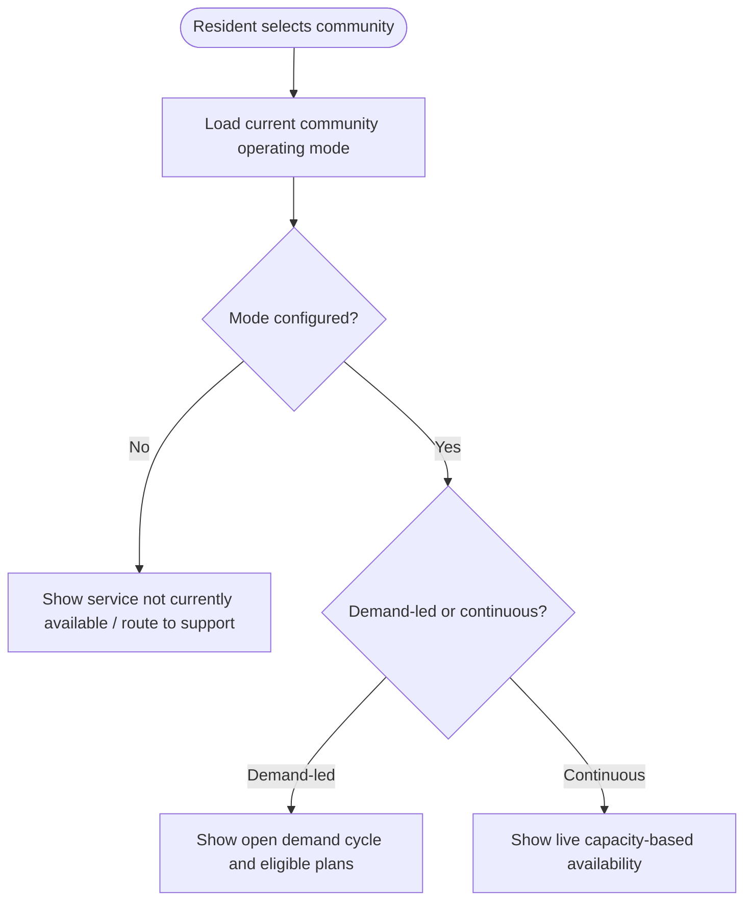

## RES-07B — Demand-led request and cycle participation

### RES-07B — Demand-led request and cycle participation

Shows the demand-led request and cycle participation workflow.

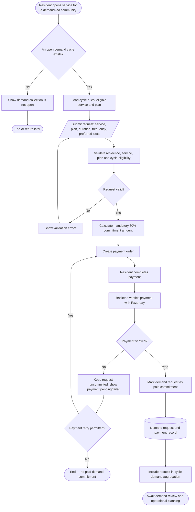

## RES-07C — Continuous booking mode

### RES-07C — Continuous booking mode

Shows the continuous booking mode workflow.

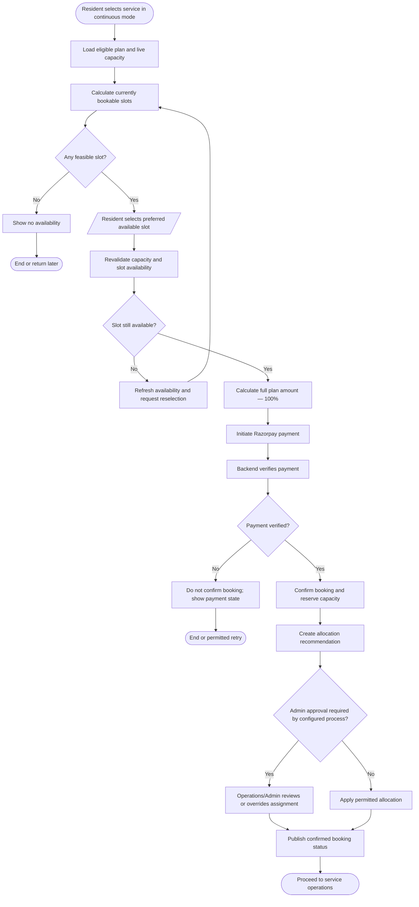

## RES-07D — Demand-led slots become bookable after release

### RES-07D — Demand-led slots become bookable after release

Shows the demand-led slots become bookable after release workflow.

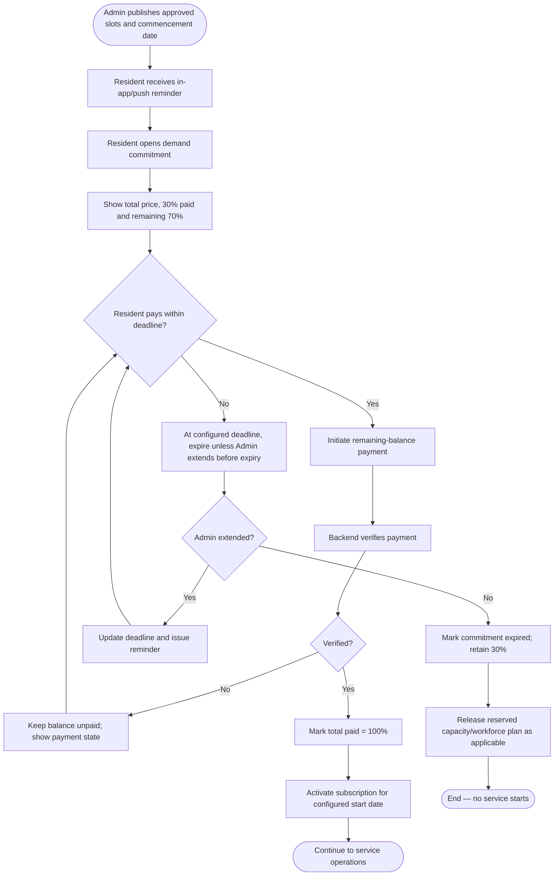

## RES-08 — Payment Integration (Razorpay)

### RES-08 — Payment Integration (Razorpay)

Collect resident payments and maintain server-verified payment records for demand commitments, continuous-mode bookings and demand-led balance payments.

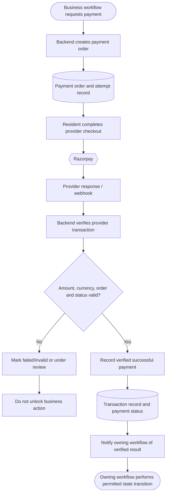

## RES-09 — Booking and Service Status

### RES-09 — Booking and Service Status

Show the current state of a resident's demand request, booking, subscription and service delivery without conflating these distinct records.

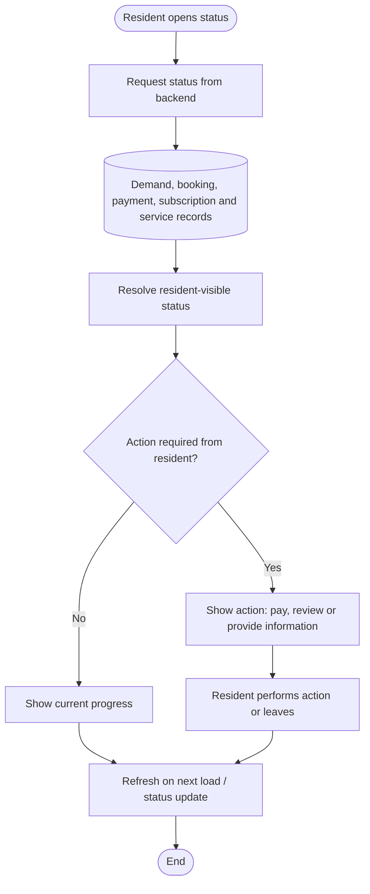

## RES-10 — Service History

### RES-10 — Service History

Present past and current service records relevant to the resident's household.

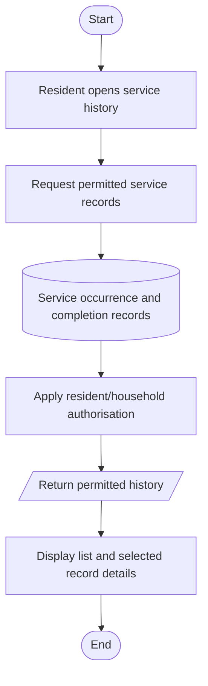

## RES-11 — Feedback and Ratings

### RES-11 — Feedback and Ratings

Allow a resident to submit feedback/rating for an eligible service experience.

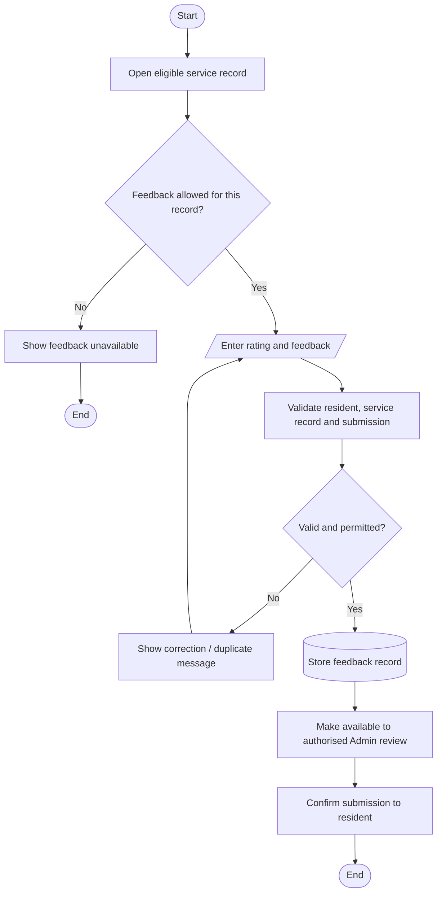

## RES-12 — Support Tickets

### RES-12 — Support Tickets

Let a resident raise and track support relating to their account, community, booking, payment or service.

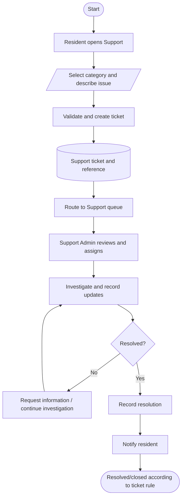

## RES-13 — Notifications

### RES-13 — Notifications

Deliver essential transactional and operational notifications to residents.

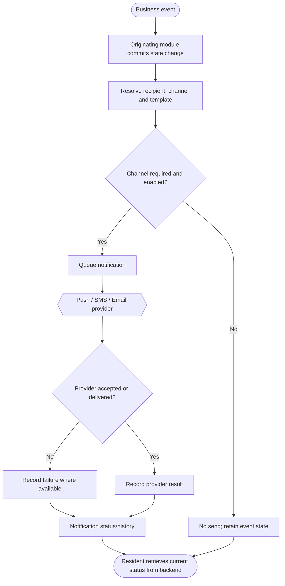

## RES-14 — Profile and Household Management

### RES-14 — Profile and Household Management

Let a resident view and manage permitted personal and household information.

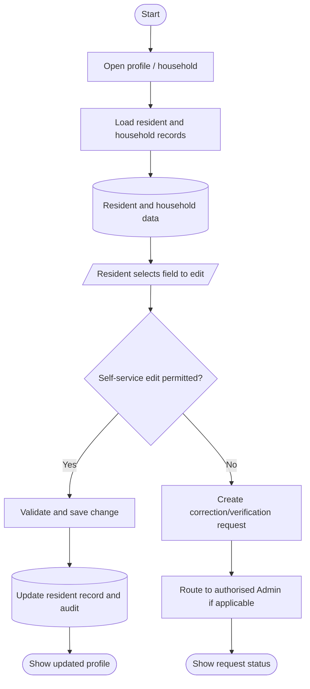

## EMP-01 — Applicant Registration

### EMP-01 — Applicant Registration

Capture an individual's interest in working with Nestovin. This is an application-interest intake, not a complete recruitment ATS.

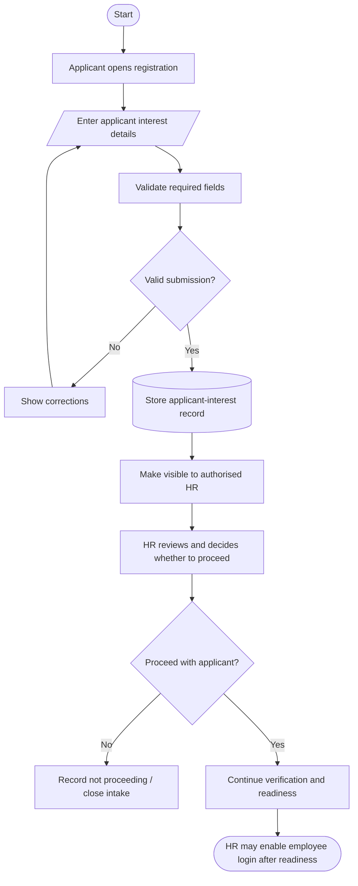

## EMP-02 — Employee Login (Employee ID and Password)

### EMP-02 — Employee Login (Employee ID and Password)

Authenticate an employee after HR has verified and enabled the employee account.

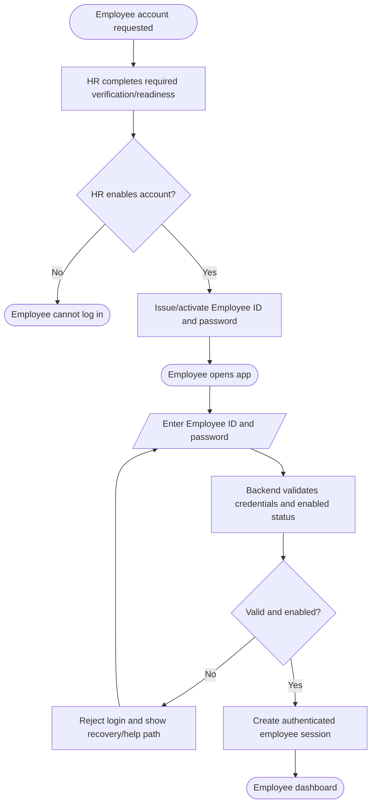

## EMP-03 — Employee Profile and Qualifications

### EMP-03 — Employee Profile and Qualifications

Maintain employee profile information and service/task qualifications used for work eligibility.

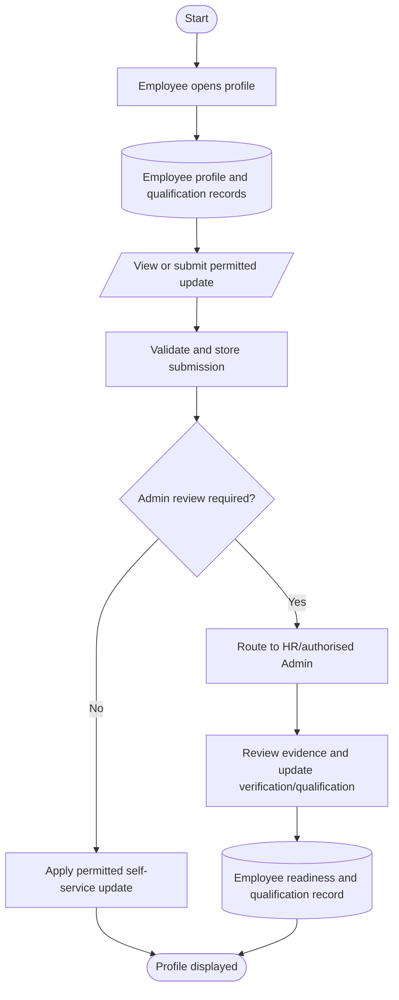

## EMP-04 — Training Videos and Completion

### EMP-04 — Training Videos and Completion

Present assigned training videos and record employee viewing/completion. This is a simple training capability, not a full LMS.

```mermaid
flowchart TD
    A([Start]) --> B[Employee opens training]
    B --> C[(Training video and assignment configuration)]
    C --> D[/Employee selects video/]
    D --> E[Play video]
    E --> F{Completion condition met?}
    F -- No --> G[Keep incomplete / allow resume]
    G --> E
    F -- Yes --> H[Record completion]
    H --> I[(Employee training completion record)]
    I --> J([Show completed status])
```

## EMP-05 — Work Schedule and Assignments

### EMP-05 — Work Schedule and Assignments

Present the employee's assigned work schedule and service assignments.

```mermaid
flowchart TD
    A([Operations creates/reviews assignment]) --> B[Validate employee eligibility and scope]
    B --> C{Eligible and permitted?}
    C -- No --> D[Reject recommendation / require another employee]
    D --> A
    C -- Yes --> E[(Store assignment and schedule)]
    E --> F[Notify assigned employee]
    F --> G[Employee opens work schedule]
    G --> H[Display assigned work]
    H --> I([Continue to attendance and service])
```

## EMP-06 — Attendance Verification (OTP / QR and Location Event)

### EMP-06 — Attendance Verification (OTP / QR and Location Event)

Record attendance at the service location using configured OTP or QR verification, with location evidence at the verification event.

```mermaid
flowchart TD
    A([Employee opens assigned service]) --> B[Initiate attendance verification]
    B --> C{Configured method?}
    C -- OTP --> D[/Enter or exchange OTP/]
    C -- QR --> E[/Scan or present QR/]
    D --> F[Capture location evidence for event]
    E --> F
    F --> G[Submit verification to backend]
    G --> H[Validate assignment, token, time and location rules]
    H --> I{Verification valid?}
    I -- No --> J[Reject event and show reason]
    J --> K([Retry or contact Operations])
    I -- Yes --> L[(Persist attendance event and evidence metadata)]
    L --> M([Attendance recorded])
```

## EMP-07 — Service Completion

### EMP-07 — Service Completion

Let an employee record completion of an assigned service occurrence and capture resident confirmation where required.

```mermaid
flowchart TD
    A([Assigned service in progress]) --> B[Employee completes configured tasks]
    B --> C[/Submit completion/]
    C --> D[Validate assignment and service occurrence]
    D --> E{Completion submission valid?}
    E -- No --> F[Show error / keep service open]
    F --> C
    E -- Yes --> G{Resident confirmation required?}
    G -- Yes --> H[/Resident confirms outcome/]
    H --> I{Confirmation received?}
    I -- No --> J[Keep pending / follow configured exception path]
    I -- Yes --> K[Record completion and confirmation]
    G -- No --> K
    K --> L[(Service completion record)]
    L --> M([Service occurrence completed])
```

## EMP-08 — Additional Work / Overtime

### EMP-08 — Additional Work / Overtime

Offer optional additional work/overtime to eligible employees and record employee response and Admin confirmation.

```mermaid
flowchart TD
    A([Operations identifies additional work]) --> B[Select eligible employees]
    B --> C[Create and send optional offer]
    C --> D[(Additional-work offer record)]
    D --> E[Employee receives offer]
    E --> F{Employee response?}
    F -- Reject --> G[Record rejection]
    G --> H([Offer closed for this employee])
    F -- Accept --> I[Record acceptance]
    I --> J[Admin reviews and confirms]
    J --> K{Admin confirms?}
    K -- No --> L[Record not confirmed and notify employee]
    L --> M([End])
    K -- Yes --> N[Create confirmed assignment]
    N --> O[Update schedule and notify employee]
    O --> P([Proceed through attendance/service])
```

## EMP-09 — Availability and Leave

### EMP-09 — Availability and Leave

Allow employees to submit availability/leave information and route leave requests for HR/Operations approval.

```mermaid
flowchart TD
    A([Start]) --> B[Employee opens availability/leave]
    B --> C[/Enter request type, dates and reason/details/]
    C --> D[Validate and submit]
    D --> E[(Pending leave/availability request)]
    E --> F[HR/Operations reviews]
    F --> G{Approve?}
    G -- No --> H[Record rejection and reason]
    H --> I[Notify employee]
    I --> J([Request closed])
    G -- Yes --> K[Record approval and reviewer]
    K --> L[Update effective availability]
    L --> M[Notify employee and allocation module]
    M --> N([Request approved])
```

## EMP-10 — Employee Notifications

### EMP-10 — Employee Notifications

Deliver essential employee-facing operational messages.

```mermaid
flowchart TD
    A([Employee event]) --> B[Resolve event, recipient and channel]
    B --> C{Notification enabled?}
    C -- No --> D([No notification; business record remains available])
    C -- Yes --> E[Send through configured provider]
    E --> F{{Push / SMS / Email provider}}
    F --> G[Record result where available]
    G --> H([Employee sees current status in app])
```

## ADM-01 — Admin Home and Overview

### ADM-01 — Admin Home and Overview

Display a role-appropriate summary of essential operational counts, pending actions and status.

```mermaid
flowchart TD
    A([Admin opens portal]) --> B[Authenticate Admin]
    B --> C{Identity active and valid?}
    C -- No --> D([Reject access])
    C -- Yes --> E[Resolve per-user permissions and data scope]
    E --> F[Request permitted summary metrics]
    F --> G[(Operational records and pending actions)]
    G --> H[Filter by permission and assigned cluster scope]
    H --> I[Display authorised overview]
    I --> J([Admin selects an accessible module])
```

## ADM-02 — Admin User Creation and Dynamic Permissions

### ADM-02 — Admin User Creation and Dynamic Permissions

Let Super Admin create Admin users and choose which modules and optional actions those users can access.

```mermaid
flowchart TD
    A([Super Admin opens Admin Users]) --> B[/Enter new Admin account details/]
    B --> C[Select account category]
    C --> D[/Select accessible modules/]
    D --> E{Action-level restriction needed?}
    E -- Yes --> F[/Configure optional actions per module/]
    E -- No --> G[Use module-level defaults]
    F --> H{Cluster-scoped account?}
    G --> H
    H -- Yes --> I[/Assign permitted cluster(s)/]
    H -- No --> J[No cluster assignment required]
    I --> K[Validate creator authority and permission combination]
    J --> K
    K --> L{Valid configuration?}
    L -- No --> M[Show permission/configuration errors]
    M --> D
    L -- Yes --> N[(Create Admin account and permission records)]
    N --> O[Activate/invite user]
    O --> P([User accesses assigned modules/actions only])
```

### Permission enforcement flow

Let Super Admin create Admin users and choose which modules and optional actions those users can access.

```mermaid
flowchart TD
    A([Admin requests protected action]) --> B[Authenticate request]
    B --> C[Load current per-user permission]
    C --> D[Check module access]
    D --> E{Module permitted?}
    E -- No --> F([Deny])
    E -- Yes --> G[Check action-level restriction if configured]
    G --> H{Action permitted?}
    H -- No --> F
    H -- Yes --> I[Check data scope / assigned cluster]
    I --> J{Record within scope?}
    J -- No --> F
    J -- Yes --> K([Allow action and audit where required])
```

## ADM-03 — City, Community, Cluster, Tower and Flat Master Data

### ADM-03 — City, Community, Cluster, Tower and Flat Master Data

Maintain the residential hierarchy used by onboarding, residence verification, community operations and cluster-scoped access.

```mermaid
flowchart TD
    A([Start]) --> B[Authorised Admin opens master data]
    B --> C{Select entity level}
    C --> D[City]
    C --> E[Community]
    C --> F[Cluster]
    C --> G[Tower / Building]
    C --> H[Flat]
    D --> I[/Enter fields and parent relationship/]
    E --> I
    F --> I
    G --> I
    H --> I
    I --> J[Validate parent, uniqueness and required data]
    J --> K{Valid?}
    K -- No --> L[Show validation errors]
    L --> I
    K -- Yes --> M[(Save master-data record and audit)]
    M --> N([Available to authorised downstream workflows])
```

## ADM-04 — Community Migration (Excel)

### ADM-04 — Community Migration (Excel)

Import structured community/tower/flat/resident setup data and identify invalid rows for correction before activation.

```mermaid
flowchart TD
    A([Start migration]) --> B[Admin uploads Excel file]
    B --> C[Validate file, columns, values and hierarchy]
    C --> D[(Import validation report)]
    D --> E{Any blocking errors?}
    E -- Yes --> F[Show invalid rows and reasons]
    F --> G[/Admin corrects file or allowed values/]
    G --> B
    E -- No --> H[Show import preview and summary]
    H --> I{Admin confirms import?}
    I -- No --> J([Cancel import])
    I -- Yes --> K[Import validated master records]
    K --> L[(City/community/tower/flat records)]
    L --> M([Migration complete; activation is separate])
```

## ADM-05 — Resident Management

### ADM-05 — Resident Management

Allow authorised Admin users to view/manage permitted resident records, residence associations, verification status and permitted booking information.

```mermaid
flowchart TD
    A([Admin opens Resident Management]) --> B[Check module, action and data-scope permission]
    B --> C{Access allowed?}
    C -- No --> D([Deny access])
    C -- Yes --> E[/Search or select resident/]
    E --> F[(Resident and residence records)]
    F --> G[Display permitted profile and status]
    G --> H{Admin action?}
    H -- View --> I([End])
    H -- Update --> J[Check edit permission and validate change]
    J --> K{Permitted and valid?}
    K -- No --> L([Reject change])
    K -- Yes --> M[(Save change and audit)]
    M --> I
```

## ADM-06 — Family-Member Approval Requests

### ADM-06 — Family-Member Approval Requests

Review family-member access requests and record manual physical verification and approval/rejection outcome.

```mermaid
flowchart TD
    A([Reviewer opens pending requests]) --> B[Filter by assigned community/cluster and permission]
    B --> C[/Select family request/]
    C --> D[Review request and evidence]
    D --> E[Perform physical verification outside system]
    E --> F[/Record verification result and decision/]
    F --> G{Approve?}
    G -- Yes --> H[(Save approval, reviewer and timestamp)]
    H --> I[Enable family access]
    G -- No --> J[(Save rejection, reviewer and timestamp)]
    J --> K[Keep family access blocked]
    I --> L[Notify Primary Resident]
    K --> L
    L --> M([End])
```

## ADM-07 — Service, Task, Plan and Pricing Configuration

### ADM-07 — Service, Task, Plan and Pricing Configuration

Configure V1 service/task definitions, plan entitlements, duration/start-date rules, fixed-slot rules and community/residence pricing.

```mermaid
flowchart TD
    A([Start configuration]) --> B[Select V1 service]
    B --> C[/Configure tasks and service attributes/]
    C --> D[/Configure plan and entitlement rules/]
    D --> E[/Configure duration, start rule, slot rule and price by community/residence/]
    E --> F[Validate configuration completeness and conflicts]
    F --> G{Valid?}
    G -- No --> H[Show errors and require correction]
    H --> C
    G -- Yes --> I[Admin reviews and publishes configuration]
    I --> J[(Versioned service/plan/price configuration)]
    J --> K([Available to resident-facing workflows])
```

## ADM-08 — Demand, Booking and Payment Status

### Primary Admin flow — demand-led mode

Provide authorised Admin users visibility and control over demand requests, demand cycles, confirmed bookings and payment states.

```mermaid
flowchart TD
    A([Admin selects community]) --> B[Open Demand Management]
    B --> C[Configure operating mode and demand cycle]
    C --> D[/Set cycle window, eligible services and request settings/]
    D --> E[Publish demand collection]
    E --> F[(Demand cycle)]
    F --> G[Collect backend-verified 30% commitments]
    G --> H[Aggregate demand by service, hours, frequency and preferred time]
    H --> I[Calculate workforce/capacity gap and slot recommendations]
    I --> J[Operations acquires/prepares workforce and updates readiness]
    J --> K[Admin creates slots manually or reviews generated recommendations]
    K --> L{Admin approves slot set and commencement date?}
    L -- No --> M[Revise capacity/slots/date]
    M --> K
    L -- Yes --> N[Publish approved slots and announce date/deadline]
    N --> O[Notify residents of remaining 70% payment]
    O --> P{Resident balance paid by deadline?}
    P -- Yes --> Q[Backend verifies 70% payment]
    Q --> R[Mark total paid = 100% and activate for start date]
    P -- No --> S{Admin extends deadline before expiry?}
    S -- Yes --> T[Update deadline and send reminder]
    T --> P
    S -- No --> U[Expire commitment; retain 30%; release capacity as applicable]
    R --> V([Proceed to service operations])
    U --> W([No service starts for expired commitment])
```

### Primary Admin flow — continuous mode

Provide authorised Admin users visibility and control over demand requests, demand cycles, confirmed bookings and payment states.

```mermaid
flowchart TD
    A([Admin enables continuous mode]) --> B[Maintain employee readiness and schedules]
    B --> C[Recalculate live capacity]
    C --> D[(Available slot/capacity records)]
    D --> E[Expose currently feasible slots to residents]
    E --> F[Resident selects slot and pays 100%]
    F --> G[Backend verifies full payment]
    G --> H{Payment verified and capacity still available?}
    H -- No --> I[Do not confirm; refresh capacity/payment state]
    H -- Yes --> J[Confirm booking and reserve capacity]
    J --> K[Generate allocation recommendation]
    K --> L[Admin/Operations reviews or overrides where configured]
    L --> M([Confirmed service proceeds])
```

## ADM-09 — Employee Profile and Verification

### ADM-09 — Employee Profile and Verification

Maintain employee profile, verification status, qualifications, service/task eligibility and deployment readiness.

```mermaid
flowchart TD
    A([HR opens employee record]) --> B[Review profile and submitted evidence]
    B --> C[/Record verification and qualification outcome/]
    C --> D{Required verification complete?}
    D -- No --> E[Mark pending / request missing evidence]
    E --> B
    D -- Yes --> F[Record approved qualifications and service eligibility]
    F --> G{Employee deployment-ready?}
    G -- No --> H[Keep not-ready and record reason]
    G -- Yes --> I[Mark ready and enable account as permitted]
    I --> J[(Employee verification/readiness record)]
    J --> K([Available to allocation workflow])
```

## ADM-10 — Scheduling and Time-Slot Configuration

### ADM-10 — Scheduling and Time-Slot Configuration

Configure fixed service slots and basic availability controls, and support slot sets used by demand-led and continuous modes.

```mermaid
flowchart TD
    A([Open scheduling]) --> B[Select community and service]
    B --> C{Operating mode?}
    C -- Demand-led --> D[Load committed demand and workforce plan]
    D --> E{Creation method?}
    E -- Manual --> F[/Admin creates slot definitions and capacity/]
    E -- Recommendation --> G[System generates slot recommendations]
    F --> H[Validate conflicts and employee capacity]
    G --> H
    C -- Continuous --> I[Calculate availability from current workforce/schedules]
    I --> J[Apply authorised Admin overrides if any]
    J --> H
    H --> K{Slot set valid and approved?}
    K -- No --> L[Revise slots/capacity]
    L --> H
    K -- Yes --> M[(Store approved slot set and publication status)]
    M --> N([Expose approved availability to residents])
```

## ADM-11 — Work Allocation and Replacement

### ADM-11 — Work Allocation and Replacement

Recommend eligible employees for demand/booking and let authorised Operations/Admin review, confirm or manually replace assignments.

```mermaid
flowchart TD
    A([Allocation required]) --> B[Load service/task, date/time, location and capacity need]
    B --> C[Find eligible employees]
    C --> D[Filter by qualification, readiness, availability, assignments and cluster scope]
    D --> E{Eligible employee found?}
    E -- No --> F[Show capacity gap / require Operations action]
    F --> G([No assignment created])
    E -- Yes --> H[Generate assignment recommendation]
    H --> I[Operations reviews recommendation]
    I --> J{Accept recommendation?}
    J -- Yes --> K[Validate and confirm assignment]
    J -- No --> L[Operations selects manual replacement]
    L --> M[Validate replacement eligibility and conflicts]
    M --> N{Replacement valid?}
    N -- No --> L
    N -- Yes --> K
    K --> O[(Save assignment and audit)]
    O --> P[Update employee schedule and notify employee]
    P --> Q([Assignment confirmed])
```

## ADM-12 — Attendance and Service Records

### ADM-12 — Attendance and Service Records

Let authorised Admin users review attendance verification outcomes, service completion and no-show records.

```mermaid
flowchart TD
    A([Admin opens attendance records]) --> B[Check permission and cluster scope]
    B --> C[/Filter by employee, community, date or status/]
    C --> D[(Attendance and service records)]
    D --> E[Review verification and completion outcome]
    E --> F{Exception present?}
    F -- No --> G([Record remains verified/current])
    F -- Yes --> H[Review exception details]
    H --> I{Employee correction request exists?}
    I -- Yes --> J[Apply ADM-12A correction review]
    I -- No --> K[Record permitted operational note/action]
    J --> L[(Persist decision and audit history)]
    K --> L
    L --> M([End])
```

## ADM-12A — Attendance correction request (client-confirmed)

### ADM-12A — Attendance correction request (client-confirmed)

Shows the attendance correction request (client-confirmed) workflow.

```mermaid
flowchart TD
    A([Employee submits correction request]) --> B[(Correction request linked to original attendance event)]
    B --> C[Admin reviews request and evidence]
    C --> D{Approve correction?}
    D -- No --> E[Record rejection and reason]
    D -- Yes --> F[Record approved correction]
    F --> G[Update effective attendance result with audit trail]
    E --> H[Notify employee]
    G --> H
    H --> I([End])
```

## ADM-13 — Support Ticket Management

### ADM-13 — Support Ticket Management

Let Support users categorise, assign, track and resolve resident support tickets with basic escalation visibility.

```mermaid
flowchart TD
    A([Support user opens ticket queue]) --> B[Load tickets within permission/scope]
    B --> C[/Select ticket/]
    C --> D[Review issue and linked resident/service/payment context]
    D --> E[Categorise and assign]
    E --> F[Investigate and record update]
    F --> G{Requires another team or escalation?}
    G -- Yes --> H[Assign/escalate to authorised team]
    H --> F
    G -- No --> I{Resolved?}
    I -- No --> F
    I -- Yes --> J[Record resolution]
    J --> K[Update ticket status and notify resident]
    K --> L([End])
```

## ADM-14 — Finance Overview and Basic Payroll Calculation

### ADM-14 — Finance Overview and Basic Payroll Calculation

Present basic booking/revenue summaries and calculate payroll using client-approved attendance, rates, overtime/incentives and deductions.

```mermaid
flowchart TD
    A([Authorised user opens Finance]) --> B[/Select period and permitted scope/]
    B --> C[(Verified booking/payment summaries)]
    B --> D[(Approved attendance and service records)]
    B --> E[(Client-approved rates, overtime and deduction rules)]
    C --> F[Prepare basic revenue/booking overview]
    D --> G[Prepare eligible work and attendance inputs]
    E --> G
    G --> H[Calculate payroll preview]
    H --> I{Inputs complete and valid?}
    I -- No --> J[Flag missing/invalid input for authorised correction]
    J --> G
    I -- Yes --> K[(Store calculation result and inputs)]
    K --> L([Submit to ADM-15 approval workflow])
```

## ADM-15 — Payroll Approval and Basic Reports

### ADM-15 — Payroll Approval and Basic Reports

Review/approve payroll calculation results and generate agreed basic reports.

```mermaid
flowchart TD
    A([Payroll result submitted]) --> B[Approver opens payroll period]
    B --> C[Review calculation and supporting inputs]
    C --> D{Approve?}
    D -- No --> E[Return for correction with reason]
    E --> F[Recalculate/update through ADM-14]
    F --> B
    D -- Yes --> G[(Record approval, approver and timestamp)]
    G --> H[Generate agreed basic report]
    H --> I([Approved payroll/report available])
```

## WEB-01 to WEB-04 and WEB-06 to WEB-09 — Public information browsing

### WEB-01 to WEB-04 and WEB-06 to WEB-09 — Public information browsing

Let visitors browse approved public information. These pages do not create a resident account, demand request or service booking.

```mermaid
flowchart TD
    A([Visitor opens website]) --> B[Load requested public page]
    B --> C[(Approved website content/configuration)]
    C --> D[Render responsive informational content]
    D --> E{Visitor chooses another action?}
    E -- Browse another page --> B
    E -- Enquiry --> F([Continue to WEB-05])
    E -- Leave --> G([End])
```

## WEB-05 — Contact Us and Enquiry Form

### WEB-05 — Contact Us and Enquiry Form

Allow a public visitor to submit an enquiry.

```mermaid
flowchart TD
    A([Visitor opens Contact Us]) --> B[/Enter enquiry details/]
    B --> C[Validate required fields]
    C --> D{Valid?}
    D -- No --> E[Show field errors]
    E --> B
    D -- Yes --> F[Submit to backend]
    F --> G[(Store enquiry record)]
    G --> H([Route through WEB-10])
    H --> I[Show submission confirmation]
    I --> J([End])
```

## WEB-10 — Enquiry Management to Support Team

### WEB-10 — Enquiry Management to Support Team

Ensure website enquiries reach the client-approved Support destination and remain traceable.

```mermaid
flowchart TD
    A([Enquiry stored]) --> B[Resolve approved Support destination]
    B --> C{Destination configured and reachable?}
    C -- Yes --> D[Route enquiry]
    D --> E[Record routing outcome]
    E --> F([Available to Support for follow-up])
    C -- No --> G[Record routing failure]
    G --> H[Make failure visible to authorised Admin]
    H --> I([Retry/manual follow-up under approved process])
```
