# NESTOVIN — Complete System Workflows

**Document ID:** NV-FWS-03  
**Version:** 0.1 — End-to-end workflow review draft  
**Prepared by:** Nexif Technologies  
**Product:** Nestovin V1  
**Date:** 5 November 2026  
**Status:** Working specification for client walkthrough; not an approved final functional baseline

---

## 1. Purpose

This document connects the individual Resident App, Employee App, Admin Portal, Public Website and shared-backend workflows into complete business journeys. It shows how records and decisions move across modules, from platform setup and resident demand through payment, workforce allocation, service delivery, support and payroll.

This is a functional workflow document, not a screen specification, API contract, database schema, infrastructure architecture or low-level implementation design. Each Mermaid block is a **separate diagram**. Render or copy them one at a time.

## 2. Scope and modelling rules

| Area | V1 boundary used in these diagrams |
|---|---|
| Resident App | 14 capability areas; Android and iOS |
| Employee App | 10 capability areas; Android and iOS |
| Unified Admin Portal | 15 selected capability areas; the other 19 from the 34-module inventory are deferred |
| Public Website | 10 pages/functions; informational and enquiry-led; no online service booking |
| Shared backend | Authentication, authorisation, central records, business workflows, integrations and audit |
| Service catalogue | Maid, Cook and Caretaker only |
| Operating model | Nestovin-managed workforce; not an open marketplace |

### Rules that must remain distinct

- A **demand request** is not a confirmed booking, and a 30% demand commitment does not activate service.
- A **booking**, **subscription**, **payment transaction** and **service occurrence** are related but separate records.
- Demand-led mode requires verified 30% at request, then verified remaining 70% after the commencement date is announced and before service begins.
- Continuous mode requires verified 100% before service begins.
- Razorpay provider response, redirect or client-side success screen is not proof of payment. Backend verification is authoritative.
- Routine employee assignments do not require employee accept/reject. Optional additional-work/overtime offers do require employee accept/reject and subsequent Admin confirmation.
- Allocation is recommendation-led; authorised Operations/Admin confirms or overrides. Employee assignment must remain within authorised cluster scope.
- Attendance uses OTP or QR, with location evidence at the verification event only. Continuous live employee tracking is outside V1.
- A notification communicates a business event; it does not itself change payment, booking, attendance or service state.

### Diagram notation

| Shape | Meaning |
|---|---|
| Rounded node | Start, end or system hand-off |
| Rectangle | Process or record operation |
| Diamond | Decision or validation |
| Arrow label | Condition or outcome |

## 3. System-wide context

The five product surfaces use the shared backend as the source of truth. External providers are called through backend-controlled workflows. The Public Website does not create bookings.

## WF-00 — Overall system context and module connections
Shows the main actors, product surfaces, shared business records and external integrations. The resident, employee and Admin apps do not maintain independent business truth.

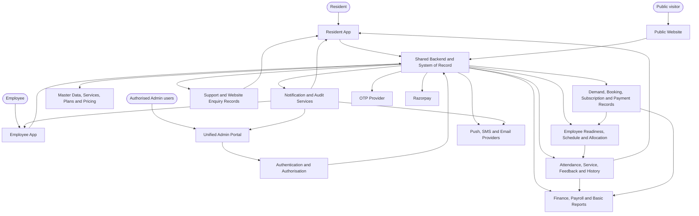

## WF-01 — Admin account provisioning and permission enforcement
Super Admin creates Admin accounts and grants module-level access with optional action restrictions. Cluster scope and backend enforcement apply on every protected operation.

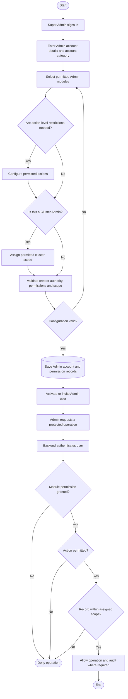

## WF-02 — Location master data and community activation
Authorised Admins create or import City, Community, Cluster, Tower and Flat records with required parent relationships. The exact hierarchy cardinality and some uniqueness rules remain client decisions.

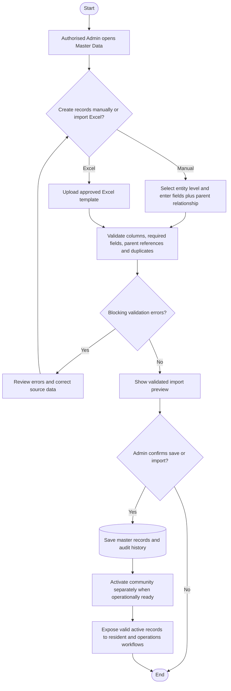

## WF-03 — Resident registration, residence verification and family access
Connects OTP login, residence selection, document review and the separate family-member approval process. A pending residence or family request does not grant verified access.

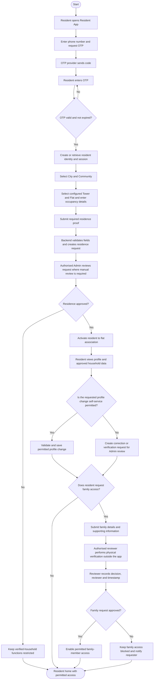

## WF-04 — Employee onboarding, verification and deployment readiness
Connects applicant interest, HR verification, employee qualifications, simple training, readiness and employee account enablement. This is not a full recruitment ATS.

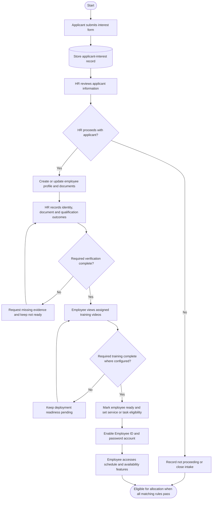

## WF-05 — Service catalogue, plan configuration and operating-mode routing
Admin configuration feeds the Resident App. Only the three approved V1 services are presented. The selected community operating mode determines which booking journey follows.

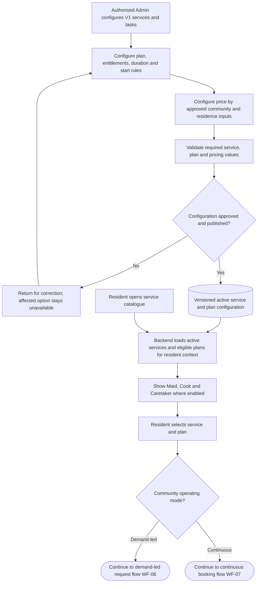

## WF-06 — Demand-led journey: request, commitment, planning, balance and service
This is the full demand-led path. Each demand cycle is configurable and repeatable. The 30% payment records a commitment only; service cannot begin until the remaining 70% is verified.

```mermaid
flowchart TD
    ADMIN["Authorised Admin opens demand cycle for community"]
    RULES["Set collection window, eligible services and request rules"]
    PUBLISH["Publish open demand cycle"]
    RESIDENT["Resident selects service and plan"]
    REQUEST["Submit hours or duration, frequency and preferred time slots"]
    CHECK["Validate resident context, plan, service and cycle eligibility"]
    VALID{"Request valid?"}
    FIX["Show errors and allow correction"]
    CALC["Calculate mandatory 30 percent commitment"]
    ORDER["Backend creates Razorpay payment order"]
    CHECKOUT["Resident completes payment checkout"]
    VERIFY["Backend verifies amount, currency, order and provider status"]
    PAID{"30 percent payment verified?"}
    UNPAID["Keep request uncommitted; display payment pending or failed"]
    RETRY_ALLOWED{"Retry permitted under approved payment rules?"}
    NO_COMMIT([No paid demand commitment is created])
    COMMIT[("Save paid demand commitment and payment record")]
    AGG["Aggregate paid demand by service, hours, frequency and preferred slots"]
    CAPACITY["Operations reviews workforce requirement and capacity gap"]
    READINESS["HR updates employee verification, qualifications and readiness"]
    SLOT["Admin creates slots manually or reviews system recommendations"]
    APPROVED{"Admin approves slots and commencement date?"}
    REVISE["Revise workforce plan, capacity or slot set"]
    RELEASE["Publish approved slots, commencement date and balance deadline"]
    REMIND["Notify resident of remaining 70 percent payment"]
    BALANCE["Resident pays remaining 70 percent"]
    VERIFY_BAL["Backend verifies remaining balance"]
    FULL{"Full 100 percent payment verified before start?"}
    PENDING["Keep service inactive and display current payment status"]
    DEADLINE{"Configured payment deadline reached?"}
    EXTEND{"Authorised Admin extends deadline before expiry?"}
    UPDATE["Update deadline and send reminder"]
    EXPIRE["Expire commitment and retain 30 percent under confirmed rule"]
    NO_START([No service starts for expired commitment])
    ACTIVATE["Activate subscription for approved commencement date"]
    BOOKING["Create confirmed service booking or occurrence schedule"]
    ALLOCATE([Continue to shared workforce allocation WF-08])

    ADMIN --> RULES --> PUBLISH --> RESIDENT
    RESIDENT --> REQUEST --> CHECK --> VALID
    VALID -->|No| FIX --> REQUEST
    VALID -->|Yes| CALC --> ORDER --> CHECKOUT --> VERIFY --> PAID
    PAID -->|No| UNPAID --> RETRY_ALLOWED
    RETRY_ALLOWED -->|Yes| ORDER
    RETRY_ALLOWED -->|No| NO_COMMIT
    PAID -->|Yes| COMMIT --> AGG --> CAPACITY --> READINESS --> SLOT --> APPROVED
    APPROVED -->|No| REVISE --> SLOT
    APPROVED -->|Yes| RELEASE --> REMIND --> BALANCE --> VERIFY_BAL --> FULL
    FULL -->|No| PENDING --> DEADLINE
    FULL -->|Yes| ACTIVATE --> BOOKING --> ALLOCATE
    DEADLINE -->|No| BALANCE
    DEADLINE -->|Yes| EXTEND
    EXTEND -->|Yes| UPDATE --> BALANCE
    EXTEND -->|No| EXPIRE --> NO_START
```

## WF-07 — Continuous-mode journey: live availability, full payment and booking
Continuous mode exposes only feasible slots derived from current workforce capacity. The selected slot is revalidated before payment and booking confirmation.

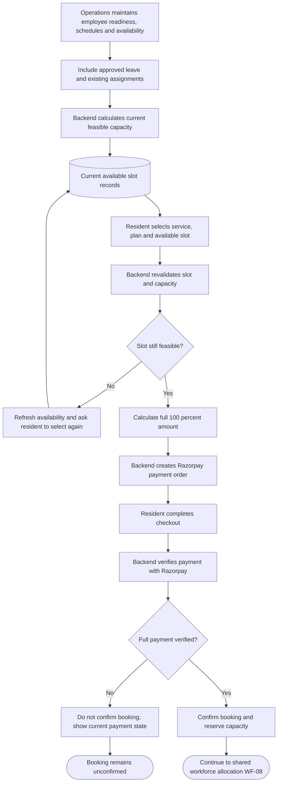

## WF-08 — Shared workforce allocation, confirmation and replacement
Both demand-led and continuous bookings enter the same allocation workflow after their required payment and booking conditions are satisfied. Routine assignments do not require employee acceptance.

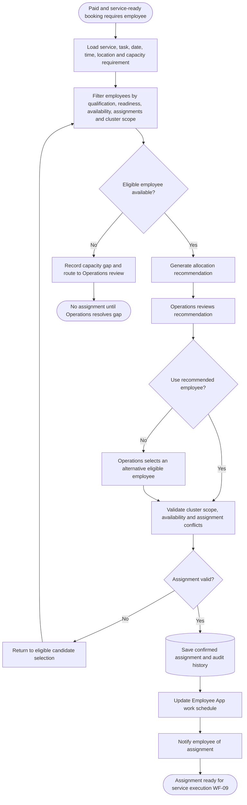

## WF-09 — Assigned service visit: attendance, execution, completion and resident history
The confirmed employee schedule connects to attendance verification and service completion. Completed service records feed resident history, eligible feedback, Admin operations and payroll inputs.

```mermaid
flowchart TD
    ASSIGN["Confirmed assignment appears in Employee App"]
    OPEN["Employee opens assigned service occurrence"]
    METHOD{"Configured attendance method?"}
    OTP["Complete OTP verification"]
    QR["Scan or present QR verification"]
    LOCATION["Capture location evidence at verification event"]
    VALIDATE["Backend validates assignment, token, time and location rules"]
    VALID{"Attendance valid?"}
    EXCEPTION["Reject verification and route to retry or Operations correction"]
    ATTEND[("Record verified attendance event")]
    TASKS["Employee performs configured service tasks"]
    SUBMIT["Employee submits service completion details"]
    CHECK["Backend validates assignment and service occurrence"]
    RESIDENT_CONFIRM{"Resident confirmation required?"}
    CONFIRM["Resident confirms service outcome"]
    COMPLETE[("Save service completion and confirmation record")]
    STATUS["Update resident booking and service status"]
    HISTORY["Make completed occurrence available in resident service history"]
    FEEDBACK{"Feedback enabled for this occurrence?"}
    RATE["Resident submits permitted rating and feedback"]
    FEEDBACK_REC[("Save feedback for authorised Admin review")]
    ADMIN["Expose attendance and service record to authorised Admin"]
    PAYROLL["Make approved attendance and service data available to payroll"]
    END([Service occurrence completed])

    ASSIGN --> OPEN --> METHOD
    METHOD -->|OTP| OTP --> LOCATION
    METHOD -->|QR| QR --> LOCATION
    LOCATION --> VALIDATE --> VALID
    VALID -->|No| EXCEPTION --> OPEN
    VALID -->|Yes| ATTEND --> TASKS --> SUBMIT --> CHECK --> RESIDENT_CONFIRM
    RESIDENT_CONFIRM -->|Yes| CONFIRM --> COMPLETE
    RESIDENT_CONFIRM -->|No| COMPLETE
    COMPLETE --> STATUS --> HISTORY --> FEEDBACK
    FEEDBACK -->|Yes| RATE --> FEEDBACK_REC --> ADMIN
    FEEDBACK -->|No| ADMIN
    ADMIN --> PAYROLL --> END
```

## WF-10 — Attendance exceptions, no-show and correction review
Captures two exception paths: a resident no-show and an employee request to correct an attendance record. The original event and the correction decision remain auditable.

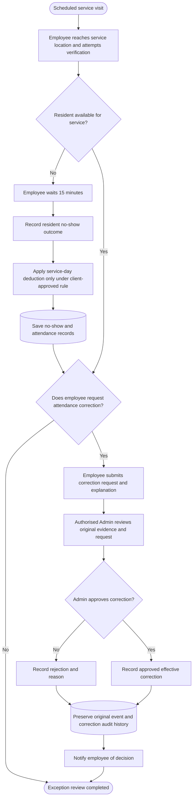

## WF-11 — Employee leave and availability change affecting capacity
An approved leave or availability decision changes future employee eligibility and the capacity used by continuous availability and allocation. Exact handling of already-confirmed conflicting assignments remains an open operating rule.

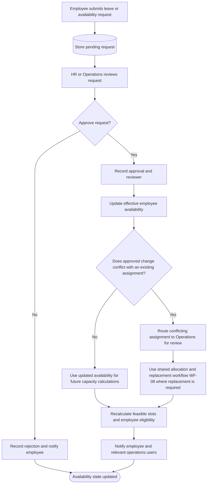

## WF-12 — Additional work and overtime offer to payroll
This is the exception to routine assignment. Employee acceptance or rejection is recorded, and an accepted offer becomes an assignment only after Admin confirmation.

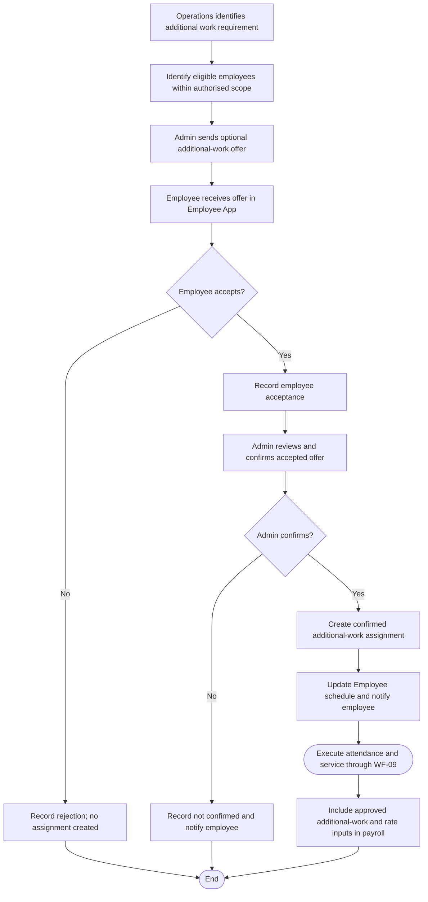

## WF-13 — Payment processing, verification and failure recovery
All payment use cases pass through one backend verification process. The owning workflow determines whether verified payment means a 30% commitment, a 70% balance or a fully paid continuous booking.

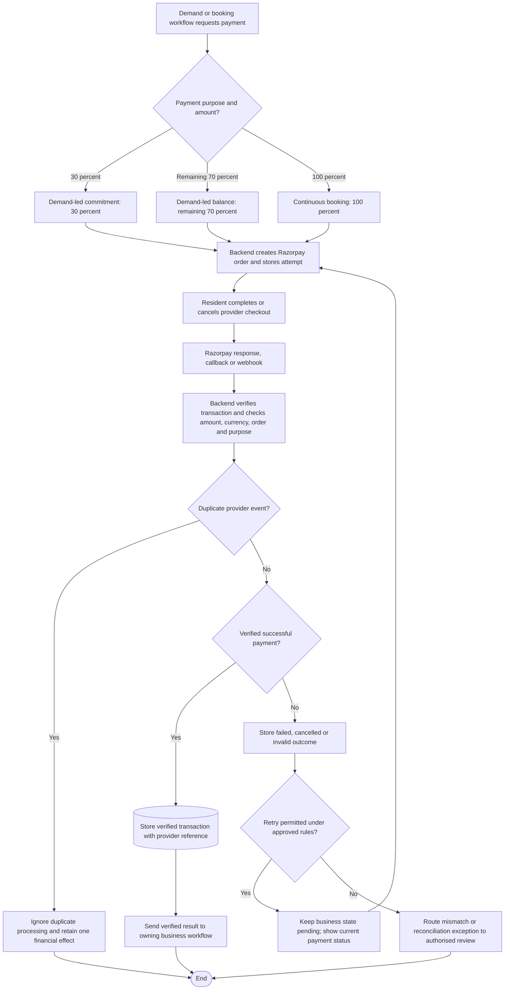

## WF-14A — Public Website information browsing and enquiry entry

Connects the informational website pages to the Contact Us path. Careers content is informational only; the website does not create resident accounts, bookings or recruitment applications.

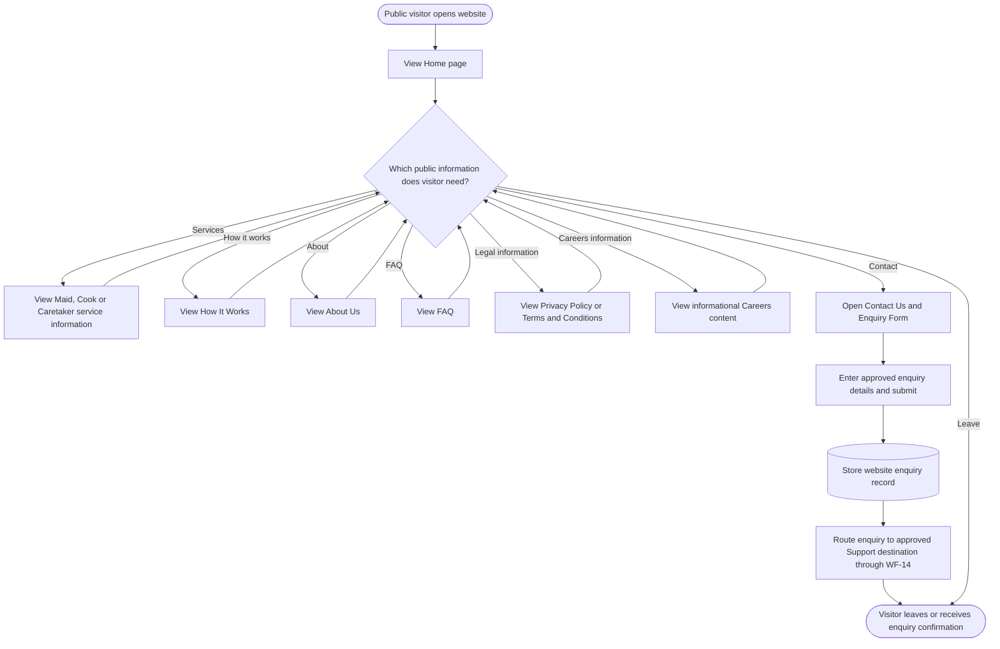

## WF-14 — Resident support, website enquiries and support resolution
Resident tickets and public website enquiries both reach an authorised Support destination, but they remain distinct intake records unless the client confirms an automatic conversion rule. Refund-related tickets require manual authorised review.

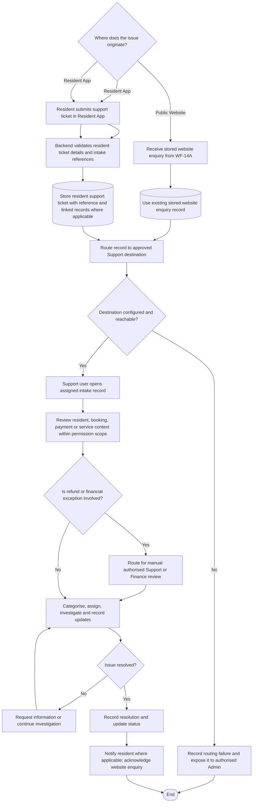

## WF-15 — Notifications across resident, employee and Admin workflows
Notifications are triggered only after the originating business event is committed. Delivery failure is recorded where available and never rolls back the underlying business decision.

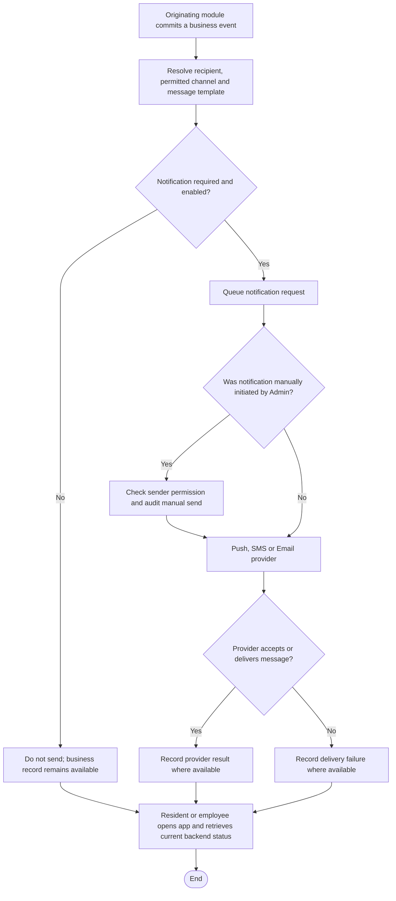

## WF-16 — Finance overview, payroll calculation, approval and reports
Payroll uses verified payment and booking summaries plus approved attendance, service and additional-work inputs. Client-approved rates and deduction rules are required; the platform does not disburse salaries or replace an ERP/accounting system.

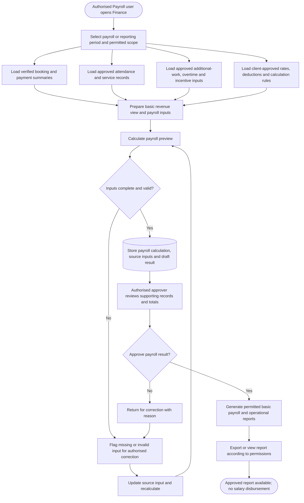

## WF-17 — Admin operational oversight and record traceability
Shows how the selected Admin modules support oversight without bypassing permission checks. The Admin Portal reads and updates authorised records; the backend remains the system of record.

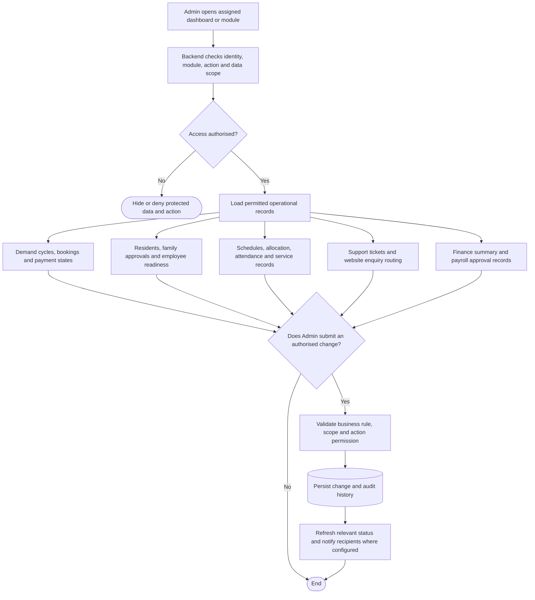

## 4. Cross-module coverage index

This index maps the capability IDs from the individual-module specification to the end-to-end diagrams above. A capability may appear in more than one diagram because its output is consumed by another part of the system.

| Product area | Capability IDs | Covered in |
|---|---|---|
| Resident App | RES-01 to RES-04 | WF-03; WF-14; WF-15 |
| Resident App | RES-05 to RES-07 | WF-05; WF-06; WF-07 |
| Resident App | RES-08 | WF-06; WF-07; WF-13 |
| Resident App | RES-09 to RES-11 | WF-09; WF-10; WF-15 |
| Resident App | RES-12 to RES-13 | WF-14; WF-15 |
| Resident App | RES-14 | WF-03; WF-17 |
| Employee App | EMP-01 to EMP-04 | WF-04 |
| Employee App | EMP-05 to EMP-07 | WF-08; WF-09; WF-10 |
| Employee App | EMP-08 | WF-12; WF-16 |
| Employee App | EMP-09 | WF-11 |
| Employee App | EMP-10 | WF-08 to WF-12; WF-15 |
| Admin Portal | ADM-01 to ADM-02 | WF-01; WF-17 |
| Admin Portal | ADM-03 to ADM-04 | WF-02 |
| Admin Portal | ADM-05 to ADM-06 | WF-03; WF-17 |
| Admin Portal | ADM-07 | WF-05 |
| Admin Portal | ADM-08 | WF-06; WF-07; WF-13; WF-17 |
| Admin Portal | ADM-09 | WF-04; WF-06; WF-08 |
| Admin Portal | ADM-10 | WF-05 to WF-07 |
| Admin Portal | ADM-11 | WF-08; WF-11 |
| Admin Portal | ADM-12 | WF-09; WF-10; WF-17 |
| Admin Portal | ADM-13 | WF-14; WF-17 |
| Admin Portal | ADM-14 to ADM-15 | WF-16 |
| Public Website | WEB-01 to WEB-04; WEB-06 to WEB-09 | WF-14A |
| Public Website | WEB-05 and WEB-10 | WF-14A; WF-14 |

## 5. Open decisions that affect cross-module behaviour

The following items are deliberately not hard-coded into these diagrams because the current workflow baseline marks them as unresolved or client-supplied:

1. **Master data structure:** exact parent-child cardinality among City, Community, Cluster, Tower and Flat; uniqueness, inactive-record and reassignment rules.
2. **Resident verification:** whether every residence submission requires manual review; accepted proof types; resubmission policy; exact family permissions and revocation rules.
3. **Commercial configuration:** final service/task matrix, plan entitlements, prices, duration, start-date rules, taxes/discount display and effect of future configuration changes on existing subscriptions.
4. **Demand operations:** collection-window settings, duplicate/amended request rules, 30% calculation basis, capacity reservation between slot release and 70% payment, and workforce-shortage recovery.
5. **Payment timing:** remaining-balance deadline, reminder cadence, payment-in-progress at expiry, late/duplicate payment reconciliation, refund approval matrix and treatment of date changes after publication.
6. **Scheduling and allocation:** labour/capacity formula, slot granularity, buffer/travel rules, ranking/tie-breakers, workload limits, assignment conflicts and backup/replacement rules.
7. **Employee policies:** readiness checklist, training completion conditions, leave types and notice rules, conflict handling for existing assignments, overtime rate/expiry/maximum hours and payroll treatment.
8. **Attendance and service:** OTP/QR validity, location tolerance, offline synchronisation, resident confirmation method, partial service/rework, no-show reason codes and exact service-day deduction calculation.
9. **Support and website:** final ticket categories/SLA/escalation; enquiry fields/consent; approved enquiry destination; whether website enquiries are converted into Support Tickets or remain separate records.
10. **Notifications and finance:** final provider/event/channel matrix, templates and retries; payroll period, approved rates, formulas, deductions, approver separation and export format.

## 6. Explicit exclusions and safeguards

- No open marketplace or independent-provider onboarding flow.
- No online booking through the Public Website.
- No extra service categories beyond Maid, Cook and Caretaker in this V1 baseline.
- No full recruitment ATS or enterprise LMS; employee onboarding and simple training only.
- No employee assignment across unauthorised clusters.
- No routine employee accept/reject step for standard assignments; accept/reject applies to optional additional-work offers.
- No continuous background/live employee tracking; location evidence is event-based at attendance verification.
- No automated salary disbursement and no ERP/accounting replacement.
- No AI/ML predictive workforce optimisation; allocation remains rule-based/recommendation-led with authorised Admin/Operations control.
- No automatic refund from a support ticket; refund exceptions require manual authorised review.

## 7. Source basis and status

This document is derived primarily from **`01_individual_module_workflows.md` (NV-FWS-01, Version 0.1, dated 4 November 2026)**, which records the current consolidated V1 workflow inventory, client clarifications through 4 November 2026, and open decisions. The delivery scope is aligned with the **Nestovin Client Delivery Roadmap v1.2 — Corrected client review copy, issued 31 October 2026**. The Master Services Agreement effective 12 October 2026 remains the governing agreement for contractual scope and change control.

Where exact rules remain open, this document keeps the decision visible instead of inventing a business rule. These diagrams are a working functional model for review; they do not by themselves approve new scope or replace the contractual documents.

---

**End of document — NV-FWS-03, Version 0.1.**
