# NESTOVIN — Individual Module Workflow Specification

**Document ID:** NV-FWS-01  
**Version:** 1.0 — Consolidated individual module workflows  
**Prepared by:** Nexif Technologies  
**Product:** Nestovin V1  
**Date:** 19 November 2026  
**Status:** Consolidated V1 workflow baseline for implementation planning; explicitly listed open decisions remain subject to business-owner confirmation

---

## 0. Purpose and how to use this document

This document describes the **individual functional workflows** of Nestovin V1. It is intended to let the client and Nexif review what each capability does, who initiates it, what decisions occur, what the system records, and what happens when the normal path cannot continue.

This is not a screen inventory, wireframe specification, API specification, database schema, or final low-level design. The diagrams use conventional flowchart shapes and selected software-modelling conventions to communicate functional behaviour. They are deliberately detailed enough to expose business rules and edge cases without prescribing implementation classes, endpoints, tables, queues, or cloud services.

### 0.1 Three-document design set

| Document | Responsibility | Status |
|---|---|---|
| `01_individual_module_workflows.md` | Individual capability workflows, actors, decisions, input/output, records, states, exceptions and acceptance scenarios | **This document** |
| `02_integration_workflows.md` | Cross-module interactions, event/data exchange, external-provider interactions, failure recovery and consistency | Not started |
| `03_complete_system_workflows.md` | End-to-end business journeys across the Resident App, Employee App, Admin Portal, Website and shared backend | Not started |

### 0.2 Source and decision precedence

This consolidated V1 workflow baseline is grounded in the following precedence:

1. **Accepted SOW and MSA** — contractual scope, obligations and change control.
2. **Nestovin PRD v1.1 Engineering Baseline, dated 19 November 2026** — latest product and engineering baseline; supersedes conflicting older workflow examples and fixed-value assumptions.
3. **Nestovin Client Delivery Roadmap v1.1, dated 31 October 2026** — V1 capability inventory and delivery boundaries, where not superseded by the later PRD.
4. **Earlier individual workflow and complete-system workflow drafts** — source material to be reconciled, not authority over later confirmed decisions.
5. **Client-provided subscription/pricing example PDF** — reference example only; not approved final prices, plan entitlements or additional service scope.
6. **Subsequent client clarifications through 19 November 2026**, including the city/community expansion-voting flow, module/action-based Admin permissions, community-specific service-plan configuration, Caretaker as a configurable package add-on, and the Super Admin-controlled demand-cycle initial payment percentage.

Where sources conflict, the later client-confirmed decision and the 19 November PRD take precedence, subject to the accepted SOW/MSA. Where a rule is not confirmed, it remains **OPEN**. Illustrative examples must not be treated as fixed business values.

### 0.3 Scope baseline

| Product surface | Agreed V1 inventory | Scope boundary |
|---|---:|---|
| Resident App | 14 capability areas | Android and iOS |
| Employee App | 10 capability areas | Android and iOS |
| Public Website | 10 pages/functions | Responsive, informational and enquiry-led; no online booking |
| Unified Admin Portal | 14 selected capability groups | Selected from a 34-group inventory; 20 other groups are deferred, not placeholders |
| Shared backend | Cross-platform services | Authentication, authorisation, central data, business workflows and integrations |

### 0.4 V1 business boundaries

- The V1 service catalogue contains **Maid, Cook and Caretaker only**.
- Nestovin is a **company-operated service model**, not an open marketplace.
- Resident and Employee apps are mobile applications. The single Admin Portal is for authorised Admin users. The Public Website is informational and enquiry-led.
- Open marketplace listings, online website booking, full recruitment ATS, full LMS, continuous employee live tracking, cross-cluster employee sharing, predictive AI workforce optimisation, automated salary disbursement and ERP/accounting replacement are not part of this V1 workflow baseline.
- The uploaded subscription/pricing example is a structural reference only. Its plan labels, flat distribution, prices and task examples are not fixed system-wide values or an approved rate card. V1 remains limited to Maid, Cook and Caretaker. Caretaker is configurable as an optional component/add-on within eligible packages, not a mandatory standalone subscription.
- A capability is considered delivered when its end-to-end workflow is usable and satisfies acceptance checks; a visible screen or menu item alone is not completion.

### 0.5 Status labels

| Label | Meaning |
|---|---|
| **CONFIRMED — source** | Explicitly present in the roadmap/SOW baseline or MSA |
| **CONFIRMED — client** | Explicitly confirmed by the client in workflow discussions |
| **RECOMMENDED — pending confirmation** | Nexif's proposed behaviour; not yet an approved business rule |
| **OPEN** | More client or operational detail is required |
| **OUT OF V1** | Excluded by the current V1 boundary |
| **SCOPE CHECK** | New detail may need reconciliation with the SOW or written change control |

### 0.6 Diagram notation

The diagrams use a consistent flowchart visual language rather than forcing each workflow into a formal UML diagram category.

| Shape / notation | Meaning |
|---|---|
| `([ ... ])` | Start, end or named actor/system boundary |
| `[ ... ]` | Process or business operation |
| `[/ ... /]` | User input, data submission or output |
| `{ ... }` | Decision or condition with labelled branches |
| `[( ... )]` | Persistent data store / record repository |
| `[[ ... ]]` | Document or formal record |
| Solid arrow | Normal control progression |
| Dashed arrow | Asynchronous, optional or notification-related interaction |
| Subgraph | Responsibility boundary such as Resident App, Admin Portal, Backend or external provider |

A diagram may omit irrelevant symbols to remain readable. Written workflow notes remain authoritative where a drawing is abbreviated.

### 0.7 Important modelling rule

The diagrams distinguish **business intent** from **system action**. A resident's demand request is not the same as a confirmed service booking; a payment-provider success page is not the same as server-verified payment; and a notification being sent is not the same as a business state changing.

---

# 1. Resident App workflows

## Resident App — capability index

| ID | Capability | Main actors | Status |
|---|---|---|---|
| RES-01 | Registration and OTP Login | Resident, OTP provider, Backend | Confirmed source |
| RES-02 | City and Community Selection | Resident, Backend | Confirmed source plus later client-confirmed city/community voting flow |
| RES-03 | Residence Registration | Resident, Backend, Admin | Confirmed source; verification details partly open |
| RES-04 | Family Member Management | Primary Resident, Family Member, Cluster Admin | Confirmed source |
| RES-05 | Service Catalogue | Resident, Backend | Confirmed source |
| RES-06 | Subscription Plans and Pricing | Resident, Pricing configuration | Confirmed source; commercial values open |
| RES-07 | Demand Request / Booking and Scheduling | Resident, Operations, Admin | Client-confirmed operating model; some rules open |
| RES-08 | Payment Integration | Resident, Razorpay, Backend | Razorpay confirmed; payment splits confirmed by client |
| RES-09 | Booking and Service Status | Resident, Backend, Employee, Operations | Confirmed source; status vocabulary partly open |
| RES-10 | Service History | Resident, Backend | Confirmed source |
| RES-11 | Feedback and Ratings | Resident, Backend, Support/Operations | Confirmed source; rating rules open |
| RES-12 | Support Tickets | Resident, Support Admin | Confirmed source |
| RES-13 | Notifications | Resident, Backend, notification providers | Channel strategy confirmed; event matrix partly open |
| RES-14 | Profile and Household Management | Resident, Backend, Admin | Confirmed source; edit rules partly open |

---

## RES-01 — Registration and OTP Login

**Purpose:** Allow a resident to create or access a resident account using phone-number OTP verification.

**Actors:** Resident; Resident App; Authentication service; OTP/SMS provider; Backend.

**Entry conditions:** App is installed and network access is available. Resident has a phone number supported by the configured authentication process.

**Primary flow**

1. Resident opens the app and selects sign-up or login.
2. Resident enters a phone number.
3. App submits the request to the backend/authentication service.
4. OTP provider sends an OTP through the configured channel.
5. Resident enters the OTP.
6. Backend/authentication service validates the OTP and its validity window.
7. On success, the system creates or retrieves the resident identity and establishes an authenticated session.
8. App routes the resident to the next required onboarding step or home experience.

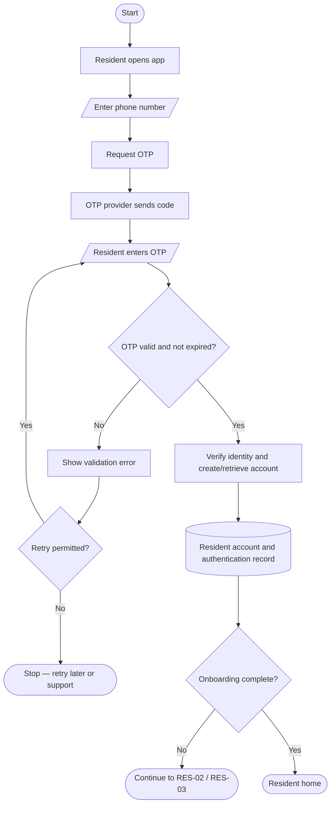

**Alternative and exception paths**

- OTP delivery fails or is delayed: show retry path; exact retry limit, resend cooldown and escalation rule are **OPEN**.
- OTP is wrong or expired: reject authentication without creating an authenticated session.
- Phone number already exists: treat as login/recovery rather than creating a duplicate resident identity; exact recovery policy is **OPEN**.
- Network drops after OTP request: allow resident to retry; provider-side duplicate handling and rate limits are technical design items.
- Resident changes phone number: identity-change workflow is not specified; do not assume an in-app phone change is allowed.

**Records / outputs:** Resident identity, verified phone number, authentication/session record and OTP attempt/audit metadata as needed.

**Rules:** Phone OTP is the resident authentication method in the agreed baseline. Authentication success does not itself verify a residence or grant household access.

**Open decisions:** OTP retry/resend limits; number-change procedure; account deletion/deactivation; whether one phone number may be associated with more than one household account.

**Acceptance scenarios:** Valid OTP authenticates; invalid/expired OTP is rejected; an existing number resolves to the existing account; failed OTP delivery never falsely authenticates.

---

## RES-02 — City and Community Selection

**Purpose:** Let a resident identify the service location and community relevant to their residence.

**Actors:** Resident; Resident App; Backend; Community Master Data.

**Primary flow**

1. Resident opens location/community selection after authentication or when changing selected service location.
2. App obtains available cities from the backend.
3. Resident selects a city.
4. App displays communities configured under that city.
5. Resident selects a community.
6. Backend validates that the community is configured for resident onboarding.
7. Selected city/community are stored against the resident's onboarding context.
8. Resident proceeds to residence registration.

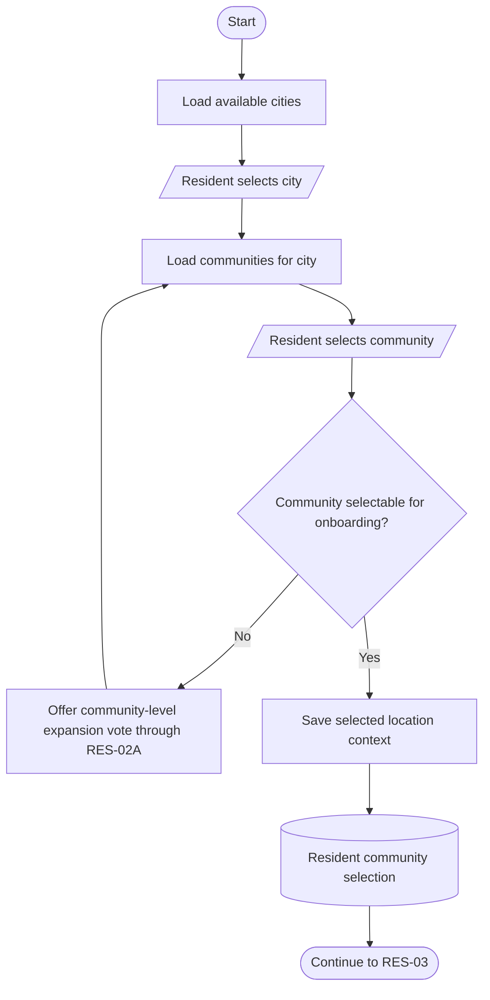

**Alternative and exception paths**

- Selected city is unavailable: offer the city-level expansion vote described in RES-02A; do not permit residence registration for that unavailable city.
- City is available but the required community is not onboarded: offer the community-level expansion vote described in RES-02A; do not permit residence registration against an unconfigured community.
- Resident selects wrong community: allow reselection before residence submission; post-registration correction rules are **OPEN**.
- Community is in demand-led mode: selection may be allowed, but available actions depend on configured operating mode and open demand cycle.
- Community is in continuous mode: availability is determined by live capacity; selection does not guarantee a slot.

**Records / outputs:** Selected city/community reference associated with resident onboarding.

**Open decisions:** Manual search vs postcode/location assistance vs curated list; multiple communities/addresses per resident; post-registration location change. Voting-specific open decisions are recorded under RES-02A.

**Acceptance scenarios:** Only communities belonging to selected city are shown; unavailable cities/communities are routed to the appropriate RES-02A voting path; a vote never grants registration or service access; only configured communities can proceed to residence registration.


### RES-02A — Unavailable City / Community Demand Voting

**Purpose:** Capture resident interest in locations where Nestovin has not yet started operations. This is an expansion-demand insight workflow, not a service registration, paid demand commitment, booking or slot-selection workflow.

**Actors:** Resident; Resident App; Backend; Super Admin.

**Scenario A — City is not currently available**

1. Resident searches for or attempts to select a city that is not currently available in Nestovin.
2. The app presents the option to vote/request Nestovin's entry into that city.
3. Resident submits the city-level vote.
4. Backend records the vote against the resident and the selected city.
5. The same resident may vote only once for the same city.
6. Super Admin can view the accumulated vote count for that city.
7. Super Admin reviews the count and decides whether and when to contact/approach that city.

**Scenario B — City is available, but the community is not onboarded/migrated**

1. Resident selects a city where Nestovin is operating.
2. The required residential community is not present among the onboarded communities available for selection.
3. The app presents the option to vote/request Nestovin's entry into that community.
4. Resident submits the community-level vote.
5. Backend records the vote against the resident and the selected community/location.
6. The same resident may vote only once for the same community.
7. Super Admin can view the accumulated vote count for that community.
8. Super Admin reviews the count and decides whether and when to contact/approach that community.

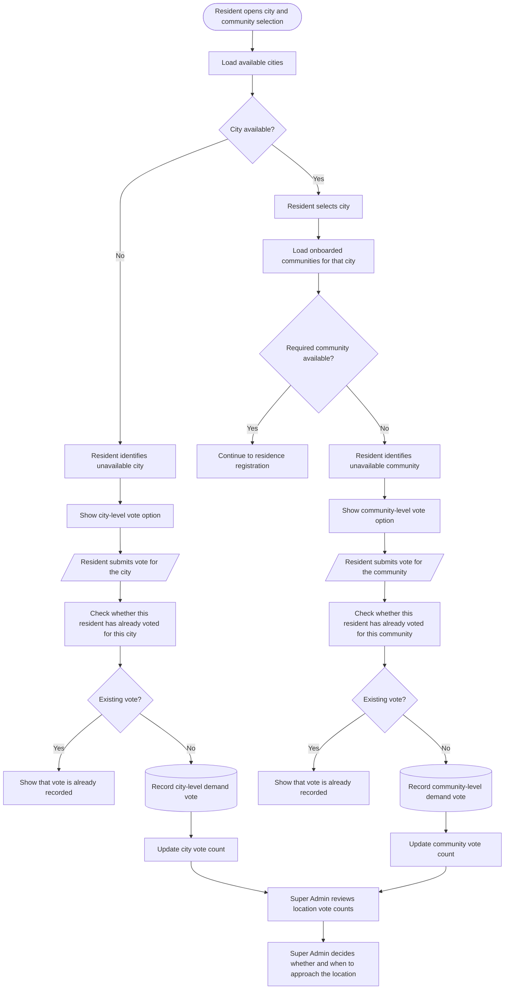

**Business rules — client-confirmed**

- An unavailable city receives a city-level vote; a city that is available but has a community that is not onboarded/migrated receives a community-level vote.
- One resident may vote only once for the same location. City votes and community votes are evaluated at their respective location levels.
- Super Admin can view the accumulated vote counts and decides whether and when to contact/approach a community/location.
- Votes are business insights for expansion planning only. A vote does not register the resident for service, grant access to an unonboarded community, create a demand-cycle commitment, initiate payment, reserve a slot, create a booking or guarantee that Nestovin will launch there.
- No automatic vote threshold or automatic expansion action has been confirmed. The expansion/contact decision remains with Super Admin.

**Records / outputs:** City-level or community-level vote record linked to the resident and the relevant location; aggregated vote counts visible to Super Admin.

**Alternative and exception paths**

- Resident has already voted for the same location: do not create a duplicate vote; show that the vote is already recorded.
- A city is available but the selected community is not onboarded/migrated: offer the community-level vote rather than treating it as a city-level vote.
- A city is unavailable: offer the city-level vote; do not create a community vote for a community that has not been selected/identified.
- A vote is successfully recorded: resident remains outside service registration/booking for that unavailable location until Nestovin separately onboards and activates it.
- Vote submission fails: show a failure state and allow retry without creating duplicate records.

**Open decisions:** How residents identify an unavailable city/community (search, typed entry or another selection method); exact resident identity key used for the one-vote rule; whether a vote can be withdrawn or changed; whether residents receive updates after voting; whether Super Admin can mark a location as contacted, under evaluation or launched; and any reporting/filtering requirements. Do not invent an automatic vote threshold.

**Acceptance scenarios**

- An unavailable city offers a city-level vote.
- An available city with a non-onboarded community offers a community-level vote.
- A resident cannot create more than one vote for the same city or community.
- City and community votes are stored and counted separately.
- Super Admin can review aggregated vote counts.
- A vote does not create a resident registration, demand commitment, payment, booking or slot.
- No automatic expansion/contact action occurs solely because a vote count reaches an assumed threshold.


---

## RES-03 — Residence Registration (Tower, Flat and Documents)

**Purpose:** Associate the resident with a specific residence within a configured community hierarchy.

**Actors:** Resident; Resident App; Backend; Admin/Cluster Admin where review is required.

**Primary flow**

1. Resident selects community and enters residence details.
2. Resident selects tower/building and flat from configured master data.
3. Resident supplies occupancy type and required residence proof/document(s).
4. App validates required fields and file constraints at client level.
5. Backend stores the request and protected document references.
6. System records the association in the configured verification state.
7. An authorised Admin reviews the request if manual verification is required.
8. On approval, resident-to-flat association becomes active for permitted services.
9. The first successfully verified resident associated with that flat is designated the Primary Resident.
10. On rejection, resident is informed of the outcome and any allowed resubmission path.

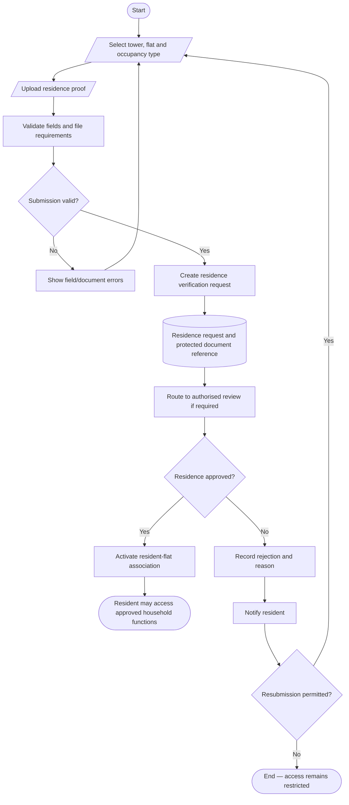

**Alternative and exception paths**

- Tower/flat absent from master data: resident cannot invent a flat record; route to authorised data-maintenance process.
- Document upload fails: allow retry; whether form data is retained as a draft is **OPEN**.
- Duplicate residence request: identify existing resident/flat relationship and avoid conflicting records; exact duplicate policy is **OPEN**.
- Proof is unclear/inconsistent: authorised reviewer decision is required; automated approval is not specified.
- Association is pending: block actions requiring verified household membership.

**Records / outputs:** Residence request, community/tower/flat, occupancy type, secure document reference and reviewer decision if applicable.

**Rules — confirmed:** Residential hierarchy is maintained in Admin master data. Documents require access controls. The first successfully verified resident associated with a flat is designated the Primary Resident. Residence verification and family-member approval are separate workflows.

**Open decisions:** Whether all submissions require manual approval; accepted document types; resubmission count; duplicate owner/tenant handling; approver; permitted changes after approval.

**Acceptance scenarios:** Resident selects existing master records; proof is private; pending association does not grant verified privileges; first successfully verified resident for a flat becomes Primary Resident; reviewer decisions are auditable where review applies.

---

## RES-04 — Family Member Management and Approval

**Purpose:** Allow a Primary Resident to request access for family members while ensuring access is granted only after manual verification and explicit approval.

**Actors:** Primary Resident; Family Member; Resident App; Cluster Admin/authorised reviewer; Backend.

**Primary flow**

1. Primary Resident opens family management.
2. Primary Resident submits the family member's phone number, required details and supporting document/proof.
3. Backend creates a pending family-member access request.
4. Request is routed to the authorised reviewer for the relevant community/cluster.
5. Nestovin/Cluster Admin performs physical verification outside the application.
6. Reviewer records verification outcome, decision, reviewer identity and timestamp.
7. If approved, family member access is enabled according to permitted household relationship.
8. If rejected, access is not granted and Primary Resident is notified.

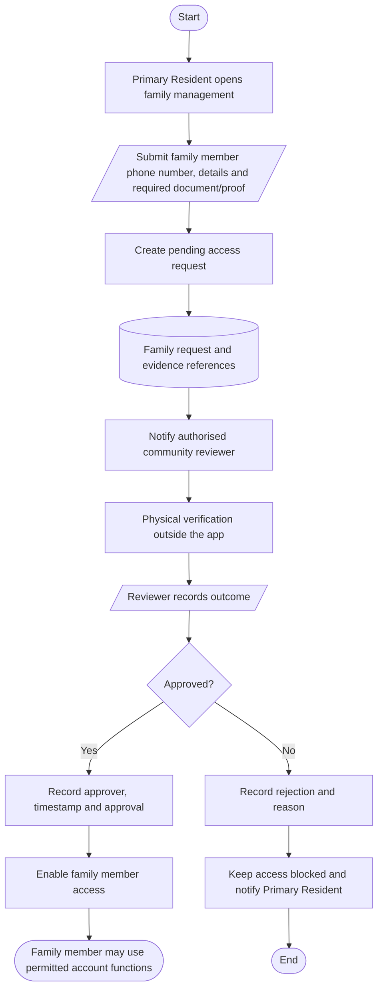

**Alternative and exception paths:** Duplicate request handling is **OPEN**; incomplete physical verification leaves the request pending; reviewer outside assigned cluster cannot decide; rejection does not grant access; approved-member removal/revocation is **OPEN**.

**Records / outputs:** Family request, evidence references, physical-verification outcome, reviewer, decision timestamp and access status.

**Rules — confirmed:** Request alone does not grant access; physical verification occurs outside the app; platform records outcome/history; approval is required before access.

**Open decisions:** Required fields/proof; allowed relationships; request cancellation; revocation; own phone authentication; Primary Resident vs family-member permissions.

**Acceptance scenarios:** Pending member remains blocked; only authorised reviewer can decide; approval records reviewer/time; rejection grants no access.

---

## RES-05 — Service Catalogue

**Purpose:** Present services Nestovin currently offers in the resident's selected community.

**Actors:** Resident; Resident App; Backend; Service/Task Configuration.

**Primary flow**

1. Resident opens the service catalogue.
2. App requests services available for the resident's community and operating context.
3. Backend returns only services configured as available for that context.
4. App displays Maid, Cook and Caretaker and configured descriptions/tasks.
5. Resident selects a service to inspect applicable tasks, plan choices or demand/booking actions.

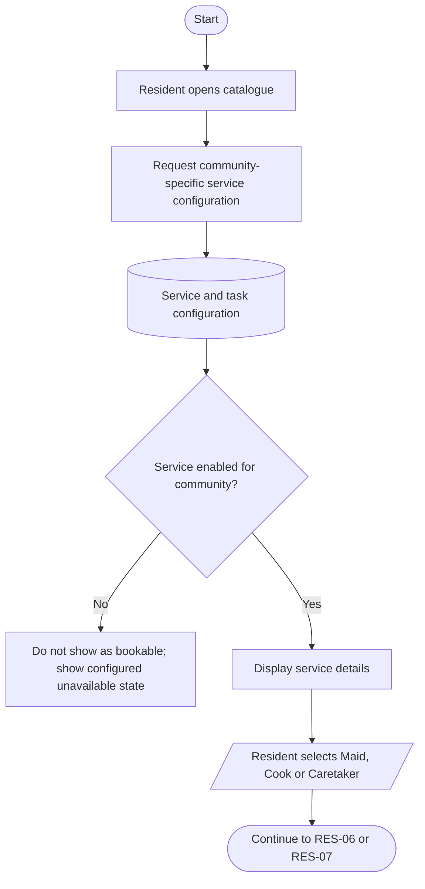

**Alternative and exception paths:** Service not enabled for community is not bookable; missing plan blocks purchase; demand-led mode leads to an open demand cycle; continuous mode leads to live capacity availability.

**Records / outputs:** Catalogue context and selected service reference; viewing alone creates no purchase/request.

**Rules — confirmed:** V1 services are Maid, Cook and Caretaker only; definitions are configured by authorised Admin users.

**Open decisions:** Task taxonomy/descriptions; visibility during demand windows; temporary service disablement while subscriptions remain active.

**Acceptance scenarios:** Only approved V1 services appear; availability is community-aware; selection alone does not create a paid request/booking.

---

## RES-06 — Subscription Plans and Pricing

**Purpose:** Display valid plan/price options for a service, residence type and community, and let a resident select a plan for a demand request or continuous booking.

**Actors:** Resident; Resident App; Backend; authorised Pricing Admin; Plan/Entitlement Configuration.

**Primary flow**

1. Resident selects a service or service combination offered in the catalogue.
2. Backend resolves available plans using community, residence attributes, service/task configuration and current pricing validity.
3. App displays eligible plans, price, duration/start rules and configured entitlements.
4. Resident reviews and selects a plan.
5. App shows the selected plan summary and applicable payment path based on community operating mode.
6. Resident proceeds to demand registration or continuous booking.

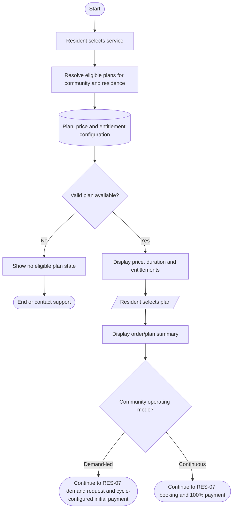

**Alternative and exception paths:** Missing/expired price prevents purchase; no eligible plan is shown; plan changed after selection—quote lock/refresh behaviour is **OPEN**; upgrade/downgrade/add-on against an active subscription is **OPEN**.

**Records / outputs:** Selected plan reference, price/version used for quote/order, duration and entitlements.

**Rules — confirmed:** Plans/pricing are Admin-configured; pricing may vary by community/residence; example PDF is not final pricing; self-service pause is excluded; demand-led and continuous modes have different payment journeys.

**Open decisions:** Final tiers/prices/duration/entitlements/frequency; service bundles; quote validity; proration; upgrade/downgrade; changes to committed requests.

**Acceptance scenarios:** Only valid plans returned; displayed price/entitlements match configured purchase version; no missing price defaults to zero or invented value.

---

## RES-07 — Demand Request, Booking and Scheduling

**Purpose:** Support the two distinct operating modes configured for a residential community: demand-led collection and continuous capacity-based booking. These are operational modes, not fixed product phases. Demand cycles may be opened repeatedly.

**Actors:** Resident; Resident App; Backend; Super Admin/authorised Admin; Operations; Workforce/Slot Management; Employee.

### RES-07A — Operating-mode selection and community context

The operating mode is configured for the relevant community by Super Admin/authorised users with the required permissions. Mode-specific rules must not be hard-coded globally. A community's current operating mode determines which resident journey is available.

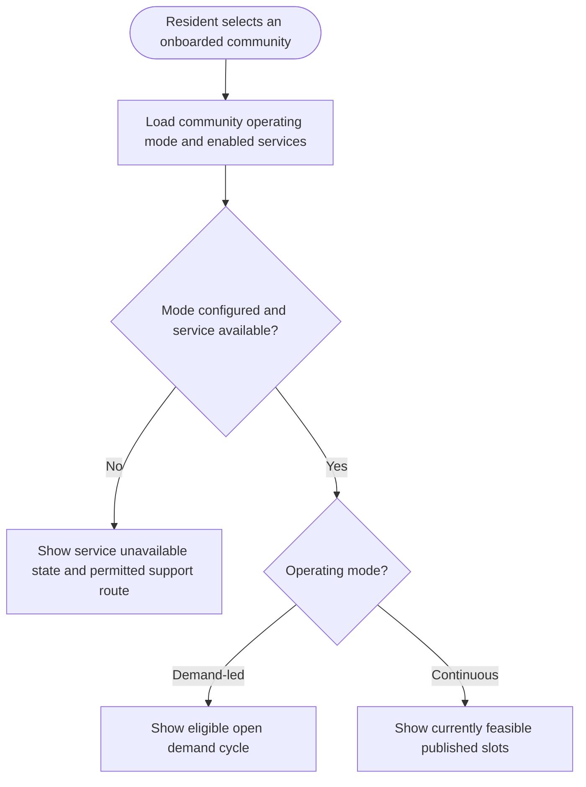

### RES-07B — Demand-led request and cycle participation

**Confirmed behaviour**

- An authorised Super Admin opens/configures a demand collection cycle for the applicable community.
- The cycle has a configured collection window/buffer; its duration is not a hard-coded number of days.
- Before publishing the cycle, Super Admin configures the initial payment percentage for that cycle.
- The initial percentage is validated and locked when the cycle is published/opened. It cannot be changed for that live cycle.
- Future cycles may use a different percentage. Changing configuration for a future cycle must not rewrite an existing cycle, commitment, payment or booking snapshot.
- Residents submit demand information for the enabled service/plan, including configured duration/hours, frequency and preferred time/slot information. Do not introduce free-form preferred-days input where the approved flow uses fixed time-slot preferences.
- The initial payment is a paid commitment signal; it is not a confirmed service booking or service activation.
- Verified demand is aggregated for workforce/capacity planning.
- Admin/Operations may create slots manually or review system-generated slot recommendations. Admin approval is required before publishing slots.
- Additional demand cycles may be opened when operations require them. There is no fixed cycle count and a new cycle must not overwrite previous cycle records.
- A separate waitlist is not implied by this workflow.

**Primary flow**

1. Super Admin configures the community, collection window, eligible services/plans, required request fields, pricing reference and initial payment percentage.
2. Backend validates the configuration and blocks publication if required values are missing or invalid.
3. Super Admin publishes/opens the cycle. The configured initial percentage is locked to that cycle.
4. Resident selects the eligible service and plan and submits the configured demand details.
5. Backend validates resident/residence eligibility, community, cycle, service, plan and request fields.
6. Backend calculates the initial commitment amount using the percentage locked to the cycle and the applicable price snapshot.
7. Backend creates the payment order.
8. Resident completes payment through the configured provider.
9. Backend verifies provider status, amount, currency, order and business references.
10. Only a verified payment creates a paid demand commitment.
11. The paid commitment is included in the cycle's demand aggregation.
12. Resident can view the request, paid amount and current commitment status.
13. Operations reviews aggregated demand and workforce/capacity readiness before the slot-release stage.

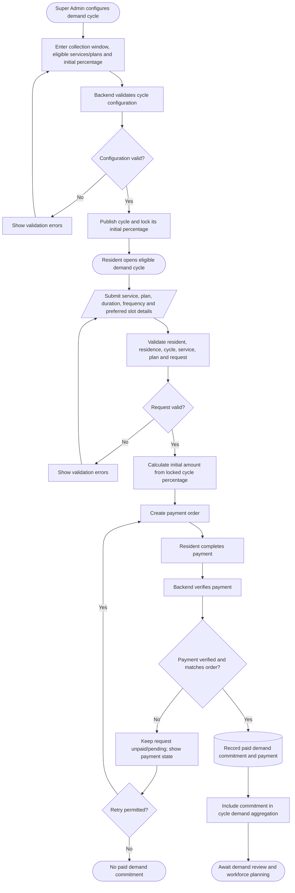

### RES-07C — Demand review, slot publication and remaining balance

1. Operations reviews verified demand totals by service, duration/hours, frequency and permitted slot preferences.
2. HR/Operations reviews workforce readiness and feasible capacity.
3. Admin creates slots manually or reviews system-generated slot recommendations.
4. Admin approves and publishes the applicable slot set, commencement date and remaining-balance deadline.
5. Resident is notified of the approved slot/start information and outstanding balance.
6. Resident pays the remaining balance by the configured deadline and before service begins.
7. Backend verifies the payment and reconciles it against the commitment and booking.
8. The booking/subscription is activated only when the full required amount is verified and operational start conditions are satisfied.
9. If the balance is unpaid or the deadline is changed/extended, the configured and approved expiry/extension/refund policy is applied. Do not infer a fixed forfeiture or refund outcome.

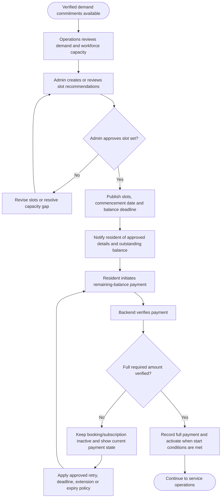

**Alternative and exception paths**

- No open demand cycle: resident cannot submit a paid demand request for that cycle.
- Invalid or unpublished cycle configuration: cycle cannot be opened.
- Initial payment fails: request is not counted as a paid commitment.
- Provider success is delayed or callback is duplicated: backend verification/reconciliation is authoritative and idempotent.
- Cycle is extended or closed: preserve cycle history and apply the configured rules to requests/payment attempts already in progress.
- Demand is insufficient or workforce capacity is unavailable: Operations reviews the gap; the system must not imply service commencement or create unsupported slots.
- Resident does not pay the remaining balance: service remains inactive; exact expiry, extension, refund or forfeiture treatment follows an approved policy and is not hard-coded here.
- Commencement date or slot changes after publication: notify affected residents; change authority, resident consent and revised deadlines remain subject to the approved policy.
- A resident participates in a later cycle: retain previous cycle/request/payment history; do not overwrite earlier records.

**Records / outputs:** Demand cycle and its immutable configuration snapshot; resident demand request; service/plan/price snapshot; request parameters; initial payment percentage and amount; payment order/transaction; paid commitment; demand aggregates; workforce/capacity review; slot set and approval; commencement date; remaining balance; deadline/extension/expiry decision; booking/subscription activation record.

**Rules — confirmed**

- Initial payment percentage is configured by Super Admin per demand cycle and locked at publication.
- The initial percentage is not a permanent code constant.
- Future configuration changes affect future cycles only.
- Paid demand commitment is not equivalent to a confirmed booking or activated service.
- Full required payment must be verified before demand-led service activation.
- Slot publication requires Admin approval.
- Demand cycles are repeatable; there is no fixed cycle count.

**Open decisions**

- Final allowed percentage range and exact numeric validation. PRD recommends whole-number percentages from 1–99; final business approval is still required.
- Collection window/buffer values, close/extension rules and concurrent-cycle policy.
- Exact request edit/amendment and duplicate-request rules.
- Calculation basis for the initial percentage (discounts, fees, taxes and rounding).
- Remaining-balance deadline, reminder schedule, expiry, extension, refund and forfeiture treatment.
- Handling of payment started before deadline but settled after it.
- Capacity reservation between slot publication and full balance payment.
- Commencement-date or slot changes after publication/payment.
- Resident alternatives when demand/capacity is insufficient.
- Whether the same resident can submit another request for the same service while an earlier request remains outstanding.

**Acceptance scenarios**

- Cycle cannot be published without a valid initial percentage.
- Published cycle retains its percentage even if future-cycle configuration changes.
- Payment amount is calculated by the backend from the cycle's locked percentage and applicable price snapshot.
- Failed/unverified payment does not create a paid commitment.
- Duplicate callbacks do not duplicate payment or commitment records.
- Demand aggregation includes only verified paid commitments.
- Slots cannot be published without required Admin approval.
- A paid commitment alone does not activate a service.
- Service activation is blocked until the full required amount is verified and start conditions are met.
- Expiry/refund/forfeiture behaviour follows an approved policy rather than an assumed fixed rule.

### RES-07D — Continuous booking mode

**Confirmed behaviour**

- Availability is derived from current workforce readiness, approved leave, existing assignments, configured capacity and Admin-published slot rules.
- Resident selects from currently feasible published slots; the system must not promise unsupported capacity.
- Backend revalidates slot/capacity before confirming the booking.
- Resident pays 100% before booking confirmation/service activation.
- Operations retains the authorised allocation review/override process.

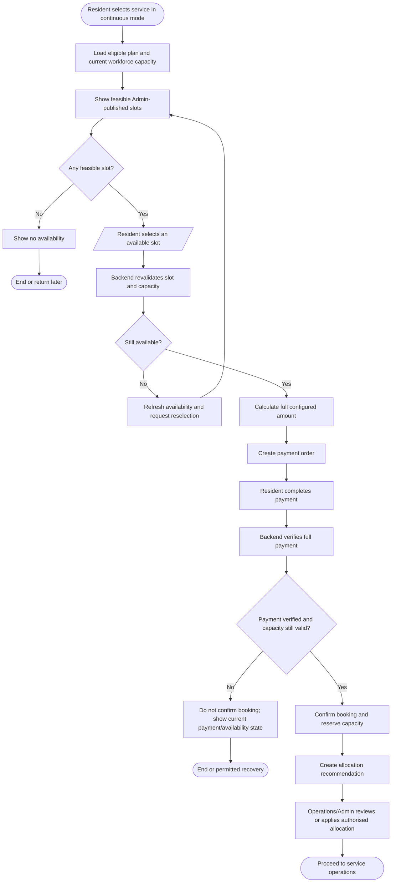

**Open decisions:** Booking horizon, same-day cut-off, earliest feasible slot, slot duration/capacity, resident choice among multiple slots, cancellation/rescheduling and payment recovery when payment succeeds but capacity is no longer available.

**Acceptance scenarios:** Only feasible published slots are shown; stale capacity is revalidated; full payment is verified before confirmation; failed payment does not confirm booking; capacity is not double-booked.

---
## RES-08 — Payment Integration (Razorpay)

**Purpose:** Collect resident payments and maintain backend-verified payment records for demand-led commitments, demand-led remaining balances and continuous-mode bookings.

**Actors:** Resident; Resident App; Backend Payment capability; Razorpay; Demand/Subscription/Booking workflows.

**Payment cases**

| Case | Amount | When |
|---|---|---|
| Demand-led initial commitment | Super Admin-configured percentage for the published cycle | At demand submission; percentage is locked to that cycle |
| Demand-led remaining balance | Remaining amount after the initial commitment | After approved slots/commencement details are published; by the configured deadline and before service begins |
| Continuous-mode booking | 100% of applicable amount | At booking, before confirmation/service activation |

**Primary flow**

1. An owning business workflow requests a payment order with a defined purpose, amount, currency and internal reference.
2. Backend calculates/validates the amount using the applicable plan/price and immutable cycle/booking snapshot.
3. Backend creates a payment order/attempt using Razorpay.
4. Resident completes provider checkout.
5. Razorpay returns provider response/callback/webhook information.
6. Backend verifies the payment using the required server-side method.
7. Backend validates provider order/reference, amount, currency, status and business purpose.
8. Backend records the verified result and makes it available to the owning workflow.
9. The owning workflow changes state only after the required payment state is verified.

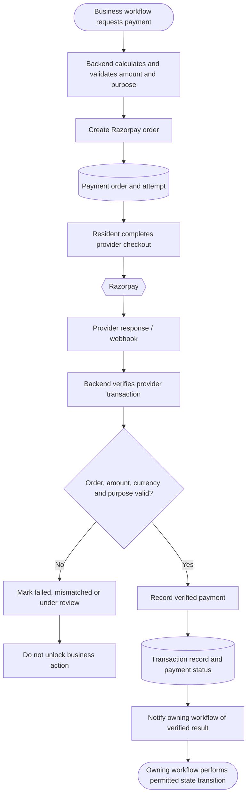

**Alternative and exception paths**

- Payment cancelled or failed: record the attempt outcome; do not activate demand, booking or subscription.
- Provider reports success but the app does not receive success: backend verification/reconciliation is authoritative; app retrieves current state.
- Duplicate webhook/callback: processing must be idempotent; the same provider transaction must not be credited twice.
- Amount/currency/order/purpose mismatch: do not mark the business payment successful; route to exception/reconciliation.
- Initial demand payment: only the cycle-configured percentage is collected; do not assume a fixed percentage.
- Remaining demand balance: calculate from the original price/payment snapshot and verified initial payment; do not assume a fixed balance percentage.
- Payment succeeds after a demand commitment has expired or its cycle has closed: handling follows the approved expiry/reconciliation policy; do not silently activate service.
- Refunds: refund eligibility, no-refund conditions, approval authority and processing rules remain subject to approved business/legal policy. A support ticket does not itself execute a refund.

**Records / outputs:** Payment order, payment attempt, provider reference, amount, currency, verified status, timestamps, business-purpose reference, cycle/booking price snapshot, reconciliation state and refund record where applicable.

**Rules — confirmed**

- Backend verification is required before payment is treated as successful.
- Frontend redirect/success screen is not proof of payment.
- Payment events must be idempotent.
- Payment records must be auditable.
- Razorpay is the named payment gateway.
- Existing commitment/booking financial terms must not be silently recalculated when future configuration changes.

**Open decisions:** Supported payment methods; timeout/expiry; retry counts; payment-in-progress handling at cycle/deadline closure; refund eligibility and approval matrix; reconciliation schedule; partial/late/duplicate payments; transaction-fee treatment; accounting treatment of retained or refunded amounts.

**Acceptance scenarios**

- Successful provider payment is verified by backend.
- Failed/cancelled/duplicate/mismatched payment does not activate service.
- Demand-led initial payment uses the cycle's locked percentage.
- Remaining balance is derived from the same applicable financial snapshot.
- Continuous booking requires verified 100% payment before confirmation.
- Duplicate callbacks do not duplicate financial or business records.
- Refunds cannot be initiated solely by opening or resolving a support ticket.

---
## RES-09 — Booking and Service Status

**Purpose:** Show the current state of a resident's demand request, booking, subscription and service delivery without conflating these distinct records.

**Actors:** Resident; Resident App; Backend; Operations; Employee; Payment capability.

**Primary flow**

1. Resident opens the relevant request, booking or subscription record.
2. App retrieves status from backend.
3. Backend returns applicable business status and permitted detail.
4. App displays status with the next action, if any.
5. Changes made by Admin/Operations or employee attendance/service events are reflected on refresh or through notification.

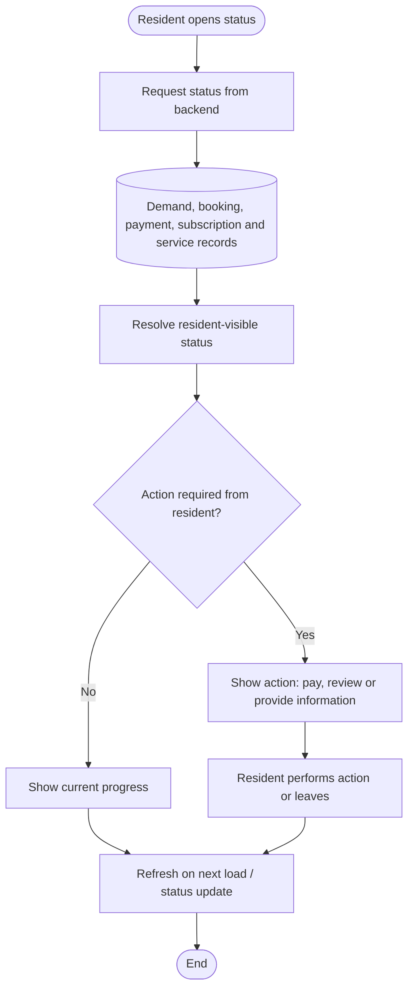

**Important conceptual separation**

- **Demand request:** resident's request submitted during a demand cycle; it becomes a paid demand commitment only after the cycle-configured initial payment is verified.
- **Booking:** confirmed service slot/appointment or scheduled service allocation.
- **Subscription:** purchased service plan and effective period/entitlements.
- **Payment:** transaction and balance state.
- **Service occurrence:** a specific scheduled service visit/occurrence and its attendance/completion record.

These may be linked, but one status must not be used as a substitute for all others.

**Open decisions:** Exact status labels and resident-visible wording; employee details visible to resident; cancellation/rescheduling; missed/changed date presentation; real-time vs refreshed/push-driven status updates.

**Acceptance scenarios:** Resident sees only permitted household records; demand is not shown as confirmed service before required steps; continuous booking reflects full-payment verification; status matches backend record.

---

## RES-10 — Service History

**Purpose:** Present past and current service records relevant to the resident's household.

**Actors:** Resident; Resident App; Backend; Service Records.

**Primary flow**

1. Resident opens service history.
2. App requests permitted household records.
3. Backend filters records according to resident identity and approved household access.
4. App presents service date, service type and allowed outcome/details.
5. Resident opens a record to view permitted detail.

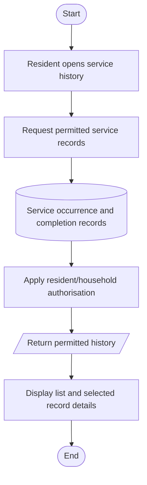

**Alternative and exception paths:** No history: show empty state. Family member with restricted access sees only permitted records. Corrected attendance/service record shows authoritative current state; visibility of historical revisions is **OPEN**.

**Records / outputs:** Resident-visible history derived from service occurrence, attendance and completion records.

**Open decisions:** Retention period; filters/search; employee name/task notes/proof/rating visibility; whether cancelled/no-show occurrences appear and how they are labelled.

**Acceptance scenarios:** History is sourced from service events; household access restrictions are applied; empty history is handled clearly.

---

## RES-11 — Feedback and Ratings

**Purpose:** Allow a resident to submit feedback/rating for an eligible service experience.

**Actors:** Resident; Resident App; Backend; Support/Operations Admin.

**Primary flow**

1. Resident opens an eligible completed service occurrence.
2. App displays feedback/rating option where enabled.
3. Resident submits configured rating and feedback fields.
4. Backend validates resident authorisation and duplicate-submission rules.
5. Feedback is stored and made available to authorised Admin users.
6. Resident receives submission confirmation.

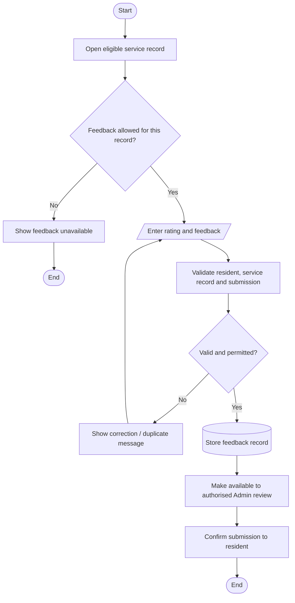

**Open decisions:** Rating scale; mandatory/optional comment; edit window; moderation/removal; anonymous vs named internal presentation; who can view/respond; whether low ratings create tickets.

**Acceptance scenarios:** Only authorised resident can review eligible service; duplicate submissions follow a defined rule; feedback is visible only to permitted users.

---

## RES-12 — Support Tickets

**Purpose:** Let a resident raise and track support relating to their account, community, booking, payment or service.

**Actors:** Resident; Resident App; Backend; Support Admin.

**Primary flow**

1. Resident opens Support.
2. Resident selects a permitted category and provides description/supporting details.
3. Resident submits ticket.
4. Backend creates ticket and reference number.
5. Ticket is routed to Support queue.
6. Support Admin categorises/assigns ticket and records updates.
7. Resident views status and permitted updates.
8. Support Admin records resolution; ticket reaches resolved/closed state under approved rule.

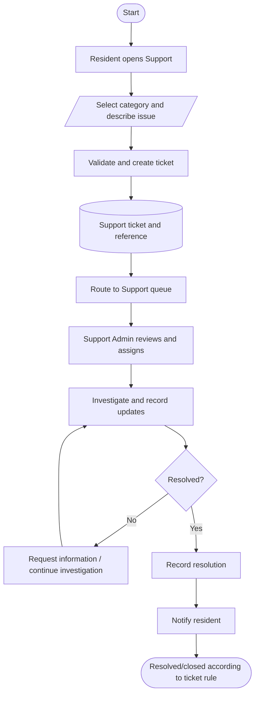

**Alternative and exception paths:** Incomplete submission handling is **OPEN**. Refund-related ticket routes to authorised Support/Finance review; opening a ticket does not issue a refund. Mis-categorised ticket may be recategorised/transferred within permission. Reopen conditions are **OPEN**.

**Records / outputs:** Ticket ID, resident, category, description, linked booking/payment/service references, assignment, update history, status, resolution and timestamps.

**Rules — confirmed:** Ticket categorisation, assignment, tracking, updates/resolution and basic escalation visibility are in Admin V1; refund exceptions require manual authorised review.

**Open decisions:** Categories, priority/SLA, routing, attachments, resident reply thread, reopening, escalation thresholds and closure confirmation.

**Acceptance scenarios:** Submission creates traceable reference; Support acts within permissions; refund ticket does not auto-refund; resident sees permitted status/updates.

---

## RES-13 — Notifications

**Purpose:** Deliver essential transactional and operational notifications to residents.

**Actors:** Resident; Backend; Notification service; push/SMS/email providers; authorised Admin sender where manually initiated.

**Primary flow**

1. Business event occurs (OTP, family decision, demand/payment status, slot/commencement update, assignment/service update or support update).
2. Originating module records the business state change.
3. Notification rules resolve recipient, channel and message template.
4. Notification service queues/sends through configured provider.
5. Delivery result is recorded where provider exposes it.
6. Resident opens app and retrieves current authoritative business status.

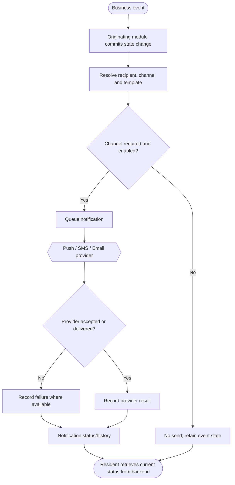

**Manual Admin notification:** Client wants authorised Admin users to issue reminders, including remaining-balance payment reminders. This is permission-controlled and must not alter payment/subscription state.

**Rules — confirmed**

- Push is intended for app notifications; SMS for OTP and selected critical events; email for selected account/support communication.
- Client wants in-app reminders/pop-ups and Admin-triggered notification for the remaining-balance reminder.
- Payment completion is established only by verified payment records, never by a reminder send or resident tap.

**Open decisions:** Final provider; event/channel matrix; templates/languages; quiet hours; retries; broadcast vs targeted notifications; manual-send permission; preferences for non-critical messages; WhatsApp decision.

**Acceptance scenarios:** Critical event notifies correct recipient; failed push does not roll back business operation; manual reminder is permission-checked/audited; payment reminder does not mark payment paid; app shows current backend state.

---

## RES-14 — Profile and Household Management

**Purpose:** Let a resident view and manage permitted personal and household information.

**Actors:** Resident; Resident App; Backend; Admin where verification/review is required.

**Primary flow**

1. Resident opens profile/household management.
2. App retrieves resident details and approved household associations.
3. Resident views permitted details.
4. Resident edits fields enabled for self-service.
5. Backend validates and saves permitted changes.
6. Changes requiring verification/Admin approval are submitted as requests rather than directly overwriting verified master data.
7. V1 maintains one active residence context per resident account. A change of residence is handled through the controlled review process rather than by silently switching the active residence.

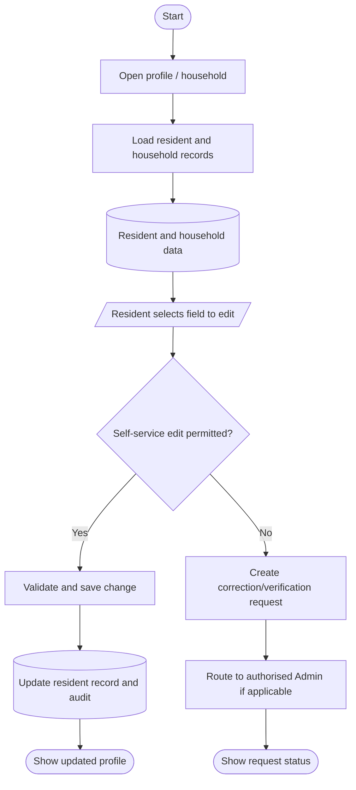

**Rules — confirmed:** V1 uses one active residence context per resident account. Residence changes must follow a controlled review process; verified residence data cannot be silently overwritten.

**Open decisions:** Editable fields; name/phone change; address/flat transfer steps and required proof; household removal; family role model; changes requiring documents/review; resident account deactivation.

**Acceptance scenarios:** Resident sees own/approved household data; one active residence context is enforced; verified residence data cannot be silently changed; identity/residence/access changes are auditable.

---

# 2. Employee App workflows

## Employee App — capability index

| ID | Capability | Main actors | Status |
|---|---|---|---|
| EMP-01 | Applicant Registration | Applicant, HR, Backend | Confirmed source; ATS excluded |
| EMP-02 | Employee Login (ID + Password) | Employee, HR, Backend | Confirmed source |
| EMP-03 | Employee Profile and Qualifications | Employee, HR, Backend | Confirmed source |
| EMP-04 | Training Videos and Completion | Employee, Backend, HR/Operations | Confirmed source; simple training only |
| EMP-05 | Work Schedule and Assignments | Employee, Operations, Backend | Confirmed source; routine assignment acceptance not required |
| EMP-06 | Attendance Verification | Employee, Resident/verifier, Backend | Confirmed source |
| EMP-07 | Service Completion | Employee, Resident where required, Backend | Confirmed source |
| EMP-08 | Additional Work / Overtime | Employee, Operations/Admin, Backend | Client-confirmed offer + accept/reject + Admin confirmation |
| EMP-09 | Availability and Leave | Employee, HR/Operations, Backend | Client-confirmed approval workflow |
| EMP-10 | Employee Notifications | Employee, Backend, provider | Confirmed source |

---

## EMP-01 — Applicant Registration

**Purpose:** Capture an individual's interest in working with Nestovin. This is an application-interest intake, not a complete recruitment ATS.

**Actors:** Applicant; Employee App; Backend; HR/authorised Admin.

**Primary flow**

1. Applicant opens the registration/interest form.
2. Applicant enters requested personal/contact details and available information.
3. App validates required fields.
4. Backend stores an applicant-interest record.
5. HR/authorised Admin reviews submitted information outside or through the permitted Admin workflow.
6. If selected to proceed, HR handles verification/readiness and later enables an employee account.

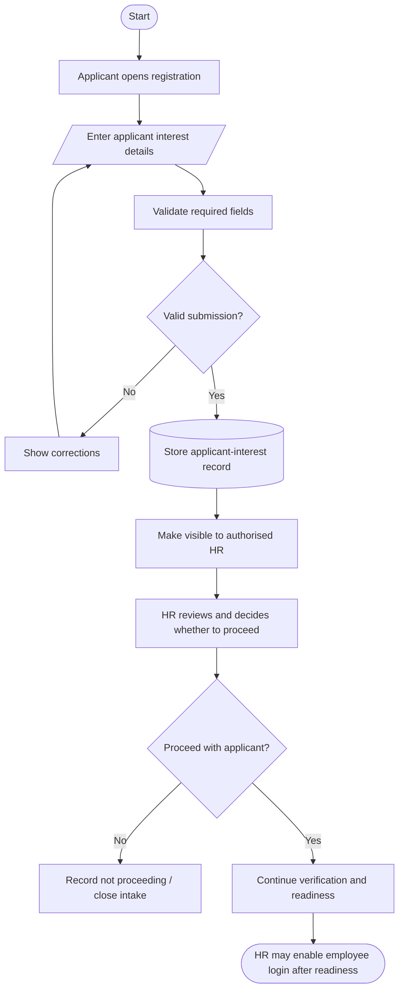

**Out of V1:** Full ATS stages, interview scheduling, automated background-check integrations, recruitment campaign management and advanced candidate analytics.

**Open decisions:** Required fields; document uploads; status labels; applicant rejection/retention policy; whether applicant can track status in app.

**Acceptance scenarios:** Applicant interest can be submitted/stored; duplicate submissions follow a defined rule; applicant is not automatically granted employee login by submitting the form.

---

## EMP-02 — Employee Login (Employee ID and Password)

**Purpose:** Authenticate an employee after HR has verified and enabled the employee account.

**Actors:** Employee; Employee App; Backend/authentication service; HR.

**Primary flow**

1. HR verifies employee readiness.
2. HR enables an employee account and Employee ID credentials through the authorised process.
3. Employee opens the app and enters Employee ID/password.
4. Backend verifies credentials and account status.
5. On success, employee session is created and permitted work information is loaded.

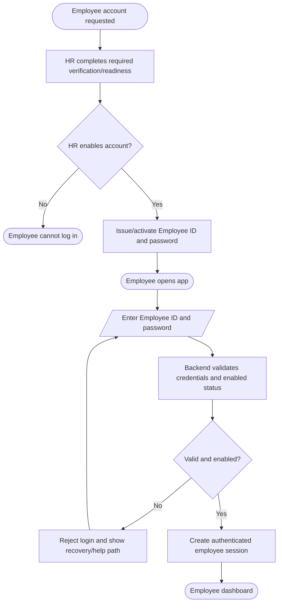

**Rules — confirmed:** Employee authentication uses Employee ID/password; HR enables access after verification/readiness.

**Open decisions:** Password set/reset; lockout; employee deactivation; lost Employee ID; multi-device sessions; mandatory first-login password change.

**Acceptance scenarios:** Applicant cannot log in before enablement; valid enabled employee can log in; disabled/unverified employee is rejected.

---

## EMP-03 — Employee Profile and Qualifications

**Purpose:** Maintain employee profile information and service/task qualifications used for work eligibility.

**Actors:** Employee; Employee App; HR/authorised Admin; Backend.

**Primary flow**

1. Employee opens profile.
2. App displays permitted details and recorded qualifications.
3. Employee submits permitted profile updates or qualification information.
4. Backend validates and records submission.
5. Fields requiring review are routed to HR/authorised Admin.
6. HR reviews and updates verification/qualification/readiness status.
7. Eligibility information is available to Operations/allocation within authorised access.

```mermaid
flowchart TD
    A([Start]) --> B[Employee opens profile]
    B --> C[(Employee profile and qualification records)]
    C --> D[/View or submit permitted update/]
    D --> E[Validate and store submission]
    E --> F{Admin review required?}
    F -- No --> G[Apply permitted self-service update]
    F -- Yes --> H[Route to HR/authorised Admin]
    H --> I[Review evidence and update verification/qualification]
    I --> J[(Employee readiness and qualification record)]
    G --> K([Profile displayed])
    J --> K
```

**Open decisions:** Profile fields; qualifications/documents per service/task; expiry tracking; re-verification frequency; self-edit permissions.

**Acceptance scenarios:** Employee views own profile; HR updates verification/qualification within permissions; allocation uses current approved readiness/qualification.

---

## EMP-04 — Training Videos and Completion

**Purpose:** Present assigned training videos and record employee viewing/completion. This is a simple training capability, not a full LMS.

**Actors:** Employee; Employee App; Backend; HR/Operations.

**Primary flow**

1. Employee opens training.
2. App retrieves assigned/available videos.
3. Employee selects and views a video.
4. App records completion when the configured completion condition is met.
5. Backend persists completion record.
6. Authorised Admin can review completion where required for readiness.

```mermaid
flowchart TD
    A([Start]) --> B[Employee opens training]
    B --> C[(Training video and assignment configuration)]
    C --> D[/Employee selects video/]
    D --> E[Play video]
    E --> F{Completion condition met?}
    F -- No --> G[Keep incomplete / allow resume]
    G --> E
    F -- Yes --> H[Record completion]
    H --> I[(Employee training completion record)]
    I --> J([Show completed status])
```

**Out of V1:** Full LMS, quiz/exam engine, certificate generation, training-content administration suite, learning paths and advanced training analytics.

**Open decisions:** Completion condition (watch duration, explicit confirmation or both); resume behaviour; mandatory/optional videos; whether completion blocks deployment readiness.

**Acceptance scenarios:** Video can be viewed; completion persists; reopening shows recorded status.

---

## EMP-05 — Work Schedule and Assignments

**Purpose:** Present the employee's assigned work schedule and service assignments.

**Actors:** Employee; Employee App; Operations/Cluster Admin; Backend; Work Allocation.

**Primary flow**

1. Operations creates or confirms assignment through the authorised allocation workflow.
2. Backend validates employee eligibility and authorised community/cluster scope.
3. Assignment is stored and made visible to assigned employee.
4. Employee opens schedule and views date, time, community/residence reference and permitted service/task details.
5. Employee follows assignment and uses EMP-06/EMP-07 for attendance/completion.

```mermaid
flowchart TD
    A([Operations creates/reviews assignment]) --> B[Validate employee eligibility and scope]
    B --> C{Eligible and permitted?}
    C -- No --> D[Reject recommendation / require another employee]
    D --> A
    C -- Yes --> E[(Store assignment and schedule)]
    E --> F[Notify assigned employee]
    F --> G[Employee opens work schedule]
    G --> H[Display assigned work]
    H --> I([Continue to attendance and service])
```

**Rules — confirmed**

- Routine assignment does not require employee accept/reject.
- Employee assignment is within authorised cluster(s) in V1.
- Manual backup/replacement assignment is available to authorised Operations/Cluster Admin.
- Cross-cluster workforce sharing is excluded.

**Alternative and exception paths:** Employee becomes unavailable after assignment → replacement workflow; exact notification/acknowledgement is **OPEN**. Assignment conflicts with approved leave/another assignment must be detected; priority/override rule is **OPEN**. Offline schedule/cache behaviour is **OPEN**.

**Records / outputs:** Assignment, employee, service/task, community/residence, date/time, assignment status, assigning user and audit event.

**Acceptance scenarios:** Employee sees own assignments; ineligible/out-of-scope employee cannot be assigned; routine assignment needs no acceptance; replacement is recorded and visible to correct employee.

---

## EMP-06 — Attendance Verification (OTP / QR and Location Event)

**Purpose:** Record attendance at the service location using configured OTP or QR verification, with location evidence at the verification event.

**Actors:** Employee; Resident or service-side verifier; Employee App/Resident App as applicable; Backend.

**Primary flow**

1. Employee opens scheduled service assignment.
2. Employee initiates attendance verification at the relevant service location.
3. System uses configured OTP or QR method.
4. Location evidence is captured at verification, subject to device permission and configured validation.
5. Backend validates assignment, verification token/QR, timing and location event according to approved rules.
6. If valid, attendance event is recorded.
7. Employee and authorised Admin can view attendance status.

```mermaid
flowchart TD
    A([Employee opens assigned service]) --> B[Initiate attendance verification]
    B --> C{Configured method?}
    C -- OTP --> D[/Enter or exchange OTP/]
    C -- QR --> E[/Scan or present QR/]
    D --> F[Capture location evidence for event]
    E --> F
    F --> G[Submit verification to backend]
    G --> H[Validate assignment, token, time and location rules]
    H --> I{Verification valid?}
    I -- No --> J[Reject event and show reason]
    J --> K([Retry or contact Operations])
    I -- Yes --> L[(Persist attendance event and evidence metadata)]
    L --> M([Attendance recorded])
```

**Rules — confirmed**

- Attendance supports OTP or QR as configured.
- Location evidence is captured at verification events only.
- Continuous employee live tracking is not included.
- If offline attendance queueing is enabled, server remains authoritative when event synchronises.

**Alternative and exception paths:** Offline queue/sync may be used if enabled; final validation remains server-side. Expired/wrong-assignment OTP/QR is rejected. Location permission/failure fallback is **OPEN**. Wrong location/time routes to correction/exception rather than silently accepting attendance.

**Records / outputs:** Attendance event, employee, assignment/service occurrence, method, timestamp, location evidence metadata and validation result.

**Acceptance scenarios:** Valid OTP/QR records attendance; invalid token rejected; no continuous tracking; offline events are server-validated if queueing is implemented.

---

## EMP-07 — Service Completion

**Purpose:** Let an employee record completion of an assigned service occurrence and capture resident confirmation where required.

**Actors:** Employee; Employee App; Resident; Backend; Operations.

**Primary flow**

1. Employee opens assigned service occurrence.
2. Employee completes configured service tasks.
3. Employee submits completion details.
4. Backend validates assignment and service state.
5. Where resident confirmation is required, resident confirms through the approved interaction.
6. Backend records completion and required confirmation.
7. Service occurrence becomes completed or enters applicable review state.

```mermaid
flowchart TD
    A([Assigned service in progress]) --> B[Employee completes configured tasks]
    B --> C[/Submit completion/]
    C --> D[Validate assignment and service occurrence]
    D --> E{Completion submission valid?}
    E -- No --> F[Show error / keep service open]
    F --> C
    E -- Yes --> G{Resident confirmation required?}
    G -- Yes --> H[/Resident confirms outcome/]
    H --> I{Confirmation received?}
    I -- No --> J[Keep pending / follow configured exception path]
    I -- Yes --> K[Record completion and confirmation]
    G -- No --> K
    K --> L[(Service completion record)]
    L --> M([Service occurrence completed])
```

**Rules — confirmed:** Service completion is distinct from assignment/attendance; resident confirmation is separate where required; completion feeds history and operational/finance workflows.

**Open decisions:** Task checklist; evidence/photo rules; resident confirmation mechanism; resident unavailable; dispute window; partial completion; rework; service overrun.

**Acceptance scenarios:** Only assigned employee submits completion; backend validates assignment; required resident confirmation is captured; completion is available downstream.

---

## EMP-08 — Additional Work / Overtime

**Purpose:** Offer optional additional work/overtime to eligible employees and record employee response and Admin confirmation.

**Actors:** Operations/Admin; Employee; Employee App; Backend.

**Primary flow**

1. Authorised Operations/Admin identifies additional work need.
2. System identifies eligible employees within permitted scope.
3. Admin issues offer to one or more eligible employees.
4. Employee receives offer and views details.
5. Employee accepts or rejects.
6. Backend records response.
7. Admin reviews and confirms additional work assignment.
8. Confirmed work appears in schedule and related attendance/service records.

```mermaid
flowchart TD
    A([Operations identifies additional work]) --> B[Select eligible employees]
    B --> C[Create and send optional offer]
    C --> D[(Additional-work offer record)]
    D --> E[Employee receives offer]
    E --> F{Employee response?}
    F -- Reject --> G[Record rejection]
    G --> H([Offer closed for this employee])
    F -- Accept --> I[Record acceptance]
    I --> J[Admin reviews and confirms]
    J --> K{Admin confirms?}
    K -- No --> L[Record not confirmed and notify employee]
    L --> M([End])
    K -- Yes --> N[Create confirmed assignment]
    N --> O[Update schedule and notify employee]
    O --> P([Proceed through attendance/service])
```

**Rules — client-confirmed:** Offers are optional where enabled; employee accepts/rejects; Admin confirmation is required after acceptance.

**Open decisions:** Eligibility; offer expiry/response deadline; pay rate/incentive; employee withdrawal; shift/leave conflicts; maximum hours; payroll approval inputs.

**Acceptance scenarios:** Employee can accept/reject; rejection creates no assignment; acceptance alone is not a confirmed assignment; Admin confirmation creates schedule entry.

---

## EMP-09 — Availability and Leave

**Purpose:** Allow employees to submit availability/leave information and route leave requests for HR/Operations approval.

**Actors:** Employee; Employee App; HR/Operations Admin; Backend; Scheduling/Allocation.

**Primary flow**

1. Employee opens availability/leave.
2. Employee selects request type and enters dates/details.
3. App validates required fields.
4. Backend creates pending request.
5. HR/Operations reviews.
6. Reviewer approves/rejects and records decision.
7. Employee is notified.
8. Approved leave updates effective availability for future allocation.

```mermaid
flowchart TD
    A([Start]) --> B[Employee opens availability/leave]
    B --> C[/Enter request type, dates and reason/details/]
    C --> D[Validate and submit]
    D --> E[(Pending leave/availability request)]
    E --> F[HR/Operations reviews]
    F --> G{Approve?}
    G -- No --> H[Record rejection and reason]
    H --> I[Notify employee]
    I --> J([Request closed])
    G -- Yes --> K[Record approval and reviewer]
    K --> L[Update effective availability]
    L --> M[Notify employee and allocation module]
    M --> N([Request approved])
```

**Rules — client-confirmed:** Employee request → HR/Operations approval; advanced workforce forecasting is excluded from V1.

**Open decisions:** Leave types; notice period; duration limits; half-day/partial-day leave; cancellation/withdrawal; overlapping assignments; emergency leave; approver by community/cluster.

**Acceptance scenarios:** Request remains pending until review; only authorised HR/Operations can decide; approved leave affects subsequent eligibility/capacity; reviewer history is retained.

---

## EMP-10 — Employee Notifications

**Purpose:** Deliver essential employee-facing operational messages.

**Actors:** Employee; Backend; Notification service; Push/SMS/Email providers; Admin.

**Primary flow**

1. Employee-related event occurs (account enabled, assignment created/changed, additional work offer, leave decision, attendance/service update or configured event).
2. Backend resolves employee recipient and permitted channel.
3. Notification is sent through configured provider.
4. Delivery outcome is recorded where available.
5. Employee opens app and retrieves current authoritative record.

```mermaid
flowchart TD
    A([Employee event]) --> B[Resolve event, recipient and channel]
    B --> C{Notification enabled?}
    C -- No --> D([No notification; business record remains available])
    C -- Yes --> E[Send through configured provider]
    E --> F{{Push / SMS / Email provider}}
    F --> G[Record result where available]
    G --> H([Employee sees current status in app])
```

**Open decisions:** Event matrix; channels by event; templates/languages; quiet hours; retry rules; employee preferences.

**Acceptance scenarios:** Employee receives configured assignment/leave/offer updates; notification failure does not erase/reverse decision; current record is available independently of notification.

---

# 3. Unified Admin Portal workflows

## Admin Portal — V1 capability index

The current V1 baseline contains 14 Admin capability groups from a 34-group inventory. The other 20 groups are deferred, excluded from V1 and are not placeholder screens.

| ID | Capability | Main actors | Status |
|---|---|---|---|
| ADM-01 | Admin Home and Overview | Admin users, Backend | Confirmed source |
| ADM-02 | Admin User and Module/Action Permission Management | Super Admin, Admin users, Backend | Client-confirmed direct module/action grants; exact catalogue open |
| ADM-03 | City / Community / Cluster / Tower / Flat Master Data | Super Admin, authorised Admin | Confirmed source plus client clarification on cluster/community grouping and location-vote review |
| ADM-04 | Community Migration (Excel) | Admin, Backend | Confirmed source plus prior client-discussed migration fields |
| ADM-05 | Resident Management | Admin, Backend | Confirmed source |
| ADM-06 | Family-Member Approval Requests | Cluster Admin/authorised reviewer | Confirmed source |
| ADM-07 | Service, Task, Plan and Pricing Configuration | Super Admin/authorised configuration users | Confirmed source; commercial setup open |
| ADM-08 | Demand, Booking and Payment Status | Super Admin/Operations/authorised Admin | Confirmed source plus client clarifications |
| ADM-09 | Employee Profile and Verification | HR/authorised Admin | Confirmed source |
| ADM-10 | Scheduling and Time-Slot Configuration | Operations/authorised Admin | Confirmed source; slot rules open |
| ADM-11 | Work Allocation and Replacement | Operations/Cluster Admin | Confirmed source; allocation decision confirmed |
| ADM-12 | Attendance and Service Records | Operations/authorised Admin | Confirmed source |
| ADM-13 | Support Ticket Management | Support Admin, Cluster Admin, Super Admin | Confirmed source plus client-discussed escalation hierarchy and working-day/urgent follow-up |
| ADM-14 | Finance & Basic Payroll | Payroll/authorised Finance user and authorised approver | Confirmed source; calculation inputs/formulas and report details partly open |

### Admin permission model — cross-cutting rule

- Super Admin has access to all V1 Admin modules and controls creation of Admin users and module access assignments.
- Super Admin selects which modules an Admin user can access when creating/updating that user.
- Module-level access is the default, with optional action-level restrictions (e.g. View, Create, Edit, Delete, Approve, Export) where configured.
- Role names/job titles such as Community Admin, Cluster Admin, HR, Operations, Support and Payroll may be used as organisational labels only. They do not determine effective permissions. Super Admin grants module access and optional action-level restrictions directly to each Admin user. Data scope (including assigned cluster(s)) is configured separately from module/action grants.
- Permissions must be enforced by backend APIs and data queries, not only by hiding navigation items.
- Cluster Admin data visibility remains restricted to assigned cluster(s), independently of module permission.
- Exact action catalogue, deny/override precedence, emergency access and Super Admin succession/recovery are **OPEN**.

---

## ADM-01 — Admin Home and Overview

**Purpose:** Display a permission-appropriate summary of essential operational counts, pending actions and status.

**Actors:** Authenticated Admin user; Admin Portal; Backend.

**Primary flow**

1. Admin signs in through the configured authentication process.
2. Backend verifies identity and active status.
3. Backend resolves module/action permissions and data scope.
4. Portal requests summary data allowed for that user.
5. Backend returns permitted counts, status and pending actions.
6. Portal displays authorised summaries and accessible module links.

```mermaid
flowchart TD
    A([Admin opens portal]) --> B[Authenticate Admin]
    B --> C{Identity active and valid?}
    C -- No --> D([Reject access])
    C -- Yes --> E[Resolve per-user permissions and data scope]
    E --> F[Request permitted summary metrics]
    F --> G[(Operational records and pending actions)]
    G --> H[Filter by permission and assigned cluster scope]
    H --> I[Display authorised overview]
    I --> J([Admin selects an accessible module])
```

**Alternative and exception paths:** User has no operational module access: show restricted state; minimum landing access is **OPEN**. Cluster assignment changes must update scope. Failed summary query must show unavailable/partial state, not fabricated zero counts.

**Acceptance scenarios:** Overview is filtered by permission and data scope; Cluster Admin cannot see other clusters; metrics reflect backend records.

---

## ADM-02 — Admin User and Module/Action Permission Management

**Purpose:** Let Super Admin create/manage Admin accounts and grant each Admin user access to selected Admin modules, with optional action-level permissions. Authorisation is module/action-based, not role-based. Any role/title displayed for organisational convenience is a label only and must not be the foundation of permission enforcement.

**Actors:** Super Admin; Admin user; Admin Portal; Backend authorisation service.

**Primary flow**

1. Super Admin opens Admin User & Permissions.
2. Super Admin creates or edits an Admin user.
3. Super Admin selects the Admin modules that the user may access.
4. For each granted module, Super Admin optionally configures action-level permissions where required (for example View, Create, Edit, Delete, Approve or Export).
5. Super Admin configures data scope separately, such as assigned cluster(s), where applicable.
6. Backend validates that grants do not exceed the Super Admin’s authority and that required scope assignments are valid.
7. Backend stores the Admin account, module grants, action grants and data-scope assignments.
8. User is invited/enabled through the approved activation process.
9. Super Admin can later change module access, action permissions or data scope; changes are audited and enforced by backend authorisation.

```mermaid
flowchart TD
    A([Super Admin opens Admin User & Permissions]) --> B[Create or select Admin user]
    B --> C[/Select permitted Admin modules/]
    C --> D{Configure optional action permissions?}
    D -- Yes --> E[/Set allowed actions within each module/]
    D -- No --> F[Apply module-level access]
    E --> G[Configure separate data scope where required]
    F --> G
    G --> H[Validate grants and scope]
    H --> I{Valid?}
    I -- No --> J[Show configuration errors]
    J --> C
    I -- Yes --> K[(Save user permissions, scope and audit record)]
    K --> L[Invite or enable Admin user]
    L --> M([User receives effective permitted access])
```

**Permission enforcement flow**

```mermaid
flowchart TD
    A([Admin requests protected action]) --> B[Authenticate request]
    B --> C[Resolve user's direct module and action grants]
    C --> D{Module permitted?}
    D -- No --> E([Deny])
    D -- Yes --> F{Requested action permitted?}
    F -- No --> E
    F -- Yes --> G[Check independent data scope / assigned cluster]
    G --> H{Record within scope?}
    H -- No --> E
    H -- Yes --> I([Allow action and audit where required])
```

**Rules — client-confirmed**

- Super Admin has access to all V1 Admin modules and controls Admin-user access.
- Super Admin grants module access directly to each Admin user; optional action-level restrictions can be configured within a module.
- Data scope (including assigned cluster(s)) is separate from module/action grants.
- Role names/job titles may be shown as labels for organisational convenience but do not determine effective permissions.
- Backend APIs and data queries enforce permissions; hiding navigation items alone is insufficient.
- Cluster Admin data visibility remains restricted to assigned cluster(s), independently of module permission.

**Open decisions:** Whether another Super Admin can be created; exact action catalogue; deny/override precedence if multiple grants are introduced later; delegation limits; activation mechanism; permission-change notification; audit retention; emergency recovery.

**Acceptance scenarios:** Permitted module works; unassigned module is blocked even by direct API/URL; action-level denial is enforced; cluster scope is enforced; permission changes take effect according to approved session-refresh rule.

---

## ADM-03 — City, Community, Cluster, Tower and Flat Master Data

**Purpose:** Maintain the residential and operational location records used by resident onboarding, residence verification, community operations, service configuration and cluster-scoped Admin access.

**Actors:** Super Admin/authorised Admin; Backend; Resident App; Employee App; Admin Portal.

**Location model — confirmed from prior discussions**

- **City:** Geographic location in which Nestovin may operate.
- **Community:** A residential society/apartment community within a city.
- **Cluster:** An operational grouping that can contain **one or more communities**. Cluster membership is used for operational responsibility and Cluster Admin data scope.
- **Tower/Block/Building:** A physical subdivision within a community.
- **Flat:** A residence/unit within a tower/block/building.
- The city/community residential hierarchy and the operational cluster grouping are related, but a cluster must not be treated as an extra physical level between a city and a community.
- The exact rule for whether a community can belong to more than one cluster at the same time remains **OPEN**; do not assume or implement many-to-many membership without confirmation.

**Primary flow**

1. Super Admin or an authorised Admin opens Location / Community Master Data.
2. Admin selects the record type to create or maintain: city, community, cluster, tower/block/building or flat.
3. For a city, Admin enters the approved city details.
4. For a community, Admin associates it with its city and enters the approved community details.
5. For a cluster, Admin creates the operational grouping and associates one or more communities with it.
6. For a tower/block/building, Admin associates it with the relevant community.
7. For a flat, Admin associates it with the relevant tower/block/building and community context.
8. Backend validates required fields, parent/location references, permitted cluster membership and uniqueness constraints.
9. If validation succeeds, the record and its relationships are saved.
10. Changes are audited and become available to downstream workflows according to the record's activation/configuration state.
11. Admin access and record visibility are enforced using the user's granted module/action permissions and assigned data scope.

```mermaid
flowchart TD
    A([Authorised Admin opens Location Master Data]) --> B{Select record type}
    B --> C[City]
    B --> D[Community]
    B --> E[Cluster]
    B --> F[Tower / Block / Building]
    B --> G[Flat]
    C --> H[/Enter city details/]
    D --> I[/Select city and enter community details/]
    E --> J[/Create cluster and associate one or more communities/]
    F --> K[/Select community and enter tower/block details/]
    G --> L[/Select tower/block and enter flat details/]
    H --> M[Validate fields, relationships and uniqueness]
    I --> M
    J --> M
    K --> M
    L --> M
    M --> N{Valid and within Admin authority?}
    N -- No --> O[Show validation or permission errors]
    O --> B
    N -- Yes --> P[(Save master record, relationships and audit event)]
    P --> Q[Expose to authorised dependent workflows according to status]
```

**Alternative and exception paths**

- Parent city/community/tower does not exist: block creation of the dependent record until the required parent record is maintained.
- A community is not assigned to an operational cluster: it must not silently inherit a Cluster Admin's scope; route assignment to an authorised Admin.
- Admin attempts to manage a community outside their assigned scope: deny the operation.
- Duplicate or conflicting location records: reject or route for authorised correction; do not silently merge records.
- Deactivation or material changes to a location already referenced by residents, bookings or service records must preserve historical references. Exact deactivation/migration behaviour remains **OPEN**.

**Records / outputs:** City, community, cluster, cluster-community association, tower/block/building and flat master records; status and relationship history; actor and audit timestamps.

**Rules — confirmed**

- A cluster can contain one or more communities.
- Cluster scope is an operational access boundary for authorised Admin users.
- Location master data is consumed by resident onboarding, residence registration, community operations, workforce operations and other dependent modules.
- Super Admin and authorised Admin users maintain the master data within their granted permissions and data scope.

**Open decisions**

- Exact fields and mandatory identifiers for city, community, cluster, tower/block and flat.
- Whether one community may belong to multiple clusters concurrently, and the rules for reassignment.
- Flat-number uniqueness scope and duplicate resolution.
- Occupied/vacant status values and ownership/occupancy data ownership.
- Inactive/deleted behaviour, merge/reassignment rules and effective dates.
- Which Admin roles/actions may create, edit, deactivate or reassign each record type.

**Acceptance scenarios**

- A community must reference a valid city.
- A cluster can be associated with one or more communities.
- Tower/block records must belong to a valid community.
- Flat records must belong to a valid tower/block and community context.
- Duplicate records are prevented according to approved uniqueness rules.
- Cluster Admin access is restricted to assigned cluster scope.
- Resident onboarding receives only valid, selectable city/community records.
- Historical transactions remain linked to the location records that applied when they occurred.

---

### ADM-03A — Review City and Community Expansion Votes

**Purpose:** Let Super Admin review resident interest in locations where Nestovin has not yet entered or onboarded a community.

**Actors:** Super Admin; Admin Portal; Backend; location-vote records.

**Primary flow**

1. Super Admin opens the location expansion-vote view within Location / Community Master Data.
2. Backend returns aggregated city-level and community-level vote counts separately.
3. Super Admin filters/reviews the location and its accumulated vote count.
4. Super Admin decides whether and when to contact/approach the city or community.
5. Any follow-up decision/status is recorded only if that tracking capability is approved.

```mermaid
flowchart TD
    A([Super Admin opens location expansion votes]) --> B[Load city-level and community-level vote aggregates]
    B --> C[Display separate location vote counts]
    C --> D[Super Admin reviews location interest]
    D --> E{Approach or contact location?}
    E -- Yes --> F[Super Admin makes the business decision]
    E -- No --> G[No expansion action]
    F --> H([Decision remains under Super Admin control])
    G --> H
```

**Rules — confirmed:** Super Admin can review accumulated votes for unavailable cities and unavailable communities. The vote is an expansion-interest signal only; it does not automatically create a city/community master record, activate a location, open a demand cycle or guarantee launch.

**Open decisions:** Filters/reporting, vote history presentation, whether follow-up status (for example, contacted/under evaluation/onboarded) is recorded in V1, and how a submitted community name/location is matched to a future master-data record.

## ADM-04 — Community Migration (Excel)

**Purpose:** Import structured community setup data through the agreed Excel template, validate the residential hierarchy and resident/occupancy information, identify invalid or duplicate rows, and require correction/approval before imported data is activated for operations.

**Actors:** Super Admin/authorised Admin; Admin Portal; Backend import service; Master Data repository; authorised reviewer/approver.

**Migration data covered by prior discussions**

The migration workbook is intended to capture the community's residential structure and relevant flat/resident classification information, including:
- Community identification/details.
- Towers/blocks/buildings.
- Floors.
- Flat numbers.
- Flat sizes.
- BHK/flat-type classification.
- Flat/resident occupancy classification, including owner, tenant and family-member categories.
- Relationships between community, tower/block, floor, flat and resident/occupancy entries.

Exact column names, formats, mandatory/optional status, allowed values and whether resident personal details are imported in the same workbook or a linked sheet remain **OPEN** until the template is confirmed. Do not invent a final spreadsheet schema.

**Primary flow**

1. Admin uses the approved Excel template and populates the community/residential structure data.
2. Admin uploads the workbook through Community Migration.
3. Backend validates file type, workbook structure, required columns, data types, row completeness, allowed classifications and parent references.
4. Backend checks duplicates/conflicts within the upload and against existing master data.
5. System creates an import batch and produces a row-level validation report with errors, warnings and valid-row counts.
6. Admin reviews the report and corrects the source workbook or uses an explicitly permitted correction mechanism.
7. Corrected data is re-uploaded/revalidated; the system retains the import batch/version relationship.
8. Once blocking errors are resolved, an authorised reviewer checks the preview and approves the migration batch.
9. Admin confirms the approved import.
10. Backend writes validated master records and relationships, with an import summary and audit history.
11. Imported community data remains in a pre-activation state until the separate authorised community activation step is completed.
12. As part of community setup, the authorised configuration user enters that community’s service catalogue, task definitions, package/plan combinations, residence eligibility and pricing through ADM-07. These values are community-specific and are not populated from a fixed global price catalogue.

```mermaid
flowchart TD
    A([Start community migration]) --> B[Admin obtains approved Excel template]
    B --> C[/Populate community, tower/block, floor, flat and occupancy data/]
    C --> D[Upload workbook]
    D --> E[Validate file, columns, values and hierarchy]
    E --> F[Check duplicates against batch and existing records]
    F --> G[(Create import batch and row-level validation report)]
    G --> H{Blocking errors or conflicts?}
    H -- Yes --> I[Show invalid rows, reasons and correction guidance]
    I --> J[Admin corrects source data]
    J --> D
    H -- No --> K[Show import preview and validation summary]
    K --> L{Authorised reviewer approves batch?}
    L -- No --> M[Return batch for correction with reasons]
    M --> J
    L -- Yes --> N{Authorised Admin confirms import?}
    N -- No --> O([Cancel or leave batch uncommitted])
    N -- Yes --> P[Import validated records transactionally]
    P --> Q[(Save master data, relationships and import audit)]
    Q --> R([Migration complete; community activation remains separate])
```

**Alternative and exception paths**

- Unsupported file type or invalid workbook structure: reject upload and explain the file-level issue.
- Missing mandatory columns or invalid values: identify affected rows/cells and require correction.
- Duplicate entries inside the workbook: flag conflicts; do not silently create duplicate records.
- Existing master-data conflict: flag for authorised resolution; do not silently overwrite existing records.
- Correction/approval rejected: retain batch and decision history and return it for correction.
- Interrupted or retried import: prevent duplicate record creation and preserve an auditable batch outcome.
- Partial import versus all-or-nothing commit behaviour remains **OPEN**.
- Migration completion does not itself activate the community, open demand collection, publish slots or enable continuous booking. Service-plan and pricing configuration is a separate reviewed/published setup step under ADM-07.

**Records / outputs:** Import batch, source workbook reference, batch/version identity, row-level validation results, duplicate/conflict report, approval/correction decisions, imported/invalid counts, actor identities and timestamps.

**Rules — confirmed from prior discussions**

- Excel is the agreed migration mechanism for community residential data.
- Migration includes towers/blocks, floors, flat numbers, flat sizes, BHK types and owner/tenant/family-member classifications.
- Validation and duplicate prevention are required.
- Corrections must be reviewed/approved before the relevant data is accepted for migration.
- Imported data and community operational activation are separate steps.

**Open decisions**

- Final workbook template, sheet names, exact columns, data types and allowed values.
- Whether resident personal details are included in the same workbook or imported separately.
- Mandatory/optional fields and validation rules for each column.
- Exact duplicate matching keys and conflict-resolution authority.
- All-or-nothing versus approved partial import.
- Workbook-only correction versus controlled row-level correction UI.
- Approval role and whether uploader/approver must differ.
- Maximum file size/row count and import processing limits.
- Rollback/cancellation policy after successful import.
- Community activation authority and prerequisites.

**Acceptance scenarios**

- Approved template can be uploaded and parsed.
- Invalid columns, malformed rows and missing required values are reported clearly.
- Duplicate rows within the workbook and conflicts with existing records are detected.
- Corrections can be submitted and revalidated.
- Import approval and confirmation are recorded with actor and timestamp.
- Reprocessing the same batch does not silently duplicate master records.
- Imported hierarchy preserves community → tower/block → floor → flat relationships.
- Owner/tenant/family-member classifications are retained and validated against approved values.
- Successful migration does not automatically activate the community or begin demand/booking operations. The community must also have its applicable service/task/package/pricing configuration completed and published through ADM-07 before resident-facing purchase flows can use it.

---

## ADM-05 — Resident Management

**Purpose:** Allow authorised Admin users to view/manage permitted resident records, residence associations, verification status and permitted booking information.

**Actors:** Admin; Backend; resident/residence records.

**Primary flow**

1. Admin opens Resident Management if module is assigned.
2. Backend filters resident records by module permission, action permission and data scope.
3. Admin searches/views resident profile, residence association, verification status and permitted booking details.
4. If permitted to update, Admin submits the change.
5. Backend validates authority/data constraints and saves an audit entry.

```mermaid
flowchart TD
    A([Admin opens Resident Management]) --> B[Check module, action and data-scope permission]
    B --> C{Access allowed?}
    C -- No --> D([Deny access])
    C -- Yes --> E[/Search or select resident/]
    E --> F[(Resident and residence records)]
    F --> G[Display permitted profile and status]
    G --> H{Admin action?}
    H -- View --> I([End])
    H -- Update --> J[Check edit permission and validate change]
    J --> K{Permitted and valid?}
    K -- No --> L([Reject change])
    K -- Yes --> M[(Save change and audit)]
    M --> I
```

**Open decisions:** Editable resident fields; account suspension; search/export; finance-sensitive fields; duplicate resident merge.

**Acceptance scenarios:** Admin sees permitted residents only; actions are independently permission-checked; changes to residence/verification-critical fields are audited.

---

## ADM-06 — Family-Member Approval Requests

**Purpose:** Review family-member access requests and record manual physical verification and approval/rejection outcome.

**Actors:** Cluster Admin/authorised reviewer; Primary Resident; Backend.

**Primary flow**

1. Reviewer opens pending family requests for assigned community/cluster.
2. Reviewer opens request and supporting details.
3. Physical verification is performed outside the application.
4. Reviewer records verification outcome and approve/reject decision.
5. Backend records reviewer, timestamp, decision and reason where provided.
6. If approved, family access is enabled; if rejected, access remains blocked.
7. Primary Resident is notified.

```mermaid
flowchart TD
    A([Reviewer opens pending requests]) --> B[Filter by assigned community/cluster and permission]
    B --> C[/Select family request/]
    C --> D[Review request and evidence]
    D --> E[Perform physical verification outside system]
    E --> F[/Record verification result and decision/]
    F --> G{Approve?}
    G -- Yes --> H[(Save approval, reviewer and timestamp)]
    H --> I[Enable family access]
    G -- No --> J[(Save rejection, reviewer and timestamp)]
    J --> K[Keep family access blocked]
    I --> L[Notify Primary Resident]
    K --> L
    L --> M([End])
```

**Rules — confirmed:** Physical verification occurs outside the app; platform records outcome/reviewer history; pending request does not grant access.

**Open decisions:** Reviewer reassignment; request SLA; rejection reason requirement; resubmission; escalation; family access revocation.

**Acceptance scenarios:** Reviewer sees assigned scope only; decision records reviewer/time; family access is enabled only after approval.

---

## ADM-07 — Service, Task, Plan and Pricing Configuration

**Purpose:** Configure each community’s available Maid, Cook and Caretaker services, service tasks, package combinations, work frequency/duration, time windows, residence eligibility and prices. The configuration is community-specific; there is no mandatory global Silver/Gold/Platinum/Diamond catalogue or fixed global price list.

**Actors:** Super Admin/authorised configuration Admin; Backend; Resident App consumes the published configuration.

**Configuration model — client-confirmed**

- The operator configures the plans/packages applicable to each community during community onboarding/migration setup.
- Package names are configurable. Names such as Silver, Gold, Platinum and Diamond in the uploaded PDF are examples, not mandatory system tiers.
- The configuration must support individual service options and combined packages, with their respective tasks, frequency, duration, time windows/slots and residence eligibility.
- Residence pricing may depend on the community’s configured residence attributes, including flat type/BHK, flat area/square metres and other configured residence categories. Do not assume BHK is the only pricing dimension.
- Caretaker is not a default standalone subscription. It may be configured as an optional component/add-on within eligible premium packages or combinations. Its availability, hours/duration, tasks and price contribution are entered for the relevant community/package. Do not assume every premium package includes it.
- The example PDF’s 1,103-flat distribution and example prices are reference material only; they must not be hard-coded or treated as actual community data.

**Primary flow**

1. Authorised Admin opens the configuration for a selected community.
2. Admin selects which V1 services are offered in that community: Maid, Cook and/or Caretaker.
3. Admin defines the relevant task catalogue and task details for each service (description, frequency, duration and applicable time window/slot as required).
4. Admin creates one or more individual service plans and/or combined packages using configurable names.
5. Admin selects the services/components included in each plan/package and configures the included tasks, frequency, duration, schedule/time windows and applicable conditions.
6. Where applicable, Admin configures Caretaker as an optional package component/add-on, including its availability, hours/duration, task scope and price contribution. It is not forced into every package and is not presented as a standalone subscription unless separately approved as a scope change.
7. Admin defines residence categories/attributes used for eligibility and pricing, including the relevant flat type/BHK and area/square-metre bands or other community-defined categories.
8. Admin enters the applicable price for each configured service/package and eligible residence category. Individual service prices and combined-package prices can be configured separately.
9. Backend validates required tasks, components, eligibility, schedule data and prices; it flags missing or conflicting combinations.
10. Admin reviews and publishes the community configuration with an effective date/version.
11. Resident-facing catalogue and purchase workflows retrieve only the active configuration applicable to the resident’s community and residence.

```mermaid
flowchart TD
    A([Open configuration for a community]) --> B[Select available V1 services]
    B --> C[Define service tasks, frequency, duration and time windows]
    C --> D[Create configurable individual plans and combined packages]
    D --> E[Select included services and package components]
    E --> F{Caretaker included as an optional add-on?}
    F -- Yes --> G[Configure eligibility, hours, tasks and price contribution]
    F -- No --> H[Continue without Caretaker component]
    G --> I[Define residence categories and eligibility]
    H --> I
    I --> J[Enter community-specific prices for services/packages and residence categories]
    J --> K[Validate completeness and conflicts]
    K --> L{Configuration valid?}
    L -- No --> M[Show errors and require correction]
    M --> C
    L -- Yes --> N[Review and publish version]
    N --> O[(Store community-specific configuration and history)]
    O --> P([Available to eligible resident purchase workflows])
```

**Alternative and exception paths**

- Missing task, entitlement, eligibility rule or price: prevent publication/purchase for the affected combination.
- A service is not offered in a community: do not show it in that community’s resident catalogue.
- Caretaker is not configured for a package: do not imply its availability or include a caretaker charge.
- A residence does not match an eligible category: do not offer the package/price; route to an authorised correction/quotation process only if such a process is later approved.
- Admin edits a configuration already used by residents: preserve the purchased plan/price/configuration snapshot for existing commitments; new configuration versions apply prospectively unless an explicitly approved migration process says otherwise.
- Configuration is withdrawn: do not silently delete or rewrite existing subscriptions; handling of already-active service obligations follows the approved change/cancellation policy.

**Records / outputs:** Community-specific service catalogue; task definitions; individual plans; combined packages; component/add-on configuration; frequency/duration/time-window rules; residence eligibility categories; price matrix; effective dates; publisher; version history; audit events.

**Rules — confirmed**

- V1 services are Maid, Cook and Caretaker only.
- Package names, included work/tasks, frequency, timings/durations, residence eligibility and pricing are configured during each community’s setup and may vary between communities.
- Caretaker is an optional component/add-on within eligible packages, not a mandatory standalone plan.
- The uploaded PDF is a reference example, not a fixed global catalogue, flat mix or price list.
- Existing resident commitments must retain the configuration/price snapshot applicable when they were made; later configuration changes must not silently rewrite them.
- Resident self-service pause is excluded.

**Open decisions:** Final field-level configuration schema; exact task attributes; residence-category and area-band definitions per community; taxes/discount display; quote locking; cancellation/refund policy; handling of exceptional residences that do not match a configured category.

**Acceptance scenarios:** Only configured V1 services appear for a community; Admin can define different packages and prices for different communities; individual services and combinations can be priced separately; optional Caretaker inclusion and price contribution are explicit; a package is not purchasable when required configuration is missing; existing commitments preserve their original plan/price snapshot.

---

## ADM-08 — Demand, Booking and Payment Status

**Purpose:** Give authorised Admin users visibility and operational control over demand cycles, paid demand commitments, booking records and backend-verified payment states without conflating these records.

**Actors:** Super Admin; Operations/authorised Admin; Resident; Backend; Payment capability; Scheduling/Workforce modules.

### Operating modes

- **Demand-led mode:** Super Admin configures and publishes repeatable demand cycles. Each cycle has its own initial payment percentage, locked at publication. Verified paid commitments are aggregated; Operations reviews workforce/capacity; Admin approves and publishes slots and commencement details; residents pay the remaining balance under the approved deadline/policy before service activation.
- **Continuous mode:** Availability is calculated from current workforce capacity; resident selects a feasible published slot and pays 100% before booking confirmation/service activation. Operations/Admin retains authorised review/override control.
- There is no fixed number of demand cycles and no hard-coded Phase 1/Phase 2 limit.

### Primary Admin flow — demand-led mode

1. Super Admin selects the community and opens Demand Management.
2. Super Admin configures the demand cycle: eligible services/plans, collection window, request rules, pricing reference and initial payment percentage.
3. Backend validates the cycle configuration. Invalid or incomplete configuration cannot be published.
4. Super Admin publishes the cycle; its initial payment percentage is locked.
5. Eligible residents submit demand requests and complete the initial payment calculated from that locked percentage.
6. Backend verifies payment; only verified commitments enter demand totals.
7. Admin/Operations reviews demand grouped by service, duration/hours, frequency and preferred fixed-slot information.
8. Operations reviews workforce readiness and capacity gaps.
9. Admin creates slots manually or reviews system-generated recommendations.
10. Admin approves and publishes the slot set, commencement date and remaining-balance deadline.
11. Residents are notified of the outstanding balance and approved commencement details.
12. Backend verifies remaining-balance payments. Service remains inactive until the full required amount and operational start conditions are satisfied.
13. Unpaid/late commitments follow the approved deadline, extension, expiry, refund and forfeiture policy. These consequences must not be hard-coded without approval.

```mermaid
flowchart TD
    A([Super Admin selects community]) --> B[Configure demand cycle]
    B --> C[/Set eligible services/plans, window, request rules and initial percentage/]
    C --> D[Backend validates configuration]
    D --> E{Valid?}
    E -- No --> F[Show validation errors]
    F --> C
    E -- Yes --> G[Publish cycle and lock initial percentage]
    G --> H[(Demand cycle configuration snapshot)]
    H --> I[Collect resident demand requests]
    I --> J[Collect payment using locked cycle percentage]
    J --> K[Backend verifies payment]
    K --> L{Payment verified?}
    L -- No --> M[Keep request unpaid/pending]
    L -- Yes --> N[(Record paid commitment)]
    N --> O[Aggregate verified demand]
    O --> P[Review workforce readiness and capacity]
    P --> Q[Admin creates or reviews slot recommendations]
    Q --> R{Admin approves slot set?}
    R -- No --> S[Revise capacity/slots]
    S --> Q
    R -- Yes --> T[Publish slots, commencement date and balance deadline]
    T --> U[Notify residents of outstanding balance]
    U --> V[Collect remaining balance]
    V --> W[Backend verifies payment]
    W --> X{Full required amount verified?}
    X -- No --> Y[Keep service inactive; apply approved deadline/exception policy]
    X -- Yes --> Z[Activate when operational start conditions are met]
```

### Primary Admin flow — continuous mode

1. Authorised Admin enables/configures continuous mode for the community, subject to Super Admin control and assigned permissions.
2. Operations maintains employee readiness, schedules and availability.
3. System computes feasible capacity from approved workforce/schedule inputs.
4. Resident App displays feasible Admin-published slots.
5. Resident selects a slot and pays 100%.
6. Backend verifies full payment and revalidates capacity before confirming/reserving the booking.
7. System produces an allocation recommendation; authorised Operations/Admin reviews or overrides within scope.

```mermaid
flowchart TD
    A([Admin enables continuous mode]) --> B[Maintain employee readiness and schedules]
    B --> C[Calculate current feasible capacity]
    C --> D[(Available slot/capacity records)]
    D --> E[Expose feasible published slots to residents]
    E --> F[Resident selects slot and pays 100%]
    F --> G[Backend verifies full payment and revalidates capacity]
    G --> H{Payment and capacity valid?}
    H -- No --> I[Do not confirm; refresh payment/availability state]
    H -- Yes --> J[Confirm booking and reserve capacity]
    J --> K[Generate allocation recommendation]
    K --> L[Operations/Admin reviews or overrides within permission]
    L --> M([Confirmed service proceeds])
```

**Admin controls required**

- Configure the operating mode for a community within Super Admin authority and assigned permissions.
- Create/configure/publish/close demand cycles.
- Set the initial payment percentage for each cycle before publication; the percentage is locked after publication.
- View paid commitments separately from unpaid/failed payment attempts.
- View demand grouped by service, duration/hours, frequency and permitted slot preferences.
- View workforce requirements and capacity gaps.
- Create slots manually or review system-generated recommendations.
- Approve and publish slot sets, commencement date and remaining-balance deadline.
- View backend-verified payment status, paid amount and outstanding balance.
- Send authorised reminders without changing payment state.
- Apply only approved deadline, extension, expiry, refund and forfeiture policies.
- View demand, booking and payment status without conflating them.

**Rules — confirmed**

- Demand-led and continuous modes remain distinct.
- Demand cycles are configurable and repeatable; no fixed cycle count.
- Initial demand-led payment percentage is configured by Super Admin per cycle and locked at publication.
- The percentage is not a permanent code constant.
- Only backend-verified payments count as paid commitments.
- Demand submission captures configured duration/hours, frequency and preferred fixed-slot information.
- Continuous-mode booking requires verified 100% payment before confirmation/service activation.
- Slot creation can be manual or system-recommended; Admin approval precedes publication.
- Allocation is recommendation-led; authorised Operations/Admin confirms or overrides within scope.
- A paid demand commitment is not a confirmed booking or active service.

**Open decisions**

- Final allowed initial-percentage range and numeric validation.
- Formula converting demand hours/frequency into required headcount.
- Service-specific labour assumptions, travel buffers, shift limits and employee productivity rules.
- Capacity reservation between slot publication and full balance payment.
- Whether published slots can be withdrawn/changed after residents have paid.
- Operational recovery process for workforce shortfall after commitments.
- Request edits/duplicates after initial payment and handling of amount differences.
- Cycle close/extension rules when payment is in progress.
- Whether demand participation requires verified residence.
- Deadline, reminder, expiry, extension, refund and forfeiture policy.
- Permission matrix for creating/closing/extending cycles, publishing slots, announcing dates and changing deadlines.
- Continuous-mode booking horizon, cutoff, cancellation and rescheduling.

**Acceptance scenarios**

- Admin can open multiple cycles over time without a fixed cycle count.
- Demand-led and continuous modes follow distinct payment/availability rules.
- A published demand cycle retains its configured initial percentage.
- Only verified payments enter paid demand totals.
- Admin can manually create slots or approve system recommendations.
- Unapproved slots are not bookable.
- A paid commitment alone does not activate service.
- Full required payment is verified before service activation.
- Deadline/expiry/refund behaviour follows an approved policy rather than an assumed fixed outcome.
- Continuous bookings require verified 100% payment before confirmation/service begins.

---
## ADM-09 — Employee Profile and Verification

**Purpose:** Maintain employee profile, verification status, qualifications, service/task eligibility and deployment readiness.

**Actors:** HR/authorised Admin; Employee; Backend.

**Primary flow**

1. HR opens an employee record or applicant record ready to progress.
2. HR reviews submitted profile details/documents.
3. HR records verification outcomes and missing items.
4. HR records approved qualifications and service/task eligibility.
5. HR updates employee readiness status.
6. Employee login is enabled only when required verification/readiness condition is satisfied.
7. Operations uses approved readiness/qualification data for workforce planning and allocation.

```mermaid
flowchart TD
    A([HR opens employee record]) --> B[Review profile and submitted evidence]
    B --> C[/Record verification and qualification outcome/]
    C --> D{Required verification complete?}
    D -- No --> E[Mark pending / request missing evidence]
    E --> B
    D -- Yes --> F[Record approved qualifications and service eligibility]
    F --> G{Employee deployment-ready?}
    G -- No --> H[Keep not-ready and record reason]
    G -- Yes --> I[Mark ready and enable account as permitted]
    I --> J[(Employee verification/readiness record)]
    J --> K([Available to allocation workflow])
```

**Rules — confirmed:** Employee profile/verification status is maintained in Admin; qualifications/readiness affect allocation; HR enables employee account after readiness. Verification standards and recruitment/training frameworks are client-owned/proprietary under MSA.

**Open decisions:** Document checklist; background/police verification steps; qualification matrix by service/task; expiry/re-verification; readiness criteria; approval separation; rejection/appeal.

**Acceptance scenarios:** HR records outcomes; not-ready employees excluded from recommendations; ready employees considered only for matching service/task and permitted cluster.

---

## ADM-10 — Scheduling and Time-Slot Configuration

**Purpose:** Configure fixed service slots and basic availability controls, and support slot sets used by demand-led and continuous modes.

**Actors:** Super Admin/Operations/authorised Admin; Backend; Workforce capacity; Resident App.

**Primary flow**

1. Authorised Admin opens scheduling configuration.
2. Admin selects community, service and operating mode.
3. Admin defines or reviews time-slot parameters and capacity settings.
4. In demand-led mode, Admin creates slots manually or requests recommendations using demand/workforce inputs.
5. In continuous mode, system derives feasible availability from live employee/schedule capacity; Admin can apply permitted overrides.
6. Admin reviews and approves slot publication where required.
7. Published availability is exposed to eligible residents.

```mermaid
flowchart TD
    A([Open scheduling]) --> B[Select community and service]
    B --> C{Operating mode?}
    C -- Demand-led --> D[Load committed demand and workforce plan]
    D --> E{Creation method?}
    E -- Manual --> F[/Admin creates slot definitions and capacity/]
    E -- Recommendation --> G[System generates slot recommendations]
    F --> H[Validate conflicts and employee capacity]
    G --> H
    C -- Continuous --> I[Calculate availability from current workforce/schedules]
    I --> J[Apply authorised Admin overrides if any]
    J --> H
    H --> K{Slot set valid and approved?}
    K -- No --> L[Revise slots/capacity]
    L --> H
    K -- Yes --> M[(Store approved slot set and publication status)]
    M --> N([Expose approved availability to residents])
```

**Rules — confirmed/recommended:** Fixed-slot configuration is in V1; capacity is considered by community/service/date and depends on employee availability and service/task demand; manual creation and system recommendations are supported with Admin approval before publication; continuous mode uses live capacity with Admin control.

**Open decisions:** Slot length/granularity; parallel capacity; worker-to-slot ratio; service duration; travel/buffer time; cutoff; booking horizon; same-day booking; cancellation/reschedule; slot lock/release; schedule-change propagation.

**Acceptance scenarios:** Admin creates manual slot set; system presents recommendations using configured inputs; invalid/conflicting sets cannot be published unresolved; only approved slots are bookable; continuous availability does not exceed authoritative capacity inputs.

---

## ADM-11 — Work Allocation and Replacement

**Purpose:** Recommend eligible employees for demand/booking and let authorised Operations/Admin review, confirm or manually replace assignments.

**Actors:** Operations; Cluster Admin; Backend allocation logic; Employee; Booking/Scheduling.

**Primary flow**

1. System receives demand/booking and required service/task, date/time and location context.
2. Allocation logic evaluates eligible employees using approved qualification, readiness, availability, current assignments and authorised cluster scope.
3. System produces recommendation or identifies capacity gap.
4. Operations reviews recommendation.
5. Operations confirms or selects a different eligible employee.
6. Backend validates scope/conflicts before saving assignment.
7. Employee schedule is updated and employee is notified.

```mermaid
flowchart TD
    A([Allocation required]) --> B[Load service/task, date/time, location and capacity need]
    B --> C[Find eligible employees]
    C --> D[Filter by qualification, readiness, availability, assignments and cluster scope]
    D --> E{Eligible employee found?}
    E -- No --> F[Show capacity gap / require Operations action]
    F --> G([No assignment created])
    E -- Yes --> H[Generate assignment recommendation]
    H --> I[Operations reviews recommendation]
    I --> J{Accept recommendation?}
    J -- Yes --> K[Validate and confirm assignment]
    J -- No --> L[Operations selects manual replacement]
    L --> M[Validate replacement eligibility and conflicts]
    M --> N{Replacement valid?}
    N -- No --> L
    N -- Yes --> K
    K --> O[(Save assignment and audit)]
    O --> P[Update employee schedule and notify employee]
    P --> Q([Assignment confirmed])
```

**Rules — confirmed:** Recommendation-led allocation; Admin/Operations confirms; authorised manual assignment/replacement supported; V1 assignment within authorised cluster(s); cross-cluster sharing and advanced predictive allocation excluded; routine assignment does not require employee accept/reject.

**Open decisions:** Ranking/scoring; tie-breaker; maximum workload; shift hours; employee preference; travel distance; household continuity; backup rules; assignment lock; reassignment notice; late arrival/absence handling.

**Acceptance scenarios:** Ineligible/unverified employee excluded; cross-cluster assignment rejected unless later approved; Operations can override with another eligible employee; conflict checks run; confirmed assignment appears in schedule.

---

## ADM-12 — Attendance and Service Records

**Purpose:** Let authorised Admin users review attendance verification outcomes, service completion and no-show records.

**Actors:** Operations/authorised Admin; Employee; Resident; Backend.

**Primary flow**

1. Admin opens attendance/service records.
2. Backend filters records by module/action permission and community/cluster scope.
3. Admin reviews OTP/QR outcomes, time/location evidence metadata, attendance state and service completion.
4. Admin may review exceptions such as failed verification, no-show or incomplete service.
5. Employee correction requests follow the separate correction workflow below.
6. Admin records permitted decision/annotation and audit history.

```mermaid
flowchart TD
    A([Admin opens attendance records]) --> B[Check permission and cluster scope]
    B --> C[/Filter by employee, community, date or status/]
    C --> D[(Attendance and service records)]
    D --> E[Review verification and completion outcome]
    E --> F{Exception present?}
    F -- No --> G([Record remains verified/current])
    F -- Yes --> H[Review exception details]
    H --> I{Employee correction request exists?}
    I -- Yes --> J[Apply ADM-12A correction review]
    I -- No --> K[Record permitted operational note/action]
    J --> L[(Persist decision and audit history)]
    K --> L
    L --> M([End])
```

### ADM-12A — Attendance correction request (client-confirmed)

1. Employee submits correction request through Employee App.
2. System stores requested correction and supporting explanation.
3. Authorised Admin reviews original attendance evidence and request.
4. Admin approves or rejects.
5. Backend preserves original event and records correction decision/change in audit history.
6. Employee is notified.

```mermaid
flowchart TD
    A([Employee submits correction request]) --> B[(Correction request linked to original attendance event)]
    B --> C[Admin reviews request and evidence]
    C --> D{Approve correction?}
    D -- No --> E[Record rejection and reason]
    D -- Yes --> F[Record approved correction]
    F --> G[Update effective attendance result with audit trail]
    E --> H[Notify employee]
    G --> H
    H --> I([End])
```

**No-show rule — confirmed from prior SOW clarification**

- For a resident no-show, employee waits 15 minutes.
- The outcome is recorded.
- Relevant service day is deducted according to the client-approved policy.
- Exact deduction calculation/entitlement rule remains **OPEN**.

**Open decisions:** Evidence retention; no-show reason codes; correction deadline; approval authority; correction after payroll close; resident dispute flow; late-arrival thresholds; incomplete-service definition.

**Acceptance scenarios:** Admin sees permitted records; correction links to original event; original/correction history remains auditable; no-show wait/result recorded; deduction uses only client-approved rule.

---

## ADM-13 — Support Ticket Management

**Purpose:** Let the Support team receive, categorise, assign, track, investigate and resolve resident support tickets, while escalating unresolved or serious cases through the confirmed operational hierarchy.

**Actors:** Resident; Support Admin/Support team; relevant Cluster Admin; Super Admin; Backend; Admin Portal.

**Ownership and escalation model — confirmed from prior discussions**

- Support is the primary owner of ticket intake and ongoing ticket tracking.
- Where a ticket requires operational/community-level intervention, Support escalates it to the **relevant Cluster Admin**.
- If the issue remains unresolved, requires higher authority or needs platform-wide intervention, it escalates to the **Super Admin**.
- Escalation does not mean Support loses ticket ownership or tracking responsibility. Support continues to monitor the ticket, its updates and its resolution status.
- Tickets have working-day deadline tracking. The system must make approaching/overdue deadlines visible for follow-up and escalation.
- Serious/urgent cases follow an urgent escalation path and must not wait for the normal working-day deadline.
- Exact SLA durations, working calendar, priority definitions and urgent-case triggers remain **OPEN**; do not invent numeric response or resolution targets.

**Primary flow**

1. Resident submits a support ticket through the Resident App.
2. Backend creates the ticket and stores its resident/context references.
3. Ticket enters the Support queue with its current status and recorded submission time.
4. Support opens the queue; backend filters records according to Support permissions and applicable data scope.
5. Support reviews the issue and linked resident, residence, community, booking, payment or service context available to that user.
6. Support categorises the ticket, records its priority under the approved priority policy and begins investigation.
7. Support records internal updates and resident-visible responses separately where the product supports both.
8. Support resolves the issue directly where it is within Support authority.
9. If community/cluster operational intervention is required, Support escalates the ticket to the relevant Cluster Admin and records the escalation reason.
10. The relevant Cluster Admin reviews the case, records action/updates and returns the outcome or requests further action.
11. If unresolved or requiring higher authority, the case is escalated to Super Admin with its history and prior actions.
12. Super Admin reviews and records the higher-level decision/action.
13. Support continues tracking the ticket, communicates permitted updates to the resident and monitors the working-day deadline.
14. When the issue is resolved, Support records the resolution and closes the ticket according to the approved closure policy.
15. Backend preserves the ticket lifecycle, assignment/escalation history, actors, timestamps and communications.

```mermaid
flowchart TD
    A([Resident submits support ticket]) --> B[(Create ticket and record resident/context references)]
    B --> C[Ticket enters Support queue; start working-day tracking]
    C --> D[Support reviews, categorises and investigates]
    D --> E{Can Support resolve within its authority?}
    E -- Yes --> F[Support records resolution]
    E -- No --> G[Escalate to relevant Cluster Admin with reason and context]
    G --> H[Cluster Admin reviews and records action]
    H --> I{Resolved at cluster level?}
    I -- Yes --> F
    I -- No --> J[Escalate to Super Admin with ticket history]
    J --> K[Super Admin reviews and records decision/action]
    K --> L[Return outcome to Support]
    L --> F
    F --> M[Support updates resident and records closure]
    M --> N[(Preserve ticket, assignment, escalation and audit history)]
    N --> O([Ticket closed])

    D -. Serious / urgent case .-> P[Immediate urgent escalation path]
    P --> G
    P --> J
    C -. Working-day deadline approaching or overdue .-> Q[Flag for Support follow-up and escalation]
    Q --> D
```

**Alternative and exception paths**

- Ticket is incomplete: Support requests required information and keeps the ticket in an appropriate pending state.
- Ticket is outside Support's direct authority: Support escalates to the relevant Cluster Admin rather than attempting an unauthorised operational change.
- Cluster Admin cannot resolve the case: escalate to Super Admin with the previous actions and context preserved.
- Serious/urgent issue: use the urgent escalation path without waiting for the normal working-day deadline.
- Working-day deadline is approaching or missed: flag the ticket for Support follow-up and escalation under the approved policy.
- Resident replies after a response/closure: reopening behaviour and allowed window remain **OPEN**.
- Refund request: ticket handling does not itself execute a refund. Refund exceptions require a separate manual, authorised financial review/action.
- Website enquiries remain a separate record type unless an approved workflow explicitly converts an enquiry into a Support Ticket.

**Records / outputs:** Support ticket; category and priority; resident and relevant business-record references; assigned Support owner; Cluster Admin/Super Admin escalation assignments; status history; working-day deadline metadata; internal/resident-visible updates; resolution and closure record; actor and timestamp audit history.

**Rules — confirmed**

- Basic ticket categorisation, assignment, tracking, updates, resolution and escalation visibility are included.
- Escalation hierarchy is Support → relevant Cluster Admin → Super Admin.
- Support retains responsibility for tracking the ticket through the escalation process.
- Working-day deadline tracking is required.
- Serious/urgent cases have an urgent escalation path.
- A support ticket must not automatically trigger a refund or other high-impact financial action.

**Open decisions**

- Final ticket categories and subcategories.
- Priority levels and the criteria for classifying a case as serious/urgent.
- Exact working-day response and resolution targets, business calendar and holiday handling.
- Exact urgent escalation recipients, notification channels and expected response targets.
- Whether Cluster Admin or Super Admin can reassign a ticket and under what authority.
- Ticket status catalogue and transition rules.
- Resident-visible versus internal-only update rules.
- Reopen window, closure evidence and resident confirmation requirements.
- Whether multiple tickets can be linked to one booking/payment/service issue.
- Website enquiry-to-ticket conversion policy; website enquiries remain separate by default.
- Support access to sensitive HR, payroll or other restricted records must remain permission-scoped.

**Acceptance scenarios**

- New resident tickets enter the Support queue and are visible only to authorised users.
- Support can categorise, assign, investigate, update and resolve tickets within its authority.
- A ticket requiring community-level action can be escalated to the relevant Cluster Admin.
- An unresolved/higher-authority ticket can be escalated to Super Admin.
- Support retains visibility and tracking responsibility after escalation.
- Working-day deadline status is visible and can trigger follow-up/escalation.
- Serious/urgent tickets can use the urgent path without waiting for the normal deadline.
- Every assignment, escalation, decision, update and closure is traceable.
- A support ticket does not itself execute a refund or bypass payment/finance authorisation.

---

## ADM-14 — Finance Overview and Basic Payroll

**Purpose:** Present basic booking/revenue summaries and provide employee-wise payroll calculation, review/approval, manual payment recording and linked expense recording. Payroll is a calculation and record-keeping workflow; V1 does not transfer money or replace accounting/ERP software.

**Actors:** Authorised Finance/Payroll Admin; authorised payroll reviewer/approver; Backend; Attendance/Service Records; Booking/Payment Records; employee compensation configuration.

**V1 payroll policy — client-confirmed**

- Payroll runs monthly by default in V1, using one common payroll cycle rather than separate cycles for each community.
- More frequent payroll schedules (for example twice monthly or every two weeks) may be considered as a future configuration enhancement; they are not required for the initial release.
- Admin calculates, reviews and approves payroll in Nestovin. Salary transfers are made manually outside Nestovin through the company’s bank/payment channel.
- After making a transfer, Admin records the actual payment in Nestovin. The system records payment status and creates/links the corresponding salary expense entry to avoid duplicate financial recording.
- Nestovin does not initiate bank transfers or mark salary paid merely because payroll was approved.

**Primary flow**

1. Authorised user opens Finance & Payroll and selects the monthly payroll period and permitted scope.
2. Backend retrieves approved attendance/service records and the applicable employee compensation settings.
3. System prepares employee-wise payroll inputs, including payable attendance/days or hours, base compensation, approved overtime, approved incentives/allowances and applicable authorised deductions.
4. System calculates gross earnings, deductions and net payable amount. Missing or invalid inputs are flagged rather than guessed.
5. Payroll Admin reviews employee-level calculations and supporting inputs.
6. Authorised reviewer approves the payroll or returns it for correction with a reason.
7. Backend stores the approved payroll version, source records, calculation inputs/results, reviewer and approval timestamp.
8. Admin makes salary transfers manually outside Nestovin.
9. After the transfer is actually made, Admin records the payment amount, date, payment method and bank/transaction reference against the employee/payroll record.
10. Backend updates the payment status (Pending, Partially Paid or Paid, as applicable) and creates or links the corresponding salary expense entry.
11. Authorised users can view payroll/payment history and generate agreed basic reports.

```mermaid
flowchart TD
    A([Open Finance and Payroll]) --> B[Select monthly payroll period and permitted scope]
    B --> C[(Approved attendance and service records)]
    B --> D[(Employee compensation and approved deduction settings)]
    C --> E[Prepare employee-wise payroll inputs]
    D --> E
    E --> F[Calculate earnings, deductions and net payable]
    F --> G{Inputs complete and valid?}
    G -- No --> H[Flag missing/invalid input for authorised correction]
    H --> E
    G -- Yes --> I[Payroll Admin reviews calculations]
    I --> J{Authorised reviewer approves?}
    J -- No --> K[Return for correction with reason]
    K --> E
    J -- Yes --> L[(Store approved payroll version and audit details)]
    L --> M[Admin transfers salary manually outside Nestovin]
    M --> N[/Record actual payment, date, method and transaction reference/]
    N --> O[Update payment status]
    O --> P[Create or link salary expense entry]
    P --> Q([Payroll and expense records available for reporting])
```

**Calculation inputs and outputs**

- Attendance/payable days or hours from approved attendance and service records.
- Employee compensation basis/rate as configured and approved for that employee.
- Approved overtime only; an overtime offer or unapproved additional work is not payable payroll input.
- Approved incentives/allowances, where configured.
- Applicable unpaid-absence deductions and other authorised deductions.
- PF/ESI or other statutory fields only where applicable and based on client-approved, professionally reviewed rules. Employer-side contributions are employer costs and must not be deducted from employee net pay.
- Output includes earnings, deductions, gross amount, net payable amount and supporting calculation details.

**Alternative and exception paths**

- Attendance or compensation data is incomplete: flag the employee/record and prevent silent calculation using assumed values.
- Attendance correction is pending: use only approved attendance for payroll; preserve the source and correction audit trail.
- Overtime is offered but not accepted/confirmed/approved: exclude it from payroll. Only approved overtime is included.
- Payroll is returned for correction: preserve the prior calculation version and record the correction/recalculation history.
- Salary transfer has not yet been made: payment remains Pending; payroll approval alone does not mark it Paid.
- Only part of the approved amount is transferred: record the actual partial payment and retain the outstanding balance.
- Transfer is made but Admin has not recorded it: Nestovin continues to show the payment as unrecorded/pending; it must not infer bank settlement.
- Duplicate payment reference or duplicate expense entry is detected: flag for authorised reconciliation and prevent duplicate expense creation where the same payment is already recorded.
- A recorded payment needs correction/reversal: require an authorised auditable adjustment; do not silently overwrite the original transaction history.

**Records / outputs:** Payroll period; employee compensation snapshot; approved attendance/service inputs; overtime/incentive/deduction inputs; calculation version; gross/net result; review/approval decision; manual payment record; payment reference; payment status; linked salary expense; report/export record; audit history.

**Rules — confirmed**

- Monthly payroll is the V1 default/common cycle.
- Payroll is calculated and approved in Nestovin; salary transfer is manual and external.
- Payment is recorded only after the actual transfer is made/confirmed by Admin.
- Salary payment is linked to an expense record to avoid duplicate manual expense entry.
- No automated salary disbursement, bank integration, accounting/ERP replacement or unapproved statutory/tax determination in V1.
- Employer-side statutory contributions are not employee deductions.

**Open decisions:** Employee compensation types and employee-specific rates; exact payable-day/absence/no-show formulas; overtime rates and approval authority; incentive/allowance catalogue; permitted deductions and approval controls; statutory applicability and professionally approved calculation rules; preparer/approver separation; correction after approval; partial-payment/reversal controls; report/export fields; finance treatment of refunds/chargebacks.

**Acceptance scenarios:** Monthly payroll can be generated from approved source records; employee-level gross/deduction/net figures are explainable; unapproved overtime is excluded; missing data is flagged; approval is auditable; approval does not initiate or imply payment; manual payment requires actual-payment details; partial payment remains outstanding; salary expense is linked to the payment without duplication.

---

# 4. Public Website workflows

## Public Website — capability index

| ID | Page/function | Behaviour |
|---|---|---|
| WEB-01 | Home | Public informational landing page |
| WEB-02 | Services | Public description of Maid, Cook and Caretaker |
| WEB-03 | How It Works | Public explanation of Nestovin service process |
| WEB-04 | About Us | Public company information |
| WEB-05 | Contact Us / Enquiry Form | Collect public enquiries |
| WEB-06 | FAQ | Display approved frequently asked questions |
| WEB-07 | Privacy Policy | Display client-approved privacy text |
| WEB-08 | Terms & Conditions | Display client-approved terms text |
| WEB-09 | Careers Information | Informational careers content only; no application/ATS |
| WEB-10 | Enquiry Management to Support Team | Route submitted enquiries to approved Support destination |

### WEB-01 to WEB-04 and WEB-06 to WEB-09 — Public information browsing

**Purpose:** Let visitors browse approved public information. These pages do not create a resident account, demand request or service booking.

```mermaid
flowchart TD
    A([Visitor opens website]) --> B[Load requested public page]
    B --> C[(Approved website content/configuration)]
    C --> D[Render responsive informational content]
    D --> E{Visitor chooses another action?}
    E -- Browse another page --> B
    E -- Enquiry --> F([Continue to WEB-05])
    E -- Leave --> G([End])
```

**Scope boundary — confirmed:** Website is informational and enquiry-led. Online service booking, general-purpose CMS and careers application management are excluded from V1. Ongoing SEO/marketing campaign work is not included merely because the website uses SEO-friendly technology.

**Open decisions:** Final copy, legal text, images, navigation, languages, accessibility acceptance level, and whether content changes are managed through code or a limited content-configuration process.

### WEB-05 — Contact Us and Enquiry Form

**Purpose:** Allow a public visitor to submit an enquiry.

**Actors:** Public visitor; Website; Backend/form handler; Support destination.

**Primary flow**

1. Visitor opens Contact Us.
2. Visitor enters client-approved enquiry fields.
3. Website validates required fields and approved consent/notice presentation.
4. Visitor submits form.
5. Backend validates and stores enquiry.
6. Backend routes enquiry to approved Support destination.
7. Website confirms successful submission to visitor.

```mermaid
flowchart TD
    A([Visitor opens Contact Us]) --> B[/Enter enquiry details/]
    B --> C[Validate required fields]
    C --> D{Valid?}
    D -- No --> E[Show field errors]
    E --> B
    D -- Yes --> F[Submit to backend]
    F --> G[(Store enquiry record)]
    G --> H([Route through WEB-10])
    H --> I[Show submission confirmation]
    I --> J([End])
```

**Open decisions:** Exact fields; consent copy; file attachments; spam prevention; duplicate enquiry handling; acknowledgement email/SMS; enquiry categories; response SLA.

### WEB-10 — Enquiry Management to Support Team

**Purpose:** Ensure website enquiries reach the client-approved Support destination and remain traceable.

**Actors:** Backend/form handler; Support destination; Support Admin.

```mermaid
flowchart TD
    A([Enquiry stored]) --> B[Resolve approved Support destination]
    B --> C{Destination configured and reachable?}
    C -- Yes --> D[Route enquiry]
    D --> E[Record routing outcome]
    E --> F([Available to Support for follow-up])
    C -- No --> G[Record routing failure]
    G --> H[Make failure visible to authorised Admin]
    H --> I([Retry/manual follow-up under approved process])
```

**Open decisions:** Destination type (ticket queue, email or other approved channel); retry/failure alert; assignment owner; whether website enquiries become Support Tickets automatically or remain separate records; retention/deletion policy.

**Acceptance scenarios**

- Every valid enquiry is stored and acknowledged.
- Enquiry is routed to client-approved destination.
- Routing failure is recorded and visible for follow-up.
- Website does not expose resident-only booking/account functions in V1.

---

# 5. Cross-cutting functional rules referenced by individual workflows

This section records shared rules so individual modules do not restate them inconsistently. Cross-module implementation details will be expanded in `02_integration_workflows.md`.

## 5.1 Identity and access

- Resident uses phone OTP authentication.
- Employee uses Employee ID/password; HR enables access after the required verification/readiness process.
- Super Admin has complete access to all Admin modules.
- Super Admin grants module access and optional action-level permissions directly to each Admin user. Role/title labels do not grant access.
- Data scope (for example, assigned cluster(s)) is separate from module/action grants.
- Every protected backend operation checks authentication, active account status, the user’s module/action permissions and applicable data scope.
- Cluster Admin data visibility is restricted to assigned cluster(s).
- Family-member account access is not granted until required verification and recorded approval.

## 5.2 Demand, booking and subscription are different business records

The platform must not treat these terms as interchangeable:

| Concept | Meaning in this workflow baseline |
|---|---|
| Demand cycle | Super Admin-configured collection window for a community/service; the initial payment percentage is locked when published |
| Demand request | Resident's detailed service request submitted during a demand cycle |
| Paid demand commitment | Demand request with its cycle-configured initial payment successfully verified; it does not itself start service |
| Slot set | Manual or system-recommended set of service availability records approved by Admin before publication |
| Booking | Confirmed service slot/appointment under the applicable operating mode and verified-payment rules |
| Subscription | Purchased service plan and its effective period/entitlements |
| Service occurrence | Specific service event delivered by an assigned employee |
| Payment transaction | Provider-linked financial event verified by the backend |
| Location expansion vote | Resident's one-time interest signal for an unavailable city or an unavailable community; not a paid demand commitment, booking or service entitlement |

## 5.3 Payment rules currently confirmed

| Operating mode / milestone | Amount | Required condition |
|---|---|---|
| Demand-led initial commitment | Super Admin-configured percentage for the published cycle | Backend verification before the request is counted as a paid commitment; percentage is locked to that cycle |
| Demand-led remaining balance | Remaining amount calculated from the same financial snapshot | Verified before service activation and by the approved deadline |
| Continuous booking | 100% | Full payment verified before booking confirmation/service activation |

**Important:** Demand-led payment percentages are not fixed constants. Super Admin configures the initial percentage for each demand cycle before publication; the percentage is locked for that cycle. The remaining amount is calculated from the applicable price/payment snapshot. The allowed percentage range and validation require final business approval. Expiry, extension, refund and forfeiture treatment for unpaid balances remain open until approved; do not assume a blanket no-refund rule.

## 5.4 Workforce allocation and operating modes

- Demand-led mode uses committed demand as an input to workforce planning.
- Continuous mode uses live workforce capacity to determine currently bookable availability.
- System allocation is recommendation-led for the current V1 workflow; authorised Admin/Operations approves or overrides.
- Routine assignments do not require employee accept/reject.
- Additional work/overtime offers are the exception: employee accepts/rejects and Admin confirms.
- V1 assignment is restricted to authorised cluster(s); cross-cluster sharing is excluded.

## 5.5 Attendance and location

- Attendance uses OTP or QR according to configured method.
- Location evidence is captured at verification events only.
- Continuous background/live employee tracking is excluded.
- Offline attendance queueing may be used if implemented; server validation remains authoritative after sync.
- Resident no-show rule: employee waits 15 minutes if the resident is unavailable, records the no-show outcome and follows the Client-approved service-day deduction policy. The exact deduction formula remains open.

## 5.6 Notification principles

- Push, essential SMS and selected email are the current channel strategy.
- Admin-authorised users can send configured reminders, including remaining-balance reminders.
- Notification delivery is not the source of truth for a business transaction.
- Payment status changes only after backend verification.

## 5.7 Audit and protected records

The workflows imply auditability for at least:

- Admin account creation and permission changes.
- Residence/family verification decisions.
- Service/plan/price configuration changes.
- Demand cycle opening/closing/extension and publication decisions.
- Slot creation, approval, publication and changes.
- Payment verification, expiry and refund exceptions.
- Employee verification/readiness and assignment/replacement.
- Attendance correction decisions and service completion.
- Payroll calculation, review and approval.

Exact audit retention and data-visibility rules remain to be specified in integration and technical design.

---

# 6. Consolidated open-decision register

The following items should be taken into client review. Their omission from a diagram does not mean they are implicitly decided.

| ID | Area | Open decision | Why it matters |
|---|---|---|---|
| OPN-01 | Resident OTP | Retry limits, resend cooldown, recovery and phone-number change | Authentication and abuse controls |
| OPN-02 | Residence | Required proof types; all submissions manual or conditional review; resubmission and correction rules | Household access integrity |
| OPN-03 | Family | Allowed relationships, required fields, request expiry, removal/revocation and own-phone login | Household access model |
| OPN-04 | Plans | Final tiers, prices, duration, entitlements, task matrix, bundle rules, price version/quote validity | Commercial correctness |
| OPN-05 | Demand request | Exact frequency/duration/preferred-slot input fields; edit and duplicate rules after the cycle-configured initial payment | Demand aggregation and charging |
| OPN-06 | Demand cycle | Close early/extend rules, cut-off timing, concurrent cycle rules and treatment of payment in progress | Cycle lifecycle |
| OPN-07 | Demand payment | Final allowed initial-percentage range/validation, calculation basis, discounts/fees, late/duplicate payment and expired-cycle reconciliation | Payment accuracy |
| OPN-08 | Workforce planning | Formula translating committed hours into employee count and shift capacity | Allocation recommendations |
| OPN-09 | Slot model | Slot duration, capacity unit, service duration, concurrency, travel buffer and worker-to-slot relationship | Slot generation |
| OPN-10 | Demand release | Capacity reservation between slot release and remaining-balance payment; slot release/withdrawal behaviour | Avoiding oversell |
| OPN-11 | Remaining balance | Exact payment deadline/reminder schedule; treatment of payment started before deadline but settled after | Commitment expiry |
| OPN-12 | Date change | Admin changes commencement date after balance notice/payment; consent, notifications and revised deadlines | Resident commitment and operations |
| OPN-13 | Non-payment | What exactly is released when the remaining balance is unpaid (employee assignment, slot, service capacity) and when; expiry/refund/forfeiture treatment | Workforce/capacity recovery |
| OPN-14 | Cancellation | Resident cancellation/reschedule policy for demand-led and continuous bookings | Refund and capacity rules |
| OPN-15 | Continuous mode | Booking horizon, same-day cutoff, earliest feasible slot, cancellation and rescheduling | Real-time service behaviour |
| OPN-16 | Mode assignment | Reconfirm that each community can have its own operating mode | Multi-community operations |
| OPN-17 | Admin permission | Full module/action catalogue; delegation limits; Super Admin creation of another Super Admin; session-refresh behaviour | Security model |
| OPN-18 | Employee | Verification checklist, qualifications, training completion condition and readiness state | Eligible workforce |
| OPN-19 | Assignment | Recommendation ranking, max workload, employee preference, travel, backup and replacement rules | Fair and feasible allocation |
| OPN-20 | Attendance | Offline queue behaviour, GPS validation tolerance, OTP/QR validity and correction deadlines | Attendance correctness |
| OPN-21 | Service completion | Task checklist, resident confirmation method, dispute/partial completion and rework | Service acceptance |
| OPN-22 | No-show | Exact service-day deduction calculation and resident-visible policy | Subscription entitlement |
| OPN-23 | Overtime | Eligibility, pay rate, expiry, response deadline, maximum hours and payroll treatment | Workforce and payroll |
| OPN-24 | Notifications | Final event/channel matrix, provider, language, quiet hours, retry, manual-send permissions and WhatsApp decision | Communication scope |
| OPN-25 | Support | Categories, priorities, SLA, escalation, reopen and refund approval rules | Support operations |
| OPN-26 | Finance/payroll | Employee compensation types/rates, formulas, deduction rules, approver separation, adjustments and exports; monthly V1 cycle confirmed | Financial accuracy |
| OPN-27 | Website | Final fields, consent text, destination, spam control, enquiry routing and content ownership | Public enquiry handling |
| OPN-28 | Account/integration | Production account owner/billing and vendor selections, subject to MSA Section 6 | Operational continuity |
| OPN-29 | Scope control | Whether detailed demand/payment/capacity additions are within current SOW grouping or require written change documentation | Commercial and acceptance clarity |

---

# 7. Client review checklist

For each workflow, the client should validate the following before it is marked approved:

- [ ] Actors and ownership of each step are correct.
- [ ] Primary path matches the actual business process.
- [ ] Alternative paths match valid operating situations.
- [ ] Exception paths cover expected failure/unusual conditions.
- [ ] Financial amounts, deadlines and consequences are correct.
- [ ] Admin authority and data visibility are correct.
- [ ] Notifications go to the correct recipients at the correct time.
- [ ] Final record/status shown to the user is correct.
- [ ] Open decisions have an owner and target resolution date.
- [ ] Any change beyond the current SOW baseline is identified and handled through the agreed scope/change process.

### Workflow approval register

| Workflow ID | Workflow title | Client status | Client comments / change reference | Reviewed on |
|---|---|---|---|---|
| RES-01 to RES-14 | Resident App workflows | Pending |  |  |
| EMP-01 to EMP-10 | Employee App workflows | Pending |  |  |
| ADM-01 to ADM-14 | Admin Portal workflows | Pending |  |  |
| WEB-01 to WEB-10 | Public Website workflows | Pending |  |  |

---

# 8. Boundaries before the next design documents

This file intentionally does not define:

- Final PostgreSQL tables, columns, indexes, row-level security policies or migration scripts.
- REST/GraphQL endpoint paths, request/response schemas, webhook signatures or API versioning.
- Service classes, repositories, domain events, message broker, queue technology or retry implementation.
- Workforce optimisation algorithm, scoring model, mathematical staffing formula or predictive AI logic.
- Final provider choice for OTP/SMS, push/email, maps, storage, monitoring or hosting beyond Razorpay as the named payment gateway.
- Final visual UI layouts or screen-by-screen interaction design.

Those belong in later architecture, integration and LLD documents after functional flows have been reviewed.

---

# 9. Source notes

1. **Nestovin Client Delivery Roadmap v1.1 (31 October 2026)** — capability inventories and V1 boundaries for Resident App, Employee App, Public Website and selected 14 Admin capability groups; notes that 20 other Admin groups are deferred and not placeholders.
3. **Nestovin Master Services Agreement (effective 12 October 2026)** — Section 1.4 change-order process; Section 4 confidentiality/data protection; Section 6 source-code/account handover; Section 10 business-model, community, workforce, subscription and operational-framework protections.
4. **Client-provided `NVHS FINAL SUB DOCUMENT(1).pdf`** — one-page subscription/pricing example. Used only as an example of possible plan packaging and residence-based price structure. Its prices and additional service labels are not adopted as final V1 configuration.
5. **Client workflow clarifications through 19 November 2026** — two operating modes; repeatable demand cycles; Super Admin-configured initial payment percentage locked per published cycle; full 100% payment for continuous-mode booking; Admin-approved manual/system-recommended slots; recommendation-led allocation; direct module/action permissions with separate data scope; community-specific dynamic service/package/pricing configuration; optional Caretaker package add-on; monthly common V1 payroll with manual salary payment/expense recording; city/community expansion voting; cluster/community grouping; Excel migration data; and Support → Cluster Admin → Super Admin escalation.

---

**End of document — NV-FWS-01, Version 1.0.**  
**Next document:** `02_integration_workflows.md` — to be prepared after this individual module workflow baseline is reviewed and approved.
