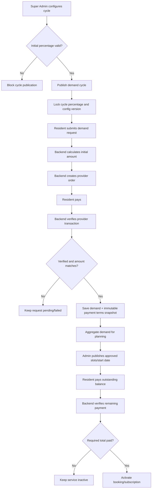
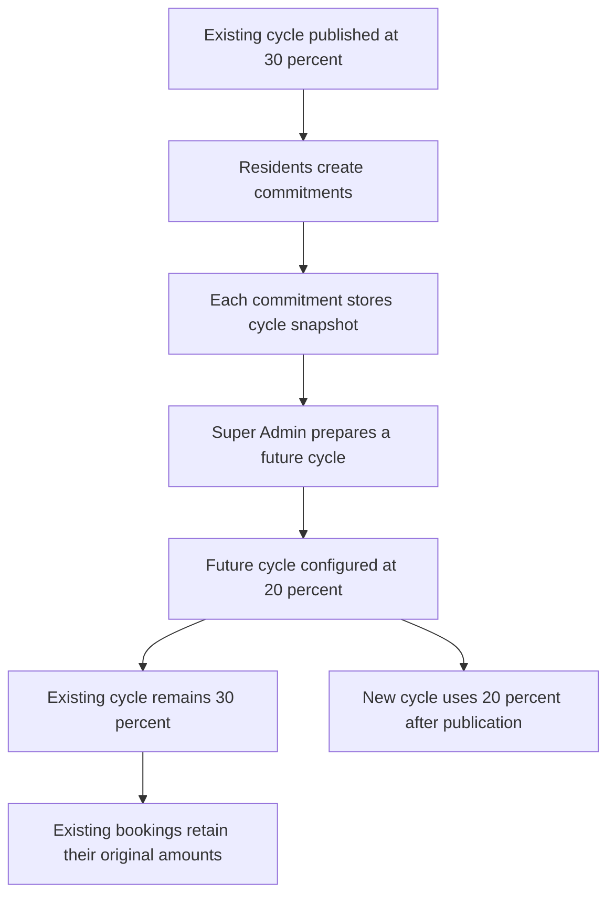
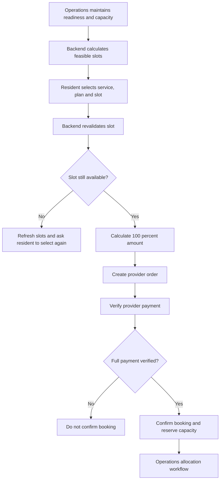
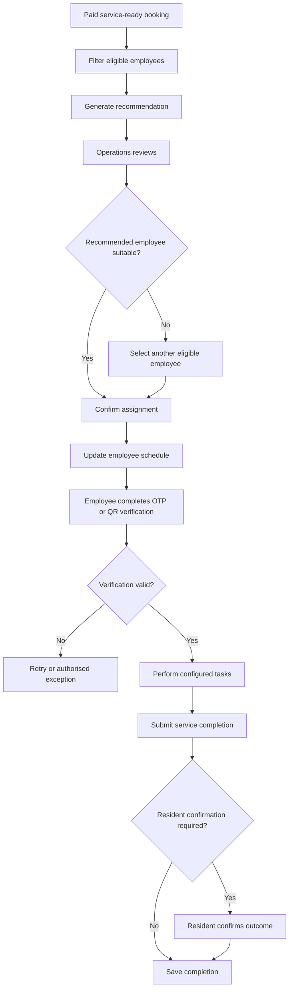

# NESTOVIN — PRODUCT REQUIREMENTS DOCUMENT

**Document ID:** NV-PRD-01  
**Version:** 1.1 — Consolidated engineering baseline  
**Issue date:** 19 November 2026  
**Product:** Nestovin Home Services & Workforce Platform  
**Tagline:** A Home That Brings People Together  
**Prepared for:** Nestovin  
**Prepared by:** Nexif Technologies  
**Status:** Working product baseline — business-owner approval required before it becomes the frozen delivery specification  
**Supersedes:** Nestovin PRD v0.9 (17 October 2026) and the earlier consolidated PRD v1.0

---

## Document control

| Item | Description |
|---|---|
| Purpose | Define the product, V1 scope, user journeys, business rules, functional requirements, data boundaries, security requirements and acceptance criteria |
| Primary audience | Nestovin business owner, product/design, architecture, engineering, QA, operations, HR, support and payroll |
| Source baseline | Original PRD v0.9; Nestovin SOW v1.1 (31 October 2026); individual module workflows NV-FLOW-01 (4 November 2026); complete system workflows NV-FWS-03 (5 November 2026); subsequent product clarifications through 19 November 2026 |
| Contract relationship | This PRD is a product/engineering specification. It does not independently amend the Master Services Agreement or replace the accepted SOW/change-order process |
| Requirement labels | **Confirmed**, **Engineering requirement**, **Recommended control**, **Open decision**, **Excluded from V1** |
| Change policy | New capabilities, integrations or materially changed workflows outside the approved baseline require impact assessment and written change approval |

### 0.1 Important reconciliation notes

This PRD intentionally resolves the following differences between earlier drafts and later product decisions:

1. The current V1 service catalogue is strictly **Maid, Cook and Caretaker**. No other service category is included in V1.
2. Nestovin operates and manages its own workforce. Employees are not independent marketplace providers.
3. Residents do not choose a named employee. Nestovin controls allocation.
4. The V1 employee workflow does **not** require an employee to accept or reject routine assignments. Routine allocation is recommendation-led and confirmed by authorised Operations/Admin. Employee accept/reject applies only to optional additional-work/overtime offers.
5. Attendance supports **OTP or QR as alternative verification methods**, with location evidence captured at the verification event. Continuous live employee tracking is excluded.
6. Demand-led payment percentages are **not hard-coded**. The Super Admin configures the initial commitment percentage before publishing a demand cycle. The configured percentage is locked for that cycle and captured against each resulting commitment/booking.
7. A later change to payment configuration applies only to a future demand cycle or future booking. It must never silently rewrite the terms of an existing booking.
8. Continuous-mode bookings use 100% payment before confirmation/service activation in the current V1 workflow.
9. V1 Admin scope is treated as **14 capability groups**, consistent with the later product-scope clarification. The earlier detailed SOW lists Finance Overview/Basic Payroll Calculation and Payroll Approval/Basic Reports as two groups; this PRD combines them into one **Finance & Basic Payroll** module. All underlying V1 behaviours remain included. The 20 remaining groups from the 34-group inventory are deferred.
10. The website is informational and enquiry-led. It does not provide online service booking, a general-purpose CMS or career application management.
11. The 24×7 service ambition is a future operating aspiration, not a V1 service promise. V1 must show only Admin-published slots backed by feasible workforce capacity.
12. The earlier draft's 4-hour employee daily capacity is an operating assumption, not a permanent hard-coded limit. Capacity must be configurable from approved operations data.

If the accepted SOW or a later client-approved document differs from this PRD, record the difference explicitly and resolve it through the governing approval/change process. Do not silently implement contradictory versions.

---

# 1. Executive summary

Nestovin is a company-operated residential home-services platform for high-rise apartments, gated communities and residential societies. It allows residents to request Maid, Cook and Caretaker services while Nestovin manages residential data, plans, demand collection, payments, workforce readiness, scheduling, service execution, attendance, support and basic payroll operations.

The platform comprises:

- Resident mobile application for Android and iOS.
- Employee mobile application for Android and iOS.
- One role-based Admin web portal.
- Responsive public website.
- Shared backend and central database acting as the system of record.

Nestovin is not an open marketplace. It employs/manages the service workforce and controls assignments. Residents select a service, plan and available/configured time option; they do not select a specific employee.

Two commercial operating modes are supported:

- **Demand-led mode:** residents submit demand commitments during an open collection cycle. The Super Admin configures the initial payment percentage before publishing the cycle. After demand is aggregated and workforce/slots are prepared, residents pay the outstanding balance before service activation.
- **Continuous mode:** residents see currently feasible availability, choose a published slot, and pay 100% before the booking is confirmed.

The product's central integrity rule is that the backend—not the mobile app, browser, admin form or payment redirect—is authoritative for payment calculations, payment verification, permissions, booking state, demand activation, attendance records and financial history.

## 1.1 Product vision

Provide residents with a dependable and professionally managed home-service experience, while giving Nestovin an operational system to coordinate its own workforce across communities and service clusters.

## 1.2 Product goals

- Make registration, residence access, service discovery and booking understandable.
- Configure services, tasks, plans, prices, entitlements, fixed slots and payment rules without hard-coding temporary business values.
- Keep demand-led and continuous booking flows distinct and auditable.
- Prevent unpaid or partially paid demand from being activated as a service when the configured workflow requires full payment.
- Maintain reliable employee readiness, scheduling, assignment, attendance and service-completion records.
- Give each Admin role only the access it needs.
- Protect personal, residence, employee, verification, location and payroll data.
- Provide enough auditability to explain who changed a configuration or operational record and why.
- Keep the first release focused on the agreed V1 capabilities rather than expanding into a large HRMS, CRM, ERP or marketplace.

## 1.3 Product non-goals for V1

- Independent provider/partner marketplace.
- Resident selection of a named employee.
- Online booking from the public website.
- Additional service categories beyond Maid, Cook and Caretaker.
- Full recruitment ATS, interview pipeline or applicant-stage automation.
- Full enterprise LMS, course authoring or advanced training analytics.
- Predictive AI/ML workforce optimisation.
- Automated cross-cluster workforce sharing.
- Continuous/background live location tracking of employees.
- Automated salary disbursement.
- Accounting/ERP replacement or unapproved statutory/tax determinations.
- General-purpose CMS, paid marketing campaigns or ongoing managed SEO.
- Dedicated CRM or applicant-tracking system for website enquiries.
- Deferred Admin modules as inactive placeholder screens.
- Unapproved integrations or unlimited feature additions.

---

# 2. Product operating model and terminology

## 2.1 Operating model

1. Nestovin onboards a residential community and loads the applicable residential structure.
2. A resident registers with phone OTP and associates their account with a residence.
3. The first successfully verified resident associated with a flat is designated the Primary Resident.
4. A Primary Resident may request family-member access. A request does not grant access; the authorised Cluster Admin records approval after the required verification.
5. The resident sees the services and plans enabled for their community and residence context.
6. The community is configured for either demand-led or continuous operation.
7. In demand-led mode, an open demand cycle collects paid commitments using a Super Admin-configured initial percentage.
8. Nestovin reviews demand, workforce readiness and feasible capacity, then publishes approved service slots and a commencement date.
9. Residents pay the remaining balance by the configured deadline. A service does not activate until the required total payment is verified.
10. In continuous mode, residents select a currently feasible slot and pay the full amount before confirmation.
11. Operations reviews allocation recommendations and confirms or replaces an eligible employee within the authorised cluster.
12. The employee performs OTP or QR attendance verification with location evidence at the event, completes the service and records the result.
13. Resident confirmation is captured when the agreed workflow requires it.
14. Attendance/service data becomes available to authorised Admin and basic payroll workflows.

## 2.2 Terminology

| Term | Definition |
|---|---|
| Tenant / operating organisation | The organisation-level data boundary used for multi-tenant isolation. Its exact relationship to future operators must be documented in the deployment model. |
| Residential community | The apartment complex, gated community or society where residents live. |
| Service cluster | Nestovin's internal operational grouping for workforce and Admin assignment. It is not automatically the same thing as a residential community. |
| Residence | A specific flat, house or villa where service is delivered. |
| Primary Resident | The first successfully verified resident associated with a flat for the V1 household-access model. |
| Family member | A person whose access is requested by the Primary Resident and enabled only after authorised approval. |
| Employee | A worker hired/managed by Nestovin, with an internal employee record and service/task eligibility. |
| Service | One of Maid, Cook or Caretaker. |
| Task | A configured work item or task definition under one of the three services. |
| Plan | A configurable commercial package defining service, residence eligibility, entitlements, duration and price. |
| Demand cycle | A bounded demand-collection process for a community or defined operating scope. |
| Demand request / commitment | A resident's demand-led request with its verified initial payment; it is not yet an activated service. |
| Booking | A confirmed resident purchase/booking record with captured commercial terms. |
| Payment attempt | A request to collect money through the payment provider. |
| Payment transaction | The provider-verified financial result associated with an order/attempt. |
| Subscription | The activated entitlement/package that governs service occurrences over a configured period. |
| Service occurrence | One planned service visit under a subscription/booking. |
| Assignment | A confirmed link between a service occurrence and an eligible employee. |
| Attendance event | A time-stamped check-in/check-out verification record. |
| Service completion | The recorded outcome of an employee's service occurrence, with resident confirmation when required. |
| Configuration snapshot | The immutable copy of the applicable business configuration captured for an existing demand request or booking. |

## 2.3 Residence and household assumptions for V1

- V1 uses one active residence context per resident account.
- After the residence is verified, the app presents that residence as the account's read-only service context.
- A residence change or correction follows a controlled request/verification workflow; it must not silently replace the existing residence linked to active bookings.
- Residence registration captures the configured community, tower/building, flat, occupancy type and required proof.
- The system validates required fields and document submission. If the configured verification rules pass, it may complete the automated verification path; cases needing review are routed to an authorised Admin.
- No resident gains household/service access while the residence remains pending, rejected or otherwise unverified.
- The exact automated document checks, proof types and manual-review exception criteria require client approval.

## 2.4 Operating-mode rule

Each community/service context is assigned an operating mode by an authorised Admin:

- `DEMAND_LED`
- `CONTINUOUS`

The resident flow follows the configured mode. A resident must not be offered both flows for the same community/service context unless Nestovin explicitly configures that behaviour.

---

# 3. Users, roles and access boundaries

## 3.1 Resident

Can:
- Register/sign in using phone OTP.
- Select the available city/community context.
- Register and view the permitted residence context.
- Request family-member access.
- View enabled Maid, Cook and Caretaker services.
- View eligible plans and applicable prices/entitlements.
- Submit a demand-led request or make a continuous-mode booking.
- Pay and view verified payment status.
- View booking, subscription and service status/history.
- Submit feedback where enabled.
- Create and track support tickets.
- Receive relevant notifications.
- View/update permitted profile and household details.

Cannot:
- Choose a specific employee.
- Access another resident's profile, household, payment or service records.
- View employee HR documents, payroll, private contact information or internal allocation scores.
- Mark a payment as successful or edit the amount due.
- Activate an unverified residence or unapproved family member.

## 3.2 Employee

Can:
- Submit applicant interest details.
- Sign in after HR enables the Employee ID and password account.
- View own profile, qualifications and training completion.
- View assigned work schedule and service occurrence details.
- Complete attendance using the configured OTP or QR method.
- Submit service completion.
- Submit attendance correction requests.
- View/submit availability or leave requests.
- View and accept/reject optional additional-work/overtime offers.
- Receive relevant notifications.

Cannot:
- Accept/reject routine assignments as a required V1 workflow.
- Access assignments outside the employee's permitted scope.
- View other employees' HR/payroll data.
- Access more resident information than needed for an assigned service.
- Change their own attendance result or payroll result without the authorised correction/approval process.
- Access continuous live-tracking data because continuous tracking is not a V1 feature.

## 3.3 Admin roles

The Admin Portal is one shared web application with role/action permissions and data-scope enforcement.

| Role | Main responsibility | Default boundary |
|---|---|---|
| Super Admin | Platform-wide administration | Global configuration and authorised cross-cluster oversight |
| Cluster Admin | Local resident/family and service operations | Assigned cluster(s) only |
| HR | Employee readiness and verification | Employee onboarding, profile, verification and training status |
| Operations | Demand, scheduling and workforce coordination | Operational records within granted scope |
| Support | Resident/employee tickets and enquiries | Tickets and linked context required to resolve them |
| Payroll | Basic compensation calculation and approval | Approved attendance, rates, payroll periods and reports |

The exact role permission matrix must be configured and tested before production. A role label alone is not sufficient authorisation.

## 3.4 Permission model

Every protected Admin operation is evaluated using:

1. Authenticated identity.
2. Active account status.
3. Module permission.
4. Action permission (view/create/update/approve/export or another explicitly granted action).
5. Record scope (global, assigned cluster, own employee records, own resident/household records or other approved scope).
6. Additional approval or step-up authentication for high-impact operations where configured.

The backend must deny access when any required check fails. Hiding a menu item in the frontend is not a security control.

---

# 4. V1 product scope

A capability is included only when its described workflow is usable and passes its acceptance checks. A screen, button, menu entry or mockup alone does not count as completion.

## 4.1 Resident App — 14 capability areas

| # | Capability | V1 behaviour |
|---:|---|---|
| 1 | Registration & OTP Login | Resident account creation/access using phone OTP, with session handling and rate controls |
| 2 | City & Community Selection | Select an available city and community; show an unavailable/contact state where onboarding is not open |
| 3 | Residence Registration | Capture community, tower, flat, occupancy type and required proof; show verification state |
| 4 | Family Member Management | Primary Resident submits family details/proof; authorised Cluster Admin reviews and approves/rejects |
| 5 | Service Catalogue | Display only Maid, Cook and Caretaker, subject to community availability |
| 6 | Subscription Plans & Pricing | Display approved packages, entitlements, duration/start rules and applicable residence/community price |
| 7 | Booking & Scheduling | Select a configured plan, service start date where permitted, and fixed Admin-configured slot |
| 8 | Payment Integration | Razorpay payment initiation and backend-verified status for demand-led and continuous modes |
| 9 | Booking & Service Status | Display demand, payment, booking, subscription, assignment and service progress states appropriately |
| 10 | Service History | Show relevant past/current service occurrence records for the resident/household |
| 11 | Feedback & Ratings | Submit a rating/feedback for an eligible completed service occurrence |
| 12 | Support Tickets | Create and track a resident support ticket |
| 13 | Notifications | Show essential OTP, family decision, demand/booking/payment, assignment, service and support updates |
| 14 | Profile & Household Management | View/update permitted resident and household information; route restricted changes to review |

## 4.2 Employee App — 10 capability areas

| # | Capability | V1 behaviour |
|---:|---|---|
| 1 | Applicant Registration | Capture basic applicant contact, service interest and service area for HR follow-up; not a full ATS |
| 2 | Employee Login | Employee ID and password; account enabled by HR after required readiness checks |
| 3 | Employee Profile & Qualifications | Maintain profile, allowed service/task qualifications and readiness information |
| 4 | Training Videos & Completion | View Client-supplied training videos/links and record completion; not a full LMS |
| 5 | Work Schedule & Assignments | Display confirmed routine assignments, slot, service and required visit details |
| 6 | Attendance Verification | OTP or QR as alternative methods, with location evidence at the verification event; approved offline queue where supported |
| 7 | Service Completion | Submit service completion details; capture resident confirmation when required |
| 8 | Additional Work / Overtime | Present optional offers; employee accepts/rejects; Admin confirms accepted offer before assignment |
| 9 | Availability & Leave | View/submit V1 availability or leave requests for authorised review |
| 10 | Notifications | Deliver essential schedule, assignment, attendance and operational notifications |

## 4.3 Public Website — 10 pages/functions

| # | Page/function | V1 behaviour |
|---:|---|---|
| 1 | Home | Introduce Nestovin and direct visitors to approved service/contact information |
| 2 | Services | Describe Maid, Cook and Caretaker only |
| 3 | How It Works | Explain the approved resident/service journey |
| 4 | About Us | Present approved company/brand information |
| 5 | Contact Us & Enquiry Form | Capture an enquiry and show a submission confirmation |
| 6 | FAQ | Display Client-approved frequently asked questions |
| 7 | Privacy Policy | Display Client/legal-adviser-approved policy text |
| 8 | Terms & Conditions | Display Client/legal-adviser-approved terms |
| 9 | Careers Information | Informational content only; no job application workflow |
| 10 | Enquiry Routing to Support | Route the enquiry to the approved Support destination/channel |

**Website exclusions:** no public online booking, no general-purpose CMS, no ATS/career applications, no CRM, no paid marketing campaign and no ongoing SEO/content operations unless separately approved.

## 4.4 Admin Portal — 14 capability areas

The agreed inventory contains 34 capability groups. V1 includes 14. The other 20 groups are deferred, excluded from V1 and must not be built as placeholder menus/screens.

| # | V1 capability | Included behaviour |
|---:|---|---|
| 1 | Admin Home & Overview | Role-appropriate operational counts, pending actions and status |
| 2 | Admin User & Role Permissions | Create/manage Admin accounts; assign role templates and module/action permissions enforced by backend |
| 3 | City / Community / Cluster / Tower / Flat Master Data | Maintain residential/operational hierarchy and Cluster Admin assignment |
| 4 | Community Migration (Excel) | Import structured community/flat data; validate rows and support correction before activation |
| 5 | Resident Management | View permitted resident profile, residence association, verification status and booking information |
| 6 | Family-Member Approval Requests | Review request/evidence, record manual verification and approve/reject with reviewer/time history |
| 7 | Service, Task, Plan & Pricing Configuration | Configure Maid/Cook/Caretaker tasks, approved plans, fixed slots/entitlements and community/residence pricing |
| 8 | Booking, Demand & Payment Status | Track demand cycles, booking requests, verified payment status and operational exceptions |
| 9 | Employee Profile & Verification | Maintain employee profile, verification/readiness status and service/task qualifications |
| 10 | Scheduling & Time-Slot Configuration | Configure fixed service slots and basic availability/schedule controls |
| 11 | Work Allocation & Replacement | View allocation recommendations/outcomes and perform authorised manual assignment/replacement |
| 12 | Attendance & Service Records | Review OTP/QR outcomes, event-based location evidence, attendance, completion, no-show and correction records |
| 13 | Support Ticket Management | Create/categorise, assign, track and resolve tickets; basic escalation visibility |
| 14 | Finance & Basic Payroll | Basic booking/revenue summary; payroll calculation from Client-approved inputs; review/approval and agreed basic reports; no salary disbursement |

**Scope reconciliation:** Earlier SOW v1.1 listed Finance Overview/Basic Payroll Calculation and Payroll Approval/Basic Reports separately as capability groups 14 and 15. This PRD groups these related functions into one V1 Finance & Basic Payroll capability to preserve the later 14-module V1 scope decision without dropping the underlying basic behaviours. The V1 capability grouping should be reflected consistently in the approved scope record.

## 4.5 Explicit V1 exclusions

- The other 20 Admin capability groups from the 34-group inventory.
- Placeholder pages, inactive menus or partial shells for deferred modules.
- Full recruitment ATS, interview pipeline and applicant-stage management.
- Full LMS, course authoring and training-content administration.
- Continuous live employee map tracking.
- Cross-cluster workforce sharing.
- Advanced workforce optimisation and predictive scheduling.
- Automated refund reconciliation and complex financial exception automation.
- Salary disbursement and statutory payroll automation.
- Online booking from the website.
- General-purpose CMS, CRM and career application management.
- Any service other than Maid, Cook and Caretaker.
- Open-ended changes not included in the approved baseline.

---

# 5. End-to-end user journeys

## 5.1 Resident registration and residence access

1. Resident opens the app and enters a phone number.
2. Backend requests an OTP through the configured provider.
3. Resident enters the OTP.
4. Backend validates expiry, attempt limits and one-time use.
5. Backend creates or retrieves the resident identity and session.
6. Resident selects city and an available residential community.
7. Resident selects configured tower/building and flat, enters occupancy details and uploads required proof.
8. Backend validates input/document requirements and creates the residence verification record.
9. The configured automatic verification path completes where all approved conditions pass; exceptions are routed for authorised review.
10. The resident sees pending/approved/rejected status. Access to verified-household functions remains blocked while the residence is not approved.
11. The first successfully verified resident linked to that flat is designated Primary Resident.
12. The verified residence is shown as the resident's service context. V1 uses one active residence context per account; changes go through controlled review.

## 5.2 Family-member access

1. Primary Resident opens family management.
2. Primary Resident enters requested family details and submits required proof.
3. System creates a pending family access request; no household/service permission is granted yet.
4. Authorised Cluster Admin receives the request within assigned scope.
5. Nestovin/Cluster Admin performs the required physical verification outside the app.
6. Reviewer records approval/rejection, reviewer identity, timestamp and reason.
7. Only an approved request enables the family member's permitted access.
8. Rejected/pending requests remain blocked.
9. Resident receives the decision notification.

## 5.3 Service catalogue and plan selection

1. Resident opens the catalogue.
2. Backend loads services enabled for the resident's community and verified residence context.
3. App displays Maid, Cook and Caretaker only where enabled.
4. Resident selects a service.
5. Backend loads the applicable plans, residence rules, price, duration, entitlements and operating mode.
6. App displays the eligible options and the fixed slot/time choices permitted by Admin configuration.
7. Resident chooses a plan and continues into the configured operating mode.

## 5.4 Demand-led journey

1. Super Admin configures the demand cycle before it is published:
   - Community/operating scope.
   - Collection window and cycle status.
   - Eligible V1 services/plans.
   - Required request fields/rules.
   - Initial payment percentage.
   - Applicable pricing/entitlement configuration reference.
2. Backend validates the configuration.
3. Backend locks the cycle's initial payment percentage when the cycle is published/opened. The percentage cannot be edited for that live cycle.
4. Resident selects service and plan and submits the configured demand information, such as duration, frequency and preferred time slots from the fixed set. V1 does not require a free-form preferred-days field.
5. Backend validates resident/residence, community, cycle, plan, service and request eligibility.
6. Backend calculates the initial commitment amount using the percentage locked to that demand cycle.
7. Backend creates the payment order with the payment provider.
8. Resident completes checkout.
9. Backend verifies the payment result, amount, currency, order and provider references.
10. Only verified payment creates a paid demand commitment.
11. Demand is aggregated by service, required hours/duration, frequency and permitted time-slot preferences.
12. Operations reviews workforce requirement/capacity; HR updates employee readiness; Admin creates or reviews slot recommendations.
13. Admin approves and publishes the service slots, commencement date and remaining-balance deadline.
14. Resident is notified of the remaining amount.
15. Resident pays the outstanding balance.
16. Backend verifies the payment. The booking/subscription is not activated until the required full amount is verified.
17. If the deadline is approaching or missed, the configured reminder/extension/expiry policy is followed.
18. Once full payment and the operational start conditions are satisfied, the subscription/service schedule is activated.
19. The booking proceeds to shared workforce allocation.

### Demand-led payment principle

The percentage is a **cycle-level configuration**, not a permanent code constant and not a resident-editable value. The system must not assume that the initial contribution is always 30%.

For illustration only: if a Super Admin configures 30% for one cycle, the initial payment is calculated as 30% and the outstanding balance as 70%. If the next cycle is configured at 20%, that new cycle uses 20%. The earlier cycle remains at 30%.

## 5.5 Continuous-mode journey

1. Operations maintains employee readiness, schedules, leave and current availability.
2. Backend calculates feasible capacity and Admin-published slots.
3. Resident selects an enabled service, plan and currently available fixed slot.
4. Backend revalidates the slot/capacity to prevent a stale or double-booked selection.
5. Backend calculates the full configured amount (100%).
6. Backend creates the payment order.
7. Resident completes checkout.
8. Backend verifies the payment.
9. Only verified full payment plus still-valid capacity confirms the booking and reserves the slot.
10. The booking proceeds to shared workforce allocation.

## 5.6 Shared workforce allocation

1. A service-ready booking/occurrence requires an employee.
2. Backend loads service/task, date, fixed slot, residence location and capacity requirement.
3. Eligible employees are filtered by:
   - Active employee status.
   - Approved verification/readiness.
   - Applicable service/task qualification.
   - Authorised cluster scope.
   - Availability/approved leave.
   - Existing assignments and time conflicts.
   - Configured daily/work-period capacity.
   - Travel/buffer feasibility if those rules are enabled.
4. System produces a deterministic allocation recommendation.
5. Operations reviews the recommendation.
6. Operations confirms the suggested employee or selects an alternative eligible employee.
7. Backend revalidates scope, readiness, availability and conflicts.
8. Confirmed assignment is stored and audited.
9. Employee schedule is updated and employee is notified.
10. If no eligible employee exists, the demand remains visibly unresolved and Operations must resolve the capacity gap. The system must not create an impossible assignment.

Routine assignments do not require an employee acceptance step. Optional additional-work/overtime offers are separate.

## 5.7 Attendance, service execution and completion

1. Confirmed assignment appears in the Employee App.
2. Employee opens the assigned service occurrence.
3. System applies the configured verification method: OTP or QR.
4. Location evidence is captured at the verification event.
5. Backend validates assignment, token/QR, time and location policy.
6. Invalid verification is rejected and routed to retry or an authorised Operations correction path.
7. Successful verification creates an attendance event.
8. Employee performs the configured service tasks.
9. Employee submits completion details.
10. Backend validates the assignment and service occurrence.
11. Where required by the approved workflow, resident confirms the service outcome.
12. System saves service completion and confirmation record.
13. Resident booking/service status and history are updated.
14. Eligible resident feedback is collected.
15. Authorised Admin can review attendance/service records; approved records become inputs for payroll.

## 5.8 No-show and attendance correction

- Employee waits 15 minutes if the resident is unavailable at the scheduled visit, as stated in the V1 source scope.
- Employee records the no-show outcome.
- Any service-day deduction follows the Client-approved no-show/entitlement policy. The application must not invent the deduction rule.
- Employee may submit an attendance correction request with an explanation/evidence.
- Authorised Admin reviews the original event and correction request.
- Approval/rejection, reviewer, reason and timestamp are recorded.
- The original event remains preserved; correction must be an auditable adjustment, not destructive rewriting.

## 5.9 Additional work / overtime

1. Operations identifies optional additional work.
2. Eligible employees are selected within authorised scope.
3. Admin sends an optional offer.
4. Employee accepts or rejects.
5. Rejection closes that offer for that employee.
6. Acceptance is not a confirmed assignment until Admin reviews and confirms it.
7. A confirmed offer creates an additional-work assignment and updates the employee schedule.
8. Approved additional-work/overtime input is made available to payroll.

---

# 6. Functional requirements — Resident App

| ID | Requirement | Priority | Acceptance direction |
|---|---|---|---|
| RES-01 | Phone OTP registration/login | Must | Valid OTP creates/retrieves the resident account; invalid, expired or over-limit attempts are rejected |
| RES-02 | City/community selection | Must | Only active/selectable records are offered; unavailable locations show a clear unavailable state |
| RES-03 | Residence registration | Must | Required residence fields and supporting proof are submitted and status is tracked |
| RES-04 | Family request | Must | Submission remains pending until authorised approval; rejection does not enable access |
| RES-05 | Service catalogue | Must | Only Maid, Cook and Caretaker are displayed, subject to enabled status |
| RES-06 | Plans/pricing | Must | Only valid plan/service/residence/community combinations are displayed |
| RES-07 | Booking/demand request | Must | Request is validated against operating mode, plan, demand cycle and fixed-slot rules |
| RES-08 | Payment | Must | Payment status comes from backend verification, not client UI success alone |
| RES-09 | Booking/service status | Must | Demand, payment, booking and service states remain distinguishable |
| RES-10 | Service history | Must | Resident sees only permitted household-linked records |
| RES-11 | Feedback | Must | Feedback is accepted only for an eligible service occurrence and cannot be duplicated contrary to configured rules |
| RES-12 | Support tickets | Must | Resident can submit a ticket and see its current status |
| RES-13 | Notifications | Must | Essential transactional events are reflected in app status and configured notification channels |
| RES-14 | Profile/household | Must | Self-service changes are validated; restricted changes create a review request |

### 6.1 Resident-facing data visibility

Residents may see information needed to understand and coordinate their service. They must not see:
- Employee HR or verification documents.
- Payroll details.
- Private employee contact information unless explicitly approved for the workflow.
- Other residents' personal data.
- Internal workforce allocation scores or confidential operational notes.
- Internal Admin permission/configuration data.

---

# 7. Functional requirements — Employee App

| ID | Requirement | Priority | Acceptance direction |
|---|---|---|---|
| EMP-01 | Applicant interest registration | Must | Valid applicant-interest record is visible to authorised HR; no ATS stages are implied |
| EMP-02 | Employee ID/password login | Must | Only HR-enabled employees with valid credentials can authenticate |
| EMP-03 | Employee profile/qualifications | Must | Employee sees permitted profile and service/task eligibility information |
| EMP-04 | Training videos/completion | Must | Employee can view assigned Client-supplied content and completion is recorded |
| EMP-05 | Work schedule/assignments | Must | Confirmed routine assignments appear with correct time, service and location instructions |
| EMP-06 | OTP/QR attendance | Must | Configured OTP or QR method is validated by backend; location evidence is attached to the event |
| EMP-07 | Service completion | Must | Employee can submit completion; backend validates state and resident confirmation is captured where required |
| EMP-08 | Additional work/overtime | Must | Employee accepts/rejects optional offer; accepted offer becomes assignment only after Admin confirmation |
| EMP-09 | Availability/leave | Must | Request is stored, reviewed and updates future capacity when approved |
| EMP-10 | Notifications | Must | Employee receives essential schedule, attendance and operational messages |

### 7.1 Employee privacy

- Employee sees only the resident and residence information needed for assigned work.
- Sensitive resident details are exposed only as required by the service workflow.
- Employee does not see payroll data of other employees.
- HR documents are not included in normal assignment views.
- Location capture is event-based for attendance verification; continuous employee tracking is excluded.

---

# 8. Subscription, pricing, booking and payment rules

## 8.1 Configurable commercial model

The system must not hard-code temporary business values into source code or client apps.

Authorised Admins configure the values approved by Nestovin, including:
- Service/task availability.
- Plan label and applicable service.
- Residence/house-type eligibility.
- Price and currency.
- Service-day/visit entitlements.
- Duration and validity.
- Start-date rules.
- Fixed-slot rules.
- Community/residence price differences.
- Demand-led initial payment percentage.
- Remaining-balance deadline and relevant cycle parameters.
- Approved cancellation/no-show/refund policy.

Sample plan names such as Silver, Gold, Platinum and Diamond are illustrative until the Client confirms the final matrix. Sample prices in source material are not automatically final.

## 8.2 Demand-cycle payment configuration

### Required Super Admin setup

Before publishing/opening a demand cycle, the Super Admin must provide the initial payment percentage for that cycle.

The cycle cannot be published if the percentage is missing or invalid.

### Validation rules

- Initial percentage must be a whole-number percentage greater than 0 and less than 100 for the two-stage demand-led flow.
- `0%` is invalid.
- `100%` is invalid for the two-stage demand-led commitment because it leaves no remaining-balance phase.
- Values outside the permitted range, non-numeric values, malformed input and unexpected precision are rejected.
- The frontend validation is for usability only; backend validation is authoritative.
- The remaining balance is calculated by the backend as `total payable amount - verified initial payment amount`. It must not be trusted from a client request.
- Currency rounding must be deterministic and consistent with the payment provider and stored amount precision.

### Locking and effective-date rules

1. Super Admin configures the initial percentage before the cycle is published.
2. When the demand cycle is published/opened, the percentage becomes locked for that cycle.
3. The percentage cannot be edited for that active cycle, including after the first resident commitment.
4. A future demand cycle may use a different percentage.
5. A percentage change must never recalculate a previous cycle's demand commitments or existing bookings.
6. Each commitment/booking stores a snapshot of the percentage, base amount, initial due amount, verified initial payment, outstanding balance, currency, cycle ID and configuration version.
7. If the business needs to correct an existing booking, it must use a separately authorised adjustment workflow with reason and audit history. It must not overwrite the original agreement silently.

### Example only

| Item | Demand Cycle A | Demand Cycle B |
|---|---:|---:|
| Configured initial percentage | 30% | 20% |
| Total configured amount | ₹1,000 | ₹1,000 |
| Initial payment due | ₹300 | ₹200 |
| Remaining payment due | ₹700 | ₹800 |

Cycle A remains at 30% after Cycle B is configured at 20%. The values above are examples, not Nestovin's fixed payment policy.

## 8.3 Continuous-mode payment

- Continuous mode requires full payment (100%) before booking confirmation/service activation in the current V1 flow.
- Backend revalidates slot capacity before confirming the booking.
- If the slot becomes unavailable or payment is not verified, the booking must not be falsely marked confirmed.
- Any future change to this commercial model requires an explicit approved product-rule change; do not infer it from the demand-led percentage setting.

## 8.4 Payment provider integration

Razorpay is the intended V1 payment provider.

Backend requirements:
- Create provider orders server-side using trusted credentials.
- Persist a unique internal payment/order ID before checkout begins.
- Bind payment purpose to the owning workflow: demand commitment, remaining balance or continuous booking.
- Verify provider signature/webhook and validate order, amount, currency, provider payment reference and expected purpose.
- Treat provider redirects/client SDK success as an untrusted indication until backend verification completes.
- Handle repeated webhooks idempotently.
- Prevent one provider transaction from being applied to more than one demand/booking.
- Reconcile a provider-success/client-timeout case without asking the resident to pay again blindly.
- Preserve pending, failed, cancelled, captured/verified, reversed/refunded and review-required outcomes as appropriate to the provider flow.
- Store immutable financial events/transaction history rather than overwriting the only payment status field.
- Do not store card number, CVV or other card credentials in Nestovin systems.

## 8.5 Financial invariants

The backend must enforce these invariants:

1. The client cannot choose or override the authoritative amount.
2. The client cannot set `isPaid`, `paymentStatus`, `verifiedAmount` or `paymentPercentage`.
3. A payment amount must match the backend-created order and the expected currency/purpose.
4. A demand commitment is created only after the initial payment has been verified.
5. A demand-led subscription/service cannot activate before the required total payment is verified.
6. A continuous-mode booking cannot confirm before verified full payment and slot revalidation.
7. A duplicate payment webhook cannot create a second commitment, booking or financial effect.
8. Changing a future cycle's configuration does not change existing snapshots.
9. A manual financial correction must create a separate authorised adjustment/reversal record and audit event.
10. Payment history is retained for reconciliation and customer support.

## 8.6 Booking terms snapshot

When a demand request/booking is created, the backend snapshots all commercially relevant terms that the user accepted, including:
- Plan/configuration version.
- Service and task reference.
- Residence/house-type input used for pricing.
- Price, currency and applicable tax/discount fields where approved.
- Entitlement quantity and validity.
- Initial payment percentage and due amount, where demand-led.
- Remaining balance.
- Operating mode and demand cycle.
- Selected fixed slot/time details once assigned/published.
- Relevant effective dates and payment deadlines.

Existing booking terms are not silently recalculated when Admin changes future configuration.

## 8.7 Open commercial rules

The software must expose the right configuration/control points, but the business owner must still approve:
- Final service/task matrix and plan entitlements.
- Price matrix, tax treatment, discounts and receipts/invoice requirements.
- Demand cycle start/end and resident request amendment rules.
- Balance payment deadline and reminder schedule.
- What happens to an unpaid commitment at expiry.
- Whether an expired commitment is refunded, partially refunded, retained or handled another way.
- Refund/partial-refund authority and approval matrix.
- Payment retries, late payments, duplicate charges and provider disputes.
- Plan renewal, pause and unused-visit treatment (self-service pause is excluded from V1).

The older workflow diagram refers to retaining the initial commitment on expiry. This PRD does **not** make that a final rule until the Client explicitly approves the refund/forfeiture policy.

---

# 9. Workforce planning, scheduling and allocation

## 9.1 Allocation principles

- Scheduling begins deterministic and explainable; no AI/ML scheduling is assumed.
- Operations owns the allocation decision and can confirm a valid recommendation or choose another eligible employee.
- Routine assignments are not sent as accept/reject offers.
- Employees are assigned only within their authorised cluster scope in V1.
- A manual replacement must pass the same eligibility and conflict checks as an automated recommendation.
- Unresolved demand must be visible, not silently dropped or assigned to an ineligible employee.

## 9.2 Scheduling inputs

- Fully paid/service-ready booking or occurrence.
- Service/task and configured duration.
- Date and fixed slot.
- Residence location and authorised cluster.
- Employee active/deployment-ready status.
- Employee service/task qualifications.
- Approved availability/leave.
- Existing confirmed assignments.
- Configured capacity/work limits.
- Any approved travel/buffer policy.
- Backup/replacement availability.

## 9.3 Candidate evaluation

1. Exclude inactive or not-ready employees.
2. Exclude employees without the required service/task qualification.
3. Exclude employees outside the permitted cluster scope.
4. Exclude employees on approved leave/unavailability.
5. Reject conflicting or overlapping assignments.
6. Validate remaining capacity and service duration.
7. Apply approved travel/buffer constraints when enabled.
8. Rank candidates using a deterministic policy approved by Operations.
9. Present recommendation with enough reason information for operational review.
10. Confirm assignment only after backend revalidation.

## 9.4 Capacity model

Employee capacity must be data/configuration driven. The older four-hours-per-day figure and the illustrative 100-worker plus 20-backup example are not fixed constants for the software.

The system should allow authorised configuration of:
- Employee working availability.
- Service/task eligibility.
- Work duration per occurrence.
- Daily/weekly capacity limits.
- Approved leave and unavailable periods.
- Fixed slot definitions.
- Any future backup designation where approved.

The exact capacity formula, backup-pool size and treatment of backup workers remain open business decisions.

## 9.5 Demand-led workforce planning

- Aggregate verified demand commitments by service, duration/hours, frequency and requested fixed-slot preferences.
- Show demand totals and estimated staffing/capacity gap.
- Operations/HR updates readiness and workforce data.
- Admin creates or reviews fixed-slot recommendations.
- Only approved slot sets are published.
- Commitment alone does not guarantee service start; balance payment and operational readiness remain gates.

## 9.6 Continuous availability

- Availability is calculated from current employee readiness, approved leave, existing assignments, configured capacity and Admin-published slot rules.
- Revalidate availability immediately before payment confirmation/booking.
- Do not expose a slot that has become invalid.
- V1 does not promise 24×7 availability. Future expanded hours must be published only when actual workforce capacity supports them.

## 9.7 Late demand and replacement

- A late/urgent request must use a constrained capacity check.
- It must not silently invalidate already-confirmed assignments.
- If no feasible employee is available, show a capacity gap and route to Operations.
- Operations may select an alternative eligible employee or an alternative available slot under the approved policy.
- Cross-cluster sharing is excluded from V1.

---

# 10. Attendance, service execution and location

## 10.1 Attendance methods

The V1 workflow supports OTP or QR as alternative methods. The active method is configured for the relevant service/community/workflow.

At a verification event, capture as applicable:
- Employee ID.
- Assignment/service occurrence ID.
- Verification method.
- Token/QR reference or one-time verification result (never store raw secrets unnecessarily).
- Device event time.
- Server receipt time.
- Location coordinates and reported accuracy, where permission is granted.
- Verification result and reason.
- Device/app metadata needed for troubleshooting, minimised appropriately.

## 10.2 Location boundaries

- Capture location only at required attendance/verification events.
- Do not run continuous/background employee tracking in V1.
- GPS is evidence, not absolute proof of a specific indoor flat.
- Use customer OTP or QR as the additional verification mechanism.
- Exact geofence radius, GPS accuracy threshold, mock-location handling and fallback policy require approval.
- Store readable address details separately from coordinates.
- Employees must be informed of the attendance location collection purpose.

## 10.3 Service lifecycle

Recommended state model:

`ASSIGNED → CHECK_IN_PENDING → ATTENDANCE_VERIFIED → IN_PROGRESS → COMPLETION_SUBMITTED → RESIDENT_CONFIRMATION_PENDING (when required) → COMPLETED → CHECKED_OUT`

Additional states may include `NO_SHOW`, `VERIFICATION_FAILED`, `EXCEPTION_REVIEW`, `CANCELLED` and `CORRECTION_REQUESTED`. Final state names can be adapted to the implementation, but transitions must be explicit and validated.

## 10.4 Offline attendance

Where offline capture is enabled:
- Only specified attendance/service events may be queued.
- Each queued event has a unique event ID.
- Device event time and server receipt/synchronisation time are stored separately.
- Synchronisation is idempotent.
- Duplicate, stale, out-of-order and conflicting events are detected.
- Invalid/conflicting records are made visible to authorised review.
- Sensitive local data is protected and removed according to an approved retention/cleanup policy.
- Offline queuing does not imply that online OTP validation can occur offline. A secure offline OTP/QR design must be separately approved if required.

## 10.5 Resident no-show

The Employee waits 15 minutes when the resident is unavailable at the scheduled visit, then records the no-show outcome. The service-day deduction is based only on the Client-approved plan/no-show policy. The application must not hard-code a deduction formula without approval.

## 10.6 Attendance correction

- Employee submits correction request and reason/evidence.
- Admin reviews the source event and evidence.
- Admin approves/rejects with reason.
- Original event remains preserved.
- Approved correction is stored as an adjustment with actor, time and linked original record.
- Employee is notified of the outcome.

---

# 11. Admin Portal — functional requirements

## 11.1 Admin Home & Overview

- Display role-specific summary counts and pending actions.
- Respect role/action permissions and record scope.
- Avoid leaking global totals or restricted information to a cluster-scoped user.
- Link summary items to an authorised module.

## 11.2 Admin User & Role Permissions

- Super Admin can create/manage Admin users and assign a role template.
- Super Admin can grant module and action permissions within their own authority.
- Cluster Admin accounts must be assigned one or more permitted cluster scopes.
- A creator must not grant permissions they do not possess or elevate another account beyond allowed authority.
- Changes to account status, role, module/action permission and cluster scope are audited.
- Disabling an account revokes future access and invalidates active sessions/tokens according to the auth design.
- Protect against accidental removal/demotion of the last authorised Super Admin.

## 11.3 City / Community / Cluster / Tower / Flat Master Data

Maintain the hierarchy used by resident onboarding and operations. Validate parent relationships, required fields and duplicate/uniqueness constraints. Exact hierarchy cardinality and geographical mapping must be confirmed.

## 11.4 Community Migration (Excel)

- Accept only the approved template/column structure.
- Validate file type, file size, columns, values, required fields, references and duplicate rows.
- Produce a row-level validation report.
- Do not activate partial/invalid data silently.
- Allow correction and re-upload or an approved correction process.
- Preview valid records before import.
- Require an authorised Admin to confirm the import.
- Record import batch, actor, time, result and rejected-row summary.
- Imported master records and community activation are separate steps.

## 11.5 Resident Management

- Search/view residents within authorised scope.
- Show residence association, verification status and permitted booking information.
- Permit only authorised profile/residence corrections.
- Restrict documents and personal data based on role.
- Audit material changes.

## 11.6 Family-Member Approval Requests

- Show pending family requests for assigned cluster(s).
- Display only the documents needed for the decision.
- Record that physical verification occurred outside the app where required.
- Record reviewer, decision, time and reason.
- Enable family access only after approval.
- Notify the Primary Resident.

## 11.7 Service, Task, Plan & Pricing Configuration

- Configure only Maid, Cook and Caretaker for V1.
- Maintain tasks and plan/service mapping.
- Configure residence/house-type eligibility and community-specific availability.
- Configure price, entitlements, duration, validity and start rules.
- Configure fixed slots and their applicability.
- Validate incomplete or conflicting configuration before publishing.
- Version published configurations.
- Preserve existing booking snapshots when future versions change.

## 11.8 Booking, Demand & Payment Status

- Create and manage demand cycles.
- Configure demand-led initial payment percentage before publishing the cycle.
- Block cycle publication when percentage or required rules are invalid.
- Lock percentage once cycle is published/opened.
- Display demand commitments separately from confirmed bookings.
- Display pending/verified/failed/reversed/refunded/review-required payment states accurately.
- Show paid amount and outstanding amount from backend-calculated records.
- Allow authorised operational review of exceptions.
- Refund exceptions require manual authorised review; no automatic refund is implied.

## 11.9 Employee Profile & Verification

- Maintain employee profile and internal employee identifier.
- Maintain service/task qualifications.
- Track verification/readiness statuses.
- Prevent allocation when required checks/qualifications are incomplete.
- Limit HR document access to authorised roles.
- Preserve status history and reviewer details where relevant.

## 11.10 Scheduling & Time-Slot Configuration

- Configure fixed slot sets, service applicability and availability controls.
- Support slot sets for demand-led and continuous modes.
- Validate slot conflicts/capacity before publication.
- Allow authorised Admins to create or approve recommended slots.
- Future slot changes must not silently invalidate existing confirmed service occurrences.

## 11.11 Work Allocation & Replacement

- View allocation recommendations and reasons.
- Confirm a valid recommended employee or choose an alternative eligible employee.
- Revalidate employee readiness, service/task qualifications, cluster scope, availability and time conflicts.
- Support manual replacement when an employee is unavailable.
- Preserve assignment history and replacement relationship.
- Notify employee/resident of relevant confirmed changes.

## 11.12 Attendance & Service Records

- Review OTP/QR results, attendance events, event-based location evidence and service completion.
- View no-show and verification exceptions.
- Review attendance correction requests.
- Preserve original attendance event and audit approved adjustments.
- Limit access to authorised roles and clusters.

## 11.13 Support Ticket Management

- View tickets within permission scope.
- Categorise, assign, update and resolve tickets.
- Link a ticket to resident/booking/payment/service records only where authorised.
- Separate internal notes from resident-visible updates.
- Support basic escalation visibility.
- Advanced SLA automation and live chat are excluded from V1.

## 11.14 Finance & Basic Payroll

- Show basic booking/revenue summaries based on verified payment transactions.
- Prepare a payroll calculation from Client-approved attendance, service hours, rates, approved overtime/incentives and deductions.
- Show calculation inputs and result for review.
- Permit authorised review/approval.
- Store calculation version, source records, reviewer and approval timestamp.
- Provide agreed basic downloadable/printable reports.
- No salary disbursement, accounting/ERP replacement or automated statutory treatment.

---

# 12. Public website requirements

The website is a responsive informational and enquiry entry point.

Requirements:
- Use approved brand assets and Client-approved content.
- Explain only the three V1 services.
- Provide contact/enquiry form validation and submission confirmation.
- Route enquiries to the approved Support destination.
- Store an enquiry reference and delivery/routing status where applicable.
- Do not create a resident booking or employee account from website enquiries.
- Do not imply an enquiry is a confirmed service request.
- Display legal policy content supplied/approved by the Client.
- Provide responsive layouts and accessible forms.

The website does not include a CMS, public booking, job applications, CRM, marketing automation or ongoing SEO campaign.

---

# 13. Support and notifications

## 13.1 Support ticket lifecycle

Proposed V1 lifecycle:

`OPEN → ASSIGNED → IN_PROGRESS → WAITING (if needed) → RESOLVED → CLOSED`

The exact names can be finalised during implementation. The system must record ticket owner, timestamps, category, status changes and resolution information. Ticket categories, SLA targets and escalation rules remain Client-approved inputs.

## 13.2 Website enquiry separation

A website enquiry and an authenticated resident support ticket are separate intake records in V1 unless the Client explicitly approves an automatic conversion rule. Enquiries are routed to the designated Support destination; a separate CRM is excluded.

## 13.3 Notification principles

- Notifications are generated from committed business events.
- Notification delivery does not create or change a booking/payment/attendance state.
- The backend remains the source of truth if delivery fails.
- Store delivery attempt/result where the provider exposes it.
- Retry transient failures safely.
- Avoid duplicate messages when the same business event is retried.
- Do not place sensitive resident/employee details in push previews unnecessarily.

## 13.4 Notification events

Resident:
- Login OTP.
- Residence/family request decision.
- Demand cycle opened/updated.
- Initial payment result.
- Slots/commencement date published.
- Remaining balance reminder/result.
- Booking/service status.
- Assignment/service update where resident visibility is enabled.
- Service completion and feedback availability.
- Support ticket updates.

Employee:
- Account enabled/security events.
- Work schedule/assignment.
- Assignment replacement or cancellation.
- Attendance verification outcome.
- Leave/availability decision.
- Optional additional-work offer and decision.
- Service operational notification.

Admin:
- Family approval pending.
- Demand/payment exception.
- Unresolved capacity/assignment gap.
- Attendance correction request.
- Support ticket queue/update.
- Payroll review/approval actions where configured.

Channels:
- Resident OTP via selected SMS/OTP provider.
- Mobile push via the selected push provider (FCM is the current intended direction).
- Email/SMS transactional channels only as approved and configured.
- WhatsApp automation is not assumed.

---

# 14. Conceptual data model

This is a domain-level entity inventory, not a final database schema. Entity names and normalisation are subject to architecture review.

## 14.1 Identity and access

- `users`
- `resident_profiles`
- `employee_profiles`
- `admin_profiles`
- `roles`
- `permissions`
- `role_permission_grants`
- `user_role_assignments`
- `user_cluster_scopes`
- `sessions` / authentication references

## 14.2 Organisation and location

- `tenants` / operating organisations
- `cities`
- `residential_communities`
- `service_clusters`
- `cluster_memberships`
- `towers`
- `flats`
- `residences`
- `residence_verification_requests`
- `residence_documents`
- `household_members`
- `family_access_requests`

## 14.3 Service and commercial configuration

- `services`
- `service_tasks`
- `plans`
- `plan_versions`
- `plan_entitlements`
- `price_rules`
- `service_slot_templates`
- `community_service_configurations`
- `configuration_versions`

## 14.4 Demand, booking and payments

- `demand_cycles`
- `demand_cycle_configurations`
- `demand_requests`
- `bookings`
- `subscriptions`
- `service_occurrences`
- `booking_terms_snapshots`
- `payment_orders`
- `payment_attempts`
- `payment_transactions`
- `payment_events`
- `financial_adjustments`
- `refund_records` (only to the approved V1 extent)

## 14.5 Workforce and service operations

- `employees`
- `employee_qualifications`
- `employee_verifications`
- `employee_training_assignments`
- `employee_training_completions`
- `employee_availability`
- `leave_requests`
- `scheduling_runs`
- `allocation_recommendations`
- `assignments`
- `assignment_replacements`
- `attendance_events`
- `attendance_correction_requests`
- `service_sessions`
- `service_completion_records`
- `resident_confirmations`
- `feedback_records`

## 14.6 Admin, support and finance

- `admin_import_batches`
- `admin_import_rows`
- `support_tickets`
- `support_ticket_updates`
- `website_enquiries`
- `notifications`
- `notification_attempts`
- `payroll_periods`
- `payroll_calculations`
- `payroll_lines`
- `payroll_approvals`
- `audit_events`

## 14.7 Data integrity principles

- Use immutable internal primary keys; human-readable employee codes are separate identifiers.
- Use foreign keys and database constraints for required relationships.
- Use unique constraints to prevent duplicate provider events and duplicate demand creation.
- Use transactions around critical payment-to-booking/demand state changes.
- Store status transition history for financial, booking, assignment and attendance lifecycles.
- Do not use one generic `status` column to conflate payment, demand, booking, subscription and service occurrence states.
- Preserve original commercial snapshots and transaction history.
- Use soft deletion/archival only where the retention policy requires it; financial/audit records must not be casually deleted.

---

# 15. Technical architecture baseline

## 15.1 Current technology direction

| Layer | Direction | Responsibility / boundary |
|---|---|---|
| Resident App | React Native + Expo + TypeScript | Resident mobile application for Android/iOS |
| Employee App | React Native + Expo + TypeScript | Employee mobile application for Android/iOS |
| Admin Portal | React + Vite + TypeScript | One role-based Admin web application |
| Public Website | Next.js + TypeScript direction | Responsive public-facing content and enquiry pages |
| Backend | Custom Node.js + TypeScript modular monolith; Express baseline | Business logic, APIs, permission checks, payment integrations and jobs |
| Database | Supabase-managed PostgreSQL | Primary transactional system of record |
| Authentication | Supabase Auth as selected service, integrated with backend authorisation | Identity/session foundation; all business permissions still checked by backend |
| Storage | Supabase Storage as selected service | Private residence/employee document storage with access policies |
| Tenant isolation | PostgreSQL Row-Level Security plus backend authorisation | Enforce tenant/record boundaries and validate access |
| Payment | Razorpay | Payment order, checkout and provider verification |
| Push | Firebase Cloud Messaging direction | Mobile push delivery |
| Maps/location | Google Maps Platform direction where justified | Address/geocoding/map support; attendance evidence comes from device location |
| OTP/SMS | Provider to be selected | Phone OTP and approved transactional SMS |
| Email | Provider to be selected if required | Transactional email |

Provider selection, account ownership, recurring charges and credentials must be confirmed. No unlisted third-party integration is implied.

## 15.2 Architecture principles

- Start with a modular monolith; do not introduce microservices without a demonstrated need.
- Keep authoritative business rules in the custom backend.
- PostgreSQL is the system of record.
- Use Supabase-managed services selectively; do not scatter core business logic among client SDK calls, database triggers and unrelated serverless functions.
- Use versioned migrations for schema changes.
- Use database transactions/constraints for money, booking, demand and allocation invariants.
- Place Razorpay, OTP/SMS, push, maps and storage behind clear integration adapters.
- Use background jobs for retryable webhook processing, notifications and scheduling tasks where needed.
- Add Redis, a separate queue or additional infrastructure only if load/operational requirements justify the added complexity.
- Maintain separate development, staging and production environments.
- Keep all secrets out of client bundles, mobile apps, source control and logs.

## 15.3 Tenant and cluster isolation

The system must support data isolation at the tenant and record-scope levels.

- The tenant/operating-organisation boundary must be explicitly modelled; do not automatically treat each apartment society as a tenant.
- Residential communities and internal service clusters are separate domain concepts.
- Tenant-owned rows must carry the required tenant reference.
- Cluster-scoped records must be queryable only by users assigned to the relevant cluster(s).
- Foreign-key relationships must not permit cross-tenant record linking.
- PostgreSQL RLS policies must cover tenant-owned and sensitive data.
- Backend APIs must still perform authoritative permission checks.
- A privileged/server database connection must not be assumed safe merely because RLS is enabled. The backend must establish and validate the request identity/scope correctly.
- Negative tests must attempt cross-tenant and cross-cluster reads, writes, exports and direct-ID lookups.

## 15.4 Backend module boundaries

Suggested domain modules:
- Identity and access.
- Tenant/organisation and location master data.
- Resident and household.
- Service catalogue and plans.
- Demand cycles and demand requests.
- Booking and payment.
- Workforce and HR.
- Scheduling and allocation.
- Attendance and service sessions.
- Support and website enquiries.
- Payroll.
- Notifications.
- Audit and configuration history.

Exact folder/API naming should follow the repository conventions and a documented architecture decision.

---

# 16. Security, privacy and system integrity

Security is a core product requirement, not an optional enhancement. The highest-risk areas are money, privileged Admin actions, resident/household access, employee documents, tenant/cluster isolation and attendance evidence.

## 16.1 Security principles

- Default deny: access is denied unless explicitly granted.
- Least privilege: each role and user receives only required access.
- Server authority: backend/database validate identity, permission, amount, payment, business state and record scope.
- Defence in depth: frontend validation improves usability; backend and database controls enforce security.
- Data minimisation: collect and retain only what the approved workflow requires.
- Auditability: high-impact actions preserve actor, time, target and reason.
- Fail closed for payment, access, residence verification, family approval and attendance verification.

## 16.2 Authentication and session security

- Resident phone OTP must be short-lived, one-time and rate-limited.
- Rate-limit by combinations of phone number, IP/network signal, device/session and request pattern as appropriate.
- Prevent OTP brute-force, resend abuse and account enumeration.
- Never log raw OTP values or passwords.
- Store authentication credentials using provider-managed secure mechanisms; do not implement custom password storage without a security review.
- Employee ID/password accounts are enabled only by authorised HR workflow.
- Admin accounts require stronger protection than ordinary resident accounts. MFA is strongly recommended for all Admin roles and required for Super Admin/financially sensitive roles before production approval.
- Use secure token storage on mobile devices and secure cookie/session settings for web where applicable.
- Implement token rotation/revocation, session expiry and logout/revocation for disabled users.
- Require re-authentication/step-up verification for sensitive actions where approved.

## 16.3 Authorisation and privilege-escalation controls

- Check module, action, tenant, cluster and record ownership on the backend for every protected request.
- Enforce the same restrictions in database queries/RLS.
- Never trust a user-supplied role, cluster ID, tenant ID or ownership field.
- A Cluster Admin cannot change their own scope or view another cluster by changing a request parameter.
- Support cannot access payroll/HR documents unless explicitly authorised.
- Payroll cannot access unrelated HR documents.
- HR controls employee readiness/verification; only authorised roles can approve those fields.
- Super Admin actions are also audited; a Super Admin UI is not exempt from backend validation.
- Prevent an Admin from granting permissions they do not have authority to delegate.
- Disable or revoke access promptly when an account is deactivated.

## 16.4 Payment tampering and financial security

The system must specifically defend against a malicious or modified client attempting to submit:
- `0%` initial payment.
- `100%` or `101%` initial payment in the two-stage demand-led flow.
- A lower amount due than the backend calculated.
- A false `paid=true` or `paymentStatus=SUCCESS`.
- A different booking/order ID.
- A different currency.
- A stale or fabricated payment reference.
- A second use of the same provider payment event.
- A changed plan/price/entitlement after checkout.

Required controls:
1. Only Super Admin (or another explicitly approved privileged role) can set the demand-cycle initial percentage.
2. Backend accepts only validated whole-number values in the permitted range for the two-stage flow.
3. Cycle publication locks the percentage for that cycle.
4. The payment amount is calculated server-side from the locked cycle configuration and booking snapshot.
5. Client requests do not control amount, percentage, currency or paid state.
6. Razorpay orders are created server-side.
7. Provider signatures/webhook authenticity are verified.
8. Provider order, expected amount, currency, purpose and internal booking/demand references are cross-checked.
9. Webhook/event processing is idempotent.
10. Duplicate provider events cannot create duplicate payments, demand commitments or bookings.
11. Payment and financial events are retained as an append-oriented transaction history.
12. Any correction/refund/adjustment uses a separate authorised action with reason, actor and audit history.
13. Existing booking/payment snapshots are not mutated by future configuration changes.
14. Reconciliation exceptions are visible to authorised Finance/Support users and do not automatically activate service.

## 16.5 Audit trail

At a minimum, audit:
- Admin account creation/deactivation.
- Role, permission and cluster-scope changes.
- Service/plan/pricing and fixed-slot configuration changes.
- Demand-cycle creation, publication and locked settings.
- Payment percentage configuration and configuration version.
- Booking/payment corrections, refunds and financial adjustments.
- Employee verification/readiness changes.
- Manual allocation/replacement.
- Attendance correction decisions.
- Payroll calculation adjustments and approvals.
- Sensitive document access/download where appropriate.
- Data import and activation actions.

Audit records should include actor, action, timestamp, target record, result, reason/justification where applicable, and before/after values where safe. Normal business users must not be able to edit or delete audit history.

## 16.6 Document and file security

- Store residence and employee documents in private storage.
- Do not expose permanent public URLs for sensitive documents.
- Use short-lived signed access where appropriate.
- Validate upload type, extension, size and required metadata server-side.
- Prevent path/key manipulation and unauthorised downloads.
- Mask sensitive identifiers in standard screens and logs.
- Restrict document access by role, purpose and record scope.
- Define retention/deletion rules before production.
- Consider malware scanning for uploaded files as part of the production security decision.

## 16.7 API and application security

- Validate all input server-side using explicit schemas.
- Use parameterised queries/ORM protections.
- Enforce request size and upload limits.
- Apply rate limits and abuse controls to OTP, login, payment initiation, support submission and sensitive endpoints.
- Configure CORS to approved application origins.
- Apply secure HTTP headers and appropriate CSRF protections for cookie-authenticated web flows.
- Do not expose service-role keys or payment secrets to browsers/mobile clients.
- Avoid sensitive data in URLs, analytics events and application logs.
- Return safe errors that do not reveal database internals, secrets or another user's record existence.
- Use dependency and secret scanning in the engineering workflow.

## 16.8 Privacy and retention

Client/legal adviser must approve:
- Privacy notice and consent for location/document collection.
- Employee notice for attendance location evidence.
- Legal basis and purpose for verification data.
- Retention periods for residence proofs, employee records, location events, OTP challenge metadata, support data, payment records and audit history.
- Data correction/export/deletion procedure and legal retention exceptions.
- Which roles may view/download original documents.
- Whether location evidence is retained beyond operational dispute/attendance windows.

## 16.9 Backup and incident readiness

- Protect backups and restrict restore permissions.
- Establish backup schedule, retention and recovery objectives with the hosting owner.
- Perform restore tests, not just backup-success checks.
- Separate production access from normal development access.
- Rotate credentials and revoke access when staff leave the project/team.
- Define an incident escalation contact and process before production launch.
- Do not claim a production security certification or external penetration test unless completed.

---

# 17. Non-functional requirements

| Area | Requirement |
|---|---|
| Reliability | Core resident, payment, demand, assignment and attendance workflows must preserve valid state through retries and transient provider/network failures |
| Data integrity | Use database constraints, transactions and idempotent processing for critical operations |
| Security | Backend authorisation, tenant/cluster isolation, payment verification, private storage and audit trail are mandatory |
| Privacy | Minimise collection, restrict access and define retention |
| Performance | Agree measurable response and scheduling targets after expected user, cluster and demand volume are supplied |
| Scalability | Support additional communities/clusters without redesigning core domain boundaries |
| Accessibility | Clear labels, contrast, text scaling, focus states and accessible forms; web should target WCAG 2.2 AA as an engineering goal |
| Mobile resilience | Handle background/foreground transitions, permission denial, intermittent connectivity and safe retries |
| Offline integrity | Unique event IDs, server validation and visible conflict handling |
| Observability | Structured logs, error visibility, payment/webhook outcome monitoring, job status and operational alerts |
| Maintainability | Type-safe code, migration history, documented API contracts, modular domain boundaries and automated tests |
| Compatibility | Agree supported Android/iOS versions, browsers and device classes before UAT |
| Recovery | Define RPO/RTO and validate restore/recovery procedures before production |
| Localisation | Use configured currency/date/time/locale handling; exact V1 languages and supported regions remain to be approved |

Do not invent numeric uptime, latency or volume commitments without a workload estimate and hosting plan. Engineering may propose targets during architecture validation, but the business owner must approve production commitments.

---

# 18. UX, brand and design requirements

## 18.1 Approved brand foundation

| Token | Value | Usage |
|---|---|---|
| Primary teal | `#00897B` | Primary actions, key brand surfaces and trust cues |
| Supporting green | `#43A047` | Positive/success and supporting emphasis |
| Background | `#F5FAF9` | Main light application background |
| Charcoal | `#111827` | Primary text and high-contrast surfaces |
| Primary typeface | Manrope | Headings and prominent labels |
| Secondary typeface | Inter | Body text, forms, tables and supporting UI |
| Tagline | A Home That Brings People Together | Brand communication |

Use approved Nestovin logo assets and lockups. Do not invent new logos, service categories or brand claims in product screens.

## 18.2 Product experience principles

- Professional, trustworthy, modern and premium.
- Simple flows; avoid unnecessary steps and settings.
- Use consistent layout, typography, spacing, iconography and interaction patterns across apps.
- Make all important states explicit: loading, empty, error, success, pending, rejected, expired and requiring action.
- Never imply a booking, payment, family approval or service completion has succeeded before the backend confirms it.
- Keep resident copy plain and reassuring; keep Admin screens operational and data-dense without clutter.
- Avoid showing technical status codes to residents.
- Do not introduce features or controls absent from the approved requirements.
- Support keyboard and accessible focus interactions in Admin web.
- Respect platform conventions on Android and iOS.

## 18.3 Design sequence

The planned design work sequence is:

1. Finalise shared design foundation and components.
2. Design Resident App.
3. Design Employee App.
4. Design Admin Portal.
5. Design Public Website.

Prepare approximately 70–80% of the agreed end-to-end flows for structured client review, then incorporate validated feedback. This is a review method, not permission to invent functionality.

---

# 19. Analytics and operational reporting

V1 reporting is basic and tied to included Admin capabilities. Metrics must use consistent definitions and must not mix demand commitments, confirmed bookings, verified payments and completed service occurrences.

Useful V1 operational counts include:
- Active communities and configured service availability.
- Resident registrations and residence verification status.
- Pending family-member requests.
- Demand cycles open/closed.
- Demand commitments and initial-payment status.
- Outstanding demand-led balances.
- Continuous-mode booking/payment status.
- Confirmed bookings and unresolved demand.
- Employee readiness and availability.
- Allocation recommendations, confirmed assignments and capacity gaps.
- Attendance verification outcomes, no-shows and corrections.
- Completed service occurrences.
- Support ticket status.
- Basic verified booking/revenue totals.
- Basic payroll calculation totals and approvals.

Exact KPI definitions, export formats and role-specific dashboard visibility must be approved. Advanced analytics and predictive workforce reporting are excluded from V1.

---

# 20. QA, test strategy and acceptance criteria

## 20.1 Test layers

- Unit tests for pricing, percentage validation, configuration snapshots, state transitions, access rules and allocation constraints.
- Integration tests for Razorpay order creation, signature/webhook verification, retries, notifications, storage and location-related workflows.
- API tests for every role/action/scope permission.
- Database/RLS tests for tenant and cluster isolation.
- Mobile functional tests on representative Android/iOS devices.
- Offline synchronisation tests for duplicate, delayed, out-of-order and conflicting attendance events.
- End-to-end tests for resident registration, demand-led commitment, balance payment, continuous booking, allocation, attendance, service completion, support and payroll.
- Security tests for tampered requests, privilege escalation, unauthorised file access and webhook forgery.
- UAT using the approved client data and scenarios.

## 20.2 Critical payment/security acceptance tests

| ID | Test | Expected result |
|---|---|---|
| PAY-01 | Super Admin enters `0%` initial payment | Backend rejects; cycle cannot be published |
| PAY-02 | Super Admin enters `100%` for two-stage demand-led flow | Backend rejects; cycle cannot be published |
| PAY-03 | Super Admin enters a value above 100 or non-numeric value | Backend rejects |
| PAY-04 | Resident changes percentage/amount in the client request | Backend ignores/rejects tampered value and uses server configuration |
| PAY-05 | Admin attempts to edit percentage after cycle publication | Backend denies update for that cycle |
| PAY-06 | New demand cycle is configured with a different percentage | New cycle uses its own locked value |
| PAY-07 | Existing commitment is opened after future percentage changes | Existing percentage, initial amount and remaining balance stay unchanged |
| PAY-08 | Client submits `paid=true` without provider verification | Booking/demand remains unpaid or pending |
| PAY-09 | Invalid webhook signature is received | Event is rejected and no booking/demand activation occurs |
| PAY-10 | Valid webhook is delivered multiple times | One financial effect and one demand/booking transition only |
| PAY-11 | Provider amount/currency/order does not match backend intent | Mark exception/review; do not activate business workflow |
| PAY-12 | User replays a payment attempt/event against another booking | Backend rejects the replay/mismatched purpose |
| PAY-13 | Partial initial payment in demand-led mode | Demand commitment is not marked fully committed unless the configured required amount is verified |
| PAY-14 | Remaining demand-led balance is unpaid | Subscription/service does not activate |
| PAY-15 | Continuous-mode payment is not fully verified | Booking is not confirmed |
| PAY-16 | Financial adjustment is made by authorised staff | Separate adjustment record and audit event are created; original transaction remains preserved |

## 20.3 Core workflow acceptance tests

| ID | Scenario | Expected result |
|---|---|---|
| FLOW-01 | Resident submits invalid/expired OTP | Login is rejected; retry/rate controls apply |
| FLOW-02 | Resident residence proof is incomplete | Residence remains pending/invalid; protected access is not granted |
| FLOW-03 | Family member request is submitted | Access remains blocked until authorised approval |
| FLOW-04 | Family request is rejected | Access remains blocked; Primary Resident is notified |
| FLOW-05 | Resident opens service catalogue | Only enabled Maid, Cook and Caretaker options appear |
| FLOW-06 | Resident selects an incompatible plan/residence | Backend rejects the combination |
| FLOW-07 | Demand-led cycle is not open | Resident cannot create a demand commitment |
| FLOW-08 | Valid demand-led payment is verified | One paid commitment is stored and included in aggregation |
| FLOW-09 | Demand-led slots are published | Resident sees total, initial amount already paid and outstanding balance from snapshot |
| FLOW-10 | Demand-led balance is paid and verified | Subscription/service activation proceeds only after all required gates pass |
| FLOW-11 | Continuous slot becomes unavailable before confirmation | Backend rejects stale selection and asks resident to choose again |
| FLOW-12 | Continuous payment is verified and slot remains valid | Booking is confirmed and capacity is reserved |
| FLOW-13 | Employee lacks mandatory qualification/readiness | Employee is excluded from allocation |
| FLOW-14 | Candidate has a conflicting assignment or insufficient capacity | Candidate is rejected by the allocation validation |
| FLOW-15 | Routine assignment is confirmed by Operations | Employee schedule is updated; no routine accept/reject step is required |
| FLOW-16 | Operations selects a manual replacement | Backend validates eligibility/scope and preserves assignment history |
| FLOW-17 | Attendance OTP or QR is valid under configured rules | Attendance event is recorded against the correct occurrence |
| FLOW-18 | Attendance verification is invalid | No verified attendance is created; exception/retry path is shown |
| FLOW-19 | Offline event is synchronised more than once | Duplicate attendance is prevented |
| FLOW-20 | Employee submits completion | Backend validates assignment and stores completion; resident confirmation is captured where required |
| FLOW-21 | Resident no-show occurs | Employee's 15-minute wait and no-show outcome are recorded; service-day deduction follows approved policy |
| FLOW-22 | Attendance correction is approved | Original event remains; correction is linked and audited |
| FLOW-23 | Resident submits a support ticket | Ticket is created, routed and visible to authorised Support |
| FLOW-24 | Website visitor submits enquiry | Enquiry confirmation is shown and record routes to approved Support destination |
| FLOW-25 | Payroll is calculated with approved sample inputs | Inputs/result are explainable and available for authorised review/approval |

## 20.4 Access isolation acceptance tests

- Resident A cannot access Resident B's profile, residence, family request, booking, payment or service history by changing an ID.
- A family member with pending/rejected access cannot access household services.
- Cluster Admin A cannot access another cluster's data by changing query parameters or direct record IDs.
- Employee A cannot access Employee B's private profile, attendance, payroll or assignments.
- Support cannot access restricted HR/payroll fields without explicit permission.
- Payroll cannot access original HR documents without explicit permission.
- Admin without a module/action grant cannot invoke the protected API even if they call it directly.
- Tenant/cluster isolation is tested at both API and database/RLS layers.
- Private documents cannot be downloaded by unauthorised accounts or through expired/reused access URLs.

---

# 21. Open decisions and client dependencies

The system design should provide clean configuration points where practical, but the business owner must still supply or approve the actual rules. These are the remaining decisions that materially affect correct implementation.

| ID | Decision needed | Why it matters | Owner |
|---|---|---|---|
| OD-01 | Final service/task matrix for Maid, Cook and Caretaker | Controls catalogue, employee eligibility and service completion | Business / Operations |
| OD-02 | Final plans, residence categories, price matrix, entitlements and validity | Controls payment and subscription schedule | Business / Finance |
| OD-03 | Demand-led percentage limits and whether whole-number percentages are accepted only | Defines Admin validation boundary; this PRD recommends whole numbers from 1–99 | Business / Finance |
| OD-04 | Demand collection window, balance deadline, reminder schedule and expiry/refund/forfeiture treatment | Prevents ambiguous financial/customer outcomes | Business / Finance |
| OD-05 | Fixed-slot definitions, durations, buffers and whether resident can choose among multiple available fixed slots | Controls booking and allocation | Operations |
| OD-06 | No-worker/capacity-gap handling and resident alternative-slot decision process | Controls exceptions | Operations |
| OD-07 | Employee capacity limits, backup pool definition, workload and travel/buffer rules | Controls feasibility and staffing estimates | HR / Operations |
| OD-08 | Residence proof types, automatic verification criteria, manual-review exceptions and residence-change process | Controls resident and household access | Business / Operations |
| OD-09 | Attendance OTP/QR configuration, QR lifecycle, geofence/accuracy thresholds, offline exception and resident-confirmation policy | Controls service evidence | Operations / Security |
| OD-10 | Exact RBAC matrix, cluster hierarchy/cardinality and Super Admin delegation policy | Controls Admin isolation | Business / Security |
| OD-11 | Payroll formulas, rates, overtime/incentives, deductions, statutory handling and approval separation | Prevents incorrect employee compensation | Payroll / Finance adviser |
| OD-12 | Support categories, statuses, response targets and approved website enquiry destination | Defines support workflow | Support / Business |
| OD-13 | OTP/SMS, push, email, maps and hosting provider accounts/ownership | Required for integration and production readiness | Client / Engineering |
| OD-14 | Data retention, privacy notice, location/document consent, legal policy and recovery targets | Required for production governance | Client / Legal / Engineering |
| OD-15 | Supported languages, currency/date conventions, browser/device versions and expected load | Required for measurable quality criteria | Business / Engineering |

The initial payment percentage itself is no longer an open hard-coded value. The product rule is decided: it is entered by Super Admin per demand cycle and locked for that cycle. The permitted numeric range and exact field validation still require final approval.

---

# 22. Risks and mitigations

| Risk | Impact | Mitigation |
|---|---|---|
| Business configuration is hard-coded | Every policy adjustment becomes a development change and can break existing bookings | Versioned configuration; backend validation; booking-level snapshots |
| Payment percentage or amount is trusted from client | Payment bypass or financial loss | Server-side calculation, provider verification, idempotency, immutable transaction history |
| Future settings mutate existing bookings | Customers receive inconsistent amounts/terms | Snapshot terms at booking/commitment creation; future-only configuration changes |
| Role/cluster checks exist only in UI | Direct API access exposes private records | Backend RBAC, RLS, scope checks and negative tests |
| Residence/family verification is weak | Unauthorised household access | Verification gates, approval history, strict record ownership |
| Employee qualification/capacity data is inaccurate | Unserviceable assignments | Readiness gates, conflict validation and visible capacity gaps |
| GPS is treated as exact indoor proof | False attendance decisions | OTP/QR plus event-based location evidence and exception review |
| Offline events are not idempotent | Duplicate or falsified attendance | Unique IDs, server validation, event timestamps and conflict queue |
| Payroll rules are invented by developers | Incorrect deductions/pay and compliance exposure | Client-approved formulas and finance/legal review |
| V1 includes deferred scope by implication | Timeline/cost/quality deterioration | Scope baseline, explicit exclusions and change-order process |
| Third-party accounts arrive late | Integration and release delays | Early account/credential checklist and integration validation |
| Design begins inventing features | Rework and inconsistent UX | Approved flows, design system and traceability to requirements |

---

# 23. Delivery and change-control principles

- This PRD is the product requirements baseline and input to architecture, API contracts, data design, UI specifications, backlog and QA.
- The accepted SOW governs the V1 commercial scope; the MSA governs legal/commercial terms.
- A capability is complete only when its workflow works and passes acceptance criteria.
- A new field or screen does not automatically imply a new business workflow.
- A related feature is not automatically included because it is technically adjacent to an included feature.
- Any additional feature, new integration or materially changed business rule is impact-assessed before implementation.
- Record every material business decision with date, owner and affected requirement IDs.
- Maintain separate statuses for confirmed requirements, engineering controls, recommended safeguards and open decisions.
- Do not claim a provider integration, compliance status, security certification or operational SLA that has not been implemented and verified.
- Do not silently turn a future ambition (for example 24×7 availability) into a current product promise.

---

# 24. Definition of Ready and Definition of Done

## 24.1 Definition of Ready

A requirement is ready for implementation when:
- Its user and business outcome are clear.
- Its trigger and expected result are defined.
- Relevant state transitions are identified.
- Required permissions and data scope are known.
- Business values/configuration sources are identified.
- Error and exception behaviour is described or explicitly marked open.
- Acceptance criteria are testable.
- Required provider/account/data dependencies are available or tracked.

## 24.2 Definition of Done

A V1 capability is done when:
- Backend rules and permissions are implemented.
- UI states and validation are complete.
- Data persists correctly with required constraints.
- Error/retry paths have been handled.
- Audit events exist for sensitive actions.
- Automated tests cover normal and critical failure paths.
- Access isolation has been tested where relevant.
- Integrated workflow has been demonstrated.
- Documentation and known limitations are recorded.
- Relevant acceptance criteria pass.

---

# 25. Approval checklist

Before treating this as the frozen product baseline:

- [ ] Confirm V1 scope counts and the 14-Admin grouping (Finance + Basic Payroll consolidated).
- [ ] Approve service/task catalogue and plan/entitlement matrix.
- [ ] Approve demand-cycle percentage range and locking rules.
- [ ] Approve demand-led balance deadline and expiry/refund/forfeiture policy.
- [ ] Approve continuous-mode booking and payment policy.
- [ ] Approve fixed-slot model and capacity rules.
- [ ] Approve residence verification and family-member access rules.
- [ ] Approve exact Admin role/action/cluster permission matrix.
- [ ] Approve employee capacity/readiness/backup policy.
- [ ] Approve attendance OTP/QR, location thresholds and resident-confirmation policy.
- [ ] Approve payroll formulas and statutory boundary.
- [ ] Approve privacy, retention and legal text.
- [ ] Confirm third-party providers, account owners and recurring charges.
- [ ] Confirm supported devices, languages, expected volumes and production recovery targets.
- [ ] Approve acceptance scenarios and UAT owners.

## Approval record

| Approver | Name | Decision/comments | Date |
|---|---|---|---|
| Nestovin business owner |  |  |  |
| Operations representative |  |  |  |
| HR / Payroll representative |  |  |  |
| Nexif product/engineering lead |  |  |  |

---

## Appendix A — Core sequence diagrams (Mermaid)

### A1. Demand-led payment and configuration snapshot

### A2. Future configuration change

### A3. Continuous booking

### A4. Allocation and service execution

---

## Appendix B — Source and traceability basis

This PRD consolidates and reconciles the following project materials:

1. `Nestovin_Product_Requirements_Document_PRD.pdf` — original 28-page PRD v0.9, 17 October 2026.
2. `Nestovin_Statement_of_Work_v1.1_Revised.docx` — revised V1 functional scope, dated 31 October 2026.
3. `Nestovin_Client_Delivery_Roadmap_v1.1.docx` — V1 capability inventory and delivery boundaries, dated 31 October 2026.
4. `01_individual_module_workflows_diagrams(1).md` — NV-FLOW-01, Version 0.1, 4 November 2026.
5. `03_complete_system_workflows.md` — NV-FWS-03, Version 0.1, 5 November 2026.
6. Subsequent Nestovin product clarifications through 19 November 2026, including the admin-configurable demand-led initial payment percentage and immutable booking-level financial terms.

Where an earlier source diagram contains a fixed 30%/70% demand-led example, this PRD supersedes the fixed values with the later confirmed rule: Super Admin configures the initial percentage before the cycle is opened; the cycle locks the value; later cycles can use new values; existing commitments/bookings preserve their original snapshots.

Where the detailed SOW groups Finance Overview and Payroll Approval as two Admin capability groups, this PRD combines them as one V1 capability to reflect the later 14-Admin-module scope decision while retaining the described basic calculation, approval and report behaviours.

---

**End of document — NV-PRD-01, Version 1.1.**
