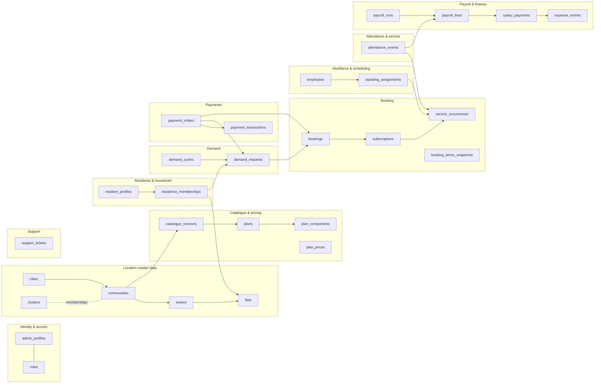
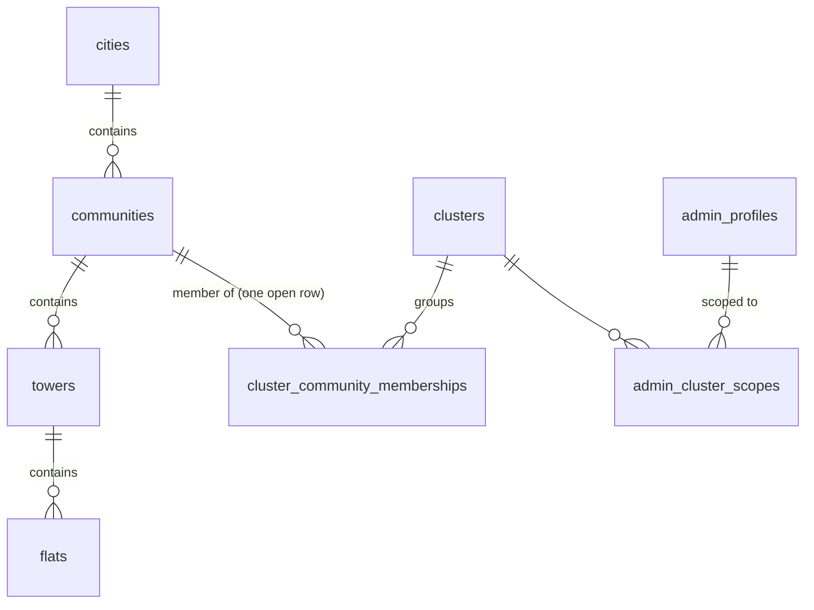
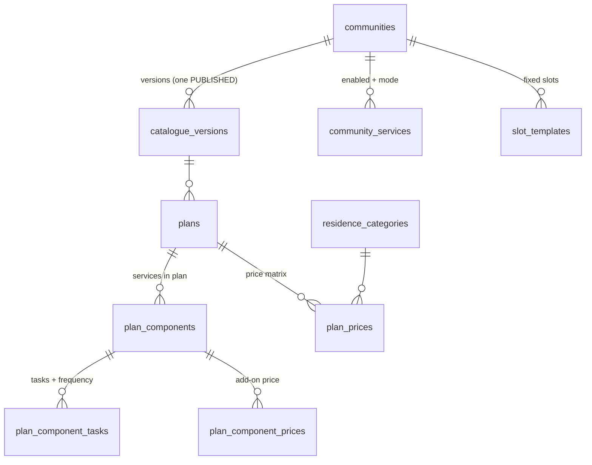
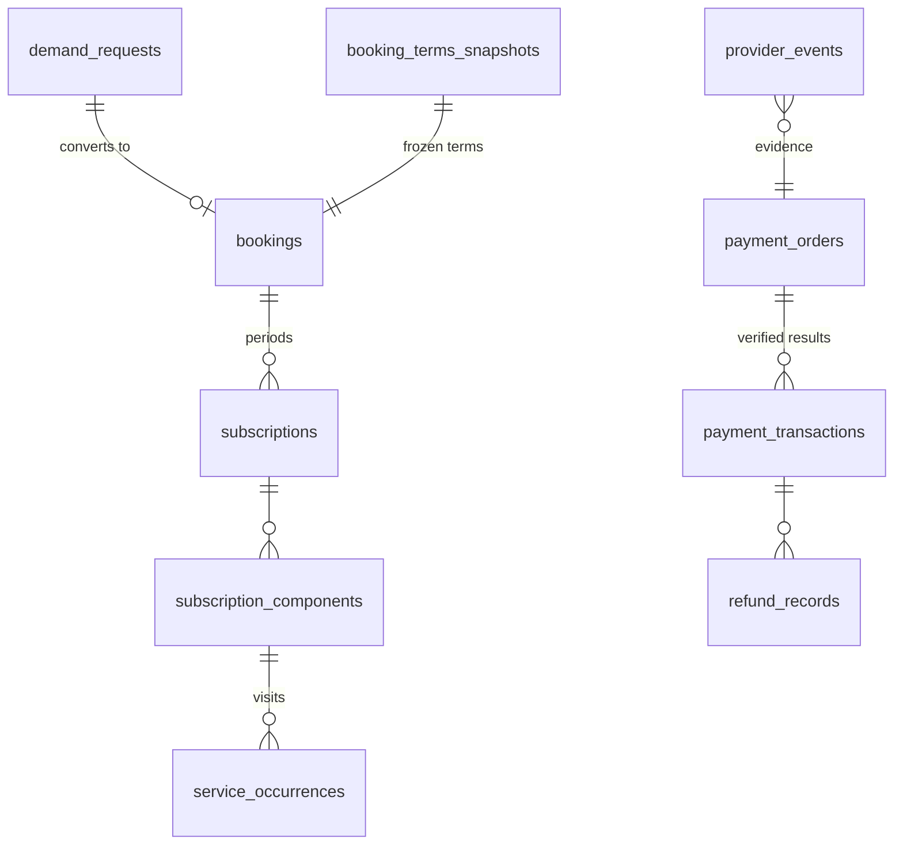

# Nestovin V1: Database design

**Status:** Design baseline for all V1 modules (20 Nov 2026).
- **Built (Milestone 1):** §4 identity & access, §5 location master data, §16 cross-cutting (audit, outbox, rate limits), website enquiries (§14).
- **Built (Phase 2):** §5.1 community migration, §6 catalogue & pricing (except slot templates). Live in `supabase/migrations`.
- **Designed, not built:** everything else. Each section is migrated when its phase starts. Column names may be refined then, but relationships, keys and constraints are agreed here.

**Sources:**
- `Nestovin_Individual_Module_Workflows_v1.0_Final.md`: the final call on flows.
- `Nestovin_PRD_v1.1_Engineering_Baseline.md`.
- ADR-001 … ADR-010.

Business rules that are still OPEN are marked **[OPEN]**. In those places the schema stores inputs but **does not encode a formula**.

---

## 1. Design principles

| Principle | How it shows up in the schema |
|---|---|
| **One private schema** | Every business table lives in `app`, which is not exposed through Supabase's Data API. `anon`/`authenticated` have no privileges. Clients reach data only through the Express API (ADR-001). |
| **Database enforces invariants** | Foreign keys, `CHECK`s, partial unique indexes and exclusion constraints guard the rules that must never break: one active cluster per community, no double-booked employee, one financial effect per provider payment. Application code is the first line of defence; the database is the last. |
| **Append-only where history matters** | Audit, status transitions, provider events, payment transactions, attendance events, salary payments and ticket updates are insert-only. Privileges plus a trigger block UPDATE/DELETE. Corrections are new rows that reference the original. |
| **Snapshots for anything money depends on** | Commitments and bookings store an immutable copy of the plan, price, percentage and deadlines that applied when they were made (`booking_terms_snapshots`). Configuration changes never rewrite existing terms. |
| **Separate lifecycles, separate records** | Demand request ≠ booking ≠ subscription ≠ payment ≠ occurrence (PRD §14.7). Each has its own table and status column. A single generic `status` is never shared between them. |
| **Scope is denormalised onto operational rows** | Tier A rows carry the `community_id` and `cluster_id` that applied **when they were created**. Scope filters and RLS policies stay index-friendly, and history keeps its original scope after a community changes cluster. |
| **No hard deletes of business data** | Master data is deactivated (`status = 'INACTIVE'`). Runtime roles have no `DELETE` on business tables, except join tables that are replaced wholesale (role grants, scopes). |

## 2. Conventions

| Item | Convention |
|---|---|
| Names | `snake_case`, plural table names, `<entity>_id` foreign keys |
| Primary keys | `uuid` (`gen_random_uuid()`). Human-readable codes (`employee_code`, ticket `reference`) are separate unique columns. Append-only logs may use `bigint identity`. |
| Identity tables | `admin_profiles.id` and `resident_profiles.id` **equal** `auth.users.id`. `employees.id` is its own uuid, with a nullable unique `auth_user_id`, because HR creates employees before login exists. |
| Timestamps | `timestamptz`. `created_at`/`updated_at` (+ `created_by`/`updated_by`) are set by the `app.tg_stamp()` trigger from the request claims. Calendar dates (leave, payroll periods, commencement) are `date`. Times of day (slots) are `time` in the community's timezone, Asia/Kolkata for V1. |
| Optimistic concurrency | Editable tables have `version int`, incremented by trigger. Updates use `WHERE id = $1 AND version = $2`. |
| Money | `bigint` **paise** + `currency char(3) default 'INR'`. Never float or numeric money in application code. |
| Percentages | `smallint` whole numbers. The demand initial percentage has `CHECK (initial_pct > 0 AND initial_pct < 100)`; the exact range is [OPEN] OD-03. |
| Enumerations | `text` + `CHECK (col IN (...))`, not Postgres enums, so adding a value is a plain migration. |
| Status history | Every lifecycle change writes `app.status_transitions` (§15) in the same transaction. |
| Geo | `numeric(9,6)` lat/lng pairs, both null or both set. No PostGIS in V1; distance is computed in the API. |
| Files | Never stored in the DB. `app.documents` keeps metadata plus the private Supabase Storage key. |
| Security tier | **A** = RLS policy + CI test (personal, location, financial data). **B** = backend authorisation + DB privileges only. |

## 3. Domain map

---

## 4. Identity & access: **built** (ADR-008)

| Table | Purpose | Key columns / constraints | Tier |
|---|---|---|---|
| `permission_modules` | 14 ADM modules (seeded) | `key` PK, `ref` unique, `grantable` (false = Super Admin only) | B |
| `permission_actions` | view, create, edit, delete, approve, export, publish, record_payment | `key` PK | B |
| `permission_module_actions` | Valid pairs | PK (module, action). A test checks it equals `packages/contracts` | B |
| `admin_profiles` | One row per admin (id = auth user) | `is_super_admin`, `status` INVITED/ACTIVE/DISABLED, `scope_type` GLOBAL/CLUSTERS, `title` (label only). Trigger keeps ≥1 active Super Admin | B |
| `roles` | Reusable permission bundles | unique `lower(name)` | B |
| `role_grants` | (role, module, action) | FK to valid pairs; trigger rejects non-grantable modules | B |
| `admin_role_assignments` | admin ↔ role | PK (admin, role) | B |
| `admin_extra_grants` | Per-admin overrides | FK to valid pairs; grantable only | B |
| `admin_cluster_scopes` | Per-admin cluster list | PK (admin, cluster) | B |
| view `admin_effective_grants` | Union of role and extra grants, with source | — | B |

**Planned additions:**
- `resident_profiles` (§6) and `employees` (§10) complete the actor set.
- `device_tokens` (§14) for push.
- `user_notifications` (§14) for in-app inboxes.

## 5. Location master data: **built**

| Table | Key columns / constraints | Tier |
|---|---|---|
| `cities` | name, state; unique (lower(name), lower(state)) | B |
| `clusters` | name, code (unique ci) | B |
| `communities` | city_id, name, code (unique ci), address, postal_code, reference lat/lng, `status` DRAFT/IMPORTED/CONFIGURED/ACTIVE/INACTIVE; unique (city, lower(name)). **Planned:** `default_operating_mode`, `timezone` (default Asia/Kolkata) | B |
| `cluster_community_memberships` | cluster_id, community_id, effective_from/to, reason, changed_by. **Partial unique: one open row per community.** Rows can only be closed, never edited or deleted | B |
| `towers` | community_id, name (unique per community), floor_count, optional lat/lng | B |
| `flats` | tower_id, community_id (set by trigger from tower), floor, flat_number (unique per tower ci), bhk_type, area_sqft. **Planned:** `residence_category_id` → §6.1, `occupancy_class` from migration | B |
| `expansion_votes` | resident_user_id, level CITY/COMMUNITY, city/community names; unique one vote per resident per location | B |

### 5.1 Community migration (ADM-04): **built** (Phase 2, ADR-011)

| Table | Key columns / constraints | Tier |
|---|---|---|
| `import_batches` | community_id (nullable until created), `file_document_id`, `status` UPLOADED/VALIDATED/REJECTED/APPROVED/COMMITTED/CANCELLED, row counts, uploaded_by, approved_by, committed_by, `supersedes_batch_id` | B |
| `import_rows` | batch_id, `row_number`, `raw jsonb` (as uploaded), `normalized jsonb`, `errors text[]`, `warnings text[]`, `target_flat_id` after commit; unique (batch, row_number) | B |

**Rules:**
- Commit is one transaction.
- Re-committing a batch is impossible (`status` guard + unique natural keys on flats).
- Committing does **not** activate the community (status becomes `IMPORTED`).
- [OPEN]: workbook template, all-or-nothing vs partial import, and whether uploader ≠ approver.

---

## 6. Catalogue & pricing (ADM-07): **built** (Phase 2, ADR-009). `slot_templates` follows in Phase 4

Everything is **per community**. Publishing freezes a version.

| Table | Key columns / constraints | Tier |
|---|---|---|
| `services` | Seeded: MAID, COOK, CARETAKER (global, immutable) | B |
| `community_services` | community_id, service_id, `enabled`, `operating_mode` nullable (null = community default; DEMAND_LED/CONTINUOUS); PK (community, service) | B |
| `residence_categories` | community_id, code, label, optional `bhk_type`, `min_area_sqft`/`max_area_sqft`, sort; unique (community, code) | B |
| `time_windows` | community_id, name (e.g. Morning), start_time, end_time; CHECK end > start | B |
| `service_tasks` | community_id, service_id, name, description, default_duration_min, status | B |
| `catalogue_versions` | community_id, `version_no`, `status` DRAFT/PUBLISHED/SUPERSEDED, effective_from, published_by/at. **Partial unique: one PUBLISHED per community.** Published rows and all their children are read-only (trigger) | B |
| `plans` | catalogue_version_id, code, name (configurable, e.g. "Gold"), description, `validity_days`, sort | B |
| `plan_components` | plan_id, service_id, `is_optional_addon`, `visits_per_day`, `days_of_week smallint` (bitmask), `duration_minutes`, `time_window_id`, `addon_hours` (Caretaker) | B |
| `plan_component_tasks` | plan_component_id, service_task_id, `frequency` PER_VISIT/DAILY/WEEKLY/MONTHLY, `times_per_period` | B |
| `plan_prices` | catalogue_version_id, plan_id, residence_category_id, `price_basis` SERVICE/PACKAGE, service_id (null for PACKAGE), `amount_paise`; unique (plan, category, basis, service). **Missing row = not offered** | B |
| `plan_component_prices` | plan_component_id (add-on), residence_category_id, `amount_paise` (0 = included); missing = add-on not offered | B |
| `slot_templates` | community_id, service_id, time_window_id, start_time, duration_minutes, days_of_week, status. **Capacity columns are added only after Operations validates the rules** (ADR-005) | B |

Publishing validation (in the API) covers: every plan has ≥1 component, every component has ≥1 task, there are no orphan prices, time windows are consistent, and at least one price exists per plan. Tax/GST fields are [OPEN] OD-02/I4. They are stored in snapshots as nullable `tax_paise`, so adding tax later changes no historical row.

---

## 7. Residents & household: built, Phase 3

| Table | Key columns / constraints | Tier |
|---|---|---|
| `resident_profiles` | id = auth user, `phone` unique (E.164), full_name, email, `status` ACTIVE/SUSPENDED | **A** (owner) |
| `residence_memberships` | resident_id, flat_id, community_id, cluster_id, `kind` PRIMARY/FAMILY, `occupancy` OWNER/TENANT/FAMILY, `status` PENDING/VERIFIED/REJECTED/REVOKED/ENDED, verified_by/at, ended_at, `primary_membership_id` (for FAMILY). Partial unique indexes: **one VERIFIED PRIMARY per flat**; **one PENDING-or-VERIFIED membership per resident** (V1: one active residence context) | **A** (owner + cluster) |
| `residence_verification_requests` | membership_id, submitted_at, `decision` PENDING/APPROVED/REJECTED, reviewed_by, reason. Manual review in V1 (X6) | **A** |
| `family_access_requests` | primary_membership_id, requested phone/name, relationship ([OPEN] list), `status`, `physical_verification_at`, reviewed_by, reason, `resulting_membership_id` | **A** |
| `resident_change_requests` | resident_id, `field`, requested value (jsonb), status, reviewer (RES-14 restricted edits) | **A** |
| `documents` | `owner_type`, `owner_id`, `doc_type`, storage bucket/key (unique), mime, size, sha256, status, uploaded_by. Downloads use signed URLs and are audited | **A** |

**Rules:**
- The first VERIFIED membership on a flat becomes PRIMARY; enforced by the partial unique index plus the service.
- Family access is enabled only on approval.
- [OPEN] OD-08 / I2: whether imported occupants are used for verification matching.

## 8. Demand-led mode: built, Phase 4 (see migration 20261123000100)

| Table | Key columns / constraints | Tier |
|---|---|---|
| `demand_cycles` | community_id, catalogue_version_id, name, `collection_opens_at`/`closes_at`, **`initial_pct`** CHECK 1–99, `status` DRAFT/PUBLISHED/CLOSED/SLOTS_PUBLISHED/COMPLETED/CANCELLED, published_by/at. **Trigger: `initial_pct`, catalogue version and window are immutable once PUBLISHED** | B |
| `demand_cycle_plans` | cycle_id, plan_id (eligible plans) | B |
| `demand_requests` | cycle_id, resident_id, membership_id, flat_id, community_id, cluster_id, plan_id, `terms_snapshot_id`, `status` DRAFT/AWAITING_PAYMENT/COMMITTED/BALANCE_DUE/CONVERTED/EXPIRED/CANCELLED/REVIEW_REQUIRED. Duplicate rule [OPEN] OPN-05: enforced later by a partial unique (cycle, resident, plan) once decided | **A** |
| `demand_request_slot_preferences` | request_id, slot_template_id, `rank`; PK (request, rank) | **A** |
| `slot_sets` | cycle_id, `status` DRAFT/APPROVED/PUBLISHED/WITHDRAWN, `commencement_date`, `balance_due_at`, approved_by/at, published_at | B |
| `published_slots` | slot_set_id, slot_template_id (copied fields: service, start_time, duration, days) | B |
| `demand_request_slot_allocations` | request_id, published_slot_id, allocated_by/at | **A** |

[OPEN]: capacity reservation between slot publication and balance (OPN-10), expiry/refund/forfeiture (OD-04), and request edits after payment. These are status values plus admin actions; no automatic consequence is encoded.

## 9. Bookings & subscriptions: built, Phase 4 (occurrences: Phase 5)

| Table | Key columns / constraints | Tier |
|---|---|---|
| `booking_terms_snapshots` | **Immutable.** plan/version ids, `plan_snapshot jsonb` (components, tasks, windows), residence_category, `total_paise`, `tax_paise` (nullable), `initial_pct` (null for continuous), `initial_due_paise`, `remaining_due_paise`, currency, cycle_id, slot details, deadlines, created_at | **A** |
| `bookings` | `mode` DEMAND_LED/CONTINUOUS, demand_request_id (unique, nullable), resident_id, membership_id, flat_id, community_id, cluster_id, terms_snapshot_id, `status` PENDING_PAYMENT/CONFIRMED/CANCELLED/EXPIRED/REVIEW_REQUIRED | **A** |
| `subscriptions` | booking_id, `period_start`/`period_end` (date), `status` PENDING_ACTIVATION/ACTIVE/ENDED/CANCELLED, `renews_subscription_id`. **Renewal rule [OPEN] C2** | **A** |
| `subscription_components` | subscription_id, service_id, time_window_id, start_time, duration_minutes, days_of_week, visits_per_day, `is_addon` (copied from the snapshot so scheduling never reads mutable config) | **A** |
| `service_occurrences` | subscription_component_id, community_id, cluster_id, flat_id, `scheduled_date`, `starts_at`/`ends_at` (timestamptz), `status` SCHEDULED/ASSIGNED/IN_PROGRESS/COMPLETION_SUBMITTED/COMPLETED/NO_SHOW/CANCELLED/EXCEPTION; unique (component, starts_at). Generated on a rolling horizon by a job (default 14 days [R]) | **A** |

Entitlement deduction for no-shows is [OPEN] OPN-22. When decided, it becomes an `entitlement_adjustments` ledger, not a column update.

## 10. Payments (Razorpay): built, Phase 4 (ADR-006, ADR-013, ADR-015)

| Table | Key columns / constraints | Tier |
|---|---|---|
| `payment_orders` | `purpose` INITIAL/BALANCE/FULL, `ref_type` DEMAND_REQUEST/BOOKING, `ref_id`, `amount_paise`, currency, provider_order_id (unique), `status` CREATED/ATTEMPTED/PAID/FAILED/EXPIRED/REVIEW_REQUIRED, `idempotency_key` (unique), expires_at, resident_id, cluster_id | **A** |
| `provider_events` | **Append-only.** provider, `event_id` **unique**, event_type, payload jsonb, signature_valid, received_at, processed_at, processing_error | B (no client data exposure; worker only) |
| `payment_transactions` | **Append-only.** order_id, `provider_payment_id` **unique** (one payment → one purpose), amount_paise, currency, method, `status` CAPTURED/FAILED/REFUNDED/PARTIALLY_REFUNDED, verified_at | **A** |
| `refund_records` | transaction_id, provider_refund_id (unique), amount_paise, status, source event id, `approved_by` (policy [OPEN]) | **A** |
| `financial_adjustments` | ref_type/ref_id, amount_paise (signed), reason, approved_by, created_at; append-only | **A** |
| `payment_exceptions` | order_id / transaction_id, `reason_code` (AMOUNT_MISMATCH, SLOT_UNAVAILABLE, CYCLE_CLOSED, DUPLICATE, …), `status` OPEN/RESOLVED, resolution note, resolved_by | **A** |

Invariant: **only a verified `payment_transactions` row can move a demand request to COMMITTED or a booking to CONFIRMED.** It runs in the same transaction, guarded by `status` preconditions.

---

## 11. Workforce: built, Phase 5

| Table | Key columns / constraints | Tier |
|---|---|---|
| `applicants` | full_name, phone, service_interest, preferred area, `status` NEW/CONTACTED/NOT_PROCEEDING/CONVERTED, converted_employee_id. No ATS stages | **A** |
| `employees` | `employee_code` unique, auth_user_id (unique, nullable), full_name, phone, `home_cluster_id`, `employment_status` ONBOARDING/ACTIVE/INACTIVE/EXITED, `readiness_status` NOT_READY/READY/SUSPENDED, `login_enabled`, joined_on | **A** (self + cluster) |
| `employee_qualifications` | employee_id, service_id, service_task_id (nullable = whole service), status, approved_by, valid_until | **A** |
| `employee_verification_items` | employee_id, `item_code` (checklist [OPEN] OPN-18), status PENDING/VERIFIED/REJECTED, document_id, reviewed_by, notes | **A** |
| `training_items` / `training_completions` | URL-based videos; completion (employee, item) unique. No LMS | B / **A** |
| `availability_rules` | employee_id, day_of_week, start_time, end_time, effective_from/to | **A** |
| `leave_requests` | employee_id, `leave_type` ([OPEN] list), starts_on, ends_on, partial-day fields, reason, status, reviewed_by | **A** |
| `work_limits` | `employee_id` nullable (null = default), max_minutes_per_day, max_minutes_per_week, effective dates. Values come from Operations | B |

## 12. Scheduling & allocation: built, Phase 5 (ADR-005, ADR-016)

| Table | Key columns / constraints | Tier |
|---|---|---|
| `standing_assignments` | subscription_component_id, employee_id, cluster_id, effective_from, effective_to, `status` ACTIVE/ENDED, confirmed_by, recommendation_id. **Exclusion constraint: no overlapping ACTIVE periods for the same component** (`btree_gist`) | **A** |
| `occurrence_assignments` | occurrence_id, employee_id, cluster_id, `starts_at`/`ends_at` (copied), `source` STANDING/MANUAL/REPLACEMENT/OVERTIME, standing_assignment_id, replaced_assignment_id, `status` ACTIVE/REPLACED/CANCELLED, confirmed_by. **Partial unique: one ACTIVE per occurrence. Exclusion constraint: an employee cannot have overlapping ACTIVE time ranges** | **A** |
| `allocation_recommendations` | target_type/target_id, `inputs jsonb`, `candidates jsonb` (eligible + exclusion reasons), `ranking_rule_version` (null until approved), generated_at | B |
| `overtime_offers` | cluster_id, service_id, starts_at/ends_at, description, rate reference ([OPEN]), `status` OPEN/CLOSED/CANCELLED, created_by | B |
| `overtime_offer_recipients` | offer_id, employee_id, `response` PENDING/ACCEPTED/REJECTED/EXPIRED, responded_at, `admin_decision` CONFIRMED/DECLINED, decided_by, resulting_assignment_id | **A** |

The database itself guarantees the confirmed-eligibility checks that matter most: no double booking (exclusion), one active assignment per visit, and cluster consistency (trigger: assignment.cluster_id = occurrence.cluster_id = employee.home_cluster_id). Readiness, qualification and leave are checked by the service in the same transaction.

## 13. Attendance & service execution: built, Phase 6 (ADR-014, ADR-016)

| Table | Key columns / constraints | Tier |
|---|---|---|
| `attendance_challenges` | occurrence_id, `method` OTP/QR, `secret_hash` (never the raw code), expires_at, used_at, attempts | **A** |
| `attendance_events` | **Append-only.** `client_event_id` **unique** (offline-safe idempotency), occurrence_id, assignment_id, employee_id, `kind` CHECK_IN/CHECK_OUT, method, `device_time`, `server_time`, lat/lng, `accuracy_m`, `distance_m` (computed vs community/tower reference), `result` VERIFIED/REJECTED/FLAGGED, `flags text[]` (OUTSIDE_RADIUS, LOW_ACCURACY, …), reason | **A** |
| `attendance_corrections` | original_event_id, employee_id, requested values, reason, evidence document, `status`, reviewed_by, decision_reason. The original event is never changed | **A** |
| `service_completions` | occurrence_id (unique), employee_id, submitted_at, notes | **A** |
| `service_completion_tasks` | completion_id, plan task ref, done bool | **A** |
| `resident_confirmations` | occurrence_id (unique), resident_id, `outcome` CONFIRMED/DISPUTED, at | **A** |
| `no_show_records` | occurrence_id (unique), employee_id, arrived_at, waited_until (≥ 15 min, confirmed rule), evidence. Deduction [OPEN] | **A** |
| `feedback` | occurrence_id, resident_id, `rating smallint` (scale [OPEN]), comment; unique (occurrence, resident) | **A** |

## 14. Support & notifications: built, Phases 3 and 7 (delivery adapters pending)

| Table | Key columns / constraints | Tier |
|---|---|---|
| `ticket_categories` | code, label, status ([OPEN] list) | B |
| `support_tickets` | `reference` unique, resident_id, membership_id, community_id, cluster_id, category_id, `priority`, `urgent`, `status` OPEN/ASSIGNED/IN_PROGRESS/WAITING/RESOLVED/CLOSED, owner_admin_id, `due_at` (working-day calendar), linked booking/payment_order/occurrence ids (nullable) | **A** |
| `ticket_updates` | **Append-only.** ticket_id, author_kind/author_id, `visibility` INTERNAL/RESIDENT, body | **A** |
| `ticket_escalations` | ticket_id, `level` CLUSTER_ADMIN/SUPER_ADMIN, escalated_by, assigned_to, reason, resolved_at. Support keeps ownership | **A** |
| `business_holidays` | date (PK), name. Drives working-day deadlines (I8) | B |
| `website_enquiries` | **built**; status NEW/IN_PROGRESS/CLOSED, routing status | B |
| `notification_outbox` | **built**; dedupe_key unique, channel EMAIL/SMS/PUSH | B |
| `notification_attempts` | outbox_id, provider, status, provider_message_id, error, at | B |
| `notification_templates` | code, channel, locale, title/body with placeholders | B |
| `user_notifications` | user_id, title, body, deep_link, read_at (in-app inbox for both apps) | **A** (owner) |
| `device_tokens` | user_id, app RESIDENT/EMPLOYEE, platform, token (unique), last_seen_at | **A** (owner) |

## 15. Payroll & finance: built, Phase 8 (ADR-007, ADR-014, ADR-017)

| Table | Key columns / constraints | Tier |
|---|---|---|
| `payroll_periods` | year, month (unique), starts_on, ends_on, `status` OPEN/LOCKED/CLOSED. One common monthly cycle | B |
| `compensation_profiles` | employee_id, `type` FIXED_MONTHLY/DAILY/HOURLY, `rate_paise`, effective_from/to, approved_by. **Exclusion: no overlapping periods per employee** | **A** |
| `compensation_components` | code, `kind` EARNING/DEDUCTION, `is_statutory`, `status` INACTIVE/ACTIVE (inactive until its rule is approved), rule reference | B |
| `payroll_runs` | period_id, `version`, `status` DRAFT/IN_REVIEW/APPROVED/RETURNED/SUPERSEDED, prepared_by, approved_by/at, return_reason. Unique (period, version). **Partial unique: one APPROVED per period.** Approved runs are read-only | B |
| `payroll_lines` | run_id, employee_id, `compensation_snapshot jsonb`, gross_paise, deductions_paise, net_paise, `flags text[]` (missing inputs, never guessed); unique (run, employee) | **A** |
| `payroll_line_items` | line_id, component_code, kind, quantity, rate_paise, amount_paise, `source_type` APPROVED_ATTENDANCE/APPROVED_OVERTIME/AUTHORISED_ENTRY, `source_ids uuid[]`, entered_by, reason | **A** |
| `salary_payments` | **Append-only.** payroll_line_id, amount_paise, paid_on, method, bank reference, recorded_by, `reverses_payment_id`. Unique (method, reference) when a reference is given | **A** |
| `expense_entries` | `category` SALARY (V1), amount_paise, incurred_on, **`salary_payment_id` unique** (no duplicate expense), recorded_by | **A** |
| view `payroll_line_payment_status` | net vs Σ payments → PENDING / PARTIALLY_PAID / PAID | — |

Revenue summaries are queries over verified `payment_transactions` minus refunds and adjustments. There are no separate revenue tables (no ERP).

## 16. Cross-cutting

| Table | Purpose | Tier |
|---|---|---|
| `audit_events` | **built**: append-only; actor, action, target, request id, reason, before/after | B (privileged read only) |
| `status_transitions` | Append-only: entity_type, entity_id, from_status, to_status, actor_id, actor_kind, reason, at. Index (entity_type, entity_id, at) | B |
| `idempotency_keys` | key + actor + route (unique), request_hash, response status/body, expires_at (24 h) | B |
| `rate_limit_buckets` | **built**: fixed-window counters | B |

## 17. Lifecycle state machines (summary)

| Entity | States (→ allowed moves enforced in code + CHECK) |
|---|---|
| Community | DRAFT → IMPORTED → CONFIGURED → ACTIVE ⇄ INACTIVE |
| Catalogue version | DRAFT → PUBLISHED → SUPERSEDED |
| Residence membership | PENDING → VERIFIED / REJECTED; VERIFIED → REVOKED / ENDED |
| Demand cycle | DRAFT → PUBLISHED → CLOSED → SLOTS_PUBLISHED → COMPLETED; DRAFT/PUBLISHED → CANCELLED |
| Demand request | DRAFT → AWAITING_PAYMENT → COMMITTED → BALANCE_DUE → CONVERTED; any → EXPIRED / CANCELLED / REVIEW_REQUIRED (policy [OPEN]) |
| Booking | PENDING_PAYMENT → CONFIRMED; → CANCELLED / EXPIRED / REVIEW_REQUIRED |
| Subscription | PENDING_ACTIVATION → ACTIVE → ENDED; → CANCELLED |
| Occurrence | SCHEDULED → ASSIGNED → IN_PROGRESS → COMPLETION_SUBMITTED → COMPLETED; → NO_SHOW / CANCELLED / EXCEPTION |
| Payment order | CREATED → ATTEMPTED → PAID / FAILED / EXPIRED; → REVIEW_REQUIRED |
| Ticket | OPEN → ASSIGNED → IN_PROGRESS ⇄ WAITING → RESOLVED → CLOSED |
| Payroll run | DRAFT → IN_REVIEW → APPROVED / RETURNED; APPROVED → SUPERSEDED (by a new version) |

## 18. Indexing & performance notes

- Every FK has an index. Scope queries use `(cluster_id, status)` or `(cluster_id, created_at desc)` composite indexes on Tier A tables.
- Lists use keyset pagination on `(lower(name), id)` or `(created_at, id)`. There is no OFFSET pagination.
- `service_occurrences`: `(cluster_id, scheduled_date)` and `(flat_id, scheduled_date)`.
- `occurrence_assignments`: a GiST index backs the employee overlap exclusion constraint.
- High-volume append-only tables (audit, attendance events, status transitions) are candidates for monthly partitioning once volumes are known. Not needed in V1.

## 19. Decisions this schema waits on

| Area | Waiting on | Schema impact once decided |
|---|---|---|
| Renewal (C2) | Business | Rules on `subscriptions.renews_subscription_id`; possibly a renewal job |
| Capacity / slots (C3) | Operations | Capacity columns on `slot_templates` / `published_slots` |
| Refund/forfeiture (C4, OD-04) | Finance | Policy fields + approval flow on `refund_records` / `payment_exceptions` |
| Payroll rules (C7, OD-11) | Payroll/Finance | Activate `compensation_components`; calculation code |
| GST / receipts (I4) | Finance | `tax_paise` becomes required; receipt numbering table |
| Migration template (OD) | Business | `import_rows.normalized` shape |
| No-show deduction (OPN-22) | Business | `entitlement_adjustments` ledger |
| Rating scale, ticket categories, leave types | Business | CHECK values / seed rows |
