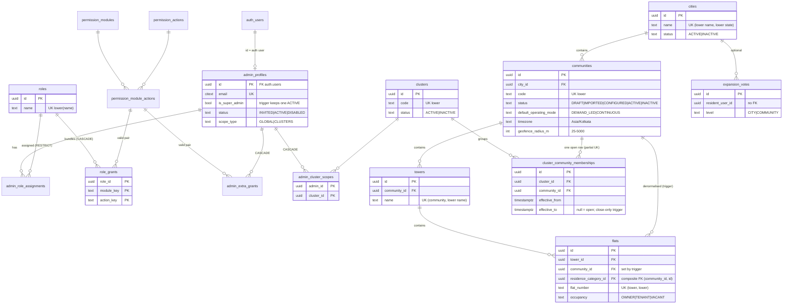
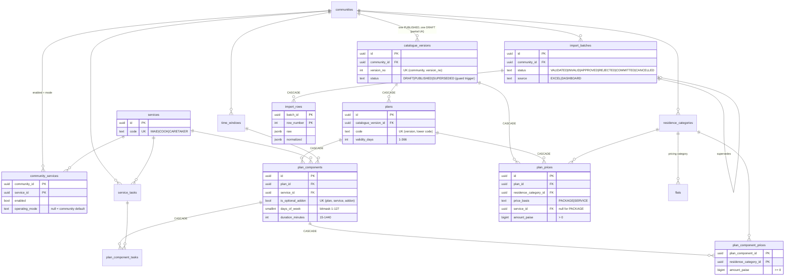
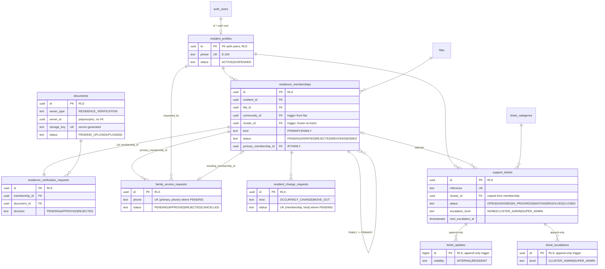
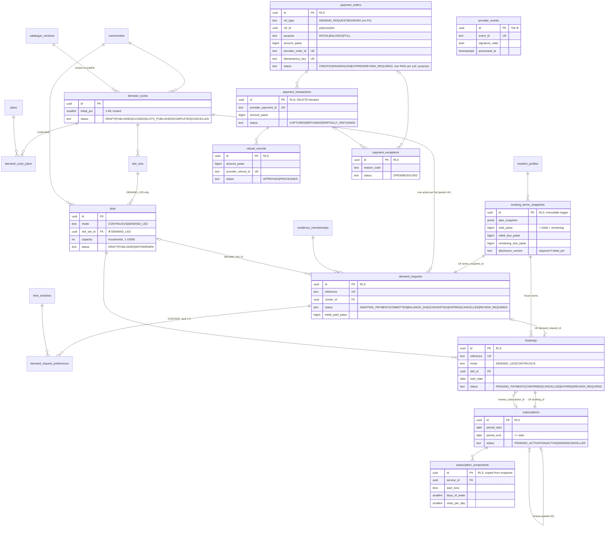
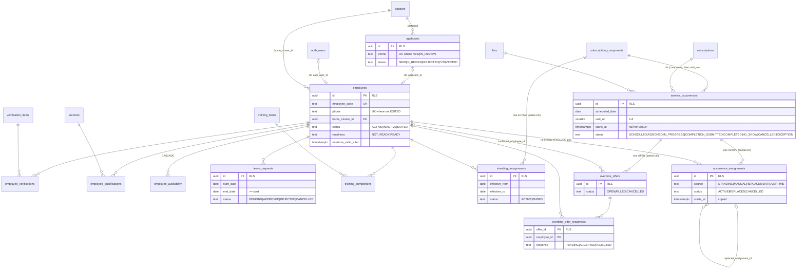
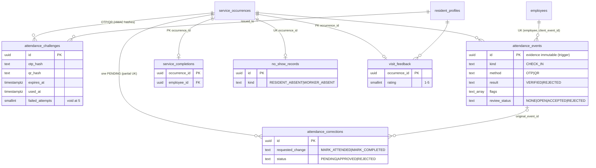
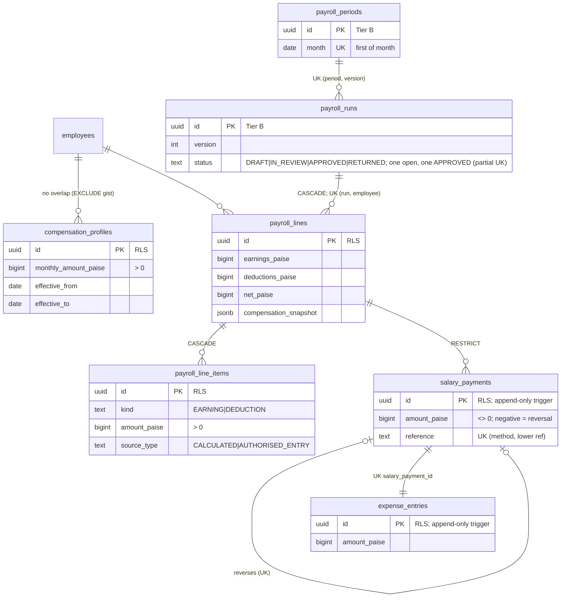
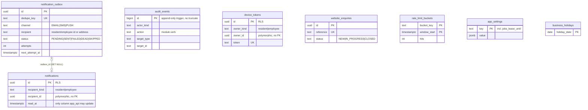

# Nestovin: entity-relationship diagram (as built)

**Source:** `supabase/migrations/20261120000100` … `20261129000800` (30 migrations), read on 21 Nov 2026.
This shows the **real** schema, not the design in `docs/Architecture/data-model.md`. Where they differ, see
`docs/reviews/2026-11-system-review.md` (finding M-8 lists the designed-but-not-built tables).

How to read it:
- One diagram per module, so each stays legible. Tables that belong to another module appear by name only,
  so you can see where the modules join.
- Only keys, scope columns, status columns and money columns are listed. Audit stamps (`version`,
  `created_*`, `updated_*`) are left out.
- `PK` = primary key, `FK` = foreign key, `UK` = unique. "(partial)" means a partial unique index; the
  predicate is in the label.
- Every `cluster_id` FK goes to `clusters`. Those edges are left out after the first diagram, because
  drawing them all hides everything else.
- **RLS** in a table comment marks a Tier A table (RLS enabled, not forced).

---

## 1. Identity, access and location master data (Tier B)

## 2. Catalogue, pricing and community migration (Tier B)

## 3. Residents, household and support (Tier A except categories and holidays)

## 4. Demand, booking, subscription and payments

## 5. Workforce, allocation and overtime (Tier A except checklists)

## 6. Attendance and service execution (Tier A)

## 7. Payroll and finance

## 8. Cross-cutting: audit, outbox, notifications, settings (Tier B except inbox and devices)

## Polymorphic and unconstrained references

These columns point at other rows without a foreign key. Each is a place where a dangling reference is possible:

| Column | Points to | Guard today |
|---|---|---|
| `payment_orders.(ref_type, ref_id)` | `demand_requests` or `bookings` | CHECK on `ref_type` only |
| `documents.(owner_type, owner_id)` | `residence_memberships` | CHECK on `owner_type` only |
| `notifications.recipient_id`, `device_tokens.owner_id` | `resident_profiles` or `employees` | none |
| `notification_outbox.recipient` | profile id, email or phone | none |
| `expansion_votes.resident_user_id` | `resident_profiles` | none |
| `support_tickets.owner_admin_id`, every `*_by` column | `admin_profiles` / auth users | none (audit only) |
| `audit_events.target_id` | any row | none (by design) |
